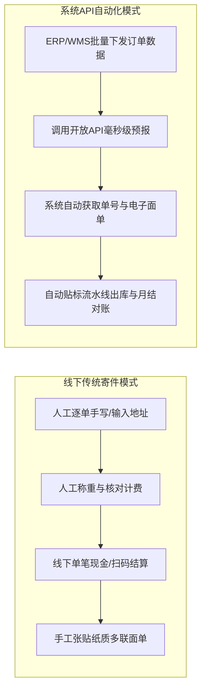
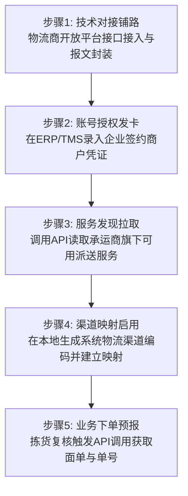
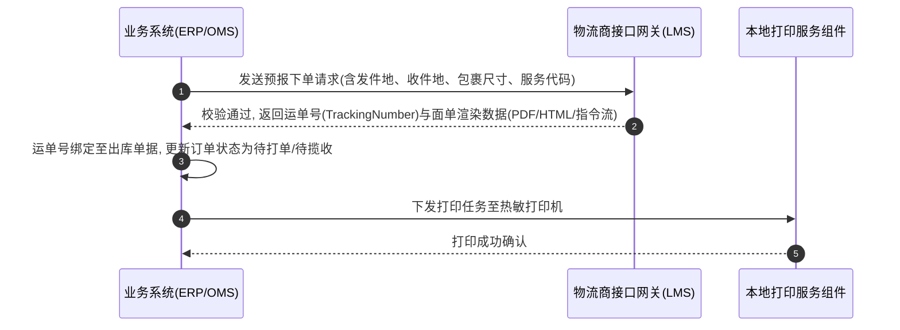
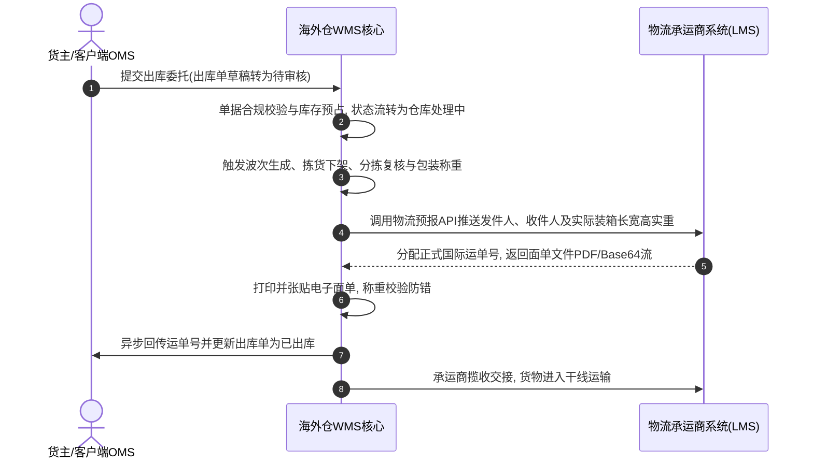
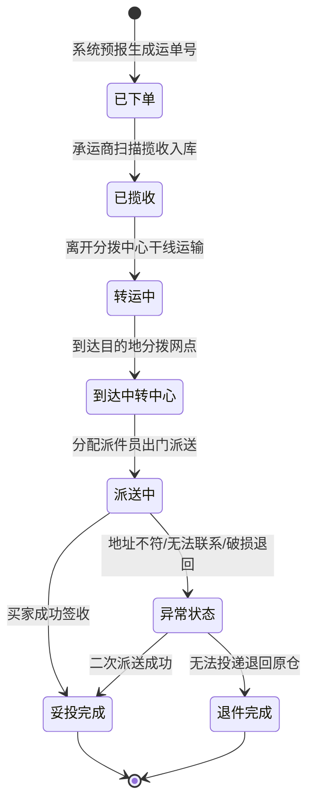
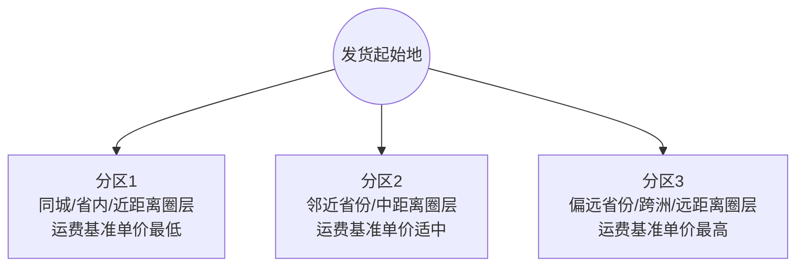

## 前言
在电商ERP体系中，核心业务模块主要涵盖商品、采购、订单、仓储与物流。其中，商品、采购和订单通常构成了ERP的前台业务骨架，而仓储与物流则是履约落地的核心支柱。

在实际企业系统架构中，物流模块不仅存在于电商ERP内部，还广泛嵌入在仓储管理系统WMS、运输管理系统TMS以及计费管理系统BMS中。物流体系承载了两大核心功能：一是物流作业与履约追踪管理，二是物流运费的精确计量与结算。

无论是国内电商还是跨境出海业务，只要存在实物周转，就必然依赖物流履约与运费对账。掌握物流模块的系统设计、接口对接规范以及运费计算引擎，是构建完整供应链数字化体系的关键。

本文系统拆解ERP与WMS中的物流模块设计，全文分为四个部分：
1.物流模块的业务体系与系统分工
2.物流商技术对接与系统授权机制
3.电子面单获取与全链路轨迹追踪
4.物流计费引擎与配置体系

---

## Part1物流模块的业务体系与系统分工

### 1.1物流基础概念与业务分类

物流本质是指将商品从供应端运输至目的地的实物转移过程，涵盖集货、仓储、分拣、包装、干线运输、转运与末端派送等环节。

#### 1.国内物流服务分类
在国内物流与供应链市场中，按照运输货物的体积重量特征、运输组织模式以及服务网络，主要划分为四大形态：

| 物流类型 | 适用货重范围 | 运输模式与网络特征 | 典型服务商代表 | 适用业务场景 |
| --- | --- | --- | --- | --- |
| 快递 | 0~20kg | 点对点全国网络化分拨，门到门小件高频派送 | 顺丰速运、中通快递、圆通速递、韵达快递、极兔速递、京东物流 | 2C电商零售、小批量样品、个人包裹 |
| 快运 | 20~300kg | 网络化零担运输，标准化分拨，支持送装一体或大件上楼 | 德邦快递、安能物流、顺丰快运、中通快运、百世快运 | 2C大件家具家电、B2B小批量商贸补货 |
| 专线 | 300kg~10T | 专线直达大票零担，干线点对点往返，定点发车但末端派送需中转 | 各地物流园区直达专线车队、区域性货运联盟 | 工业原料、产成品批量调拨、区域仓间补货 |
| 整车 | 10T以上 | 点对点包车运输，无中转直达，按整车计费，灵活性高 | 满帮集团、货拉拉卡车、运满满、专业整车货运车队 | 原材料大批量采购、全国中央仓至区域仓大批量调拨 |

在国内电商ERP场景中，日常订单大多属于2C消费小包裹，系统集成的物流模块主要对接快递类服务商。

#### 2.跨境物流四大阶段体系
跨境电商由于涉及跨国境长途运输与多国海关监管，物流链条远比国内复杂，按履约阶段通常拆分为四大关键环节：

| 跨境物流阶段 | 核心定义与运输方式 | 接口与系统支持度 | 典型服务商代表 | 核心业务诉求 |
| --- | --- | --- | --- | --- |
| 头程物流 | 将国内工厂或仓库的商品运输至目的国海外仓，涵盖海运整柜FCL、海运拼箱LCL、空运包机与中欧班列 | 数字化接口逐步普及，多数支持预报报关数据与订舱状态回传 | 联宇物流、大森林全球物流、各大国际货代企业 | 舱位保障、清关顺畅度、运输周期与大宗运价把控 |
| 直邮物流 | 国内包裹通过跨境专线或邮政直邮直发海外最终消费者手中，通常为轻小件空运专线 | 成熟OpenAPI支持，可在线批量获取运单号与电子面单 | 4PX递四方、云途物流、燕文物流、纵腾网络 | 清关时效快、末端派送稳定、整体链路时效高 |
| 尾程物流 | 本地海外仓完成拣货打包后，交付目的国本地物流商派送至买家地址 | 标准化RESTful API对接，实时获取本地快递单号与面单 | FedEx、UPS、USPS、DHL、本地卡派车队 | 妥投率高、本地覆盖范围广、尾程运费具备成本优势 |
| 平台物流 | 电商平台自建或官方深度整合的官方物流履约体系 | 与平台开放接口深度绑定，单据与轨迹直接同步至电商平台后台 | 亚马逊FBA/AWD、Temu托管物流、TikTok官方物流 | 享有平台流量扶持与履约时效兜底保障 |

在跨境ERP中，物流模块必须支持头程货运计划、国内直邮打单以及第三方海外仓尾程派送的全链路管理。

---

### 1.2主流ERP中的物流管理模块

不同定位的ERP系统，其物流模块的功能侧重点有所不同。

#### 1.国内电商ERP物流模块布局
以聚水潭和万里牛为例，国内电商ERP聚焦于高并发打单、智能分单策略与快递对账：
- 聚水潭物流管理：涵盖物流公司配置、快递服务授权、物流统计报表与运费对账管理。系统实时监控各承运商的发货揽收率、转运时效与异常滞留单，为商家考核快递KPI提供数据依据。
- 万里牛物流策略：支持智能匹配策略。系统根据收件人地址、订单重量、商品类目以及运费成本，自动分派最优快递渠道；同时集成菜鸟、拼多多、抖音等主流平台的电子面单打印组件。

#### 2.跨境电商ERP物流模块布局
以领星ERP和店小秘为例，跨境ERP强调多平台授权、报关属性与跨境渠道映射：
- 领星ERP：设立专门的头程发货工作台与自发货物流映射中心。支持根据海外仓库存警戒线生成头程调拨单，跟踪货代海运提单轨迹；在尾程端支持对接第三方仓储服务商，自动拉取海外仓绑定的尾程派送服务。
- 店小秘：提供覆盖全球数百家跨境物流商的授权中心。用户配置报关品名、申报金额、危险品标识等报关参数，打单时自动将报关信息合并至面单输出。

---

### 1.3新零售与私域商城后台的物流模块

在新零售多级履约体系中，品牌总部除向消费者直发外，还频繁涉及向区域前置仓或线下门店配货调拨。以有赞、维他百货等私域新零售系统为例，其配送体系包含两个维度：
1.门店配送与同城自提：针对同城即时履约场景，后台支持划定门店电子围栏半径，配置同城配送运费规则，并集成达达快送、顺丰同城、美团跑腿等即时配服务商。
2.多区域快递运费模板：支持按件数计费或按重量计费。运营人员可针对江浙沪皖包邮区、偏远省份或特定城市单独设置首件/首重费用及续件/续重单价。

---

### 1.4海外仓与仓配一体化系统（TMS）

在仓配一体化或海外仓企业中，系统架构多遵循OTWB模型（OMS订单管理、TMS运输管理、WMS仓储管理、BMS计费管理）。
在此类架构中，TMS作为独立系统运行，或作为核心模块嵌入在统一运营门户（OMP）中。其核心功能包括：
1.承运商接入中台：维护各大快递公司与本地卡车车队的接口网关。
2.派送渠道字典：维护各服务商旗下的细分服务通道（如标准地面派送、隔日达特快派送、超大件卡派）。
3.全网轨迹抓取引擎：定时拉取全网包裹履约状态，并向OMS和WMS反向同步运单生命周期。

---

## Part2物流商技术对接与系统授权机制

### 2.1线下寄件痛点与API数字化升级

传统线下寄件与现代系统化物流对接存在显著差异：

在日发数千甚至数万单的仓储作业中，依靠人工逐票录入不可行。必须通过系统API直连物流商服务器，实现在线批量预报与电子面单秒级打印。

---

### 2.2物流商对接与授权的五步落地模型

系统从零接入一家物流商至实际打单出库，标准业务流程可拆解为五个步骤：

#### 步骤说明
1.技术对接铺路：物流商（如顺丰开放平台、圆通开放平台、快递鸟、快递100）提供标准OpenAPI。ERP或TMS研发团队根据接口规范完成协议封装，梳理报文结构并处理通信异常。该阶段为系统通用能力建设，完成后对所有商户复用。
2.账号授权发卡：技术通道打通后，各企业客户需输入自身与物流商签约的独立商户信息。物流商据此判断计费归属与月结额度。
3.服务发现拉取：授权校验通过后，系统调用接口拉取该商户名下已开通的物流产品列表（例如顺丰标快、顺丰特惠、顺丰冷运等）。
4.渠道映射启用：企业在后台勾选需要启用的物流产品，并在ERP内部生成系统物流渠道编码，建立系统渠道与承运商外部渠道的映射关系。
5.业务下单预报：仓储拣货打包完毕后，系统自动调用预报接口，将包裹信息推给承运商，换取正式运单号并完成打单贴标。

---

### 2.3物流商授权配置要素与向导设计

在ERP或TMS后台进行服务商授权时，需根据承运商类型输入对应的鉴权参数。

#### 1.常见授权模式与参数清单

| 授权通道类型 | 适用场景 | 核心配置字段 | 字段业务释义 |
| --- | --- | --- | --- |
| 官方API直连模式 | 企业与顺丰、FedEx、DHL等直接签约 | 客户编码（CustomerCode/AppKey） | 物流商分配给签约商户的唯一身份标识 |
|  |  | 授权秘钥（AppSecret/CheckWord） | 接口数据签名校验与加密认证秘钥 |
|  |  | 月结账号（MonthlyAccount） | 物流计费与后结款对账绑定的结算卡号 |
|  |  | 始发网点编码（SiteCode） | 负责日常揽收的线下营业网点代码 |
| 平台/三方软件共享模式 | 依赖拼多多、菜鸟、店小秘等打单通道 | 平台授权Token | 经由三方服务市场Oauth2协议授权生成的访问令牌 |
|  |  | 共享租户ID | 多店铺或多组织在三方打单中台的统一标识 |
| 线下自定义模式 | 未对接API的本地专线车队或同城车队 | 渠道自定义编码、线下联系人、约定运价 | 仅做系统标识记录，不走线上实时预报接口 |

#### 2.标准化授权向导设计
主流ERP（如店小秘、领星）通常采用三步向导引导用户完成配置：
- 第一步：选择物流商并输入商户鉴权凭证（测试连接确保通信正常）。
- 第二步：选择启用的派送渠道，设置渠道别名与适用仓库。
- 第三步：关联打印模板与电子面单规范（如100mm*150mm两联单或三联单）。

---

## Part3电子面单获取与全链路轨迹追踪

### 3.1物流下单与面单获取闭环

物流预报下单是系统将待发货包裹信息转化为有效承运单据的核心动作：

---

### 3.2典型出库履约泳道流程

#### 1.海外仓OMS出库单业务流程
在海外仓储管理场景中，出库业务涵盖OMS客户端、海外仓WMS系统与物流服务商LMS的协同交互：

#### 2.跨境ERP销售出库与第三方仓协同
在跨境卖家通过ERP委托第三方海外仓一件代发时，业务由ERP分流派单、三方仓执行下架并完成追踪号反写：
1.ERP订单处理：ERP拉取平台订单后，依据智能规则匹配目标海外仓与指定物流产品。
2.推送三方仓：ERP通过API向三方海外仓WMS推送出库请求。
3.仓内打单作业：三方仓WMS调用物流商接口获取面单，完成拣选、贴标与包装出库。
4.单号反写闭环：三方仓将物流运单号异步回传ERP，ERP自动调用电商平台接口执行发货声明，将运单号同步给海外消费者。

---

### 3.3预报下单接口报文核心要素解析

以行业通用标准（如Aftership/Postmen标准Shipping API）为例，系统预报下单的核心报文字段如下：

#### 1.请求参数核心字段（Request JSON）

| 字段节点 | 字段名称 | 类型 | 必填 | 业务说明与约束 |
| --- | --- | --- | --- | --- |
| `shipper_account` | `id` | String | 是 | 系统内绑定的物流商授权账号唯一标识 |
| `service_type` | `service_type` | String | 是 | 物流商定义的派送产品代码，如`fedex_ground`、`dhl_express` |
| `ship_from` | `contact_name` | String | 是 | 发件人姓名 |
|  | `company_name` | String | 否 | 发件人企业名称 |
|  | `street1` | String | 是 | 发货仓库详细街道地址第一行 |
|  | `city` | String | 是 | 发件城市 |
|  | `state` | String | 是 | 发件省份或州简写代码（如加州CA） |
|  | `postal_code` | String | 是 | 发件地邮编 |
|  | `country` | String | 是 | 发件国家标准ISO二字码（如CN、US） |
| `ship_to` | `contact_name` | String | 是 | 收件人姓名 |
|  | `phone` | String | 是 | 收件人联系电话（关税通知与末端派送关键项） |
|  | `street1` | String | 是 | 目的收件详细地址第一行 |
|  | `city` | String | 是 | 目的城市 |
|  | `state` | String | 是 | 目的省/州代码 |
|  | `postal_code` | String | 是 | 目的邮政编码（尾程分区计算的核心依据） |
|  | `country` | String | 是 | 目的国家ISO二字码 |
| `parcels` | `box_type` | String | 否 | 包装箱类型，默认自定义箱`custom` |
|  | `weight` | Object | 是 | 实测重量对象，包含`value`数值与`unit`单位（kg/lb） |
|  | `dimension` | Object | 是 | 包裹外规长宽高，包含`width`、`height`、`depth`与`unit`（cm/inch） |
|  | `items` | Array | 否 | 装箱内物明细，含商品SKU编码、申报英文品名、数量与海关编码 |

#### 2.响应参数核心字段（Response JSON）

| 字段名称 | 类型 | 业务含义与系统处理动作 |
| --- | --- | --- |
| `tracking_number` | String | 承运商正式运单号，保存至出库单主表并反写销售平台 |
| `files.label.url` | String | 物流面单下载URL或Base64内容，用于系统本地存储与热敏打印 |
| `rates` | Array | 预报阶段承运商返回的实时预估运费及明细项（用于事前扣款校验） |
| `status` | String | 运单预报状态，通常为`Created`、`Pending`或`Failed` |

---

### 3.4物流轨迹跟踪与状态管理

获取运单号后，系统必须持续跟踪包裹的物理运输轨迹，以保障履约闭环并对物流商时效进行履约考核。

#### 1.单家直连与轨迹聚合平台
物流轨迹的获取存在两种主流架构方案：
- 逐一单家直连：ERP或WMS直接对接各大快递公司的轨迹查询接口。优点是链路短、无额外三方费用；缺点是协议规范各异、维护数百家接口的工作量巨大。
- 对接聚合轨迹服务商：系统统一对接第三方轨迹聚合服务商（国内如快递100、快递鸟；跨境如17TRACK、Track123、Aftership）。聚合服务商通过标准化API提供全球数百家快递的一站式轨迹归一化服务，大幅降低研发维护成本。

#### 2.轨迹状态机归一化模型
各物流商在不同国家的底层状态术语存在差异，系统通常在中间层将其抽象映射为六大核心标准化状态：

---

## Part4物流计费引擎与配置体系

### 4.1海外仓与物流费用三大支柱

在供应链体系中，计费管理系统BMS负责核算物流与仓储履约的一切费用。以海外仓业务为例，其收费体系主要由三大支柱构成：

| 费用大类 | 业务实质 | 典型计费科目与计费规则 |
| --- | --- | --- |
| 库内操作费 | 仓储作业过程中消耗的人力与耗材成本 | 卸货费（按集装箱规格或托盘计费）、入库上架费（按件或按箱）、出库分拣费（每单基础操作费+首件加续件费）、定制包材费、贴标换标费 |
| 仓租费用 | 货物占用仓库库位空间的租金成本 | 按托盘天租（整托存储）、按立方日租（散件存储）、阶梯超期仓租（如0~30天免租或优惠，31~90天标准租金，90天以上加收惩罚性高额滞纳租金） |
| 物流配送费 | 将商品从仓库运输至买家地址的承运运费 | 干线运输运费、同城卡派运费、尾程快递运费及各项附带增值费 |

---

### 4.2物流费用的核心构成与附加费

#### 1.运费核心构成公式
物流费用的通用计算公式为：

$$运费总额 = 基础运费 + 物流附加费$$

- 基础运费：与发货地、目的地距离以及货物的计费重量直接挂钩，通常按照分区与重量段矩阵标准进行测算。
- 物流附加费：指承运商在标准运输之外，因特殊货物属性、特殊配送环境或外部宏观成本波动而收取的额外费用。

#### 2.常见物流附加费矩阵
以顺丰国际及欧美尾程派送服务为例，常见附加费规则如下：

| 附加费类别 | 触发征收条件 | 计费方式与标准样例 |
| --- | --- | --- |
| 偏远地区附加费 | 收件地址属于海岛、高山、荒漠或偏远村落（按邮编判定） | 固定金额/票（例如每票加收25美元）或按公斤加收 |
| 私人住宅派送费 | 目的地属于居民住宅楼而非商业写字楼（欧美尾程极度普遍） | 固定加收（例如FedEx每票加收4~5美元住宅费） |
| 超长超重附加费 | 单边长度超过120cm、次边超过76cm或单件实重超过30kg | 固定加收（例如每件加收15~25欧元） |
| 异形与不规则包装费 | 货物呈圆柱形、木架包装或外包装不合规需人工搬运 | 固定加收（如DHL每票加收14欧元） |
| 燃油附加费 | 随国际原油价格月度或周度波动的调节系数 | 基础运费乘以燃油费率百分比（如加收12.5%） |
| 旺季资源调节费 | 双十一、黑五、网一等电商大促期间运力紧张 | 每公斤额外加收固定调节费（如加收2元/kg） |
| 脱欧服务费 | 自欧洲大陆发往英国脱欧后的跨国特别通关清关操作 | 每票固定征收（如DHL每票收取3.95欧元） |

---

### 4.3基础运费的两大核心要素：分区与重量段

#### 1.什么是分区？
分区是以发货地址为起始圆心，根据运输距离长短、交通便利度与分拨难度，将所有目的地址划分成的若干费率等级。在同一个分区内部，执行相同的费率标准。

在系统设计中，分区的划分维度支持多层级抽象：
- 邮编分区（欧美最主流）：以目的邮政编码为映射维度。
- 国家分区（国际干线与欧洲跨国派送）：以国家代码为分区维度（如DHL欧洲派送将英国、法国、德国、瑞士分别划为不同费率区）。
- 省份分区（国内物流最主流）：如将江浙沪划为1区，华中南划为2区，新疆西藏划为3区。
- 城市分区：细化至地市维度（如将偏远地市从省份中剥离单独设区）。

#### 2.邮编分区与发货仓库关联实务
以美国FedEx Ground派送为例，目的邮编所属的分区并不是绝对固定的，而是高度依赖发货仓的物理位置：

| 目的邮编（Dest. ZIP） | 美西仓发货对应分区 | 美东仓发货对应分区 | 业务含义分析 |
| --- | --- | --- | --- |
| 005 | Zone 8 | Zone 2 | 005位于美国东海岸，美东仓近距离发货属于Zone2（极低运费），美西仓跨美洲大陆发货属于Zone8（极高运费） |
| 010~013 | Zone 8 | Zone 2 | 距离美东极近，距离美西极远，系统智能路由时应优先派送至美东仓发货 |
| 014 | Zone 8 | Zone 3 | 距离美东仓属于中短途Zone3，距离美西仍为远途Zone8 |
| 015~016 | Zone 8 | Zone 2 | 同上，属于东部近邻圈层 |
| 017~041 | Zone 8 | Zone 3 | 属于东部次级辐射圈层 |

这证明了在分布式多仓系统中，ERP必须根据收件人邮编精准计算不同仓库的分区与运费，才能做出最优分仓分发策略。

#### 3.什么是重量段？
重量段是指承运商划分的连续重量区间范围。在某一重量区间内，运费可能统一固定，或者适用相同的计费单价。

重量段设置存在严格的系统校验规范：

| 校验维度 | 规范说明 | 规则要求与系统防错 |
| --- | --- | --- |
| 计量单位强制性 | 每个重量区间必须明确标注数值与物理单位（如kg、g、lb） | 严禁无单位入库，避免系统底层换算产生千倍级偏差 |
| 非等宽与小数区间 | 业务允许非规律递增与小数值区间 | 例如0~0.5kg、0.5~1.5kg、1.5~4.5kg为合法区间 |
| 区间闭环与连续性 | 重量段必须连续，遵循左开右闭数学逻辑 | 例如(0,1]kg、(1,2]kg、(2,3]kg，系统判定无断层 |
| 严禁断层与空档 | 两个相邻区间不能存在任何空隙 | 错误反例：设置0~1kg后直接设置3~4kg，导致1~3kg包裹计费异常报错 |
| 严禁交叉与重叠 | 区间之间不能相互重合 | 错误反例：设置1~3kg后又设置2~5kg，系统将无法判定唯一定价通道 |

---

### 4.4两大核心计费模式与公式演练

#### 1.计费模式一：总价模式（矩阵查表法）
总价模式常见于欧美本地快递、德国DHL包裹以及各类轻小件直邮渠道。其核心逻辑是：根据分区与重量段，直接匹配二维价格矩阵中的固定总额，再加上每票固定的基础操作费。

##### 示例计费矩阵

| 分区 | 起始重量(kg) | 截止重量(kg) | 矩阵总价(元) | 每票基础费(元) |
| --- | --- | --- | --- | --- |
| 1区 | 0 | 2 | 3.00 | 5.00 |
| 2区 | 0 | 2 | 3.20 | 5.00 |
| 3区 | 0 | 2 | 3.40 | 5.00 |
| 4区 | 0 | 2 | 3.60 | 5.00 |

##### 计算公式

$$运费 = 矩阵总价 + 每票基础费$$

##### 测算示例
包裹实际计费重量为1.5kg，发往1区：
1.落入1区[0,2]kg重量段区间，查表得出矩阵总价为3.00元；
2.读取每票基础费为5.00元；
3.最终运费为：3.00 + 5.00 = 8.00元。

---

#### 2.计费模式二：首续重模式
首续重模式是国内快递物流、国际大票零担以及电商运费模板最经典的计费架构。运费被解构为首重费与若干续重单元费用的总和。

##### 示例计费矩阵

| 分区 | 起始重量(kg) | 截止重量(kg) | 首重标准(kg) | 首重费(元) | 续重单位重量(kg) | 续重单价(元) |
| --- | --- | --- | --- | --- | --- | --- |
| 1区 | 0 | 30 | 0.5 | 35.00 | 0.5 | 1.50 |
| 2区 | 0 | 30 | 0.5 | 35.00 | 0.5 | 1.20 |
| 3区 | 0 | 30 | 0.5 | 70.00 | 0.5 | 1.20 |
| 4区 | 0 | 30 | 0.5 | 60.00 | 0.5 | 4.00 |

##### 计算公式
设实际计费重量为 $W$ ，首重标准为 $W_{first}$ ，首重费为 $C_{first}$ ，续重单位为 $W_{add}$ ，续重单价为 $C_{add}$ ：

- 当 $W \le W_{first}$ 时：

$$运费 = C_{first}$$

- 当 $W > W_{first}$ 时：

$$运费 = C_{first} + \left\lceil \frac{W - W_{first}}{W_{add}} \right\rceil \times C_{add}$$

其中 $\lceil \rceil$ 为向上取整符号。

##### 测算示例
包裹实际计费重量为1.5kg，发往1区：
1.首重标准为0.5kg，首重费为35.00元；
2.超出首重部分的重量为：1.5 - 0.5 = 1.0kg；
3.续重计费单位为0.5kg，包含续重单位数为：1.0 / 0.5 = 2个；
4.最终运费为：35.00 + 2 * 1.50 = 38.00元。

---

### 4.5计费重量进位与结算尾数规范

在真实业务场景中，承运商并非直接按物理秤测得的原始读数直接乘除，而是执行严格的小数进位与货币修约规则。以顺丰速运官方标准为例：

#### 1.计费重量小数点进位规则
- 中国内地互寄业务：
  - 包裹在10kg以下：续重以0.1kg为计重单位，保留一位小数；
  - 包裹在10~100kg：续重以0.5kg为计重单位，不足0.5kg按0.5kg向上进位；
  - 包裹在100kg及以上：四舍五入取整千克。
- 港澳本地互寄业务：续重以0.5kg为计重单位，不足0.5kg按0.5kg计算。
- 中国内地至港澳台业务：
  - 100kg以下：续重以0.5kg为计重单位，不足0.5kg按0.5kg计；
  - 100kg及以上：以1kg为计重单位，小数点后尾数大于零一律向上进位至下一个整数千克。
- 中国内地至海外国际业务：
  - 20kg以下：续重以0.5kg为计重单位，不足0.5kg按0.5kg进位；
  - 20kg及以上：以1kg为计重单位，小数点后尾数大于零一律向上进位至下一个1kg。

#### 2.费用计算结果修约规则
- 运费总额计算结果：通常执行四舍五入取整到元（保留整数值）。
- 保价与燃油附加费结算：
  - 跨区域、跨国保价与燃油费按四舍五入取整到元；
  - 中国内地互寄及内地至港澳台燃油附加费按四舍五入保留一位小数（角）。

系统在搭建BMS计费微服务时，必须提供独立的进位策略配置项，以便与不同承运商对账单实现分毫不差的自动化校验。

---

## 课后实操与扩展阅读

### 实操建议
建议登录海外仓OMP或企业ERP系统，进入物流中心完成以下实操动作：
1.完成一次三方承运商的模拟授权与参数填写，验证通信接口。
2.新建一套发货物流渠道，配置渠道别名、重量尺寸容差与打印模板。
3.结合仓库实际业务，配置一套多阶梯重量段与跨区首续重运费矩阵，并用测试订单进行运费试算。

### 扩展知识
- 超额累进与全额累进税率：物流大票计费中经常借鉴税法中的阶梯累进与速算扣除数模型，能够大幅简化阶梯算法的逻辑深度。相关概念可参考知乎专栏[《超额累进、全额累进和速算扣除数》](https://zhuanlan.zhihu.com/p/115482134)。
- 计抛比（体积重计算）：国际干线普遍采用体积重（长*宽*高/5000或6000），系统需在入库与出库称重环节自动比对实重与体积重，取较大值作为计费重量。
- 业务进阶参考：
  - 物流商授权与渠道初始化设计可查阅语雀文档[《5.4物流商授权和物流渠道的初始化配置》](https://www.yuque.com/jiaowovitamin/otwb2/tlc6qn6e9hi7gu6f)。
  - 尾程物流价格矩阵配置可查阅语雀文档[《6.4海外仓BMS的尾程物流报价》](https://www.yuque.com/jiaowovitamin/otwb2/ch70e2f6d9dgara9)。

### 课程在线录播视频
如需回看直播课程录屏，可访问腾讯会议录制归档：
- 课程主题：ERP/WMS中的物流模块和物流计费
- 录制时间：2024-07-25 20:56:16
- 录播链接：[腾讯会议录屏回放](https://meeting.tencent.com/crm/NLWGgXz6e2)（如提示权限限制可提交申请）。

