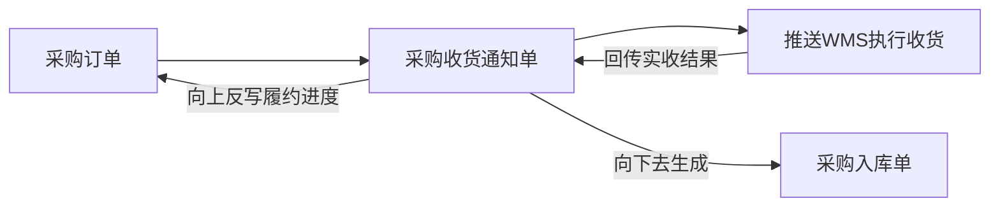
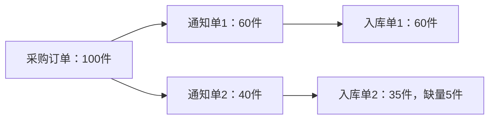
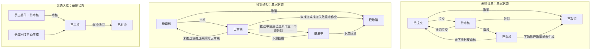
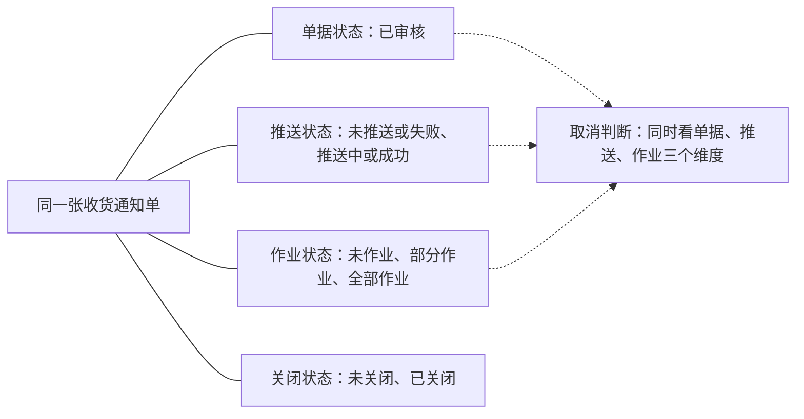
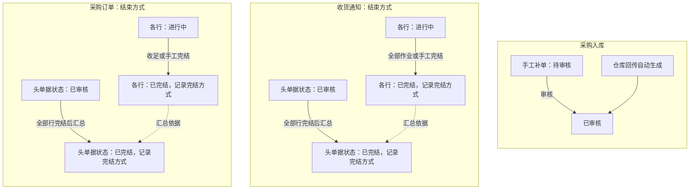
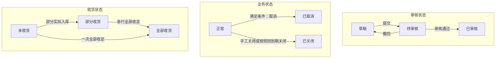
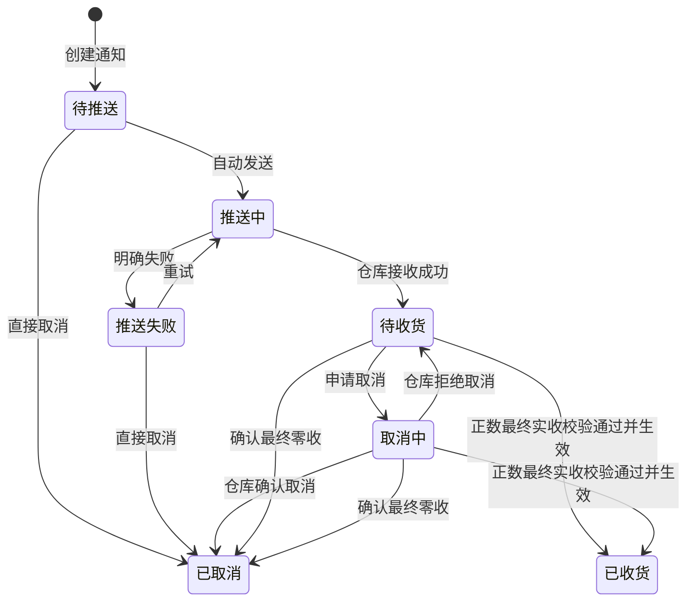
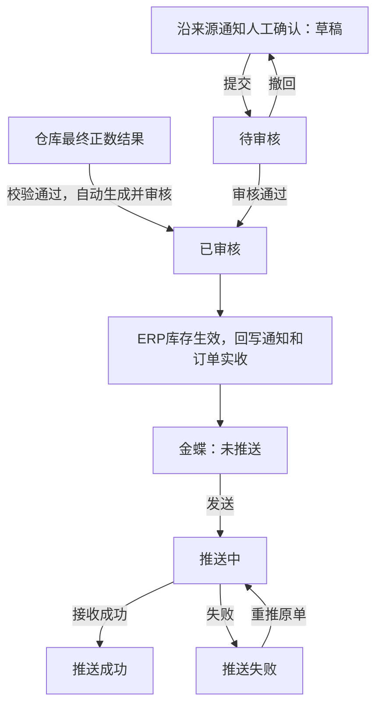

# ERP项目番外篇：深入讲解ERP的单据分层设计

| 项目 | 内容 |
| --- | --- |
| 面向人群 | 已完成ERP第1~3讲，或对多层单据与状态机设计感到困惑的学员 |
| 学习时长 | 60分钟 |
| 难度等级 | ⭐⭐⭐⭐ |
| 前置课程 | [ERP项目第3讲：采购链路与三层单据设计](./ERP项目第3讲-采购链路与三层单据设计.md) |

## 1. 课程背景

大家在学习ERP的时候，会发现在ERP里面有很多名字相近的单据：采购订单、采购收货通知单、采购入库单；到了销售模块，又有销售订单、销售发货通知单、销售出库单。

买一次货，为什么需要这么多张单？每张单又有自己的状态，有的还分单据头状态、单据行状态。看起来都认识，放到一起就容易绕。

今天这节课，是我们ERP项目的番外补充篇。我希望大家在学ERP之前，能先把ERP为什么需要多层单据、各层状态应该怎么设计搞清楚。理解这些，再去看采购、销售等课程，就能明白那些字段和操作是为了处理什么业务。

关于ERP的分层单据设计，其实我也经历过不少摸索和踩坑。最早在重构公司的新零售ERP项目时，我调研了金蝶、SAP、百胜等成熟竞品，结合业务场景初步搭建了三层单据架构，后来把这些经验放进了第一期供应链课程。随着公司项目进入测试和实际运转，我发现第一版设计把字段、状态和联动关系搞得太细、太复杂，研发处理和业务操作都苦不堪言，于是我又花时间重新做减法。

随后回看第一期供应链课程中的相关模块，我发现内容确实有些偏复杂，不利于新手学习理解，所以我也希望能把这部分做简化，并将调整后的思路融入到强盛ERP仿真项目中。这样大家既能看到课件文字稿，又能实际操作体验“强盛ERP”这个Demo项目，还能看看里面的项目结构是怎么搭建的。

## 2. 学习目标

- 理解ERP多层单据的本质：能说清“业务安排、执行指令、实际结果”三层角色的核心分工与数据流转关系
- 掌握正交解耦与状态机设计：能解释一张单据为什么需要这些状态维度，什么操作会改变它，以及变化后上下游怎么联动
- 具备全局单据选型能力：能够根据业务特征，准确判断业务应该采用三层、两层还是一层的单据架构，并能讲透背后的业务动因

## 3. 业务本质：一笔采购为什么需要多张单据

我们举个例子：向供应商采购100件商品，供应商分两批送货。第一批送60件，仓库实收60件；第二批送40件，仓库实收35件，缺量5件。

| 单据 | 记录什么 | 负责什么 |
| --- | --- | --- |
| 采购订单 | 总共采购100件，向谁买、什么价格 | 统筹业务安排，记录全局采购意图，简称L1 |
| 采购收货通知单 | 第一批通知送60件，第二批通知送40件 | 承接独立的批次收货任务，下发仓库执行，简称L2 |
| 采购入库单 | 第一批实际入库60件，第二批实际入库35件 | 记录仓库实际收货结果，沉淀库存流水，简称L3 |

供应商分批发货时，每一批都需要作为独立任务由收货通知单承接。WMS作业完成后，ERP的处理链路是：先更新收货通知单，再由收货通知单向上反写采购订单的履约进度，并向下去生成采购入库单。



如果把这些批次变化都揉在一张采购订单上，不仅要记录总数，还要区分每一批的在途、实收与缺量。批次越多，单据越难维护。

通过单据分层，职责划分非常清晰：
1. 采购订单记录业务总协议，汇总各批次反写的执行进度；
2. 采购收货通知单承接每次独立的收货指令；
3. 采购入库单如实记录每次生效的入库资产。



单据明细层层关联：通知行关联订单行，入库行关联通知行。后续要追查第二批少收的5件商品，可以精准定位到具体的通知批次与明细行。

需要注意的是，采购订单和收货通知单都不增加ERP即时库存，只有最终生效的入库单才会增加库存。至于一张通知单允许一次还是多次回传，需要根据业务和接口约定决定；后文会详细说明为什么推荐单次确认。

## 4. 演进复盘：单据状态机的三次迭代历程

单据头是整张单共有的信息，例如单号、供应商、审核状态；
单据行是商品明细，每行有自己的商品和数量。

### 4.1 第一阶段：公司新零售ERP，先把各项规则分开表达

当时我把采购、销售等业务抽象成三层，并分别定义审核、执行、关闭和结果处理规则。

| 单据 | 单据头状态字段及取值 | 单据行状态 |
| --- | --- | --- |
| L1采购订单 | 1. 单据状态：待提交、待审核、已审核、已取消<br>2. 关闭状态：未关闭、已关闭 | 关闭状态：未关闭、已关闭 |
| L2收货通知单 | 1. 单据状态：待审核、已审核、取消中、已取消<br>2. 推送状态：未推送、推送中、推送成功、推送失败、无需推送<br>3. 作业状态：未作业、部分作业、全部作业<br>4. 关闭状态：未关闭、已关闭 | 关闭状态：未关闭、已关闭 |
| L3采购入库单 | 1. 单据状态：待审核、已审核、已红冲<br>2. 财务推送状态：未推送、推送中、推送成功、推送失败<br>3. 辅助标识：红冲标识 | 无 |

先看单据主状态的流转。采购订单与收货通知单的关闭状态单独设立字段维护，单据关闭后，其单据主状态依然保留为已审核。



但仅仅看懂这张主状态流转图，系统依然无法判断一个操作是否允许执行。因为在L2收货通知单的单据头上，同时挂了四个状态维度：



图中的实线表示字段归属，虚线表示校验依赖。比如业务想点击“取消通知单”，系统必须联合判断：
1. 状态为已审核且仓库完全未作业时，如果是未推送或明确推送失败，允许直接取消；
2. 如果已经推送中或推送成功，则必须向下游仓库发起取消申请，进入“取消中”等待确认；
3. 一旦仓库已有作业结果（部分作业或全部作业），则强行拦截不允许取消；
4. 单据关闭还有一套根据各明细行汇总计算的逻辑。

这套设计的优点在于正交解耦、职责切分极细：
1. 业务审核、接口通信、物理作业和手工关闭互不干扰，字段职责非常清晰；
2. 每次分批执行都能独立追踪，单据行支持细颗粒度控制；
3. 出错时通过红冲单抵消并保留原始单据关联，具备完整的审计追溯能力。

但它的缺点在实际落地中更加致命：
1. 状态组合爆炸：仅L2单据头就有4个状态维度，排列组合多达数十种，极易出现边界逻辑遗漏或不可流转的死态；
2. 业务认知成本高：采购员和库管很难一眼看懂单据到底停在哪一步，列表筛选条件繁琐，甚至需要复杂的界面提示去解释为什么某个按钮无法点击；
3. 头行联动与校验成本高：页面上一个按钮能不能点、是否允许取消，需要跨字段联合判断，行级关闭还要反复向上做整单聚合计算。

多字段解耦本身并没有错，但收货通知单本质上只是一个承接单次执行的过渡载体。赋予它过多维度的状态控制，表面上看规则滴水不漏，实际落地时开发、测试和业务操作都陷入了泥潭。

### 4.2 第二阶段：把项目经验放进采购课程

在第一期课程中，我用采购链路讲解这套设计，补充了供应商协同、分批送货和仓库执行等业务背景。为了区分商品全部收齐与剩余缺量不再执行两种场景，我引入了“已完结”和“完结方式”两个概念。

| 单据 | 单据头状态字段及取值 | 单据行状态 |
| --- | --- | --- |
| L1采购订单 | 1. 单据状态：待提交、待审核、已审核、已取消、已完结<br>2. 完结方式：自然完成、手工完结 | 1. 行状态：进行中、已完结<br>2. 完结方式：自然完成、手工完结 |
| L2收货通知单 | 1. 单据状态：待审核、已审核、取消中、已取消、已完结<br>2. 推送状态：未推送、推送中、推送成功、推送失败、无需推送<br>3. 作业状态：未作业、部分作业、全部作业<br>4. 完结方式：自然完成、手工完结 | 1. 行作业状态：未作业、部分作业、全部作业<br>2. 行状态：进行中、已完结<br>3. 完结方式：自然完成、手工完结 |
| L3采购入库单 | 1. 单据状态：待审核、已审核<br>2. 财务推送状态：未推送、推送中、推送成功、推送失败 | 无 |

审核、撤销提交、反审核和取消的主要路径沿用前一版，L2收货通知单依然需要结合推送与作业状态联合判断能否取消。这里重点看新增的“已完结”是如何流转与汇总的：



这一版的核心变化是把“已完结”直接合并进了单据主状态中，同时在头和行两个层级都记录完结方式。

这套设计的优点在于业务解释力更强：
1. 明确区分了履约的两种终态：足额入库属于“自然完成”，供应商断货或异常截断属于“手工完结”，更贴合供应链实操场景；
2. 业务背景更饱满，补充了协同和分批执行的上下文。

但它在系统架构上暴露了新的设计缺陷：
1. 审批状态与履约状态混淆产生语义污染：单据状态原本是用来表达审批流的，将“已完结”并入单据状态后，单据完结就会直接冲掉“已审核”状态。导致下游报表、权限校验和下推判断原本只过滤“已审核”，现在全都必须打补丁兼容“已完结”；
2. 头行完结状态冲突与汇总成本高：头和行都记录完结方式，如果一张单据中A行是自然完成，B行是手工完结，单据头该记录哪种完结方式就成了逻辑死角；
3. 未根治中间层复杂度：虽然把“关闭”换成了“完结”，但收货通知单头部的推送状态与作业状态依然全部保留，跨状态联合校验的痛点并未解决；
4. 业务闭环存在断点：对于第二批缺收5件手工完结后，采购订单上的在途占用与未清配额如何精准释放回补，在这一版规则中依然没有彻底闭环。

### 4.3 第三阶段：在实际运转中发现问题，重新做减法

公司项目在测试和实际运转中暴露出多状态组合的复杂性后，我回看第一期课程，推倒重来，回到第一性原理对单据体系重新做正交解耦，并将简化后的思路落地到强盛ERP仿真项目中。

这次我先问自己：哪些信息确实需要同时并列展示？哪些只是同一个任务的前后流转步骤？
订单的审批资格、是否有效、收货进度三者各司其职，必须拆开独立维护；收货通知单从自动推仓到仓库收货，本质是同一笔任务的前后推进，直接放进单轴时间线；商品明细行首先维护数量组，在没有强烈单行截断诉求前，坚决不设行级流程状态。

| 对比项 | 第一阶段（公司新零售原稿） | 第二阶段（第3讲课件） | 第三阶段（强盛ERP） |
| --- | --- | --- | --- |
| L1采购订单 | 单据状态＋关闭状态<br>（审批与关闭解耦，但缺少收货看板） | 单据状态（含已完结）＋完结方式<br>（审批被完结覆盖，产生语义污染） | 审核状态＋业务状态＋收货状态<br>（三维度完全正交，已审核长期稳定） |
| L2收货通知单 | 单据、推送、作业、关闭四组字段<br>（笛卡尔积交叉判定，操作查表） | 单据、推送、作业、完结方式<br>（行增设作业状态，判断依然繁琐） | 单据状态单轴推进<br>（自动推仓，零收按取消，消除长驻态） |
| 行级控制 | 行关闭状态<br>（由各行关闭汇总至单据头关闭） | 行状态＋完结方式<br>（通知另有行作业状态，头行双重冗余） | 彻底砍掉行级状态<br>（只维护数量组，整单取消与整单关闭） |
| 缺收与配额 | 规则未闭环<br>（少收导致L1下推配额永久卡死） | 引入手工完结截断<br>（但配额释放逻辑依然未写明） | 动态配额公式闭环<br>（实收替代通知占用，缺量差额自动释放） |
| L3结果单 | 包含财务红冲设计<br>（审计链完整，但系统链路长） | 彻底删除了红冲机制<br>（无任何逆向纠错闭环） | 审核与推送解耦<br>（零收不生成结果单，走技术改数/线下兜底） |

这套设计的优点在于认知极其直观，逻辑彻底闭环：
1. 状态正交看板化：L1三维度一眼看清（审批资格、业务有效性、累计履约进度），已审核状态长期稳定不被冲掉；
2. 单轴推进与极简生命周期：L2收敛为一条单轴推进的时间线，剔除人工二次审核，消除“部分作业”的常驻死态，零收直接按取消处理不留脏数据；
3. 配额计算彻底闭环：单据行彻底取消状态控制，通过动态在途配额公式 `可下推数量 = 采购数量 - 累计实际入库数量 - 在途通知数量` 实现额度自动平账，缺收差额自动释放回补。

但它也有明确的适用边界与系统妥协：
1. 业务容差度收窄：默认单张通知只接收一次最终结果，不支持持续多次追加回传；一期按整单关闭，暂不支持按单行单独取消或关闭余量；
2. 逆向纠错成本转为线下：砍掉红冲后，入库账目若发生错误依赖技术改数或线下协同，牺牲了一定的系统内审计弹性。

接下来，我们看当前这套方案在实际页面和状态机中具体如何落地配合。

## 5. 核心方案：三张单据的状态机与联动设计

### 5.1 采购订单：三个字段，回答三个问题

| 字段 | 状态值 | 谁来改变、用来做什么 |
| --- | --- | --- |
| 审核状态 | 草稿、待审核、已审核 | 提交、审核、撤回，控制修改和下推资格 |
| 业务状态 | 正常、已取消、已关闭 | 取消或关闭，控制是否继续办理，不另设作废状态 |
| 收货状态 | 未收货、部分收货、全部收货 | 按各行累计实际入库数量计算，展示履约进度 |



一张订单完全可以是“已审核+已关闭+部分收货”：它通过了审核，已经收了一部分，后来决定不再安排剩余采购。三个信息都需要保留。

这里的“正常”只表示未取消、未关闭。采购全部收足后，当前方案保持“已审核+正常+全部收货”，不必再增加一个重复的“已完成”。

需要明确的是，强盛ERP阶段3做减法的一个核心设计：**业务单据审核不同意统一改称“撤回”，系统不设“已驳回”状态，也不单独挂驳回分支**。无论是审批人审核不同意打回，还是制单人主动撤回，在系统底层都执行“撤回”动作，单据直接回到“草稿”状态，并保留撤回/审核意见供采购员修改后重新提交。这样既消除了冗余状态，又保证了操作闭环。

分成三个字段不表示操作互不约束。操作按钮需要联动校验三个维度的状态：

| 操作 | 条件 | 执行后的影响 |
| --- | --- | --- |
| 编辑、提交、删除 | 草稿+正常 | 提交后进入待审核；草稿只能删除、不能取消 |
| 审核通过、撤回 | 待审核+正常 | 审核通过变为已审核；撤回（含审核不同意打回）退回草稿并保留意见；待审核取消同时终止审核流程，不允许删除 |
| 新增通知 | 已审核+正常，且对应行可下推数量大于0 | 占用本次通知额度 |
| 取消订单 | 待审核可直接取消并终止审核；已审核时须无实际入库且下游无仍需执行的通知 | 业务状态变为已取消，不增加库存，联动取消名下未推送或推送失败的通知 |
| 关闭订单 | 已审核+正常 | 业务状态变为已关闭；禁止新增通知，已有有效通知继续执行 |

待推送或明确推送失败的通知可以随订单一起取消；涉及推送中、待收货或取消中的通知，要先处理其执行情况，取得必要的仓库确认。订单取消、关闭都保留原审核状态和操作历史。

关闭原因、时间、操作人和关闭方式可以另行记录，不需要把“手动关闭”“到期关闭”各做一个流程状态。

### 5.2 收货通知单：用单轴状态串联本次任务

通知来自已审核订单，当前方案创建后自动推送仓库，不再增加一次通知审核。

| 状态 | 含义 |
| --- | --- |
| 待推送 | 已创建，等待系统发送 |
| 推送中 | 请求已发出，结果未确定 |
| 推送失败 | 已明确发送失败，可以重试 |
| 待收货 | 仓库已接收，ERP等待最终结果 |
| 取消中 | 已申请取消，等待仓库确认 |
| 已取消 | 本次任务不再执行，或已确认整批零收 |
| 已收货 | 已确认本批正数实收结果，任务结束 |



有三处需要解释。

**第一，“待收货”不表示仓库一定还没动手。** 它只表示ERP尚未取得最终结果，因此不能自己认定取消成功。

**第二，“已收货”表示这一批结束，不表示全部收足。** 通知60件，最终实收50件，状态就是已收货，明细显示缺收10件。还要补收，就另建通知。仓库内部可以分次作业，但对ERP按约定汇总为一次最终结果，所以这里不需要长期保留“部分收货”。

**第三，等待回传不等于实收0。** 只有仓库明确确认整批最终零收，才取消通知、释放全部通知额度，不生成零数量入库单、不增加库存，回传记录仍保留。

| 当前情况 | 可以怎么处理 | 对数量和库存的影响 |
| --- | --- | --- |
| 待推送、明确推送失败 | 直接取消；失败也可重试 | 取消成功才释放通知额度，不改变库存 |
| 推送中、发送结果不确定 | 等待接口回调；超时未决时支持系统对账反查或人工核实，确认下游未接单后置为推送失败 | 不提前释放额度，不盲目重复发送 |
| 待收货 | 接收结果或申请取消 | 申请取消时仍占用额度 |
| 取消中 | 等待确认，同时处理可能到达的实际结果 | 有效正数结果按实收入库，不能再落成已取消 |
| 回传校验失败 | 保留异常，修复后继续处理原记录 | 暂不完成通知、不回写实收、不增加库存 |
| 已收货、已取消 | 查看及追溯 | 不在原通知上追加收货 |

推送记录、失败原因、重试次数仍然要留。减少页面上的状态字段，不代表删除这些记录。

### 5.3 采购入库单：审核与财务推送分别记录

| 字段 | 状态值 | 用途 |
| --- | --- | --- |
| 审核状态 | 草稿、待审核、已审核 | 控制结果是否生效 |
| 金蝶推送状态 | 未推送、推送中、推送成功、推送失败 | 跟踪已生效结果是否传递成功 |



正常回传自动审核。仓库已经执行，但接口拿不到结果时，可以沿来源通知人工确认实际结果，走提交审核流程；采购入库不开放无来源的随意建单。

草稿可以修改，待审核可以审核或撤回，已审核后不直接修改已生效数量。金蝶推送失败只影响传递状态，不撤销ERP入库，重推也不能再增加一次库存。

这张单记录的是实际入库50件，50件生效就是本张结果单的全部内容。订单还有50件没收，是订单的履约进度，入库单不用再设置“部分收货”。

至于结果出错后的更正，早期方案设计了红冲，当前强盛方案没有展开常规业务更正，而是保留技术介入或线下处理。这是现有方案的能力限制。实际项目仍要明确更正权限、原记录保留、库存影响及下游同步，不能把减少状态理解成可以随意改掉已生效结果。

### 5.4 单据明细行：只维护数量，不设行级状态

当前采购方案按整单审核、取消和关闭，商品行保留以下数据即可：

| 单据 | 行级主要数据 | 关联 |
| --- | --- | --- |
| 采购订单 | 采购数量、累计入库数量、在途通知数量、可下推数量 | 订单行是后续数量累计的来源 |
| 收货通知 | 通知数量、实收数量、缺收数量 | 关联订单行 |
| 采购入库 | 实际入库数量 | 关联通知行，并可追溯订单行 |

某行收没收足，可以按数量计算并展示，额度占用与释放完全由在途公式动态计算。只有业务确实需要“SKU-A剩余不收，SKU-B继续收”这样的独立控制时，才需要考虑增加行关闭状态及操作。

一张订单各行都收足，头才显示全部收货；所有行都没有实收，显示未收货；其余显示部分收货。不要把不同商品的数量加在一起互相抵消。

## 6. 案例走查：分批到货、缺量释放与关单推演


### 6.1 第一批实收60件，第二批通知40件只收35件

沿用前面的100件采购，假设期初库存为0，没有其他出入库，所有实收都已确认入库。

先看一个公式：

```text
可下推数量 = 采购数量 - 累计实际入库数量 - 在途通知数量
```

这里的“在途通知数量”指有效、尚未结束的通知占用量，包含待推送、推送失败、待收货、取消中等情况，不是运输途中的实物库存。公式按订单行分别计算。

注意：本方案默认按不超收设计，实收数量上限严格受通知数量约束；业务上若存在超收容差，需另设超收比例控制，本课暂不展开。

| 节点 | 采购订单状态（审核/业务/收货） | 通知状态 | 累计入库 | 在途通知 | 可下推 | 库存 |
| --- | --- | --- | --- | --- | --- | --- |
| 订单审核 | 已审核/正常/未收货 | 无 | 0 | 0 | 100 | 0 |
| 创建并推送A：60件 | 已审核/正常/未收货 | A待收货 | 0 | 60 | 40 | 0 |
| A最终实收60件 | 已审核/正常/部分收货 | A已收货 | 60 | 0 | 40 | 60 |
| 创建并推送B：40件 | 已审核/正常/部分收货 | B待收货 | 60 | 40 | 0 | 60 |
| B最终实收35件 | 已审核/正常/部分收货 | B已收货，缺5件 | 95 | 0 | 5 | 95 |

B结束时，原来占用的40件撤下，以实际入库35件替代，因此可下推数量自动恢复到5件。B少收的5件额度已经自动释放，不需要再手动关闭一次B。

两张通知累计安排了100件，但实际入库只有95件。如果供应商后续还要补送少收的5件，直接利用恢复的5件额度新建通知C即可。

早期两份稿件没有明确写出缺量释放规则。如果只按“采购数量减去已通知数量”死板计算，又不在缺收结束时调整占用，这里可下推数量就会永远为0，少收的5件配额就被永久卡死。这也是数量规则必须和状态结束一起设计的原因。

Demo实操观察：打开强盛ERP演示环境，重点对比采购订单、通知B和入库单B三个界面的联动，看B结束前后可下推数量为什么从0恢复到5。

### 6.2 订单剩余不采购了，已经通知的那批怎么办

换一个分支：仍然采购100件，第一批已入库60件，另有第二批30件通知已被仓库接收，还有10件未安排。

**如果只是不再安排新的采购，关闭订单即可。** 30件通知继续执行。之后仓库实收30件，库存从60增加到90，订单显示“已审核＋已关闭＋部分收货”。未收的10件保留在明细中，但不能再下推。

**如果连已经通知的30件也不收了，还需要申请取消通知。** 仓库同意后，通知才变成已取消，释放30件额度。订单已经关闭，即使释放了额度也不能重新下推；库存仍为60。如果仓库拒绝取消，通知继续执行。

我们用推演表格对比这两个分支的变化：

分支一：只关闭订单，通知单B继续执行并实收30件

| 节点 | 采购订单状态（审核/业务/收货） | 通知B状态 | 累计入库 | 在途通知 | 可下推 | 库存 |
| --- | --- | --- | --- | --- | --- | --- |
| 当前现状 | 已审核/正常/部分收货 | B待收货 | 60 | 30 | 10 | 60 |
| 关闭订单 | 已审核/已关闭/部分收货 | B待收货 | 60 | 30 | 10 | 60 |
| B实收30件 | 已审核/已关闭/部分收货 | B已收货 | 90 | 0 | 10 | 90 |

分支二：订单已关闭，同时申请取消通知单B（仓库同意取消）

| 节点 | 采购订单状态（审核/业务/收货） | 通知B状态 | 累计入库 | 在途通知 | 可下推 | 库存 |
| --- | --- | --- | --- | --- | --- | --- |
| 申请取消B | 已审核/已关闭/部分收货 | B取消中 | 60 | 30 | 10 | 60 |
| 仓库同意 | 已审核/已关闭/部分收货 | B已取消 | 60 | 0 | 40 | 60 |

特别注意：在分支一和分支二中，订单关闭后明细行的“可下推数量”在底层仍按公式如实显示剩余差额。但由于订单业务状态已变为“已关闭”，系统在界面交互层直接置灰拦截“新增通知”按钮。这就是为什么“剩余数量”和“操作权限”必须分开：前者忠实记录数据事实，后者由状态机规则控制，绝不能为了禁止操作而在底层把计算值强行改成0。

| 概念 | 本课方案中的含义 | 是否改变采购即时库存 |
| --- | --- | --- |
| 完成 | 说明哪件事做完：订单全部收足，或通知本批结束 | 状态名称本身不记账，按实际入库结果增加 |
| 关闭订单 | 不再安排新的通知，已有有效通知继续执行 | 关闭不改变库存，后续有效实收仍可增加 |
| 取消通知 | 撤回本批任务，必要时等待仓库确认 | 取消不改变库存，只释放通知占用 |
| 取消订单 | 整张订单作废终止，要求无实际入库且无仍需执行的通知 | 不增加库存；已有实收不能靠取消抹掉 |

Demo实操观察：在强盛ERP中关闭订单后，观察明细行可下推数量与页面操作按钮权限的分离；再演练通知单申请取消，观察“取消中”与“已取消”在配额释放上的差异。


## 7. 业务迁移：换成其他业务怎样设计

### 7.1 ERP一定必须做成三层吗：按角色定层数

讲完采购业务的三层单据，大家可能会问：我们在ERP里面设计业务，是不是所有业务链路都必须死板地套用三层单据？

答案显然不是。三层是完整形态，绝不是通用教条。

现实中的供应链业务，始终包含三类不同的角色：
1. 业务安排：回答“我要做什么”，记录与供应商、客户或内部确认的业务约定；
2. 执行指令：回答“这一批怎么执行”，是一次具体执行的任务指示；
3. 实际结果：回答“实际发生了什么”，记录真实收发货的事实，是库存记账与财务推送的唯一凭据。

核心原则：角色不等于单据。在实际项目中到底建几层单据，取决于业务安排与执行任务的关系：

| 单据形态 | 适用条件与业务动因 | ERP常见通用单据 |
| --- | --- | --- |
| 三层结构（安排→指令→结果） | 存在分批履约或跨仓时序依赖：一次安排可能分多次送达、交货或退货，每次执行需要独立的批次状态与取消流程；或调入端必须依赖调出端的实发结果 | 采购订单（分批收货）<br>大宗销售订单（分批发货）<br>采购退货单/销售退货单（分批退货）<br>跨仓调拨业务（包含调出出库与调入入库两阶段协同） |
| 两层结构（安排兼指令→结果） | 一次只有一个有效执行任务：整单整发、不分批执行，业务安排单自身直接兼任仓库指令，无需多设一层通知单 | 极简销售订单（单仓整单一次发货）<br>其他出入库申请单（样品、领用、报废等一次性收发） |
| 一层结构（只有结果单） | 事实已在外部发生或纯账面调整：物理作业已由外部系统完成，ERP只做记账与财务核算；或属于同仓不同库位/账套间转移，不推外部仓库执行 | 内部直接调拨单（账内库位转移）<br>盘盈盘亏单/损溢出入库单（仓库盘点结果回传） |

通用设计原则可以总结为“三问定层数”：
一问有没有分批或两端跨仓依赖（有则设通知单做三层）；
二问业务单能否直接兼任指令推仓（能则合并为两层）；
三问是否为纯账面调整或外部已完成的事实（是则直接用一层结果单记账）。

### 7.2 状态字段按它要表达的信息来定

我目前建议大家先做下面几个判断：


| 要判断什么          | 建议                    | 这样考虑的原因               |
| -------------- | --------------------- | --------------------- |
| 多个信息是否需要同时成立   | 需要时分字段，例如已审核、部分发货、已关闭 | 列表和操作规则都能直接识别这些信息     |
| 是否属于同一次任务的先后步骤 | 可以组织成一个流程状态           | 用户更容易知道当前节点和下一步操作     |
| 是否只是数量进度       | 优先由结果数量计算             | 避免数量已经变化，状态却漏更新       |
| 单据行能否独立办理      | 有逐行控制需求再增加行状态         | 行状态应有对应操作，不能仅因为有明细就增加 |
| 一个状态是否叫“完成”    | 写清完成对象和触发条件           | 本批结束、全部收足、业务关闭是不同含义   |


例如销售订单可以表达审核、业务状态和发货进度，发货通知表达本批执行过程，销售出库单承接实际结果。与此同时，销售涉及库存预占，不能把采购入库的数量规则原样复制过去；退货还可能需要控制原单可退数量。

同样，如果通知需要独立审批，就保留审核；如果仓库需要多次结果回传，就保留相应进度和多张结果的关联。先明确业务要求，再选择状态表达，才能知道简化到哪里合适。

## 8. 本讲小结与自查清单

回到这节课开头的问题：买一次货，为什么需要这么多张单？

答案很明确：业务安排管约定，执行指令管分批，实际结果管记账。把这三件事拆开，履约历史才不会被冲掉，分批和取消才有清晰安放的容器。

设计单据体系时，可以用这3个问题自查：
1. 职责是否正交：审批资格、业务有效性、履约进度是否拆为独立字段？已审核状态是否会被后续履约覆盖？
2. 流程是否闭环：部分收货或缺收终结后，未完成的通知额度能否自动释放？关闭订单后，有效在途与不可下推的边界是否清楚？
3. 层数是否克制：不分批的业务能不能做成两层？账面调整能不能做成一层？没有独立行操作时，明细行是否坚决不加行状态？

大家可以打开强盛ERP演示环境，亲自操作采购订单的关闭与收货通知单的取消，看一看可下推数量在缺量结束前后的数值变化。搞懂了这套分层与配额逻辑，再去学后面的采购、销售、库存课程，就能清楚每一个状态和字段背后的业务目的。

## 9. 常见答疑

### 9.1 为什么收货通知单不长期保留“部分收货”状态

在实际业务中，供应商送货经常出现少送、分批送的情况。很多同学会问：仓库今天卸车验了30件，明天再验剩下的10件，为什么不在通知单上设一个“部分收货”状态让它停留在那里？

核心在于区分“仓库内部作业进度”与“ERP协同任务粒度”。
仓库内部WMS可以多次扫描上架，但在ERP视角，一张收货通知单对应的是一次确定的送货预约任务。

如果通知单长期保留“部分收货”，会带来两个严重问题：
1. 状态变成常驻死态：如果供应商剩余的货因断货永远不送了，这张通知单将永远停留在“部分收货”，系统无法自动判断它究竟还在不在执行；
2. 在途配额无法精准释放：ERP的在途通知数量公式将始终把这笔单据计入在途占用，导致采购订单剩余额度被长期卡死，无法重新发起下推。

因此推荐的规范做法是：一张通知单只承接一次最终收货确认。若供应商分批送达，业务上应该生成两张独立的通知单分别对应不同送货批次；或者在仓库全部点验完毕后，向ERP回传一次最终实收结果，通知单直接落入“已收货”终态，差额自动释放回采购订单。

### 9.2 很多传统ERP明细行都有行状态，为什么本方案坚持一期砍掉

在一些成熟的大型ERP中，明细行往往带有行关闭、行完结等字段。为什么我们在本课方案中主张明细行不设流程状态？

状态是为操作服务的。如果明细行没有配套的独立行级操作（例如采购员能在界面上单独勾选某一行点击“取消该行”或“关闭该行”），那么行状态就是纯粹的冗余。

头行双层状态机会带来极高的系统维护成本：整单提交时要校验各行状态，某一行发生变化时又要向单据头做聚合汇总计算，极易产生逻辑死角。

在绝大多数自研ERP一期，采购业务的核心诉求是“整单把控”。通过“整单关闭”结合动态在途配额公式：
可下推数量＝采购数量－累计实际入库数量－在途通知数量
系统就已经能够自动、精确地计算出每行的剩余可用额度，完全不需要依靠繁琐的行状态来控制。只有当业务出现“单笔订单包含数十个品类，且业务要求高频单独针对某一个SKU做不可逆截断”时，才值得引入行级状态。

### 9.3 采购入库单审核生效后发现库管录错了数量，没有红冲该怎么处理

早期方案设计了红冲机制，当前方案删除了常规红冲。如果实际业务中入库单数量录错了，系统该怎么闭环？

严格的单据红冲机制需要生成负数入库单对冲原单，并联动库存账套、成本核算与财务凭证冲销，链路极长，自研ERP早期开发和维护成本过高。

在系统一期，对录错数量的异常数据通常采用两种方式兜底：一是技术介入后台更正，二是业务通过盘点调整或其他出入库单在线下对账调平。

需要注意：不设红冲不代表可以随意改库改账。任何修正操作都必须在系统底层记录审计日志，注明修改人、原因和时间戳，确保账实追溯不断链。

## 10. 实操任务与交付物

### 10.1 任务说明

本讲的实操任务围绕“状态机流转与动态配额推演”展开，重点检验对单据联动和数量公式的掌握程度。

#### 必做任务：分批缺收与在途配额推演表

业务场景：
采购订单PO202609001采购SKU-A共200件，期初库存为0。
1. 第一次下推通知单ASN-01安排120件，仓库实收120件并生成入库单GR-01，入库单审核生效；
2. 第二次下推通知单ASN-02安排80件，仓库实收70件并生成入库单GR-02，入库单审核生效，通知单ASN-02结束（缺量10件）；
3. 采购员获知供应商断货，剩余10件不再采购，在ERP中点击关闭采购订单。

请根据上述业务过程，填写状态流转与数量字段变化表：

| 节点 | 采购订单状态（审核/业务/收货） | ASN状态 | GR状态 | 累计入库 | 在途通知 | 可下推数量 | 实际库存 |
| --- | --- | --- | --- | --- | --- | --- | --- |
| 初始：订单审核生效 |  | 无 | 无 |  |  |  |  |
| 节点1：创建并推送ASN-01（120件） |  |  | 无 |  |  |  |  |
| 节点2：GR-01审核生效（实收120件） |  |  |  |  |  |  |  |
| 节点3：创建并推送ASN-02（80件） |  |  | 无 |  |  |  |  |
| 节点4：GR-02审核生效（实收70件，ASN-02结束） |  |  |  |  |  |  |  |
| 节点5：采购员手工关闭订单 |  |  | 无 |  |  |  |  |

#### 选做任务：基于“三问原则”设计跨仓调拨单据体系

业务场景：
华东中心仓向华南分仓调拨500件商品，由第三方干线物流承运，在途运输耗时3天。华南分仓实际到货清点为498件，运输途中外箱破损损耗2件。

任务要求：
1. 运用本讲“三问定层数”原则，判断该调拨业务应该设计几层单据，并说明理由；
2. 列出各层单据的名称与职责（安排层、指令层、结果层）；
3. 说明少收的2件损耗在系统内应如何记账与闭环，避免两端仓库账目不平。

### 10.2 产出标准

| 交付物 | 合格标准 |
| --- | --- |
| 分批缺收推演表 | 6个节点的订单状态、通知状态、入库单状态完全正确；在途通知与可下推数量计算无误；能准确计算缺量释放后的真实数值，并讲清关单后界面拦截下推的权限控制逻辑 |
| 跨仓调拨单据设计（选做） | 准确识别跨仓调拨的两端时序依赖；说明调出与调入两阶段的单据分层；针对破损损耗给出合理的差异处理方式 |

## 11. 自检清单

学完这一讲，重点检查自己能否独立回答以下关键问题：

1. 我能说清为什么买一次货在ERP中不能只用一张采购订单完成吗？
2. 我能说清采购订单的审核状态、业务状态、收货状态为什么要拆成三个正交字段吗？
3. 我能背出并解释动态配额计算公式吗？知道通知单在不同状态下如何计入在途吗？
4. 我能解释为什么通知单以缺收状态终结时，差额配额能够自动释放回订单吗？
5. 我能说明关闭订单与取消订单在适用条件、库存影响、在途任务处理上的本质差异吗？
6. 我能运用“三问原则”快速判断其他业务（如退货、调拨、盘点）应该采用一层、两层还是三层单据吗？

## 12. 补充知识

### 12.1 高频面试考点

#### 考点1：你在设计供应链系统时，如何避免状态机组合爆炸？
回答要点：
1. 职责正交解耦：将审批资格、业务有效性、执行进度拆为独立字段，互不污染，避免用一个状态表达多重含义；
2. 单轴任务推进：将同一次执行任务的流转收敛为单轴时间线状态，消除长驻死态；
3. 数据计算替代流程状态：履约进度由实收数量动态计算得出，一期坚决不设冗余的行级状态与完结方式。

#### 考点2：采购订单的“取消”和“关闭”有什么本质区别？
回答要点：
1. 取消是整单作废：前置校验严格，必须在无任何实际入库且下游无在途有效任务时才可执行，取消后不产生库存变动；
2. 关闭是终止后续操作：保留既有事实，允许在已有部分入库的前提下执行；关闭后系统禁止下推新通知，但已下推且正在执行的通知允许继续完成入库。

#### 考点3：当仓库回传的实收数量少于通知数量时，ERP系统如何处理配额？
回答要点：
1. 不能死锁通知数量：通知单终结时，原通知数量占用必须撤销，以实际入库数量替代占用；
2. 差额自动释放：通知数量减去实收数量的差额，自动回补到采购订单的可下推配额中，业务可根据实际情况决定补下新通知还是直接关闭订单。

### 12.2 推荐延伸学习

- **Demo实操验证**：在“强盛ERP”仿真系统采购模块中，实际演练采购订单关闭、收货通知单取消等操作，观察页面按钮权限与明细行数量的变化情况。
- **关联正课学习**：
  - 《ERP项目第3讲-采购链路与三层单据设计》：深入学习采购申请、供应商协同、送货预约及发票对账全链路；
  - 《ERP项目第4讲-从一个仓库到多逻辑仓库存模型》：深入学习实收入库后，正品、残品、在途、锁定等多种逻辑库存状态的划分与流转。