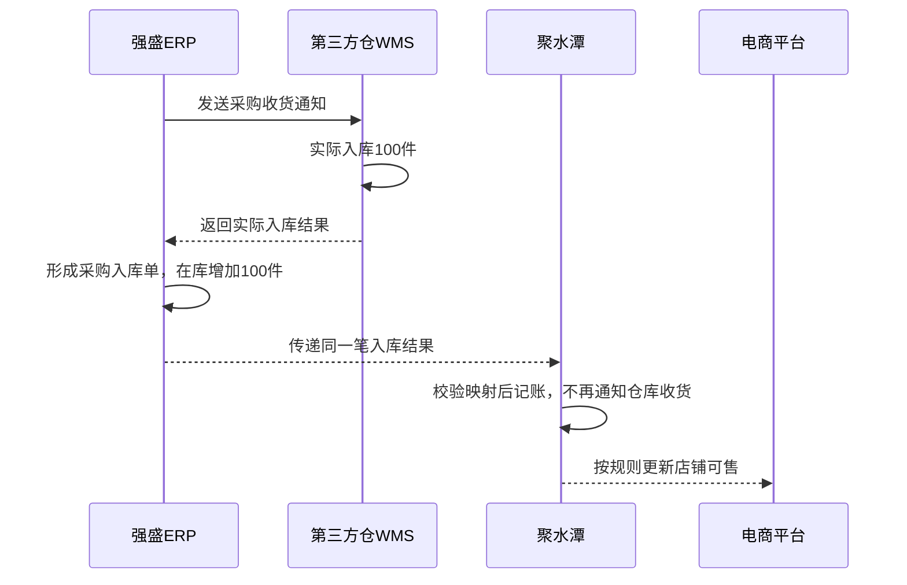
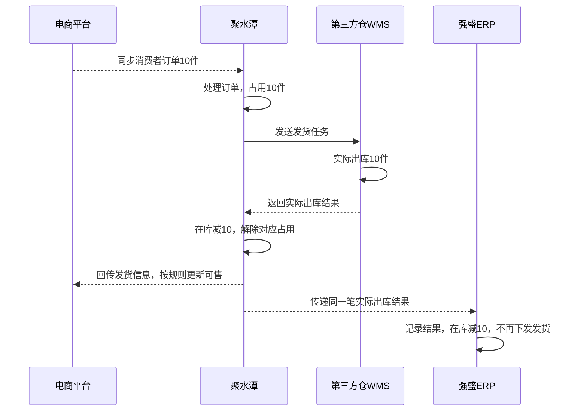

# ERP项目番外：自研ERP为什么做，怎样与电商ERP和财务ERP协同

| 项目 | 内容 |
| --- | --- |
| 面向人群 | 已完成ERP第1—7讲，理解主数据、采购、销售与库存基础，但对多系统协同仍有疑问的学员 |
| 学习时长 | 预计60—75分钟，含练习；按课堂讨论情况调整 |
| 难度等级 | ⭐⭐⭐ |
| 前置课程 | [《ERP项目第7讲：ERP的三层库存体系与库存同步方案拆解》](ERP项目第7讲-ERP的三层库存体系与库存同步方案拆解.md)，结合第1—6讲回看 |

## 1. 课程背景

第1讲我们讨论了强盛为什么选择自研ERP，第2讲建立了主数据，第3、4讲讲采购和库存模型，第5、6讲讲销售与电商履约，第7讲继续讨论库存分配与同步。

拆开看，每个模块都能理解。但把几个系统放到一起，大家可能又有点迷糊：聚水潭有商品和库存，领星也有；金蝶有采购、销售，强盛自研ERP还要再做采购、销售。这几套系统到底怎么配合？

我们用一个教学场景把问题摆出来：供应商送来100件充电器，第三方仓已经入库，强盛ERP也查得到100件，但店铺可售数量还没有增加。

| 角色 | 此时会问什么 |
| --- | --- |
| 采购 | 货已经收到了，为什么还不能卖？ |
| 电商运营 | 聚水潭有没有拿到这笔入库数据？ |
| 仓库 | 货只入了一次，怎么几个系统都有入库记录？ |
| 产品经理 | 这笔入库该传给谁？消费者下单后，又由谁通知仓库发货？ |
| 财务 | 业务系统已经记录了出入库，为什么还要把结果交给金蝶？ |

这些疑问，需要把前面学过的单据、库存和系统分工放回同一条业务链里。

本讲要解决的问题是：

> 强盛为什么保留多个ERP？同一批货从采购入库到电商销售，谁发起业务、谁执行、谁接收结果，各个系统怎样记账而不重复执行？

我们先沿着“入库100件、卖出10件”走完整条电商链路，再说明FBA和共享库存为什么要另外处理。最后在§3.6继续追问：业务已经记清楚，为什么还要把结果交给金蝶，以及两边怎样完成业财交接。

强盛科技是课程中的虚拟企业。下文用教学方案和示例数量解释系统协同，不表示相关接口已经完成联调；正式项目一期范围仍以《3.强盛ERP的定义和上下游链路》为准。本讲不展开API签名、报文字段和完整接口实现。

## 2. 学习目标

| 学完后要能做到 | 对应知识点 |
| --- | --- |
| 解释为什么自研ERP与外部ERP并存 | 企业业务分工、自研与外购的取舍；产品有功能不等于企业必须使用 |
| 判断同名单据是否重复 | 采购订单、收货通知、实际结果；一次实物执行与多系统记录 |
| 说明采购入库怎样影响店铺可售 | 实际入库、业务库存、渠道库存依据与平台可售之间的联系 |
| 区分余额同步与结果同步 | 数量口径、数据时点、重复处理及回传循环 |
| 说明SKU与仓库映射为什么必要 | 商品、单位、实体仓、逻辑仓和库存状态的对应关系 |
| 推演电商订单占用与实际出库 | 在库、占用、可用，以及结果归集的处理时点 |
| 识别不能直接套用主线的场景 | FBA履约、共享库存超额承诺、阶段4与阶段5的边界 |
| 解释自研ERP与金蝶的联动 | 业务与财务职责、建设模式、七类结果单交接、失败与更正处理 |

**本讲交付物**：系统分工与结果流转表＋库存变化推演表＋业财交接判断表。

## 3. 课程内容

### 3.1 为什么要自研ERP，又为什么保留外部ERP

#### 自研之前，业务也能运转

按照前面的课程背景，阶段3的强盛已经使用成熟系统：金蝶承担后台库存与财务底座，店小秘和旺店通分别承接跨境与国内电商业务。

到了阶段4，课程设定中的强盛选择自研后台主链，同时保留领星、聚水潭和金蝶。这里的变化，是主数据、采购、B2B销售和逻辑库存等工作，开始由自研ERP统一承接。

为什么要这样做？因为公司要处理的已经不只是“把某个店铺的订单发出去”。同一个商品会被采购、仓库、国内电商、跨境和批发团队使用；同一批货又可能有不同用途。公司需要决定：谁维护内部商品编码，谁管理采购过程，哪些货留给哪类业务，以及业务结果最终在哪里汇总。

某个系统有一个“库存管理”菜单，并不代表这些问题就都解决了。

#### 为什么还要保留电商ERP

接管后台主链以后，店铺订单仍然要处理，平台状态仍然要衔接。强盛可以继续使用成熟的渠道工具，把自研投入放在自己的业务规则和后台协同上。

本篇先记住下面这组分工。它说明的是本课程讨论的角色，不是这些产品的完整能力清单。

| 系统 | 在这条业务链里主要负责什么 |
| --- | --- |
| 强盛自研ERP | 维护内部业务资料，管理采购与B2B等业务，记录逻辑仓库存，归集外部实际结果 |
| 聚水潭、领星等电商ERP | 承接各自适用的渠道订单、库存与履约衔接；具体履约模式要分别看 |
| WMS或第三方仓作业系统 | 组织收货、上架、拣货、出库等仓内动作，记录实际作业结果 |
| 金蝶ERP | 在本项目中承担财务核算；详细联动见§3.6 |

仓库是否自营，与WMS是否自研也要分开。自己经营的仓库可以购买WMS，第三方仓也可以使用它自己的作业系统。

#### 如果不自研，行不行

可以。企业需要的是一套能支撑业务的方案，采购成熟产品、二次开发和自研都可能是选择。

判断时至少要问：现有产品能不能支持关键规则？能否与其他系统顺畅协作？规则调整要付出多大代价？企业有没有能力长期维护自研系统？

如果成熟产品已经满足需求，集成也能解决问题，就没有必要为了“拥有自研ERP”重做一遍。反过来，如果关键规则长期受限，反复外挂和人工处理的成本越来越高，才有理由认真评估自研。

**强盛选择自研，是课程中的建设选择；多个系统协作，并不以自研为前提。**换一家企业，承担后台主链的也可能是一套外购ERP，后面的协同问题仍然存在。

### 3.2 同名单据与多套库存：怎样判断是不是重复

先看一笔采购。

采购人员决定向供应商买100件货，在强盛ERP里创建采购订单。准备到货时，需要告诉仓库预计收什么、收多少。仓库实际完成入库后，又要把真实结果告诉强盛。

这三个动作对应的问题不同：

| 记录 | 回答什么问题 | 是否因此增加在库库存 |
| --- | --- | --- |
| 采购订单 | 向谁买、买什么、买多少 | 否 |
| 采购收货通知 | 这次请哪个仓库准备接收什么 | 否 |
| 采购入库结果 | 实际入了哪个仓、多少件 | 按确认后的实际结果增加 |

对接时，仓库可能还会接收采购订单号等参考信息。但传了这些信息，不等于把订单、通知和结果变成同一种单据。

现在再往前想一步：仓库实际收了100件，WMS需要留下作业记录，强盛ERP需要增加业务库存，聚水潭也可能需要记录这笔入库，以便后续处理电商订单。

于是，三个系统里都可能出现入库记录。

**货只入了一次，几个系统分别记录这一次入库。**不能把三个系统中的100件加起来，说公司有300件货；也不能因为对方收到入库记录，就让仓库再执行一次收货。

所以判断单据是否重复，不能只看名称。更有用的问法是：这张单据是让别人去做一件事，还是告诉别人一件事已经做完？它是否会再次驱动执行、再次增加库存？

下面我们就沿着这100件货，把几个系统真正串起来。

### 3.3 采购入库如何变成平台可售库存

#### 商品上架了，就能卖了吗

假设强盛准备在一家国内电商店铺销售一款充电器。标题、图片、描述和价格都已经准备好，商品也发布了。接下来还要回答：这个商品可以卖多少件？

在我们接下来讨论的方案中，聚水潭根据可用库存和店铺规则计算可售数量，再同步给平台。商品资料可以通过平台后台或相关工具维护，本篇不展开刊登操作。

这里先固定教学条件，避免一开始就把所有业务混到一起：

| 条件 | 本例设定 |
| --- | --- |
| 商品 | 同一款充电器，示例SKU为DEMO-01 |
| 仓库 | 一个第三方仓，使用其WMS执行收发 |
| 采购主控 | 强盛ERP |
| 电商履约 | 聚水潭衔接一个国内电商店铺 |
| 库存用途 | 这批货专供该电商业务，不与B2B共享 |
| 数量规则 | 期初为0，实际入库100件；暂不考虑安全库存、其他占用和预售 |

这些是为了推演而设定的条件，不是强盛项目新增的已确认规则。

平台要有可售数量，聚水潭就得有相应的库存依据。那聚水潭里的库存又是怎么来的？

如果采购、收货本来就在电商ERP的业务链里完成，它可以根据这条链的结果记账。现在采购交给强盛ERP，实际入库由第三方仓完成，就需要把这笔结果传递过去。

#### 仓库有货，为什么店铺还可能卖不了

强盛创建采购订单和收货通知，供应商送货，仓库实际入库100件。WMS记录结果并回传，强盛ERP据此形成采购入库单，对应逻辑仓增加100件。

到这一步，仓库知道货到了，强盛ERP也知道。但如果聚水潭没有从任何路径取得这笔结果，它的账上仍可能是0，店铺可售也就不会因为这次入库自动增加。

货已经在仓库里了，系统之间的消息却还没走完。

下面这张图采用“WMS回强盛，强盛再传入库结果给电商ERP”的教学方案。实际项目也可能经SaaS中转，须按接口及业务分工确定路径。

图中只有仓库执行了一次实物入库。强盛和聚水潭后面的动作，都是根据这次事实处理各自的数据。

#### 告诉对方“现在有多少”，还是“这次增加多少”

要让另一套系统更新库存，可以从两个角度设计。

一种是传库存余额，例如“截至这个时点，某仓的DEMO-01在库100件”。另一种是传业务结果，例如“入库结果IN-001，本次DEMO-01实际入库100件”。

| 比较 | 库存余额 | 业务结果或库存事件 |
| --- | --- | --- |
| 主要表达 | 现在有多少 | 这次发生了什么、变化多少 |
| 举例 | 在库＝100 | IN-001入库＋100 |
| 接收方重点检查 | 数量口径、范围、时点与版本 | 来源、对应业务、数量、是否已经处理 |
| 典型错误 | 用过时余额覆盖最新余额 | 把同一笔入库重复处理 |

两者不能只用“给数字”和“给单据”粗略区分。余额也可能装在一张调整单里传递，业务事件也可以是一条接口消息。真正要看的是接收方怎样理解和处理它。

本例沿用入库结果这条路：强盛把实际入库事实转换成电商ERP能够识别的数据，接收方按自己的规则记账。有时会把这种处理口头称为“虚拟入库”，这里的意思只是**不再做一次仓库实物作业**，并不表示可以没有来源地加库存。

具体落在哪种单据、是否需要已有采购单、是否还需确认，要看目标产品的接口。本篇不把“采购入库”一律映射成某个固定API，也不因为接口能增加数量，就把真实采购随意改成盘盈或其他入库。

#### 两边的SKU和仓库不一样，怎么传

发送数量之前，还要先让两个系统认出“是哪种货、哪部分库存”。

强盛内部商品可能叫DEMO-01，渠道系统使用另一套编码，平台商品又有自己的标识。编码可以不同，但必须知道它们对应的是同一款商品，计量单位也要能正确换算。不能一边按件，一边按箱，直接把100传过去。

仓库映射还要多想一步。假设另一种情况下，同一个实体仓合计有100件，强盛ERP按用途和状态拆成：

| 逻辑仓 | 数量 | 是否纳入本例电商销售范围 |
| --- | ---: | --- |
| 电商正品仓 | 70 | 是 |
| B2B专用仓 | 20 | 否 |
| 待检仓 | 10 | 否 |
| 合计 | 100 | 不能直接把合计作为电商可售 |

如果聚水潭的某个仓只对应电商正品仓，它接收的在库范围就是70件。它以后回传“出库5件”，强盛也要知道应扣电商正品仓。

倘若多个逻辑仓汇总成一个渠道仓，反向回传时就需要保留归属或制定明确规则。不能正向把数加起来，反向再凭感觉选一个仓扣。

这正是前面主数据和逻辑仓课程在集成里的用途：**先把商品、仓库、状态和数量口径对应起来，再讨论同步多少。**

### 3.4 电商出库如何回传自研ERP

现在回到最初的例子：100件货全部供该电商业务使用，入库结果已经处理完成，聚水潭和强盛的在库都是100件。

#### 下单以后，货还在不在仓库

消费者下单购买10件。聚水潭取得订单、完成相应处理，在本例的占用节点把10件库存留给这笔订单，再向仓库发送发货任务。

这个时候，仓库里的货还没有发出去。因此在库仍是100件，但其中10件已经有了用途。没有其他限制时，聚水潭可供其他订单使用的数量变成90件。

等仓库实际出库10件，聚水潭取得结果后，在库变为90件，同时解除对应的10件占用。**不能已经从100减到90，又因为解除占用再减10。**

用一张表把几个时点分开看。表中的库存均限定为本例这批货；WMS这里只列在库，不展开其作业分配和锁定记录。

| 时点 | WMS在库 | 聚水潭在库 | 聚水潭占用 | 聚水潭可用 | 强盛在库 |
| --- | ---: | ---: | ---: | ---: | ---: |
| 入库结果均已处理 | 100 | 100 | 0 | 100 | 100 |
| 订单占用10件，尚未出库 | 100 | 100 | 10 | 90 | 100 |
| WMS已出库，其他系统尚未处理结果 | 90 | 100 | 10 | 90 | 100 |
| 聚水潭处理出库结果 | 90 | 90 | 0 | 90 | 100 |
| 强盛处理同一出库结果 | 90 | 90 | 0 | 90 | 90 |

这里展示的是一种异步传递顺序。中间短暂不一致不一定是记错账，但需要能追踪结果是否已经送达和处理，不能无限期停在中间状态。

平台可售没有直接塞进这张表，因为平台还会处理下单占用，并受同步延迟影响。本例在全部处理完成、没有其他规则影响时，目标可售为90；不能假设平台每一瞬间的显示值都等于某个ERP的在库。

#### 为什么强盛收到订单后，不再发一次货

本例由聚水潭主控电商履约。订单已经经过它的处理，并由它通知仓库执行。强盛接收原订单信息，可以用于关联和查询；接收实际出库结果，才据此记录业务库存减少。

强盛不能看到一个外部订单，就再生成一套发货指令给仓库。否则两套系统都可能认为自己负责履约，同一笔消费者订单就有重复发货的风险。

这也解释了第5讲为什么区分B2B过程主控和B2C结果归集。在这个方案里，强盛管理B2B销售时负责推动履约；接收渠道B2C结果时，主要负责把已经发生的事实记清楚。

#### 结果传过去了，就算完成了吗

还不能只看“接口调用成功”。需要知道对方是否接受、是否已完成业务处理，以及这笔结果有没有被处理过。

假设第一次发送出库结果时，强盛已经扣了10件，但发送方没有收到成功响应，于是又发送一次。如果强盛再扣一次，账面就变成80件，仓库却还有90件。

因此要能识别同一笔业务结果。识别方式取决于外部系统，可能需要来源系统、结果单号、明细标识等共同确定。特别是分批发货，一个平台订单可以对应多次实际出库，不能仅用平台订单号把后面的合法结果全部拦掉。

还有一种更隐蔽的重复：WMS直接回了一次结果，聚水潭又转了一次。两条消息不一定长得一样，但可能描述同一次出库。设计时要确定结果入口，或建立跨来源的关联，确保只入账一次。

反向同步也一样。聚水潭出库10件，强盛据此扣10件，不能把这个扣减又当成强盛新发生的一笔出库，要求聚水潭再扣10件。

最后还要能发现漏传。对账时要比较同一仓库范围、同一SKU和库存状态，并考虑结果处理的时点。发现数量差异，先找未处理的单据和真实业务原因，不能直接把一个系统的数覆盖到另一个系统，就认为问题解决了。

#### 余额覆盖与重复扣减，是两个不同的问题

前面比较两种同步方式时提到，余额方式要防旧数据，事件方式要防重复业务。用数字看就很清楚：

| 情况 | 系统怎样处理 | 后果 |
| --- | --- | --- |
| 最新在库90，再设置为90 | 设置同一个余额 | 不会因此变成80 |
| 最新在库90，收到旧余额100后覆盖 | 旧数据覆盖新数据 | 已经发出的10件被重新加回账面 |
| 100件库存，同一出库10件的事件执行两次 | 重复扣减 | 错变成80件 |

因此，不能说覆盖一定错，也不能说只要用结果单就一定安全。要先明确谁提供权威数据，再处理好范围、时点、重复消息和对账。

### 3.5 FBA与共享库存：哪些场景不能直接套用

#### FBA订单不能照搬国内仓打单流程

前面讲的是卖家通过电商ERP组织第三方仓发货。Amazon FBA是另一个分支：卖家先把货送入Amazon履约网络，消费者下单后，由Amazon完成拣货、包装和配送。领星的FBA库存页面则汇集Amazon报告及接口中的库存数据。[Amazon官方FBA说明](https://sell.amazon.com/fulfillment-by-amazon)、[领星FBA库存说明](https://www.lingxing.com/help/article/fbaInventory)

所以，不能因为领星能查看相关订单和库存，就把FBA描述为“领星拉单，然后自己打单通知国内仓发给消费者”。也不能通过在领星里增加国内仓库存，就认为Amazon FBA可售库存已经增加。

还要分清两个动作：把货从国内仓运往FBA，是仓库之间的备货转移；FBA把货发给消费者，才是消费者销售履约。前一个动作不能提前当成消费者销售，再在后一个动作发生时重复扣销售库存。

至于海外仓、自发货等其他模式，应根据实际执行方和结果来源另画分支，不能只替换图里的系统名字。

#### 两边最后都是90，就已经不会超卖了吗

现在把最初“这批货专供电商”的条件去掉，让电商和B2B共用100件货。

聚水潭接了80件订单，已经占用，但还没出库。如果强盛只接最终出库结果，它此时仍看到在库100件。B2B销售又来了一张50件订单，强盛如果只按自己的可用记录判断，也可能接受。

| 业务 | 已承诺数量 | 是否已经出库 |
| --- | ---: | --- |
| 电商订单 | 80 | 否 |
| B2B订单 | 50 | 否 |
| 合计 | 130 | 仓库实际只有100件 |

此时两个系统的在库都可以是100，没有哪边多记一笔入库，却已经多承诺了30件。

这说明，**实际出库结果同步解决的是出库记账问题，发货前的分配与占用解决的是还能承诺多少的问题。**

可以把库存明确分给不同业务使用，也可以建立渠道额度或统一占用协同。选择哪种方式，要看是否需要共享、怎样分配、如何释放，以及系统能否支持。单靠“发货后把结果回传”，不能解决共享库存的全部问题。

第7讲的V2库存中心正是进一步讨论这些事情。阶段4的结果归集与阶段5的统一调度，应当分开理解。当前正式项目一期也没有把跨渠道配额与统一调度纳入范围。

#### 不只是采购增加、销售减少

为了讲清主线，我们只走了采购入库和销售出库。实际设计还要逐项覆盖其他库存变化。

| 业务变化 | 对协同的要求 |
| --- | --- |
| 退货实际入库 | 根据真实收货结果及质量状态记账，待检品不能直接当正常可售 |
| 仅退款、不退货 | 不能因为钱退了就增加库存 |
| B2B出库、调拨等 | 如果影响电商可使用的库存范围，需要相应更新渠道侧依据 |
| 盘盈、盘亏或状态调整 | 明确结果来源、归属和对方处理方式，不能只看总数量 |

不必在这篇番外里重做所有单据设计。但以后做集成方案时，要把每一种变化的来源和去向列出来，否则正向销售跑通了，库存仍可能逐渐对不上。

### 3.6 自研ERP与金蝶怎样联动

前面的100件充电器已经入库，又卖出了10件。强盛ERP现在记录在库90件，电商履约结果也已经接回来了。

对于业务人员，这能回答“收了多少、发了多少、还剩多少”。但财务还需要继续问：这批商品的存货价值是多少？与供应商的应付怎样处理？这次销售对应哪些收入、成本和收款？

库存数量算对了，这些问题并不会自动有答案。我们需要把业务事实交给财务，按核算规则继续处理。

#### 业务型与财务型，说的是系统职责

ERP可以涵盖采购、销售、库存、生产、财务等领域。“业务型ERP”和“财务型ERP”在这里是按承担的职责区分，不是把市场上的产品严格分成两类。

| 看同一笔采购入库 | 强盛ERP关注 | 金蝶在本项目中关注 |
| --- | --- | --- |
| 业务事实 | 哪个供应商、什么商品、实际入库多少、进入哪个仓 | 接收可以用于核算的业务事实及来源交易信息 |
| 后续处理 | 更新业务库存、记录采购执行结果 | 按财务规则处理存货价值、应付及后续账务 |
| 结果用途 | 支持查询、业务执行和库存管理 | 支持核算、凭证、账簿及财务报表 |

所以，说“强盛用金蝶做财务”，不等于金蝶没有采购、销售和库存能力。SAP、Oracle的ERP也不能简单理解为记账工具。企业决定的是各套系统在自己业务中的分工。

#### 企业一定要有两套ERP吗

不一定。业务管理和财务核算都要有人负责，但可以放在同一套系统，也可以分开建设。

| 建设方式 | 怎样分工 | 选择时主要考虑什么 |
| --- | --- | --- |
| 自研业务ERP＋外购财务ERP | 自研系统管理业务过程，成熟财务系统承担核算 | 个性化业务需求、集成成本与长期研发维护能力 |
| 一套综合型ERP | 在同一套ERP中使用业务和财务模块 | 流程适配、标准化程度、实施与维护成本 |
| 核心ERP＋专业业务系统 | 核心ERP承担确定的业务与财务职责，SRM、WMS、MES等承接专业协同或执行 | 核心业务由谁主控，专业系统怎样交接结果 |

第三种可以与第二种结合，并不是互斥的三选一。使用综合型ERP，也可以另外接WMS；自研业务ERP与金蝶的组合，也需要仓库和渠道系统配合。

强盛在课程中选择第一种方式，是希望自主维护后台业务规则，同时使用金蝶的财务核算能力。具体是否值得自研，仍然要回到§3.1的成本、适配与维护能力判断。

#### 入库100件之后，强盛把什么交给金蝶

继续看这笔采购。采购订单表示准备买100件，收货通知表示请仓库执行接收。只有实际入库结果，才能说明这一批真正收了多少。

强盛一期的设计是：**采购入库单在ERP生成并审核通过后，系统自动把这张结果单逐单推送给金蝶，由金蝶按其核算规则处理。**不需要财务在推送前再审核一次，也不把采购订单和收货通知一起作为待推送单据。

| 业务节点 | 强盛ERP的处理 | 金蝶侧的交接 |
| --- | --- | --- |
| 下采购订单100件 | 记录采购安排，不增加在库 | 本项目不推送采购订单 |
| 实际入库100件，结果单审核通过 | 对应逻辑仓增加100件 | 自动推送这张采购入库单及来源交易信息 |
| 电商实际出库10件，强盛的结果单审核通过 | 对应库存减少10件 | 自动推送这张销售出库单及来源交易信息 |
| 金蝶接收结果 | 保留推送结果，业务库存不再增减一次 | 按财务规则继续核算，不再通知仓库收发货 |

这里不能直接把“收到采购入库数据”说成“已经付款”，也不能把“收到销售出库数据”说成“已经收款或完成全部收入、成本核算”。实际收发、发票、收付款和会计处理是有关联但不同的事项。

例如，在一种采购核算安排中，货先到、发票后到，会涉及暂估及后续发票核验、差异处理。这个例子帮助大家理解为什么财务还需要后续信息；强盛的具体暂估、发票和凭证规则，仍需财务确认，不能仅凭一张入库单推导出来。

本例只给了数量，没有给出成本与完整交易条件，因此也不能直接算出剩余90件的账面价值，更不能把销售金额当成销售成本。

#### 为什么有的项目还要传采购订单和发票

因为系统分工不同。如果目标财务系统还负责采购匹配、发票校验或结算过程，它可能需要订单、发票、结算信息以及相关主数据。不能把强盛“结果单逐单交接”的范围推广成所有项目的统一做法。

强盛一期已确认的业务单据交接范围是以下七类，具体依据见[《结算与业财交接》§4.2—4.3、§6](../../03-业务分析和设计/06-结算与业财交接.md)。

| 交接范围 | 本项目怎么处理 |
| --- | --- |
| 采购入库、采退出库、销售出库、销退入库 | 已审核后逐单推送，携带来源交易信息；外部电商金额沿用渠道结果 |
| 其他入库、其他出库、直接调拨 | 已审核后逐单推送，不传成本价格，由财务ERP核算 |
| 订单、申请、通知、分步式调拨主单 | 不推送；分步式调拨两端形成的直接调拨结果分别推送 |
| 商品等基础资料与映射 | 按基础资料分发与集成规则准备，使财务ERP能识别业务对象；不等于只传七张单据就无需主数据 |

逐单意味着分批入库形成几张结果单，就分别交几张，不按日期或供应商合并成一个总数。这样出现差异时，能追溯到具体业务。

强盛ERP不建立应收应付、收付款、核销和财务对账台账，也不回算金蝶的存货成本。平台账单、费用与最终回款由财务线下处理并在财务ERP记账。七类结果在金蝶中具体对应什么单据、币别与税费字段怎样映射，仍需接口核验。

#### 推送失败了，要不要把库存退回去

假设100件已经实际入库，强盛ERP也记好了，但金蝶接口暂时不可用。此时不能为了让两个系统数字立即一样，就把强盛库存减回0。货已经到了，失败的是数据交接。

| 情况 | 应怎样理解与处理 |
| --- | --- |
| 推送失败 | 保留已生效的业务和库存，记录失败原因，修复后针对原结果单重推 |
| 同一结果重复推送 | 可以有多次尝试，不能因此重复形成有效财务记录 |
| 已接收，但财务处理尚未完成 | 推送成功不等于已经生成凭证、完成核销或关账 |
| 原业务内容有误 | 回到业务域处理真实错误；不能只重发错误数据，也不能在推送记录里随意改业务内容 |
| 退货或其他更正 | 保留与原业务的关联，按业务与财务规则分别处理，不把原有事实直接抹掉 |

对于成功接收后发现的异常，本项目已有人工处理财务侧错误单据、修复后重推原结果单的运维安排，见[《结算与业财交接》§4.4](../../03-业务分析和设计/06-结算与业财交接.md)。但不能把它讲成所有状态都能直接删单；涉及已记账、已关账或跨月更正时，适用条件和处理方式仍要由财务结合目标系统确认。

做业财对接，既要检查“单据有没有送达”，也要能追溯“财务处理的是哪笔业务”。对账时还要统一范围、日期和金额口径，不能拿业务实时库存与不同期间的财务报表直接比较。本项目的核算与财务对账由财务负责，自研ERP保留必要的业务来源和交接记录。

到这里，前面的链路就多了一段：仓库提供实际收发结果，强盛和电商ERP按分工记录业务，金蝶再根据相关事实及财务资料完成核算。**业财一体化可以跨系统实现，关键是职责明确、记录关联、差异能够追查和处理。**

### 3.7 本讲小结：怎样看懂一家企业的系统分工

回到开头的100件货。仓库完成实物入库，强盛据此记录业务库存，电商ERP取得对应库存依据后计算店铺可售；消费者下单后，由主控电商履约的系统通知仓库执行，实际出库结果再回到需要记账的系统。

判断系统分工时，先找业务发起方、实物执行方和结果接收方，再看各自的单据与库存。同一个系统可以在采购中主控过程，在电商销售中只接收结果。强盛再把已审核的实际结果交给金蝶，财务按其规则完成核算，不能把业务记账与财务处理混成同一个时点。

前面的主数据、逻辑仓、单据分层和库存同步知识，就是在这些交接处发生联系。结果回传还需要防重、异常处理与对账；共享库存则要继续解决发货前的承诺问题。

## 4. 实操任务 & 交付物

### 4.1 任务说明

#### 任务1：系统分工与结果流转表

沿用本讲教学方案：强盛ERP主控采购，第三方仓执行，聚水潭主控国内电商履约；采购结果由WMS回传强盛，再传递到聚水潭，电商出库结果经聚水潭回到强盛。

分别为采购入库和电商出库填表，并说明哪些动作只是记账，不能再通知仓库执行。

| 业务 | 谁发起 | 谁执行实物作业 | 实际结果从哪里进入强盛 | 强盛接收后做什么 |
| --- | --- | --- | --- | --- |
| 采购入库 |  |  |  |  |
| 电商出库 |  |  |  |  |

补充回答：如果后台主系统换成外购ERP，表中的哪些职责仍然需要保留？用这个问题检查自己是否把“需要这项能力”和“必须自研”混为一谈。

#### 任务2：库存变化推演表

初始条件：WMS、聚水潭和强盛均记录在库90件，聚水潭占用为0。这批货仅供该电商业务使用，没有安全库存及其他限制。消费者新下单4件，仓库随后全部发出，聚水潭处理结果后再传给强盛。

| 节点 | WMS在库 | 聚水潭在库 | 聚水潭占用 | 聚水潭可用 | 强盛在库 |
| --- | ---: | ---: | ---: | ---: | ---: |
| 初始 | 90 | 90 | 0 | 90 | 90 |
| 聚水潭已占用，仓库尚未出库 |  |  |  |  |  |
| WMS已出库，聚水潭尚未处理结果 |  |  |  |  |  |
| 聚水潭已处理，强盛尚未处理 |  |  |  |  |  |
| 强盛已处理 |  |  |  |  |  |
| 强盛再次收到同一结果 |  |  |  |  |  |

再回答：怎样识别同一笔结果？如果一张平台订单分两次出库，能不能只靠平台订单号去重？

#### 任务3：业财交接判断表

按强盛一期规则填写，不推演未经确认的会计分录。

| 情况 | 是否推送金蝶或怎样处理 | 是否改变强盛已生效库存 |
| --- | --- | --- |
| 创建采购订单100件，尚未入库 |  |  |
| 实际入库100件，采购入库单已审核 |  |  |
| 该入库单首次推送失败 |  |  |
| 修复后重推同一张入库单 |  |  |
| 金蝶已经接收，是否可以认定已经付款 |  |  |

补充说明：如果换成由财务系统承担采购匹配的方案，是否仍能坚持“所有项目都不传采购订单”？

### 4.2 产出标准

| 交付物 | 合格标准 |
| --- | --- |
| 系统分工与结果流转表 | 发起、执行和接收结果的职责清楚；没有重复通知仓库；能解释外购也可以承担后台主系统职责 |
| 库存变化推演表 | 占用不减少在库；实际出库后按结果扣减；重复结果不再次扣减；能识别分批出库与重复消息的区别 |
| 业财交接判断表 | 区分安排、实际结果、交接与核算；失败不回滚库存，重推不重复记账；不把一期范围当成通用规则 |

## 5. 自检清单

- 我能说明强盛为什么自研，也能解释为什么不是所有企业都必须自研吗？
- 我能区分一个产品拥有的功能与它在企业中承担的职责吗？
- 我能解释一批货只入库一次，为什么多个系统都可以有对应记录吗？
- 我能从平台可售数量，追溯到渠道计算依据和实际入库结果吗？
- 我能区分库存余额与业务结果，说明各自容易出什么错吗？
- 我能说明SKU、单位和仓库映射不清楚，会怎样导致错账吗？
- 我能正确推演占用、实扣和解除占用后的数量吗？
- 我能解释FBA为什么不能直接照搬国内仓发货链路吗？
- 我能用100件货被承诺130件的例子，说明结果一致不等于不会超卖吗？

- 我能解释业务与财务为什么需要协同，但不一定需要两套独立ERP吗？
- 我能说清强盛交给金蝶哪些结果，以及推送成功为什么不等于核算全部完成吗？
- 我能区分推送失败、业务错误和跨期更正，知道哪些问题需要财务确认吗？

## 6. 补充知识

### 6.1 面试考点

| 问题 | 回答方向 |
| --- | --- |
| 有电商ERP了，为什么还需要后台ERP？ | 结合采购、主数据、逻辑库存与渠道履约说明职责，避免用产品名称代替业务分工 |
| 多个系统都有库存，是不是重复建设？ | 同一次实物业务可以有多系统记录，但同一套账不能重复增减，也不能重复通知执行 |
| ERP之间的库存同步要注意什么？ | 先讲同步对象和方向，再讲映射、时点、防重、异常与对账 |
| 为什么只回传出库结果还可能超卖？ | 出库结果是实际执行记录，共享库存还需要控制发货前的分配和占用 |
| 为什么有了金蝶还要自研ERP？ | 解释个性化业务与财务核算的职责取舍，不把自研说成必选项 |
| 业财对接是不是把单据推过去就结束？ | 区分业务生效、接收成功与财务处理；说明主数据、关联、防重及差异处理 |

### 6.2 练习参考

任务1中，采购由强盛发起、仓库执行，强盛根据WMS实际结果形成采购入库记录；电商发货由聚水潭主控、仓库执行，强盛接收经聚水潭传递的结果，记录出库，不再下发一次发货任务。

任务2按题设顺序填写：

| 节点 | WMS在库 | 聚水潭在库 | 聚水潭占用 | 聚水潭可用 | 强盛在库 |
| --- | ---: | ---: | ---: | ---: | ---: |
| 聚水潭已占用，仓库尚未出库 | 90 | 90 | 4 | 86 | 90 |
| WMS已出库，聚水潭尚未处理结果 | 86 | 90 | 4 | 86 | 90 |
| 聚水潭已处理，强盛尚未处理 | 86 | 86 | 0 | 86 | 90 |
| 强盛已处理 | 86 | 86 | 0 | 86 | 86 |
| 强盛再次收到同一结果 | 86 | 86 | 0 | 86 | 86 |

去重应关联具体执行结果。一个平台订单可能分多次出库，不能仅用平台订单号拦截全部后续结果，也不能只看数量相同就判为重复。

任务3中，采购订单不推；已审核入库结果自动推送。实际入库使库存增加100件，后续推送失败和重推均不再次改变库存。金蝶接收成功不能证明已经付款。换一种职责分工后，应重新确定订单、发票等数据需求，不能照搬强盛的一期范围。

### 6.3 推荐资料与课程衔接

| 想回看什么 | 对应材料 |
| --- | --- |
| 自研与外购的取舍 | [《ERP项目第1讲：ERP系统定位与系统选型决策》§3.3](ERP项目第1讲-ERP系统定位与系统选型决策.md) |
| 商品与仓库的对应关系 | [《ERP项目第2讲：ERP主数据体系架构与功能设计》§3.4.4、§3.5](ERP项目第2讲-ERP主数据体系架构与功能设计.md)，[《ERP项目第4讲：从一个仓库到多逻辑仓库存模型》§3.2、§3.8](ERP项目第4讲-从一个仓库到多逻辑仓库存模型.md) |
| 谁主控、谁接结果 | [《ERP项目第5讲：多渠道销售与履约模块产品设计》§3.2.3](ERP项目第5讲-多渠道销售与履约模块产品设计.md) |
| 占用、实扣与履约差异 | [《ERP项目第6讲：电商ERP的订单模块产品设计》§3.6—3.7](ERP项目第6讲-电商ERP的订单模块产品设计.md) |
| 共享库存与调度 | [《ERP的三层库存体系与库存同步方案拆解》§1.1、§4](ERP项目第7讲-ERP的三层库存体系与库存同步方案拆解.md) |
| 强盛与金蝶的交接范围 | [《结算与业财交接》§4、§6—7](../../03-业务分析和设计/06-结算与业财交接.md) |
| 阶段演进与正式一期范围 | [《ERP项目：业务背景 & 项目说明》§4](<ERP项目的业务背景 & 项目说明.md>)，[《3.强盛ERP的定义和上下游链路》§一—三](../../01-全局背景信息/3.强盛ERP的定义和上下游链路.md) |

本篇§3.4“余额覆盖与重复扣减”专门区分余额覆盖与事件重复处理。回看第7讲§6.4时，也请分清这两种情况，不将“覆盖余额”本身理解为再次扣减。
