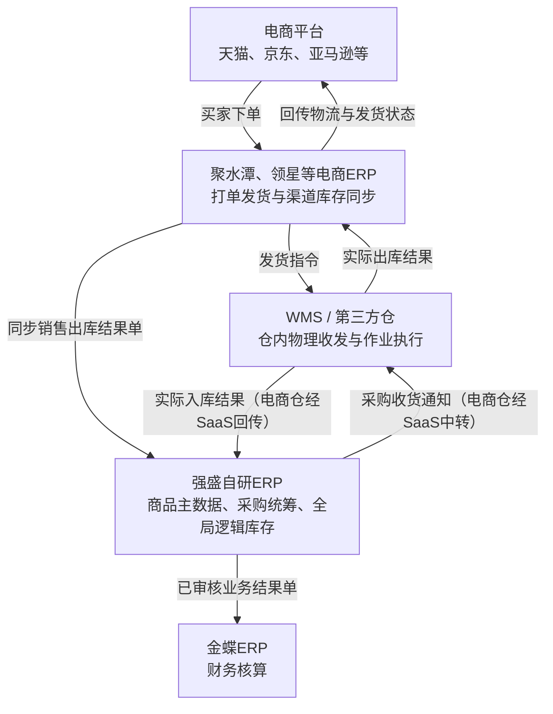
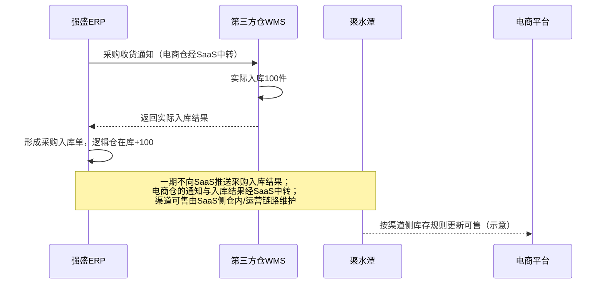
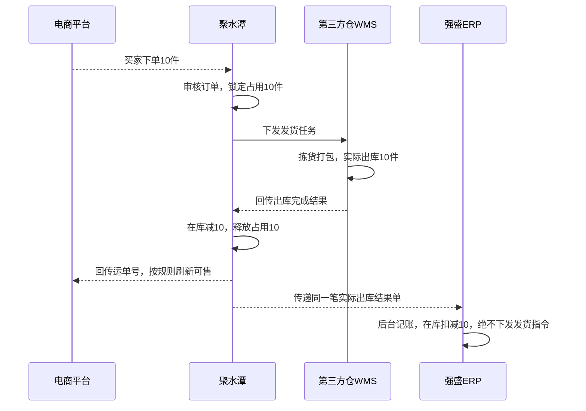
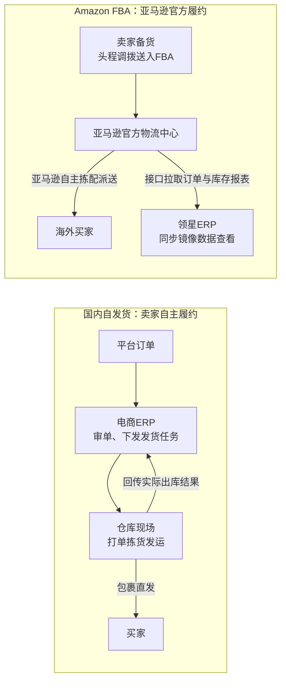

# ERP项目番外篇：拆解自研ERP与电商ERP、财务ERP的协同设计

| 项目 | 内容 |
| --- | --- |
| 面向人群 | 已完成ERP第1到7讲，理解主数据、采购、销售与库存基础，但对多系统协同仍有疑问的学员 |
| 学习时长 | 预计60到75分钟，含练习；按课堂讨论情况调整 |
| 难度等级 | ⭐⭐⭐ |
| 前置课程 | [《ERP项目第7讲：ERP的三层库存体系与库存同步方案拆解》](ERP项目第7讲-ERP的三层库存体系与库存同步方案拆解.md)，结合第1到6讲回看 |

## 1. 课程背景

在我们课程的ERP项目中，有一个很多人容易搞混、而且在实际工作里经常理不清的场景，就是我们自研的ERP跟外部那些SaaS或者第三方的ERP系统，到底是怎么串联起来的。

很多同学做产品设计时会发现：怎么外部的电商ERP有这批单据，我们自研的ERP里也有；而且有的系统叫这个名字，有的系统叫那个名字。那它们之间到底是什么关联？又有什么区别？

也有一些同学会觉得：市面上的商业软件都那么成熟了，聚水潭能管库存，领星能管库存，金蝶也能管进销存，强盛再自研一套ERP，这不是纯粹在重复造轮子吗？

实际上，只要你在真实的多渠道电商企业里待过，你就会明白：“多系统并存”根本不是架构失控，而是企业业务发展到一定阶段的必然结果。

因为在现实商业世界里，根本不存在一个全知全能的超级ERP。外部的电商ERP（比如聚水潭、领星）强在渠道连接与打单履约，天猫、亚马逊规则天天在变，它们适配得最快；财务ERP（比如金蝶）强在法定会计核算与凭证报表，规则极其严谨合规；但当企业盘子做大之后，面对多个电商平台、海外市场、线下批发渠道，到底谁来统筹全局商品编码？谁来统一下采购单？谁来统一分配和调度不同仓库的可用库存？这些属于企业自己的全局供应链中枢规则，外部成品软件根本承载不了，这就是自研后台ERP必须站出来的真正原因。

所以今天这节番外课，我们不讲孤立的功能开发，而是把这几套系统的协同关系，链路拆解清楚。

第一，理清定位边界：搞清楚聚水潭、领星、金蝶和强盛自研ERP各自的核心职责，为什么它们谁也替代不了谁；

第二，分清执行角色：一笔业务从采购入库一直到终端销售，到底由谁发起指令、由谁去物理执行、又由谁在后台接收结果记账；

第三，跑通数据闭环：几套系统各自管着一套库存，怎样通过接口顺畅联动，做到既能实时同步可售，又绝不产生重复发货、重复记账和超卖。

## 2. 学习目标

- 能解释为什么自研ERP与外部ERP并存，说清企业业务分工与自研外购的取舍逻辑
- 能判断跨系统同名单据是否重复，分清一次现场实物执行与多套系统账面记录的区别
- 能说明采购入库怎样影响店铺前台可售，理顺实际入库、业务库存与平台可售之间的流转关系
- 能区分库存余额同步与业务结果单传递，指出两类模式的数据时点、防重设计与常见翻车场景
- 能推演电商订单占用与实际出库的全流程时差，掌握可用库存计算与结果归集时点，避免二次扣减与重复发货
- 能识别不能直接套用常规主线的特殊业务形态，讲透FBA履约差异与共享库存超卖的诱因及对策
- 能解释自研ERP与金蝶的业财联动机制，明确七类结果单交接边界、数据口径以及失败更正策略

**本讲交付物**：系统分工与结果流转表 + 库存变化推演表 + 业财交接判断表

## 3. 课程内容

### 3.1 为什么要自研ERP，又为什么保留外部ERP

#### 时代背景与系统演进：强盛不是一上来就自研的

大家千万不要以为一家公司做大了，脑子一热就要把所有系统推倒重来。强盛在早期的阶段3，完全依赖市面上成熟的第三方系统：金蝶作为后台财务和库存的底座，店小秘做跨境，旺店通接国内电商，业务一样跑得好好的。

演进到阶段4的时候，强盛确实决定要开始自研后台ERP了，但在这个阶段，公司依然购买了领星ERP和聚水潭ERP。很多同学的第一反应是：既然都开始自研了，为什么不一步到位，把领星和聚水潭也替换掉？

要理解这个决策，我们得先看清楚，领星和聚水潭在强盛日常业务里到底在干什么。它们的核心价值主要集中在两件事上：

第一件，是全渠道的订单履约。
领星负责跨境电商平台，比如亚马逊FBA、eBay、沃尔玛、Shopee、Lazada；聚水潭负责国内电商平台，比如天猫、京东、淘宝、拼多多。这些电商ERP最核心的本领，就是帮企业解决平台对接的问题：从各个电商平台上把买家订单实时抓取下来，在系统里审单、打单、通知仓库发货，然后再把物流单号回传给平台。这是它们最擅长、也最繁琐的核心业务链路。

第二件，是批量刊登与商品上架。
强盛做多渠道经营，手里有几十个平台和店铺。一款充电器的标题、描述、价格、主图，不可能由运营人员登录一个个平台后台手动上传。在跨境业务里，通过ERP工具批量上传叫作“刊登”；在国内平台通常叫作“商品上架”。

#### 从商品上架到库存反推：数据到底从哪里来

当商品成功上架之后，所有运营和系统马上就会面临一个最关键的问题：这个商品到底能卖多少件？我们能销售多少数量？

因为消费者在电商平台下单时，平台必须展示实时的库存状态，一旦缺货超卖就会面临处罚。所以，这个时候我们又要把库存数据同步到各个电商平台里面去。这也是为什么成熟的电商ERP，都会有一个非常核心、完善的功能模块，专门做“库存同步”。

那我们顺着这个逻辑继续往下想：库存同步的前提，是系统里必须先有库存数据，它才能结合各个店铺的计算公式，把数量同步给平台。

那电商ERP里的这笔库存数据，到底是从哪里来的？

一般来说，电商ERP内部都自带仓库与库存模块，它最基础的底层逻辑，就是按“仓库+SKU”来管理和计算库存的。

大家学过进销存都知道，库存不可能凭空修改，必须由具体的业务单据驱动流水：通过采购入库增加库存流水，通过销售出库扣减库存流水。

那么，领星和聚水潭账上的库存，到底通过什么途径增加？
通常有两种业务路径：
一种，是直接在电商ERP里向供应商下采购单，供应商送货到仓库，仓库收货后直接在电商ERP里加库存。
另一种，也是强盛在阶段4选择的路径：由强盛自研ERP统筹采购。我们直接在自研ERP上对接供应商、统一下单，并向第三方仓下发收货通知。

这时候关键问题就来了：第三方仓实际验收入库之后，增加的库存是记录在强盛自研ERP里的。此时电商ERP账面上依然是0。

我们怎样把自研ERP的这笔入库数据同步给聚水潭或领星？在系统设计上，通常有两种经典做法：

第一种做法，是直接推库存余额更新。自研ERP入库后有了最新在库数据，直接把最新的“仓库+SKU”库存数量推给聚水潭或领星，用自研的数据去动态覆盖对方，让电商ERP知道最新的存量是多少。
第二种做法，是推入库结果单。自研ERP入库完成后，把入库事实封装成一张入库结果单推送过去，让聚水潭或领星在自己系统里做一次“虚拟入库”，同样把账面库存加上去。

只要电商ERP通过某种方式拿到了这笔库存，整条业务大链条就彻底跑通闭环了：
聚水潭有了库存，就能根据各店铺规则算出可售数量，同步给电商平台；平台有了库存，商品上了架，消费者就能正常下单；买家下单后，订单被拉取到聚水潭，由聚水潭锁定库存、打单发货；发货完成后，聚水潭扣减自己系统的库存，并把出库结果单回传给强盛自研ERP；强盛自研ERP收到结果单后，再同步扣减自己的后台库存。

这样一进一出，自研ERP管中枢采购，电商ERP管前端履约，两套系统的数据就形成了完整的进销存闭环，这就是主流的多系统协同玩法。

#### 为什么多系统协同不以自研为前提

顺着这个推导，大家就能看明白系统之间的分工了：

| 系统 | 在这条业务链里主要负责什么 |
| --- | --- |
| 强盛自研ERP | 维护内部业务主数据，统筹采购业务与逻辑仓库存，归集外部实际履约结果 |
| 聚水潭、领星等电商ERP | 承接各自适用的渠道订单，负责刊登上架、打单发货与渠道库存同步 |
| WMS或第三方仓作业系统 | 组织收货、上架、拣货、出库等仓内物理动作，记录实际作业结果 |
| 金蝶ERP | 在本项目中承担财务核算；详细联动见§3.6 |

这里要顺便说明三个前提：
第一，强盛科技的B2B大客户批发业务通常在线下直签或自研ERP内流转，在自研ERP内部即可完成闭环，不涉及外部电商平台对接。因此本讲重点聚焦多系统协同最复杂、最典型的B2C电商业务场景。
第二，仓库是否自营，跟WMS系统是否自研是两码事。第三方仓既可能直连自研ERP，也可能像强盛东莞菜鸟仓那样经由聚水潭中转通信（部分仓WMS仅开放经SaaS对接）。今天为了把业务流向彻底讲透，我们在教学图中把第三方仓WMS单独抽成独立节点，核心是看清现场物理作业与电商系统记账各自的真实职责。
第三，**Shopify独立站是例外**：已付款订单由强盛自研ERP拉取、人工选仓选物流并审核后直推仓库履约，与聚水潭/领星主控的国内、跨境平台ToC不同。三条销售路径怎么分叉，见课程项目文档[《销售与履约业务设计》](../../03-业务分析和设计/02-销售与履约业务设计.md)§4.1总览图；下文§3.4末再作对照。

我们以典型的B2C电商业务为例，各系统的角色和主要流向如下。看图时只要盯住三个角色：业务发起方、实物执行方、结果接收方：

> **与强盛科技一期项目范围对齐**（详见[《3.强盛ERP的定义和上下游链路》](../../01-全局背景信息/3.强盛ERP的定义和上下游链路.md)§三、§四）：采购入库在自研ERP形成结果单并增加**全局逻辑仓**库存；向财务ERP推送已审核结果单。一期**不向**聚水潭、领星推送采购入库等库存事件，也**不做**全量库存双向同步。聚水潭/领星侧如何形成可售库存，可能依赖仓内作业与SaaS自身链路；自研ERP与它们的集成重点是**销售/退货实际结果归集**、执行指令与商品SKU分发。§3.3会区分「行业常见完整闭环」与「强盛一期边界」。课程项目二版迭代（2026-10-14）进一步明确：聚水潭与领星按两套独立接口与映射设计，不共用一套「电商ERP」抽象配置；销售侧以国内电商订单、跨境电商订单承接原订单与各次实际结果（不再使用「外部原始订单」对象）；FBA消费者段不进入归集、不驱动强盛逻辑仓。二版范围与任务见[《ERP项目第二版迭代·核心需求与改动任务》](../../04-产品设计方案/20261014-ERP项目第二版迭代/00-二版核心需求与改动任务.md)。

说到底，企业核心是要有一套能支撑业务跑顺的方案，买成熟软件、二次开发还是自研，都只是工具手段。

如果成熟软件已经能满足关键规则，系统打通成本也可控，完全没有必要为了追求自研而自研。强盛在课程中选择自研后台主链，是为了带大家亲手搭一次中枢底座，把底层逻辑吃透。换一家企业，承担后台主链的哪怕是一套外购ERP，今天讲的这套协同与闭环逻辑，依然完全适用。

### 3.2 同名单据与多套库存：怎样判断单据有没有做重

顺着刚才聊到的采购链路，很多刚做集成设计的同学，一看到各个系统里都冒出“通知单”或“入库单”，就容易怀疑单据是不是做重了、库存会不会重复计算。

一笔采购业务跨了强盛自研ERP、第三方仓WMS、聚水潭或领星三套系统。其实只要把各系统各自持有的单据和职责摊开，整条脉络就会非常清晰：

#### 各系统的单据分工与流转

1. 强盛自研ERP（采购中枢）：
   * 采购订单：商务与交易依据，明确向哪个供应商买、买什么规格、买多少件以及结算价格。此时货物还在供应商处，不影响实物库存。
   * 采购收货通知单：下发给仓储的作业指令，通知指定仓库准备接货，明确预计到货时间与预计接货数量。它只负责派发任务，同样不增减库存。
   * 采购入库单：收到仓库回传的实际收货结果后生成的业务结果单，确认实物入库事实，据此正式增加自研ERP的账面库存。

2. 第三方仓WMS（实物作业系统）：
   * 到货通知单（ASN单）：WMS接收自研ERP的收货通知后生成对应的入库指令（行业常称为ASN单，即预到货通知）。仓库现场以此作为排班、月台预约、点数质检与库位上架的作业执行依据。
   * 入库作业单（或实收记录）：仓库工人把实物上架完成后，WMS生成的物理收货确认单据。它记录了实收数量、良品残品情况与批次信息，并将该实际结果回传给强盛自研ERP。

3. 聚水潭或领星等电商ERP（渠道履约系统）：
   * 采购入库单（渠道侧虚拟入库，**行业常见做法**）：在仓库由自研ERP直连驱动的场景里，电商ERP通常不必再建采购订单、也不必再向仓库下发收货指令；不少企业会把自研ERP审核后的采购入库结果推给电商ERP，在渠道侧做**纯数据记账**以增加可售依据。**强盛科技一期不把这条推送纳入范围**（见§3.3）。反过来，若仓库本身经聚水潭、领星衔接（电商仓），通知与入库结果由SaaS中转、渠道下推其对接仓，这时渠道侧出现的是执行映射单据，不是这里的渠道虚拟入库，也不会让仓库多收一次货；两种情形要分开判断，避免与自研ERP通知单上的「虚拟入库」混为一谈。

#### 三套系统的单据对照与职责矩阵

把三套系统放在同一张表里对照，单据边界一目了然：

| 系统 | 持有的核心单据 | 单据性质 | 解决的核心问题 | 会不会驱动现场物理动作 |
| --- | --- | --- | --- | --- |
| 强盛自研ERP | 采购订单 | 商业契约 | 向谁买、买多少、什么结算条款 | 否 |
| 强盛自研ERP | 采购收货通知单 | 作业指令 | 命令哪个仓库准备接货验收 | 否（仅下发任务） |
| 第三方仓WMS | 到货通知单（ASN单） | 作业指令 | 仓库现场以此排月台、验货上架 | 是（驱动现场实物搬动作业） |
| 第三方仓WMS | 入库作业单 / 实收记录 | 作业结果 | 确认实物到库、上架数量与批次 | 否（作业已完成） |
| 强盛自研ERP | 采购入库单 | 业务结果 | 确认进货事实，增加后台全局账面库存 | 否（作业已完成） |
| 电商ERP（聚水潭/领星）| 采购入库单（渠道虚拟入库） | 业务结果（行业常见） | 接收自研ERP推送的入库结果时，增加渠道账面以供售卖；强盛一期不建此推送 | 否（纯数据记账，绝不指挥仓库） |

#### 判断单据是否做重的两条标准

以后大家在设计多系统协同方案时，判断单据有没有重复，千万不要只看系统界面的名字是不是都叫“入库单”，只需在心里核对两条标准：

第一，这张单据是作业指令，还是业务结果？作业指令负责派活，业务结果负责记账。
第二，它会不会再次驱动物理动作、会不会重复累加实物？仓库现场实际只卸了一次车，WMS、自研ERP和电商ERP是在各自系统的账本里，分别记录这同一次物理事实。电商ERP里的采购入库单只是为了拿到可售数据，绝不能再反向指挥仓库再去收一次货。

把指令与结果切开，把物理作业与多账本记账分清，跨系统的单据设计就不会跑偏。

### 3.3 采购入库如何变成店铺前台可售

#### 物理入库到渠道可售的数据断点

搞清楚单据性质后，我们沿着这100件充电器继续往下走。

假设我们在天猫店上架了这款充电器，标题、图片、详情页和定价都做好了。现在的问题是：天猫店铺的前台到底能卖多少件？

在强盛的方案里，是由聚水潭根据自己账上的可用库存，结合店铺设定的分配规则，算出可售数量并同步给天猫平台的。

我们先固定一下这组推演条件，防止把不同业务搅在一起：
* 商品：同一款充电器，SKU为DEMO-01；
* 仓库：合作的第三方仓，由该仓自带的WMS负责物理收发；
* 采购管控：由强盛自研ERP统一下单管理；
* 电商履约：由聚水潭对接国内天猫店铺；
* 数量设定：期初库存为0，本次采购实际入库100件，这批货全部专供电商，不考虑安全库存和预售。

按照前面的推导，强盛下了采购单并通知仓库，供应商送货，仓库现场入库100件。WMS把入库结果回传给强盛自研ERP，强盛生成采购入库单，后台在库库存变成了100件。

货已经在仓库的架子上放着了，强盛自研ERP在对应**逻辑仓**里也记上了100件。聚水潭若要支撑天猫可售，还需要在渠道侧有自己的库存依据——这在很多企业里靠「自研ERP把入库结果推给电商ERP」补齐；**强盛一期不做这一步**，采购链在自研ERP入账并推财务后即告一段落，与[《3.强盛ERP的定义和上下游链路》](../../01-全局背景信息/3.强盛ERP的定义和上下游链路.md)§3.1一致。

下面时序图按**强盛一期已确认链路**绘制（电商仓的通知与入库结果经聚水潭、领星中转，但不表示多执行一次收货）：

真正动用人工和叉车搬货的，只有仓库现场那一次。自研ERP记的是全局逻辑仓事实；聚水潭与平台可售的衔接，在行业里常另做数据同步，但**不能把它当成强盛一期的必做集成**。

#### 余额覆盖与结果单传递：行业常见做法（完整闭环时）

若企业选择「自研ERP统筹采购、电商ERP统筹ToC」，往往还要回答：入库结果怎样进聚水潭/领星？
在系统设计里，通常有两种思路：

第一种思路，是推库存余额。
也就是强盛直接告诉聚水潭：“截至当前时点，某仓库的DEMO-01实物在库就是100件。”聚水潭收到后，用这个100直接覆盖自己的在库账面。

第二种思路，是推业务结果单（或者叫库存事件）。
强盛把具体的入库事实包成一张单据推过去：“采购入库单IN-001，DEMO-01实际入库100件。”聚水潭拿到这张单据后，在自己系统里做一次虚拟入库，账面加100件。

| 同步模式 | 核心传达的信息 | 接收方重点防范的漏洞 | 典型的翻车场景 |
| --- | --- | --- | --- |
| 库存余额同步 | 告诉你现在总共有多少 | 时效性、时点先后与版本覆盖 | 网络延迟导致旧的较小余额覆盖了最新的较大余额 |
| 结果单传递 | 告诉你这次发生了什么变化 | 唯一来源标识与接口幂等防重 | 网络重试导致同一张入库结果单被执行了两次，虚增库存 |

很多初学者容易以为余额覆盖更省事，其实在分布式系统里，余额同步对时间戳和顺序的要求极其苛刻。一旦网络稍有延迟，乱序的旧数据直接把新数据盖掉，前台库存立马算错。

行业实践里更稳妥的往往是**结果单传递**（相对余额覆盖）。接收方在渠道侧做的「虚拟入库」，含义是：**纯数据记账，不再指挥仓库收货**，绝不是无中生有加库存。

这与强盛自研ERP里采购收货通知单的**「虚拟入库」**不是同一个按钮：后者指**不推仓库、在ERP内按通知量直接生成采购入库单**，与聚水潭是否记账无关。术语对照见项目[《集成协作与人工补充》](../../03-业务分析和设计/07-集成协作与人工补充.md)§4.2.1。

### 3.4 电商出库如何回传自研ERP

#### 订单占用与实扣出库的时差推演

现在我们回到教学场景：这100件充电器全部供天猫店使用。以下数量推演按**渠道侧已完成可售同步**的完整闭环讲解（聚水潭账面与强盛逻辑仓均为100件）；若只按强盛一期范围，强盛侧在采购入库后即为100件，聚水潭可售是否一致取决于渠道侧链路，不以自研ERP推送入库结果为前提。

这时候，天猫前台来了一位消费者，下单买了10件充电器。

聚水潭通过接口把这笔订单抓取下来，在系统里审单。在这个瞬间，很多新手产品经理最容易犯迷糊：仓库里的货少了吗？

实物一件都没少。此时仓库现场连打单都还没打呢，货架上的实物在库依然是实打实的100件。但聚水潭这边不能再当做没发生，它必须立刻做一件事：把这10件库存锁定起来，加上订单占用。此时在库依然是100，占用是10，对外可供其他订单购买的可用数量就变成了90。

那账面的实物在库到底什么时候扣？
等聚水潭把发货任务推给仓库，仓库现场拣货、打包、贴快递单，快递员扫码装车出库之后，WMS把实际出库结果回传给聚水潭。聚水潭拿到这个出库凭证，在库数量才正式从100扣减为90；同时，因为实物已经发运出库、履约已经完成，原来占用的那10件顺理成章释放归零。

大家以后在自己设计库存扣减逻辑时一定要格外当心，牢记核心计算公式：可用库存 = 在库库存 - 订单占用。在强盛自研ERP后台，这两个概念对应的是即时库存与预占库存；底层公式里通常还包含盘点或质检用的冻结库存，我们这个场景专供电商，暂不考虑冻结。
出库发生时，是在库减10（100变为90），同时占用释放10（10变为0）。两者抵扣后，前台可用库存依然稳稳保持在90件不变。
千万不能把实际出库当成是对可用库存的二次扣减（误把90再减10算成80），更不能在扣减了在库后遗忘释放占用。

我们对照下面这张时序明细表，把各系统的数字变化仔细看一遍：

| 业务节点与时点 | WMS现场在库 | 聚水潭在库 | 聚水潭占用 | 聚水潭可用 | 强盛后台在库 |
| --- | ---: | ---: | ---: | ---: | ---: |
| 初始状态：入库处理完毕 | 100 | 100 | 0 | 100 | 100 |
| 买家下单：聚水潭占用10件，尚未出库 | 100 | 100 | 10 | 90 | 100 |
| 现场作业：WMS已实际出库，出库结果在途（聚水潭尚未接收） | 90 | 100 | 10 | 90 | 100 |
| 渠道记账：聚水潭处理出库结果 | 90 | 90 | 0 | 90 | 100 |
| 后台归集：强盛接收同一笔出库结果 | 90 | 90 | 0 | 90 | 90 |

大家可以看到，因为系统间网络交互存在时间差，在中间状态下，几套系统的数字会短暂不一致。这完全属于正常的异步处理，只要确保最终每一笔结果都能送达并入账即可。

#### 履约主控与结果归集：谨防二次发货风险

这里有个非常关键的系统职责问题：聚水潭把订单处理完、发货完成之后，会把结果推给强盛自研ERP，那强盛收到之后，要不要再通知仓库发一次货？

绝对不能。

在强盛这套体系里，国内电商的履约主控方是聚水潭。订单是由聚水潭抓取的，仓库的发货任务也是由聚水潭下发的。强盛自研ERP哪怕接收了国内/跨境电商订单信息，也仅仅是用于后台查询、数据分析或客户关联。

如果强盛一看到外部订单，也自作主张给仓库下发一次发货指令，那仓库就会收到两份拣货单，同一笔买家订单就会被仓库打包发货两次，造成严重的资损。

这就印证了我们在第5讲提到的原则：强盛自研ERP做B2B销售时是全过程主控，负责指挥履约；而面对**聚水潭、领星承接的**渠道B2C时，它是结果归集者，核心职责是把已经发生的履约事实记清楚，绝不横插一脚去重复指挥。

**独立站（Shopify）例外**：同一项目里，独立站属于ERP主控履约——拉取已付款订单、审核占库、自动推仓、回写发货结果，与上文聚水潭主控模型相反。三条路径只在「实际出库记入逻辑仓并交财务」处汇合，见[《销售与履约业务设计》](../../03-业务分析和设计/02-销售与履约业务设计.md)§4.1。

### 3.5 FBA与共享库存：不可生搬硬套的特殊业务形态

#### Amazon FBA链路与国内自发货的本质区别

刚才推演的整套闭环，是基于国内电商自发货（卖家通过渠道ERP组织第三方仓发货）的经典模式。但在跨境电商业务中，Amazon FBA是完全不同的另一套玩法。

很多同学在领星ERP里看到了FBA订单和FBA库存，就想当然地以为：领星拉取了亚马逊订单，然后领星打单通知国内仓库发给海外买家。这是对FBA业务的极大误解。

FBA的本质，是卖家先把整批货物提前海运或空运送到亚马逊的官方运营中心。当海外消费者下单后，是由亚马逊自己的仓储网络负责拣货、打包和配送。领星里的FBA库存数据，只是通过接口定时拉取亚马逊官方的报表镜像而已。

这里必须严格区分两个截然不同的业务动作：
第一个动作：把充电器从国内仓运往亚马逊FBA仓。这在业务性质上属于跨仓备货调拨，货物所有权依然在强盛手里，绝不能在这个阶段就确认为对消费者的销售出库。
第二个动作：海外买家在亚马逊下单，亚马逊FBA完成配送。这才是真正的终端销售履约。

如果大家在系统设计时，把第一步调拨当成销售扣了账，等第二步亚马逊真正卖出时又扣一次，库存和财务成本就会连续翻车。

**与课程项目二版口径对齐**：跨境电商订单只承接自发货，FBA消费者段不进入强盛销售结果归集，也不驱动强盛逻辑仓库存；领星里的FBA订单与库存仅作镜像查看（数据保留在领星侧，强盛本期不设只读入口），从国内仓送入FBA仍按库存转移处理。

#### 共享库存的协同陷阱：多系统协同下的超卖诱因与务实对策

现在我们把最初的设定拿掉，看一个在多系统对接时极其普遍但也极容易踩坑的业务场景。

如果我们没有把库存按业务划分成专属的逻辑仓，而是让天猫店铺和线下业务共享同一个逻辑仓库存，系统协同就会立刻面临时间差带来的超卖风险。

典型的冲突过程通常是这样发生的：
仓库里实际存放了100件充电器。天猫店铺销售火爆，聚水潭ERP已经完成了80件的打单、拣货并实际发货出库。但由于网络延迟、系统批量同步机制或者接口轮询周期，这笔出库结果还没有及时回传给强盛自研ERP。

此时强盛自研ERP由于存在数据感知盲区，后台账面依然认为这100件库存完好在库且全部可用。
恰在此时，线下B2B销售经理接到了客户订单，打开强盛自研ERP看到后台赫然显示有100件在库，便放心地在系统内确认了50件的线下销售单，向客户承诺了交期。

| 业务环节与系统 | 系统账面记录 | 物理现场实际状态 | 业务隐患与冲突 |
| --- | --- | --- | --- |
| 聚水潭ERP（电商） | 已经完成80件出库扣减 | 实物已打包出库发走80件 | 尚未将出库事实回传自研ERP |
| 强盛自研ERP（自研） | 账面仍显示在库100件 | 盲区期内误判库存充足 | 依据滞后数据确认了50件线下单 |
| 最终业务结果 | 两边系统合计承诺130件 | 仓库架子上实际只剩20件 | 严重超卖，线下订单面临违约 |

两个系统在各自内部运行都完全正确，没有虚增数据，但由于外部系统与自研系统之间存在回传时差，直接导致了超额承诺与库存不准。

这是我们在与外部独立ERP协同过程中最棘手的一类难题。面对这种跨系统同步难题，我们要建立一个极其重要的工程与业务认知：多系统协同有解决思路，但没有绝对完美的万能解法。

因为聚水潭是第三方独立封闭系统，自身拥有一套完整闭环的库存与单据逻辑，强盛自研ERP无法直接把控其底层的事务锁。如果我们非要追求在两个完全独立的系统之间实现毫秒级绝对强一致，试图把每一笔库存锁得严丝合缝，不仅要投入巨大的研发精力和服务器成本，还会受制于外部接口限流、网络抖动等不可控因素，实际落地效果往往很不理想。

因此，处理这类问题必须回归业务本源：结合实际业务量规模，评估线上与线下同时抢库存的频次多还是少。不要陷入技术完美主义，而是应当采取务实有效的组合策略：

| 应对措施 | 核心实施方案 | 业务效果与适用场景 |
| --- | --- | --- |
| 1. 划分独立逻辑仓 | 将线上电商与线下业务的库存彻底隔开，线上划归电商逻辑仓，线下划归线下逻辑仓，禁止共用同一个逻辑仓。 | 最彻底也最稳妥的做法。从源头上隔离，杜绝跨渠道争抢，适合库存分配相对固定的业务。 |
| 2. 提高回传时效 | 要求并推动聚水潭在完成出库后，通过Webhook实时推送或高频接口同步，尽可能加快回传时效。 | 大幅压缩自研ERP的数据盲区窗口期，让账面数据尽可能贴近真实物理进度，降低撞单概率。 |
| 3. 建立定期巡检核查 | 自研ERP建立定时巡检机制，主动定期调用聚水潭接口查询其可用库存与在途占用，校验水位偏差。 | 及时监控外部系统的实际消耗进度，提前发现潜在缺货风险，为线下销售承诺提供兜底参考依据。 |

> **强盛科技一期边界**（当本讲当作项目说明书阅读时必看）：一期**不做**跨系统事前锁库，也**不建设**对聚水潭/领星的库存水位巡检接口；共享同一逻辑仓时的撞单风险，主要靠**组织上划分电商专供与线下逻辑仓**降低概率，靠**销售结果回传后的库存校验与异常阻断**（例如来源已出库但ERP账面不足时不记账）兜底，而不是靠毫秒级双系统强一致。ERP与仓库之间另有按日的库存比对（汇总逻辑仓与仓库快照），不自动改账，也不等同于拉取渠道ERP占用。阶段4重点仍是单据与结果归集；统一库存中心属后续演进方向。

这就再次说明了一个核心原则：事后回传出库结果，解决的仅仅是履约完成后的记账闭环；而发货前的多渠道库存控制，必须依靠合理的库存切分与协同机制（一期以划分逻辑仓为主，巡检与统一调度列为行业进阶手段）。

这也是为什么在阶段4我们重点做好单据与结果归集，而到了阶段5才演进出统一库存中心。在当前阶段，不要试图用过于复杂的接口去强行消灭所有延迟，而是要用清晰的逻辑仓划分与务实的对齐机制，保障业务平稳运行。

#### 全生命周期覆盖：退货、调拨与异常流水

为了把主干链路讲透，我们刚才重点走了采购入库和销售出库这两条主线。但在实际业务中，库存流水远不止这两种。我们在设计多系统协同方案时，必须把所有异常分支的来源和去向逐一理顺：

| 业务异动场景 | 系统协同的核心设计规则 |
| --- | --- |
| 买家退货实际入库 | 必须严格依据仓库质检后的实际收货结果与良品/不良品状态分别记账，待检品绝不能直接加为前台可售。 |
| 仅退款、不退货 | 仅仅是资金原路退回，实物并未回仓，绝不能触发库存增加指令。 |
| 发货拦截与退单追回 | 现场拦截或快递退回必须形成闭环，已出库的走冲正或逆向入库，不能单方面作废订单导致账实脱节。 |
| 售后补发与样品领用 | 补发或寄样没有平台订单流水，必须走专门的补发单或其他出库单回传，杜绝实物无账消耗的黑洞。 |
| 套包拆装与组合销售 | 前端组合套包与后端散件扣减必须统一定义，明确由哪一端解包，避免子件库存呆滞虚高。 |
| 采购退货出库 | 退还供应商时必须先锁定待退批次，并同步扣减电商可用水位，防止瑕疵待退品被前台再次超卖。 |
| B2B出库与仓间调拨 | 调拨或大客户出库若影响了电商共用的物理仓，必须同步刷新渠道侧的可用库存依据。 |
| 盘盈盘亏与状态调整 | 查明现场物理盘点的差异原因，明确以哪方数据为准，不能脱离业务单据直接在前端手动改数。 |

做系统方案设计时，把这些边界条件考虑周全，才不会出现“正向销售顺顺当当，但几个月后账面库存和实物越差越多”的顽疾。

### 3.6 自研ERP与金蝶怎样联动

#### 从实物数量到存货价值：财务到底在算什么账

前面这100件充电器，入库了100件，又顺利发走了10件。强盛自研ERP里现在记录在库90件，外部电商的履约结果也顺利接了回来。

站在业务和仓储的角度，大家觉得大功告成了：货收了、单发了、账面剩90件，数量完全对得上。

但如果你拿着这套数据去跟公司财务交接，财务会提出一连串业务人员平时根本不考虑的问题：
这批充电器当初到底花了多少钱买的？单位采购成本是多少？供应商的发票开过来了没有？如果货到了发票还没到，要不要做暂估入账？发走的那10件充电器，对应的销售成本是多少？什么时候确认收入？增值税税额怎么算？

你看，库存数量算准了，财务核算才刚刚拉开序幕。

这就是“业务型系统”和“财务型系统”的本质分工：
强盛自研ERP是业务中枢，它关心的是物理事实：哪个供应商、什么规格、实物进了哪个仓、给哪个买家发了货，目的是支撑供应链业务的高效运转。
而金蝶在强盛体系里承担的是核算中枢：它需要接收真实可靠的业务事实凭证，套用严格的会计准则，把“数量”折算成“资产价值与资金流水”，最终出具资产负债表和利润表。

| 观察维度 | 强盛自研ERP核心关注点 | 金蝶ERP在本项目中核心关注点 |
| --- | --- | --- |
| 关注焦点 | 业务事实：供应商、SKU、实收数量、进入哪间逻辑仓 | 财务资产：采购成本单价、存货资产原值、应付账款与发票对应 |
| 处理动作 | 变更实物与逻辑在库、记录业务履约流水 | 计提暂估、核销应收应付、结转销售成本、生成会计凭证 |
| 终极目标 | 指挥现场作业、防超卖、保障交付履约 | 账实相符、成本合规、出具法定财务报表与经营分析 |

搞清这个区别，大家就不会误以为金蝶只是个记账软件，也不会产生“业务系统既然记了出入库，为什么金蝶还要再算一遍”的困惑了。

#### 业财分工模式：自研业务搭配外购专业财务

很多同学在公司做信息化规划时，常会纠结一个问题：公司到底该不该同时维护两套ERP？

在业界，处理业务运转与财务核算通常有三种典型的架构形态：

| 架构形态 | 核心运作方式 | 优势与局限 | 典型适用场景 |
| --- | --- | --- | --- |
| 1. 自研业务ERP搭配外购财务系统（强盛模式） | 自研系统掌控全渠道订单调度、逻辑库存与履约主链；财务核算直接外购金蝶、用友等成熟软件，由业务端单向推送结果单。 | 业务端变化极快且定制灵活，研发成本可控；财务合规省心。局限是需要自建产品研发团队。 | 商业模式多变、渠道复杂且有自研能力的品牌商或电商企业。 |
| 2. 一体化综合型ERP单系统闭环（大一统模式） | 全面采购SAP、Oracle或金蝶云星空全功能模块，进销存、仓储、生产到财务总账全在同一套系统内完成。 | 天然业财一体，流程高度规范，无系统间同步时差。局限是系统笨重，面对电商多变玩法二次开发成本极高。 | 传统大型制造企业、流程高度标准化且对外渠道稳定的企业。 |
| 3. 综合型ERP为底座加二次开发外挂专业系统（核心加外挂模式） | 以SAP或大型成熟ERP为企业中枢，掌控总账、主数据与核心购销合同；通过二次开发与接口集成，外挂对接聚水潭等电商ERP、专业WMS或TMS。 | 既保留了核心ERP的财务严谨性与审计合规性，又兼顾了前台作业的专业度与灵活性。局限是接口繁多，实施与二开成本极为昂贵。 | 业务规模大、预算充裕，需要专业系统支撑复杂现场作业的大型集团。 |

强盛选择自研业务主链加金蝶财务，而不是采购全套SAP做二次开发外挂，核心在于投入产出比与迭代效率：一套大型综合ERP加上各系统的定制二开集成，实施周期往往以年为单位，动辄数百万元；而通过轻量级自研主控业务调度，只把结果单异步推给金蝶，既能敏捷响应业务创新，又能以极低的成本满足财务审计要求。

#### 业财交接边界：强盛一期到底把什么推给金蝶

那么，这100件充电器采购入库、又卖出10件之后，强盛自研ERP到底要把什么交接给金蝶？

很多初学者容易想当然：我们平时总说采购要“三单匹配”，那金蝶里面是不是必须也有一张采购订单？是不是要把采购订单、收货通知、发票、出入库单一股脑全推过去？

在强盛一期的架构里，金蝶里面其实完全不需要采购订单。交接边界切得很干净：只交接已生效的业务事实结果单，绝对不传过程性单据。

为什么三单匹配成立，金蝶里却不需要采购订单？
因为在系统分工上，采购订单是商务计划与采购意向，它表达的是“打算买什么”，实物并未产生，债务也未成立；更重要的是，商务谈判、交期跟进、退货与采购对账全部在自研ERP业务端完成。当仓库实际收货生成采购入库单时，该入库单已经完整继承了采购订单上的约定单价、币别与结算条款。

金蝶接收到这张采购入库单后，就可以直接按“入库数量乘合同单价”进行存货资产核算与暂估入账；后续供应商发票送达时，财务在金蝶内凭发票核销该入库单即可。如果强行把采购订单推给金蝶，金蝶里就会多出一堆没有实物的意向数据，未来采购订单发生改价、删行、分批取消时，两套系统还要做极复杂的双向状态同步，得不偿失。

具体到强盛一期的正式规范，交接给金蝶的单据严格限定为以下七类结果单，过程性单据一律不推：

| 单据类别 | 纳入交接的结果单（推） | 严格排除的过程单（不推） | 核心交接规则与口径 |
| --- | --- | --- | --- |
| 采购业务 | 采购入库单、采购退货出库单 | 采购订单、收货通知单、退货申请单 | 推送实收或实退数量、仓库与业务日期，携带来源采购订单的单价与交易金额，用于金蝶存货暂估与核销。 |
| 销售业务 | 销售出库单、销售退货入库单 | 销售订单、发货通知单、退货申请单 | 推送实际出库或退货入库数量；外部电商直接沿用平台结算回传的优惠后成交金额，不按ERP价目表重算。 |
| 仓储调整 | 其他入库单、其他出库单、直接调拨单 | 调拨申请单、盘点单、报损申请单 | 只传递实际变动数量与物理仓库，不传成本单价与成本金额，由金蝶在月末按自身的存货计价规则核算成本。对于有在途周转的分步式调拨，调拨主单同样不推，而是由调出端与调入端各自生成的直接调拨单分别推送。 |

除单据范围外，整套业财交接还必须坚守三条核心运行底线：
第一，逐单交接，绝不汇总。一单对应一单推送，分批入库生成几张入库单就推送几张，绝不在接口层按月或按供应商合并总数，确保金蝶账面每一笔凭证都能精准追溯到业务现场的原始单据。
第二，金蝶收到入库单不等于付款，收到出库单不等于收钱。入库只是形成暂估应付，后续还要经历开票、对账与资金支付；销售出库只是结转成本，电商平台回款还涉及平台账期、佣金扣点与售后抵扣。
第三，平台账单结算完全留在财务。电商平台的月度结算对账单、平台佣金、物流履约费、仅退款等资金往来，由财务在线下或金蝶系统内集中处理记账，本期不进入自研ERP进行归集。自研ERP专注于把供应链实物发生的实际结果准确交出，两端职责清晰、边界分明。

#### 异常处理：推送失败了要不要回滚库存

在系统实际运行中，经常会遇到各种异常：金蝶服务器临时维护、网络超时，或者金蝶端基础资料缺少映射导致入库单推送失败。

这时候，强盛自研ERP要不要把已经增加的100件库存减回去？

绝对不行。

大家要记住：货已经在货架上整整齐齐码着了，实物事实不容篡改。失败的只是跨系统的数据交接管道，而不是物理业务本身。

| 异常情况 | 正确的业务理解与系统处理策略 |
| --- | --- |
| 单据推送失败 | 强盛后台保留已生效的库存与单据，在推送日志中记录失败原因，运维修复后针对原结果单重试 |
| 同一单据重复推送 | 网络重试可能发送多次，金蝶接口必须基于业务单号做幂等拦截，绝不可重复生成多份财务单据 |
| 金蝶已成功接收 | 仅代表数据送达，财务后续是否审核凭证、是否关账，属于财务域内部流程，业务端不再重复干涉 |
| 原始业务确实录错 | 不能在推送表里强行篡改，必须回到业务系统走正规红冲、退货或冲销流程，保留完整审计底账 |

业财一体化本质不是做一套大而全的系统，而是把业务事实与财务核算的交接规则定义清楚：职责分明、单据关联、管道通畅、差异可查。

### 3.7 本讲小结：看懂多系统协同的三步法则

走完这100件充电器的全生命周期，我们把整张业务图谱完整收拢起来：

小结图省略「自研ERP→渠道入库同步」：行业常见，强盛一期不做。渠道可售与下单占用见§3.3～§3.4；独立站走ERP主控路径见§3.4。

以后大家在实际工作里，不管是面对强盛这套架构，还是接手其他企业的复杂系统，只要抓牢这三个基本盘，脉络就会非常清楚：

第一步：找准角色定位。谁是业务发起方？谁是实物执行方？谁是结果接收方？搞清楚哪套系统是指令源头，哪套系统只是在做台账同步。
第二步：理清单据性质。一张单据到底是作业指令，还是完成凭证？是要求现场去搬货，还是纯粹在系统间同步事实？
第三步：守住交接边界。库存同步防旧数据覆盖与重复扣减，共享库存控事前分配，业财联动推有效结果，失败绝不回滚物理事实。

把这三步想透，多系统之间的千头万绪自然就会变成一条清晰顺畅的业务闭环。

## 4. 实操任务 & 交付物

### 4.1 任务说明

#### 任务1：系统分工与结果流转表

沿用本讲教学方案：强盛ERP主控采购，第三方仓执行，聚水潭主控国内电商履约；采购结果由仓库回传强盛并记入逻辑仓（电商仓经SaaS中转；一期不向聚水潭推采购入库结果）；电商出库结果经聚水潭归集回强盛。

分别为采购入库和电商出库填表，并说明哪些动作只是记账，不能再通知仓库执行。

| 业务 | 谁发起 | 谁执行实物作业 | 实际结果从哪里进入强盛 | 强盛接收后做什么 |
| --- | --- | --- | --- | --- |
| 采购入库 |  |  |  |  |
| 电商出库 |  |  |  |  |

补充回答：如果后台主系统换成外购ERP，表中的哪些职责仍然需要保留？用这个问题检查自己是否把“需要这项能力”和“必须自研”混为一谈。

#### 任务2：库存变化推演表

初始条件：WMS、聚水潭和强盛均记录在库90件，聚水潭占用为0。这批货仅供该电商业务使用，没有安全库存及其他限制。消费者新下单4件，仓库随后全部发出，聚水潭处理结果后再传给强盛。

| 节点 | WMS在库 | 聚水潭在库 | 聚水潭占用 | 聚水潭可用 | 强盛在库 |
| --- | ---: | ---: | ---: | ---: | ---: |
| 初始 | 90 | 90 | 0 | 90 | 90 |
| 聚水潭已占用，仓库尚未出库 |  |  |  |  |  |
| WMS已出库，聚水潭尚未处理结果 |  |  |  |  |  |
| 聚水潭已处理，强盛尚未处理 |  |  |  |  |  |
| 强盛已处理 |  |  |  |  |  |
| 强盛再次收到同一结果 |  |  |  |  |  |

再回答：怎样识别同一笔结果？如果一张平台订单分两次出库，能不能只靠平台订单号去重？

#### 任务3：业财交接判断表

按强盛一期规则填写，不推演未经确认的会计分录。

| 情况 | 是否推送金蝶或怎样处理 | 是否改变强盛已生效库存 |
| --- | --- | --- |
| 创建采购订单100件，尚未入库 |  |  |
| 实际入库100件，采购入库单已审核 |  |  |
| 该入库单首次推送失败 |  |  |
| 修复后重推同一张入库单 |  |  |
| 金蝶已经接收，是否可以认定已经付款 |  |  |

补充说明：如果换成由财务系统承担采购匹配的方案，是否仍能坚持“所有项目都不传采购订单”？

### 4.2 产出标准

| 交付物 | 合格标准 |
| --- | --- |
| 系统分工与结果流转表 | 发起、执行和接收结果的职责清楚；没有重复通知仓库；能解释外购也可以承担后台主系统职责 |
| 库存变化推演表 | 占用不减少在库；实际出库后按结果扣减；重复结果不再次扣减；能识别分批出库与重复消息的区别 |
| 业财交接判断表 | 区分安排、实际结果、交接与核算；失败不回滚库存，重推不重复记账；不把一期范围当成通用规则 |

## 5. 自检清单

**先检查系统协同与单据判断**

- 我能说明强盛为什么自研，也能解释为什么不是所有企业都必须自研吗？
- 我能区分一个产品拥有的功能与它在企业中承担的职责吗？
- 我能解释一批货只入库一次，为什么多个系统都可以有对应记录吗？
- 我能从平台可售数量，追溯到渠道计算依据和实际入库结果吗？
- 我能区分库存余额与业务结果，说明各自容易出什么错吗？
- 我能正确推演占用、实扣和解除占用后的数量吗？
- 我能解释FBA为什么不能直接照搬国内仓发货链路吗？
- 我能用100件货被承诺130件的例子，说明结果一致不等于不会超卖吗？

**再检查业财交接**

- 我能解释业务与财务为什么需要协同，但不一定需要两套独立ERP吗？
- 我能说清强盛交给金蝶哪些结果，以及推送成功为什么不等于核算全部完成吗？
- 我能区分推送失败、业务错误和跨期更正，知道哪些问题需要财务确认吗？

## 6. 补充知识

### 6.1 面试考点

| 问题 | 回答方向 |
| --- | --- |
| 有电商ERP了，为什么还需要后台ERP？ | 结合采购、主数据、逻辑库存与渠道履约说明职责，避免用产品名称代替业务分工 |
| 多个系统都有库存，是不是重复建设？ | 同一次实物业务可以有多系统记录，但同一套账不能重复增减，也不能重复通知执行 |
| ERP之间的库存同步要注意什么？ | 先讲同步对象和方向，再讲单据依据、时点、防重、异常与对账 |
| 为什么只回传出库结果还可能超卖？ | 出库结果是实际执行记录，共享库存还需要控制发货前的分配和占用 |
| 为什么有了金蝶还要自研ERP？ | 解释个性化业务与财务核算的职责取舍，不把自研说成必选项 |
| 业财对接是不是把单据推过去就结束？ | 区分业务生效、接收成功与财务处理；说明主数据、关联、防重及差异处理 |

### 6.2 练习参考

任务1中，采购由强盛发起、仓库执行，强盛根据仓库实际结果形成采购入库并记入逻辑仓（电商仓经SaaS中转），一期不向聚水潭推采购入库结果；电商发货由聚水潭主控、仓库执行，强盛接收经聚水潭传递的销售出库结果，记录出库，不再下发一次发货任务。独立站场景另按ERP主控履约作答（§3.4）。

任务2按题设顺序填写：

| 节点 | WMS在库 | 聚水潭在库 | 聚水潭占用 | 聚水潭可用 | 强盛在库 |
| --- | ---: | ---: | ---: | ---: | ---: |
| 聚水潭已占用，仓库尚未出库 | 90 | 90 | 4 | 86 | 90 |
| WMS已出库，聚水潭尚未处理结果 | 86 | 90 | 4 | 86 | 90 |
| 聚水潭已处理，强盛尚未处理 | 86 | 86 | 0 | 86 | 90 |
| 强盛已处理 | 86 | 86 | 0 | 86 | 86 |
| 强盛再次收到同一结果 | 86 | 86 | 0 | 86 | 86 |

去重应关联具体执行结果。一个平台订单可能分多次出库，不能仅用平台订单号拦截全部后续结果，也不能只看数量相同就判为重复。

任务3中，采购订单不推；已审核入库结果自动推送。实际入库使库存增加100件，后续推送失败和重推均不再次改变库存。金蝶接收成功不能证明已经付款。换一种职责分工后，应重新确定订单、发票等数据需求，不能照搬强盛的一期范围。

### 6.3 推荐资料与课程衔接

| 想回看什么 | 对应材料 |
| --- | --- |
| 自研与外购的取舍 | [《ERP项目第1讲：ERP系统定位与系统选型决策》§3.3](ERP项目第1讲-ERP系统定位与系统选型决策.md) |
| 谁主控、谁接结果 | [《ERP项目第5讲：多渠道销售与履约模块产品设计》§3.2.3](ERP项目第5讲-多渠道销售与履约模块产品设计.md) |
| 占用、实扣与履约差异 | [《ERP项目第6讲：电商ERP的订单模块产品设计》§3.6至3.7](ERP项目第6讲-电商ERP的订单模块产品设计.md) |
| 共享库存与调度 | [《ERP的三层库存体系与库存同步方案拆解》§1.1、§4](ERP项目第7讲-ERP的三层库存体系与库存同步方案拆解.md) |
| 强盛与金蝶的交接范围 | [《结算与业财交接》§4、§6至7](../../03-业务分析和设计/06-结算与业财交接.md) |
| 阶段演进与正式一期范围 | [《ERP项目：业务背景 & 项目说明》§4](<ERP项目的业务背景 & 项目说明.md>)，[《3.强盛ERP的定义和上下游链路》§一至三](../../01-全局背景信息/3.强盛ERP的定义和上下游链路.md) |
| 项目二版迭代范围与任务 | [《ERP项目第二版迭代·核心需求与改动任务》](../../04-产品设计方案/20261014-ERP项目第二版迭代/00-二版核心需求与改动任务.md) |
| 虚拟入库术语、一期库存推送边界 | [《集成协作与人工补充》§4.2.1](../../03-业务分析和设计/07-集成协作与人工补充.md) |
| 独立站与三条销售路径 | [《销售与履约业务设计》§4.1](../../03-业务分析和设计/02-销售与履约业务设计.md) |

本讲§3.3的“余额覆盖与结果单传递”讲解行业常见完整闭环；强盛一期是否向SaaS推入库结果以[《3.强盛ERP的定义和上下游链路》](../../01-全局背景信息/3.强盛ERP的定义和上下游链路.md)为准。回看第7讲§6.4时，也请分清余额覆盖与事件重复处理，不要把“覆盖余额”本身理解成再次扣减。
