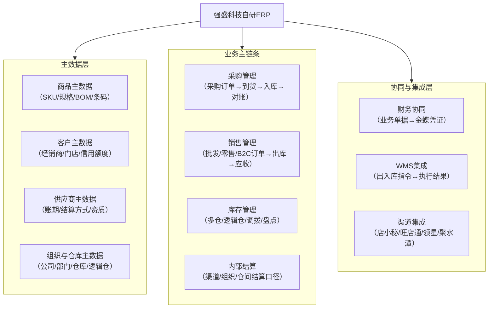
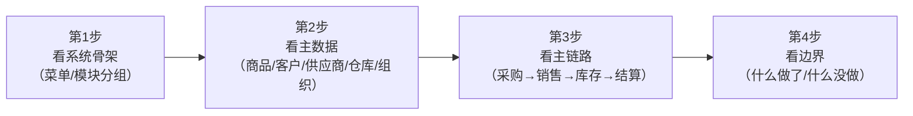
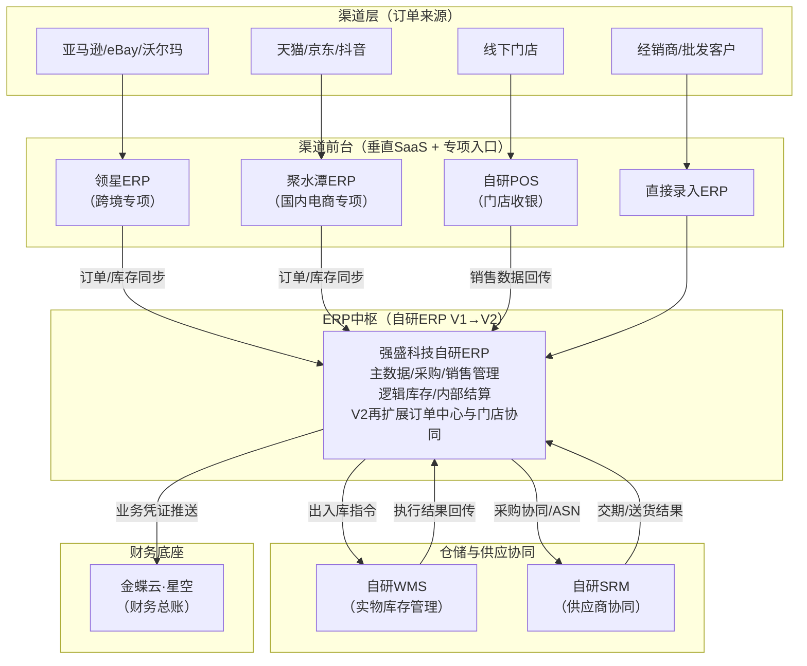

# ERP项目第1讲：ERP系统定位与系统选型决策

| 项目 | 内容 |
| --- | --- |
| 面向人群 | 已完成进销存项目全部课程 + 已阅读ERP业务背景与项目说明的学员 |
| 学习时长 | 90分钟 |
| 难度等级 | ⭐⭐⭐ |
| 前置课程 | [ERP项目的业务背景 & 项目说明](./ERP项目的业务背景%20&%20项目说明.md) |

## 1. 课程背景

前面的业务背景文档已经讲清楚了3件事：ERP分为传统ERP、电商ERP、公司内部ERP三大类；强盛科技从阶段3的「金蝶底座 + 前台SaaS分治」，走到阶段4的后台主链条自研，再到阶段5的全渠道中枢化升级；以及同一家公司在不同阶段对ERP的定义完全不同。

从这一讲开始，我们正式进入ERP项目的课程内容。整套ERP课一共8讲，按照**系统定位→主数据底座→后台主链路→中枢化升级→系统集成**的顺序推进：

| 阶段 | 讲次 | 解决什么 |
| --- | --- | --- |
| 系统定位 | 第1讲（本讲） | 为什么需要ERP？成熟系统/SaaS和自研怎么选？竞品怎么拆？ |
| 主数据底座 | 第2讲 | 商品/客户/供应商/仓库/组织主数据怎么设计？ |
| 后台主链路 | 第3～5讲 | 采购、库存（含逻辑仓）、多渠道销售怎么做？ |
| 中枢化升级 | 第6～7讲 | 全渠道库存分配和门店配货怎么做？ |
| 系统集成 | 第8讲 | ERP和WMS怎么对接？ |

**这一讲是整套课的起点**——不进入任何一个具体模块的设计，而是先解决3个前置问题：

1. 金蝶底座+前台SaaS分治到底撑不住在哪里（用具体业务场景讲清楚）
2. 该保留成熟系统/SaaS，还是自研（建立结构化的决策框架）
3. 怎么拆竞品来辅助设计（金蝶和领星的实操拆解）

这3个问题想清楚了，后面7讲才有设计的基础和判断力。尤其要先抓住一个主判断：**阶段3的分治架构不是失败，而是业务继续长大后，必须有人把业务规则和数据口径收回来。**

## 2. 学习目标

- 能用3个具体场景说清为什么「金蝶底座 + 前台SaaS分治」继续撑不住了（不是背结论，而是讲故事）
- 能画出一个典型自研ERP的模块全景图，并区分V1先做什么、V2再升级什么
- 能说清多系统组合搭配法和All-in-One大而全法两种策略的优劣
- 能用「5维评估法」判断一个业务场景该保留成熟系统/SaaS，还是自研
- 能拆解金蝶云·星辰和领星ERP的核心模块结构，并对比它们的场景-功能映射差异

**本讲交付物**：强盛科技信息化演进路径图 + 自研ERP模块全景图 + 成熟系统/SaaS与自研决策评估表

## 3. 课程内容

### 3.1 从进销存到ERP：强盛科技到底遇到了什么问题

业务背景文档讲过，阶段3不是「完全没有主系统」。当时金蝶云·星空已经承担了后台归口，店小秘和旺店通分别处理跨境、国内电商前台执行。这套组合在当时是合理的：比继续用管家婆和Excel强得多，也比一上来就自研大系统更现实。

但阶段3跑通之后，问题也开始变清楚：后台有了归口，前台也能跑，可**业务规则和数据口径并没有真正统一**。

先快速对齐一下阶段3的系统组合：

| 系统 | 它在强盛科技是干嘛的 | 类型 |
| --- | --- | --- |
| **金蝶云·星空** | 管采购、库存主账、基础仓储、国内B2B批发、应收应付与财务总账 | 传统ERP/后台底座 |
| **店小秘ERP** | 管跨境电商（Amazon/eBay为主）的订单、刊登、FBA与头程 | 跨境电商SaaS |
| **旺店通OMS** | 管国内电商（天猫/淘宝）的订单审核、打单发货与仓配执行 | 国内电商SaaS |
| **仓库现场作业** | 依赖金蝶基础仓储能力和人工流程，库位、扫码、防错、波次能力不足 | 轻仓储/人工补位 |

> 如果你对上面某个系统不熟悉，不影响学习——只需要记住它的一句话定位即可。课件末尾§6.3有更多术语释义。

下面不用急着记一长串问题，先抓3类核心矛盾。后面所有ERP模块，基本都从这3类矛盾里长出来。

| 核心矛盾 | 代表场景 | 具体表现 | ERP要解决什么 |
| --- | --- | --- | --- |
| **库存口径不统一** | 大促超卖、跨境备货抢国内库存 | 旺店通看到还有2000个可卖，但其中800个已经被跨境团队安排发往FBA；金蝶主账有数量，前台锁库却不是同一套实时规则 | 建立统一可售、锁定、预留、在途口径，让各渠道从同一个库存规则里取数 |
| **主数据不统一** | 商品编码四国大战 | 同一款氮化镓65W充电器，店小秘、旺店通、仓库标签、金蝶各叫各的名字；新品上架要多系统重复录入 | ERP建档一次，向下游系统分发编码、规格、条码和映射关系 |
| **业务到财务追溯不统一** | 月末合账、采购审计追溯 | 前台退款、跨境汇率、仓库收货、金蝶凭证散在不同系统里；财务和审计要跨系统翻记录 | 业务单据先在ERP形成中枢，再把应记账结果推送金蝶，保证能从业务追到凭证 |

这3类问题指向同一个结论：问题不是某个产品不好，也不是阶段3完全没有主系统，而是**后台归口之后，企业还需要一个能统一主数据、统一库存口径、统一业务单据流、统一业财协同的业务中枢**。

这就是强盛科技后来走向自研ERP的原因。

> 面试时如果被问「你们为什么要做ERP」，不要只说「因为系统太多了」——挑上面2～3个场景，讲具体表现和根因，再说ERP怎么解决，说服力会强很多。

### 3.2 一个典型自研ERP的模块全景图

在拆竞品之前，先建立一个「ERP模块全景图」。

这里先不要把阶段5的全渠道中枢全部塞进来。本讲主线是阶段4的自研ERP V1：它先把后台主链条收回来，解决主数据、采购、销售、逻辑库存、业财协同这些问题。阶段5的订单中心、全渠道库存调度、门店协同，是V1跑稳之后的升级。

这张图重点要讲3件事：

1. **主数据层是地基**——商品、客户、供应商、仓库、组织，这5类主数据必须先建好，后面所有业务单据都挂在上面。没有统一主数据，后面的采购、销售、库存全是空中楼阁
2. **业务主链条是核心**——采购、销售、库存、内部结算，这4个模块覆盖了强盛科技「货怎么进来、怎么管、怎么卖出去、怎么形成经营结果」的后台主链路
3. **协同与集成层是桥梁**——ERP不能独立运行，必须和财务系统、WMS、前台渠道系统打通

| 模块 | 解决什么业务场景 | 阶段定位 | 对应本课程哪一讲 |
| --- | --- | --- | --- |
| 商品/客户/供应商/仓库/组织主数据 | 所有系统围绕同一套编码运行，消灭「四国大战」 | V1地基 | 第2讲 |
| 采购管理 | 供应商→公司的采购全链路：下单→到货→入库→对账 | V1主链路 | 第3讲 |
| 库存管理（含逻辑仓） | 多仓库存、逻辑仓、调拨、盘点、库存口径统一 | V1主链路 | 第4讲 |
| 销售管理（批发/零售/B2C） | 批发订单、零售销售结果、B2C电商订单归集后的出库、应收与结算口径 | V1主链路 | 第5讲 |
| 全渠道库存分配 | 同一批货在不同渠道之间的分配、锁定、防超卖 | V2升级项 | 第6讲 |
| 门店配货与补货 | 门店要货→总部配货→门店收货→差异处理 | V2升级项 | 第7讲 |
| ERP↔WMS/SRM/金蝶集成 | 系统间数据流、接口设计、异常处理 | V1必做能力 | 第8讲 |

**这里有一个容易犯的错误**：把ERP的模块全景图和「功能列表」搞混。模块全景图回答的是「ERP管哪些业务领域」，不是「ERP有多少个菜单」。面试时如果被问「你们ERP有哪些模块」，不要报菜单名，而是用上面这张图的逻辑来讲：先主数据层，再业务主链条，再集成层。

### 3.3 成熟系统/SaaS保留与自研：决策框架

强盛科技在阶段4做了一个关键决定：后台主链条自研，成熟系统/SaaS继续保留。**这个决策过程本身是面试高频考点**，也是PM核心能力之一。

#### 两种信息化策略

| 策略 | 定义 | 优势 | 劣势 |
| --- | --- | --- | --- |
| 多系统组合搭配法 | 每个业务方向选最专业的垂直SaaS，拼在一起用 | 上手快、单点专业度高、初始成本低 | 数据孤岛、主数据分裂、跨系统协同成本高 |
| All-in-One大而全法 | 用一套大系统覆盖所有业务 | 数据统一、流程协同、维护集中 | 实施周期长、定制化难、单点深度可能不够 |

强盛科技的选择不是纯粹的二选一，而是**混合策略**：

- 后台主链条自研（主数据、采购、销售、逻辑库存与业务单据中枢）→ All-in-One大而全思路
- 前台渠道执行保留SaaS（领星管跨境、聚水潭管国内电商）→ 多系统组合搭配法思路
- 财务保留金蝶星空 → 成熟财务系统与审计口径需要

**为什么要这样选？** 引入一个结构化的判断框架。

#### 5维评估法：这个场景该保留成熟系统/SaaS，还是自研

| 评估维度 | 倾向保留成熟系统/SaaS | 倾向自研 |
| --- | --- | --- |
| **1. 业务独特性** | 业务场景标准化，行业通用 | 业务逻辑高度定制，SaaS改不了 |
| **2. 平台深度依赖** | 需要深度对接特定平台API（如亚马逊） | 不依赖单一外部平台 |
| **3. 数据归口权** | 数据可以留在SaaS，不需要跨系统汇总 | 必须统一归口，作为其他系统的主数据来源 |
| **4. 迭代频率** | 需求稳定，不需要频繁改 | 需求变化快，需要随业务快速迭代 |
| **5. 成熟度/公信力** | 需要成熟产品能力、实施稳定性或审计认可 | 企业内部规则更重要，外部公信力不是关键 |

**补充说明：什么是「数据归口权」？**

简单说就是**「这条数据谁说了算」**。比如一款商品叫什么名字、编码是什么：如果领星叫A、聚水潭叫B、金蝶叫C，那到底以谁为准？如果没有一个系统拥有「归口权」（即唯一可信来源），所有系统都各自为政，就会出现前面§3.1里「商品编码四国大战」的场景。自研ERP的核心诉求之一，就是把商品主数据的归口权拿回来：ERP建档，其他系统同步。

把强盛科技的几个系统套进去：

| 系统 | 业务独特性 | 平台依赖 | 数据归口权 | 迭代频率 | 成熟度/公信力 | 结论 |
| --- | --- | --- | --- | --- | --- | --- |
| 领星（跨境） | 标准 | 深度依赖亚马逊 | 不需要归口 | 稳定 | 相对成熟 | **SaaS** |
| 聚水潭（国内电商） | 标准 | 深度依赖天猫/京东 | 不需要归口 | 稳定 | 相对成熟 | **SaaS** |
| 金蝶星空（财务） | 标准 | 不依赖 | 财务独立归口 | 稳定 | **财务产品成熟，IPO需要稳定审计口径** | **保留成熟系统** |
| 主数据/采购/销售/库存/内部结算 | **高度定制** | 不依赖 | **必须统一归口** | **频繁** | 内部系统 | **自研** |
| WMS（仓储执行） | **高度定制** | 不依赖 | ERP下游 | **频繁** | 内部系统 | **自研** |

如果面试官问「你们为什么要自研ERP」，把5维评估法讲出来，比「因为SaaS不够用」这种笼统回答有力得多。哪怕他没有听过这个5维评估法，你这样讲也会更有结构，更容易让人信服。

**这里有一个容易犯的错误**：认为「自研就是什么都自己做」。阶段4的自研ERP并没有取代领星和聚水潭，也没有取代金蝶财务——它只收回了后台主链条。自研的价值不是「什么都自己做」，而是**拿回主数据、业务规则和后台主链条的控制权**。

### 3.4 竞品拆解方法与实操：金蝶云·星辰对比领星ERP

自研ERP不是闭门造车——你必须知道成熟产品是怎么做的，才能判断哪些设计可以借鉴、哪些需要根据自身业务重新设计。

这一讲选金蝶云·星辰和领星ERP做案例，不是因为它们能完全代表强盛科技的最终方案，而是因为它们刚好代表两类不同的参照物：

| 案例 | 为什么选它 | 本讲重点看什么 |
| --- | --- | --- |
| 金蝶云·星辰 | 更容易注册体验，能直观看到商贸型ERP里的采购、销售、库存、财务怎么连起来 | 看传统商贸ERP的主数据、采购/销售/库存主链路、业财一体思路 |
| 领星ERP | 跨境ERP代表性强，适合理解跨境场景下的商品资料建档、商品映射、采购补货、FBA/海外仓库存管理、订单履约 | 看跨境供应链链路如何围绕平台、商品、仓库、库存和履约等场景展开；广告投放等运营功能不是本课重点 |

#### 拆竞品的方法：4步结构化拆解

每一步重点看什么：

| 步骤 | 看什么 | 为什么重要 |
| --- | --- | --- |
| 系统骨架 | 左侧菜单怎么分组、哪些是主干模块、哪些是辅助模块 | 了解这款产品的核心定位和目标用户 |
| 主数据 | 商品、客户、供应商、仓库、组织怎么建档，字段有哪些，规则挂在哪里 | 主数据设计决定了后面所有单据的质量上限 |
| 主链路 | 采购、销售、库存、结算/财务协同怎么串起来 | 单据怎么拆、状态怎么流转、库存什么时候变、业务结果怎么进入财务口径 |
| 系统边界 | 什么功能做了、什么功能没做、什么交给了其他系统 | 判断这款产品的核心战场和设计取舍 |

#### 金蝶云·星辰对比领星ERP：横向对比

再强调一次口径：强盛科技阶段3叙事里用的是**金蝶云·星空**，不是金蝶云·星辰。本讲拆星辰，是把它当作更容易上手的学习样本。

| 维度 | 金蝶云·星辰 | 领星ERP |
| --- | --- | --- |
| **目标用户** | 中小零售/批发型企业 | 跨境电商卖家（主攻亚马逊） |
| **核心定位** | 业财一体化管理 | 跨境供应链履约与经营核算 |
| **系统骨架** | 采购→销售→库存→财务，另有门店/POS等零售能力 | 商品/Listing→采购补货→库存→订单履约→成本利润 |
| **主数据重心** | 商品+客户+供应商+仓库/门店+组织 | 商品+ASIN/MSKU映射+平台店铺+FBA/海外仓 |
| **采购链路** | 采购订单→入库→应付→付款（标准链路） | 采购计划→采购单→收货单（偏FBA备货） |
| **销售链路** | 批发/零售订单→销售出库→应收→收款；门店零售可走POS | 平台自动拉单→审核→发货→回款 |
| **库存深度** | 多仓+调拨+盘点（基础库存） | FBA库存+海外仓+国内仓（三层库存） |
| **财务能力** | ✅ 业财一体，自动生成凭证 | ⚠️ 利润核算为主，不做总账 |
| **门店能力** | ✅ 有门店/POS能力；本课程只借鉴总部配货、门店要货、门店库存口径，不展开POS收银/会员运营 | ❌ 不覆盖 |
| **平台集成** | ⚠️ 不是电商订单中台开箱形态，深度对接通常依赖零售方案、接口或生态集成 | ✅ 亚马逊深度集成 |

**从这张对比表可以提炼出3个设计判断**：

1. **金蝶的核心价值是「业财一体」和商贸主链路**——业务动作能和应收应付、凭证衔接起来。强盛科技自研ERP在财务协同上应该借鉴金蝶的「业务单据→财务结果」思路
2. **领星的核心价值是「跨境供应链履约链路」**——ASIN/MSKU映射、采购补货、FBA/海外仓库存、订单履约、成本利润口径，这些能力和跨境平台深度绑定，不适合由自研ERP重复建设。广告投放、Listing精细运营等内容只作为边界认知，本课不展开
3. **门店能力要看边界，不要误读成POS项目**——金蝶有门店/POS能力，但本期ERP只讲总部配货、门店要货、门店库存这些后台协同，不展开收银、会员、促销等POS前台经营场景
4. **两款产品都不能直接覆盖强盛科技的全局库存诉求**——金蝶偏商贸与业财，领星偏跨境库存与FBA。强盛科技要做的是跨国内电商、跨境、批发、门店的统一可售、锁定、预留和逻辑仓，这部分必须自己设计

**这里有一个容易犯的错误**：拆竞品时只看「它有什么功能」，不看「它为什么这样设计」。功能列表人人都能列，但理解「为什么金蝶会把商贸、财务、门店放在一起」「为什么领星的采购链路偏FBA备货而不是标准采购」，才是竞品拆解的核心价值。

#### 场景-功能映射表：强盛科技能从竞品借鉴什么

| 业务场景 | 金蝶怎么做的 | 领星怎么做的 | 强盛科技自研时要借鉴什么 | 自研时要自己设计什么 |
| --- | --- | --- | --- | --- |
| 商品主数据管理 | 标准三大档案+多属性+多单位 | 平台SKU映射+ASIN | 借鉴金蝶的多属性+多单位体系 | 加上跨渠道SKU映射关系 |
| 采购全链路 | 标准采购订单→入库→对账 | 采购计划→FBA补货 | 借鉴金蝶的标准采购链路 | 支持BOM/MRP相关的采购计划口径 |
| 库存管理 | 基础多仓+调拨 | FBA三层库存 | — | 全渠道逻辑仓+可售/锁定分离 |
| 销售与履约 | 批发/零售订单到出库、应收的链路 | 平台拉单+自动审核 | 借鉴金蝶的销售出库与应收衔接 | 多渠道订单归集后的统一口径 |
| 财务协同 | 业财一体，凭证自动生成 | 利润核算 | 借鉴金蝶的自动凭证生成 | ERP→金蝶的接口设计 |
| 门店协同 | 门店、POS、要货配货等零售能力 | 不覆盖 | 只借鉴总部配货、门店要货、门店库存口径 | 总部配货→门店收货→差异处理；不展开POS收银/会员 |

### 3.5 强盛科技自研ERP的系统架构与定位

有了模块全景图和竞品参照之后，最后把强盛科技的系统全局架构画清楚。

为了避免阶段混淆，下面这张图画的是课程最终要讲到的完整形态：阶段4先形成自研ERP V1，收回后台主链条；阶段5在V1基础上接入POS销售结果、全渠道订单与库存调度，升级成ERP V2。

这张图里最关键的3个定位判断：

1. **ERP是业务中枢，不是简单的前台执行工具**——它管业务规则、主数据、逻辑库存和结算口径；领星、聚水潭继续管平台专项执行
2. **WMS/SRM不是ERP的附属菜单**——WMS管实物执行，SRM管供应商协同，ERP负责把采购、库存和结算规则串起来
3. **金蝶仍然是财务归口**——ERP不直接替代总账，而是把业务结果整理成金蝶能记账、能审计、能追溯的数据

### 3.6 本课程的学习边界

最后明确这8讲课程覆盖什么、不覆盖什么：

**课程覆盖的模块**（学完你能设计什么）：

| 模块 | 对应业务线 | 核心设计难点 |
| --- | --- | --- |
| 主数据体系 | 全局基础 | 多系统围绕一套编码运行，主数据怎么分发 |
| 采购管理 | 供应商→公司 | 多规格BOM、部分到货、三单匹配 |
| 库存管理 | 多仓+逻辑仓 | 可售/锁定/在途口径分离、全渠道分配 |
| 销售管理 | 公司→经销商/电商B2C/零售销售结果 | 批发订单、B2C订单归集、价格口径、信用控制、出库应收与退货退款 |
| 门店要货与配货 | 总部→门店 | 门店要货、总部配货、门店收货、差异处理；不展开POS收银 |
| 财务协同 | ERP→金蝶 | 业务单据自动驱动凭证生成 |
| 多系统集成 | ERP↔WMS/SRM/POS/领星/聚水潭/金蝶 | 接口设计、数据一致性、异常补偿 |

**课程不覆盖的（不是这门课的内容）**：

| 不覆盖的模块 | 原因 | 在哪里学 |
| --- | --- | --- |
| 电商平台深度对接（拉单、刊登、SKU映射、物流面单、平台售后） | 属于电商ERP/OMS专项能力，本课只讲订单进入ERP后的归集和口径 | 延伸拓展-OMS章节 |
| 跨境平台专项运营（广告投放、Listing运营、FBA货件细节、海外仓细节） | 属于领星等跨境ERP专项，本课只借鉴商品映射、采购补货、库存、履约和成本利润口径 | 参考领星帮助文档 |
| POS前台经营（收银、会员、储值、促销、导购、交班） | 属于门店POS业务，本课只讲总部配货、门店要货、门店库存协同 | 后续POS/新零售专题 |
| WMS仓内精细作业（库位策略、波次、PDA拣货、复核、路径优化） | 属于WMS执行系统，本课只讲ERP和WMS的指令、回传和异常边界 | WMS项目课程 |
| 财务总账/成本核算/合并报表 | 属于金蝶星空等财务系统，本课只讲业务单据如何形成财务接口结果 | 参考金蝶帮助文档 |
| 大型工厂生产排产 | 本课程不展开车间排产、工艺路线、设备产能等制造深水区；BOM/MRP只作为采购计划与供应链协同背景出现 | ERP延伸专题或制造ERP资料 |

## 4. 实操任务 & 交付物

### 4.1 任务说明

本讲是系统认知课，任务围绕「看懂全局、建立判断力」展开。

#### 必做任务

- **任务1**：画出强盛科技的信息化演进路径图——从Excel → 管家婆 → 金蝶底座 + 前台分治 → 自研ERP V1 → 自研ERP V2。每个阶段标注核心系统、触发下一步的原因（一句话）
- **任务2**：用「5维评估法」评估一个你熟悉的业务场景（可以是自己公司的，也可以是假设场景），输出一张「成熟系统/SaaS与自研」评估表

#### 任务模板

信息化演进路径图建议按这个结构填写：

| 阶段 | 核心系统 | 当时解决了什么 | 后来暴露了什么 | 下一阶段为什么升级 |
| --- | --- | --- | --- | --- |
| 阶段1 | Excel |  |  |  |
| 阶段2 | 管家婆 |  |  |  |
| 阶段3 | 金蝶底座 + 店小秘/旺店通 |  |  |  |
| 阶段4 | 自研ERP V1 + WMS/SRM + 领星/聚水潭 + 金蝶 |  |  |  |
| 阶段5 | 自研ERP V2 + POS + 主数据/BI + 金蝶 |  |  |  |

成熟系统/SaaS与自研评估表建议按这个结构填写：

| 业务场景 | 业务独特性 | 平台依赖 | 数据归口权 | 迭代频率 | 成熟度/公信力 | 结论 |
| --- | --- | --- | --- | --- | --- | --- |
| 示例：跨境补货与FBA库存 | 标准化较高 | 强依赖亚马逊/FBA数据 | 不做企业主数据源 | 需求较稳定 | 领星能力成熟 | 保留SaaS |
| 示例：统一商品主数据 | 强盛内部规则强 | 不依赖单一平台 | 必须归口 | 需持续迭代 | 内部规则优先 | 自研 |

#### 选做任务

- **任务3**：注册金蝶云·星辰（免费体验版），或选择店小秘ERP、领星ERP、万里牛ERP中的一款，按「4步结构化拆解法」体验一遍采购→入库→库存变化的主链路，输出一份简短的竞品拆解笔记（不超过1页A4）

### 4.2 产出标准

| 产出物 | 合格标准 |
| --- | --- |
| 信息化演进路径图 | 覆盖5个阶段（阶段1→5），每阶段有核心系统清单和触发原因 |
| 成熟系统/SaaS与自研评估表 | 5个评估维度全覆盖，每个维度有具体判断依据，最终有明确结论 |
| 竞品拆解笔记（选做） | 按4步拆解法组织，系统骨架→主数据→主链路→边界，有自己的判断和发现 |

## 5. 自检清单

学完这一讲，先不用背具体案例，重点检查自己能不能说清下面几件事：

- 我能用自己的话说清楚ERP和进销存的区别吗？
- 我能说清强盛科技为什么不是一开始就自研ERP，而是先经历了「金蝶底座 + 前台SaaS分治」吗？
- 我能说清阶段3分治架构后来主要暴露了哪几类问题吗？
- 我能大致画出自研ERP V1的核心模块：主数据、采购、销售、库存、内部结算、财务协同吗？
- 我能区分哪些能力属于ERP V1后台主链路，哪些能力属于阶段5的V2升级项吗？
- 我能用「5维评估法」判断一个场景更适合保留成熟系统/SaaS，还是适合自研吗？
- 我知道金蝶云·星辰和领星ERP在这一讲里分别值得重点看什么吗？
- 我能说清ERP、WMS、SRM、金蝶、领星/聚水潭之间的大致分工吗？

## 6. 补充知识

### 6.1 面试考点

- 你们ERP系统是自研的还是采购的？为什么？（用5维评估法或其他结构化方式表达）
- 进销存和ERP的核心区别是什么？（不说「ERP功能更多」，从管理边界、数据归口、财务集成三个维度回答）
- ERP项目为什么经常失败？（需求不清把ERP当进销存、数据迁移脏数据、组织阻力、范围蔓延）
- 你怎么做ERP选型？（先明确核心需求，再用5维评估法判断保留成熟系统/SaaS还是自研，然后拆竞品做参照）

### 6.2 推荐资料

- 金蝶云·星辰（免费体验版）——重点体验采购→入库→库存→财务凭证的完整链路
- 万里牛ERP（免费注册）——国内电商ERP实操体验，了解电商ERP和传统ERP的差异
- 领星ERP（免费注册，需销售激活）——跨境电商ERP实操体验，重点看商品映射、采购补货、FBA/海外仓库存、订单履约和成本利润口径
- 店小秘ERP（免费注册）——跨境电商ERP实操体验，重点看主数据管理、商品映射、采购、销售、库存等模块

> **下一讲预告**：第2讲进入ERP的第一个核心模块——主数据体系。业务背景是阶段4统一商品编码的需求——当四个系统叫同一款产品四个名字时，主数据到底该怎么设计、怎么分发、怎么保证全系统一致。
