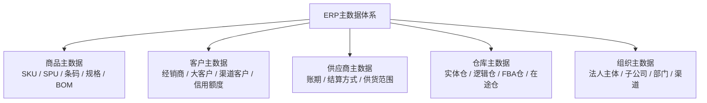
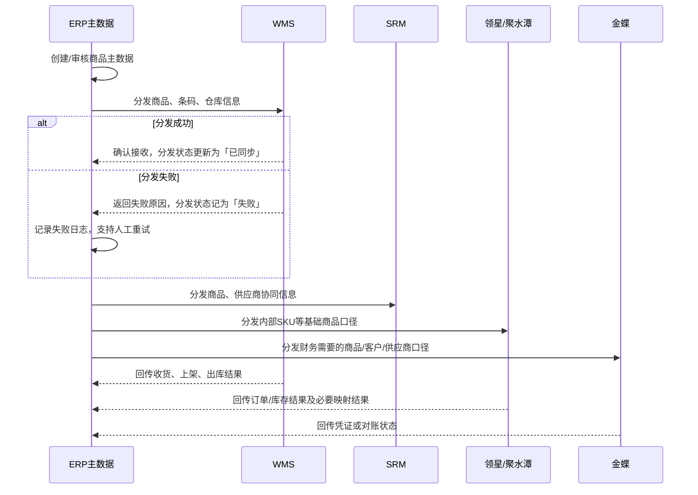
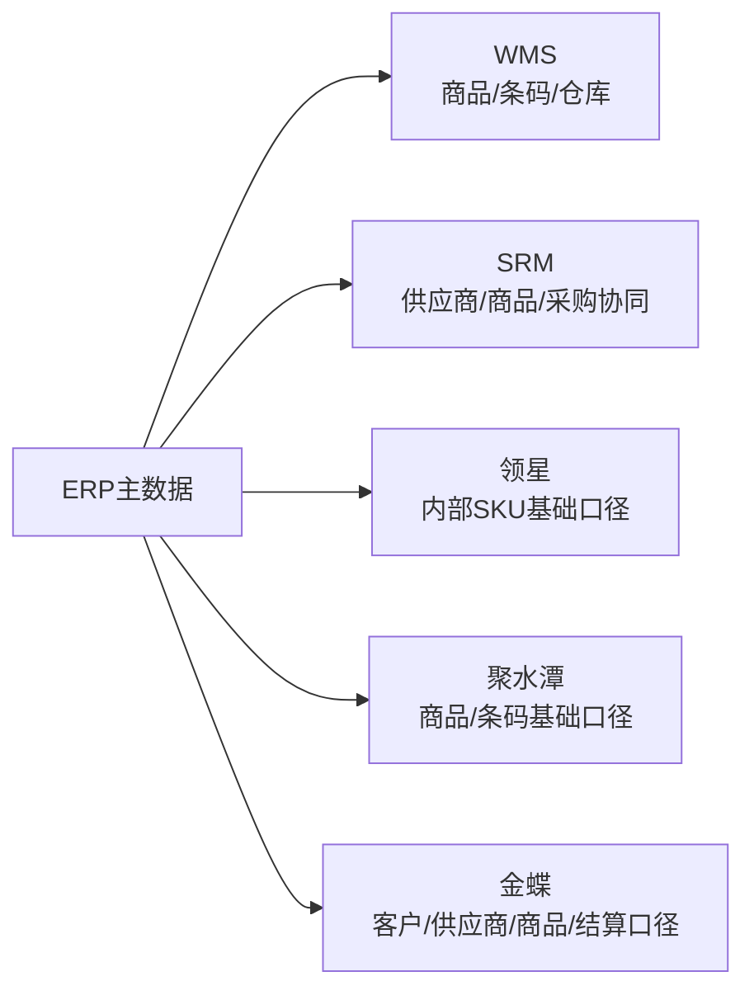

# ERP项目第2讲：ERP主数据体系架构与功能设计

| 项目   | 内容                                                      |
| ---- | ------------------------------------------------------- |
| 面向人群 | 已完成ERP第1讲 + 已阅读ERP业务背景与项目说明的学员                          |
| 学习时长 | 90分钟                                                    |
| 难度等级 | ⭐⭐⭐                                                     |
| 前置课程 | [ERP项目第1讲：ERP系统定位与系统选型决策](./ERP项目第1讲-ERP系统定位与系统选型决策.md) |

## 1. 课程背景

上一讲我们讲清楚了一个判断：强盛科技在阶段3用「金蝶底座 + 店小秘/旺店通前台分治」跑通了业务，但业务继续长大之后，问题不再是「有没有系统」，而是**业务规则和数据口径没有真正统一**。

从这一讲开始，我们进入ERP V1的第一个核心模块：主数据体系。

很多同学一听到「主数据」，第一反应会觉得它只是一些资料维护页面：

- 商品档案
- 客户档案
- 供应商档案
- 仓库档案
- 组织档案

但在ERP里，主数据不是简单的「资料表」，也不是简单的「基础设置」。它是采购、销售、库存、结算、财务协同、系统集成能不能跑通的地基。

如果主数据没设计好，后面的业务单据都会出问题：

| 后续模块 | 如果主数据不统一，会出现什么问题                 |
| ---- | -------------------------------- |
| 采购管理 | 采购单上的商品、供应商、税率、结算方式无法统一          |
| 销售管理 | 同一客户在不同渠道口径不同，价格、账期、信用额度对不上      |
| 库存管理 | 同一SKU在ERP、WMS、领星、聚水潭里叫法不同，库存无法合并 |
| 内部结算 | 批发、电商、跨境、内部组织之间的结算对象和结算规则不清楚     |
| 财务协同 | ERP推给金蝶的数据无法匹配科目、客户、供应商和商品口径     |

所以第二讲先不急着做采购单、销售单、库存台账，而是先想清楚一个关键问题：

**强盛科技自研ERP V1，应该怎么把主数据管起来？**

更准确地说，不是一次性把所有字段都设计到完美，而是要知道：

1. 阶段3先要统一哪些基础口径？
2. 阶段4自研ERP V1要补哪些主数据能力？
3. 阶段5全渠道中枢化之后，主数据还会继续长出哪些字段和分发规则？
4. ERP主数据从哪里来，又要分发到哪里去？

## 2. 学习目标

- 能用自己的话说清楚：主数据不是资料表，而是ERP业务地基
- 能说清ERP主数据和进销存主数据的区别
- 能理解主数据会随业务阶段持续演进，而不是一次性做到完美
- 能识别ERP V1里的5类核心主数据：商品、客户、供应商、仓库、组织
- 能区分ERP商品主数据和渠道SaaS商品映射之间的边界
- 能设计一套基础的主数据字段清单，并说明每个关键字段为什么需要
- 能说清ERP主数据如何从外部系统接收、在ERP归口、再分发到WMS、SRM、领星、聚水潭、金蝶

**本讲交付物**：ERP主数据关系图 + 主数据字段设计表 + 主数据分发关系图

## 3. 课程内容

### 3.1 主数据不是资料表，而是业务地基

阶段3的时候，强盛科技的同一款5V/2A USB充电器，可能在不同系统里长这样：

| 系统       | 可能的叫法           | 这个系统为什么这么叫   |
| -------- | --------------- | ------------ |
| 金蝶云·星空   | USB充电器-5V2A     | 偏后台商品档案和财务口径 |
| 店小秘ERP   | QS-USB2A-US-BLK | 偏跨境SKU和站点规格  |
| 旺店通OMS   | 5V2A充电器-黑色      | 偏国内电商发货和打单   |
| 仓库标签     | 2A黑美规           | 偏现场识别和贴标     |
| Excel汇总表 | USB2A黑美规        | 偏人工汇总和临时统计   |

如果只是看名字，好像只是「命名不规范」。但对ERP来说，这不是小问题。**因为系统不知道这些是不是同一个东西。**

一旦系统无法确定它们是不是同一个商品，后面的问题会连着来：

- 采购不知道补哪一个SKU
- 仓库不知道收货后应该入哪个商品
- 电商前台不知道这批货能不能卖
- 财务不知道成本应该归到哪一个商品上
- BI不知道这个商品的销量和毛利应该怎么合并

所以，主数据要解决的第一件事，就是让企业内部所有系统用同一套「业务语言」说话。

在ERP里，主数据至少承担4个作用：

| 作用   | 说明                                    |
| ---- | ------------------------------------- |
| 统一识别 | 同一个商品、客户、供应商、仓库、组织，在所有系统里都能识别出来       |
| 单据引用 | 采购单、销售单、入库单、出库单都要引用主数据，不能每张单临时手填      |
| 规则承载 | 账期、信用额度、默认供应商、默认仓库、结算方式等规则都要挂在主数据上    |
| 系统集成 | ERP要把主数据分发给WMS、SRM、领星、聚水潭、金蝶，下游才能处理业务 |

一句话总结：

**ERP里的主数据，不是为了录资料，而是为了让采购、销售、库存、财务和下游系统都用同一套口径协同。**

### 3.2 主数据不是一次性设计完的，而是随业务阶段演进

很多人新手产品朋友，在做主数据的设计的时候，容易走两个极端：

| 极端做法 | 问题                                                          |
| ---- | ----------------------------------------------------------- |
| 字段太少 | 当前能建档，但后面采购、库存、财务、渠道映射都不够用，后续经常要做这种“加字段”的需求                 |
| 字段太多 | 录入成本太高，业务不愿意填，最后大量字段变成空值，而且有很多冗余设计，导致版本落地速度慢，研发大量过度设计，一堆烂代码 |

更合理的做法是：**先满足当前阶段的业务闭环，再为下一阶段预留扩展。不要过度设计，适当想的远一点的即可。**

放到强盛科技的故事里，主数据是这样一步步长出来的。

| 阶段              | 主数据重点                                        | 为什么要这样设计                                 |
| --------------- | -------------------------------------------- | ---------------------------------------- |
| 阶段3：金蝶底座 + 前台分治 | 商品主数据、供应商主数据、仓库主数据、客户主数据的基础建档；前台系统各自维护渠道商品映射 | 先让金蝶、店小秘、旺店通能识别同一批货，支撑基础采购、库存、B2B销售和前台发货 |
| 阶段4：自研ERP V1    | 商品/物料/BOM体系、供应商协同资料、仓库与逻辑仓、组织主数据、客户信用与结算口径   | 支撑自研ERP接管后台主链条，并和WMS、SRM、领星、聚水潭、金蝶稳定协同   |
| 阶段5：ERP V2全渠道中枢 | 门店、物流、商品品牌、经营分类与指标标签、主数据分发与审计追溯              | 支撑全渠道库存、门店配货、经营分析、IPO审计和主数据平台            |

所以你不能用阶段5的标准去要求阶段3，也不能用阶段3的字段去支撑阶段4。

**本讲的设计重点放在阶段4——自研ERP V1上线时，主数据的第一版应该怎么建。** 阶段5的扩展方向作为背景预告，帮助你看到主数据演进的全景，但不是本讲的实操范围。

比如阶段3里，只要能知道「这是什么商品、哪个供应商供货、在哪个仓库」就已经能跑起来。这里的重点不是把商品字段做得多复杂，而是先把商品、供应商、仓库、客户这几类基础对象建起来，让金蝶和前台系统能识别同一批货。

到了阶段4，强盛科技开始做精品SKU、参股工厂、供应商协同、WMS/SRM集成，主数据要补的就不只是「给商品主数据增加字段」，而是几类对象一起升级：

| 主数据对象/关系 | 阶段4要补什么                            |
| -------- | ---------------------------------- |
| 商品/物料主数据 | 商品的BOM/组合关系、采购属性、质检要求、批次管理、SN管理    |
| 供应商主数据   | 供应商生命周期管理、账期、结算方式、供应商资质、SRM协同规范和要求 |
| 商品-供应商关系 | 默认供应商、默认采购价、供货周期、最小起订量、要货关系        |
| 仓库主数据    | 实体仓、逻辑仓，三方仓集成配置，多维度库存口径等           |
| 组织/客户主数据 | 组织归属、客户信用、价格等级、内部结算口径              |

再到阶段5，门店、BI、IPO审计进来之后，还会继续增加：

- 总部和门店的结算关系
- 门店生命周期管理
- 门店仓库、门店库存口径
- 经营分类和BI指标标签
- 主数据分发状态
- 审计追溯和变更留痕

这就是主数据设计的核心难点：**它不是一次性字段设计，而是一个持续治理过程。如果我们不知道当前要设计多少字段，要怎么搭建产品架构，最好的方式就是先调用业务需求，然后再做竞品分析，能想远一些，但是不要想得太远。**

### 3.3 ERP V1先管哪5类核心主数据

强盛科技阶段4的自研ERP V1，不需要一开始就做成主数据平台，但至少要把5类核心主数据管起来：

在看字段之前，先建立一张总览表。主数据设计不要一上来就问「页面上放哪些字段」，而是先问5个问题：

1. 这类主数据在什么业务场景里会被用到？
2. 它在ERP里承担什么用途？
3. 它可能从哪里来？
4. 它要分发到哪些系统？
5. 它最关键的字段是什么？

| 主数据类型  | 典型使用场景                            | 在ERP里的用途                 | 可能来源                          | 主要分发去向                     | 关键字段举例                        |
| ------ | --------------------------------- | ------------------------ | ----------------------------- | -------------------------- | ----------------------------- |
| 商品主数据  | 采购下单、仓库收发、渠道销售、库存核算、成本归集          | 统一内部SKU、规格、单位、条码、品类和状态   | ERP新建、历史金蝶导入                  | WMS、SRM、金蝶；向领星/聚水潭提供基础商品口径 | 商品编码、SKU、SPU、条码、规格、单位、品类、状态   |
| 客户主数据  | 批发销售、渠道订单归集、应收结算、信用控制             | 统一客户身份、账期、信用额度、价格政策和结算对象 | ERP新建、历史客户导入、平台/渠道订单归集        | 销售模块、金蝶、渠道系统               | 客户编码、客户类型、账期、信用额度、价格等级、所属渠道   |
| 供应商主数据 | 采购下单、到货跟踪、SRM协同、采购对账、应付结算         | 统一供应商身份、供货范围、账期和协同状态     | ERP新建、历史金蝶导入、SRM补充            | 采购模块、SRM、金蝶                | 供应商编码、供应商类型、供货品类、账期、结算方式、资质状态 |
| 仓库主数据  | 采购入库、销售出库、调拨、盘点、库存可售计算、渠道备货       | 区分实体仓、逻辑仓和多维度的库存口径       | ERP建仓、WMS仓库映射、平台/FBA仓补充       | SRM、WMS、领星、聚水潭、金蝶、ERP库存模块  | 仓库编码、仓库类型、所属组织、是否虚拟仓          |
| 组织主数据  | 经营主体、权限控制、审批流、经营归属、内部结算、BI分析、库存分配 | 统一法人主体、子公司/分公司、部门、销售渠道   | ERP新建、财务/法务主体导入、人事组织导入、渠道资料维护 | ERP各业务模块、金蝶、BI             | 组织编码、组织类型、上级组织、财务主体、结算主体、启停状态 |

这张表其实就是主数据设计的「总方案」。后面每一类主数据的字段设计，都要能回到这里：它服务哪个场景，解决哪个口径问题，又会影响哪些下游系统。

#### 3.3.1 商品主数据

商品主数据是最核心的一类主数据，因为采购、库存、销售、财务、报表分析等，几乎所有的模块都会引用它。

在强盛科技这里，商品主数据至少要支撑这些关键场景：

| 场景       | 商品主数据要解决什么                               |
| -------- | ---------------------------------------- |
| 商品建档     | 先把一个商品在ERP里的唯一身份定下来，避免同一实物被重复建成多个SKU     |
| 采购下单/补货  | 采购员能选到正确SKU，系统能带出采购单位、默认供应商、起订量和采购提前期    |
| 供应商协同/质检 | SRM和质检环节能识别供应商交付的是哪个SKU，以及是否需要贴标、质检、异常处理 |
| 仓储执行     | WMS收货、上架、出库、盘点时能识别条码、箱规、规格、包装和商品状态       |
| 库存管理     | ERP能按同一SKU汇总实物库存、逻辑库存、在途库存、锁定库存和可售库存     |
| 销售履约     | 批发订单、电商订单归集后，都能落到同一个内部SKU，后续才能正确扣减库存和发货  |
| 渠道映射     | ERP提供稳定的内部SKU口径，领星、聚水潭等渠道系统再维护各自的平台商品映射  |
| 财务核算/报表  | 成本、收入、库存金额、税率和品类能按同一商品口径归集，并推送金蝶或BI      |

所以商品主数据的设计方案，不是「建一个商品档案页面」这么简单，而是要把ERP内部SKU、SPU、条码、规格、单位、品类、BOM/组合关系这些通用口径先稳定下来。

这里还要注意：不是所有字段都应该塞进一张「商品主表」。有些适合放在商品主档，有些适合做子表、关系表或业务配置。

| 字段类别    | 关键字段                            | 说明                       | 推荐承载方式     | 阶段定位      |
| ------- | ------------------------------- | ------------------------ | ---------- | --------- |
| 身份识别    | 商品编码/SKU编码、商品名称、商品类型、所属SPU、商品状态 | ERP内部唯一识别商品，并控制能不能被新单据引用 | 商品主档       | V1必填      |
| SPU层信息  | SPU编码、SPU名称、产品系列、品类、品牌/型号       | 管同一款商品的共性信息，不直接参与库存数量计算  | SPU主档      | V1建议      |
| SKU规格信息 | 颜色、插头规格、功率、容量、包装形态、规格组合         | 决定这个商品能不能被单独采购、入库、销售和核算  | SKU主档/规格子表 | V1必填      |
| 单位与包装   | 基本单位、采购单位、销售单位、箱规、单位换算比例        | 支撑采购按箱下单、仓库按个收发、销售按套报价   | 单位/包装配置    | V1必填      |
| 条码与标签   | 商品条码、箱码、是否需要贴标、标签要求             | 支撑WMS扫码收货、发货、盘点和供应商贴标协同  | 条码/标签子表    | V1必填或逐步补齐 |
| 采购与供应商  | 默认供应商、采购提前期、最小起订量、供应商商品编码、是否质检  | 支撑采购下单、补货建议、SRM协同和到货质检   | 商品-供应商关系表  | V1建议      |
| 库存属性    | 是否可库存、是否批次管理、是否序列号管理、是否可售、是否停用  | 支撑库存控制、库存锁定和异常拦截         | 商品库存配置     | V1建议      |
| 财务/分析属性 | 存货分类、成本归集品类、税率、金蝶商品映射           | 支撑成本核算、库存金额和金蝶归口         | 财务属性配置     | V1建议      |
| 分发状态    | 分发系统、分发状态、失败原因、最后同步时间           | 支撑WMS、SRM、金蝶、渠道系统同步和问题追踪 | 分发记录/同步日志  | V1建议      |

商品编码的格式要明确：

| 字段   | 格式要求                                       |
| ---- | ------------------------------------------ |
| 商品编码 | 仅允许大写字母（A-Z）、数字（0-9）、连字符（-）；禁止中文、空格及其他特殊字符 |

这里不要写成「建议使用字母、数字、连字符」。那是软约束。对于编码字段，PRD里应该写成「仅允许」，否则前端和测试很容易理解成可选建议。

#### 3.3.2 客户主数据

ERP里的客户，不只是「买货的人」。客户主数据的关键，是区分哪些对象需要进入ERP客户档案，哪些只应该保留在订单明细或渠道系统里。

在强盛科技这里，客户主数据至少要支撑这些关键场景：

| 场景       | 客户主数据要解决什么                                       |
| -------- | ------------------------------------------------ |
| B2B批发销售  | 经销商、代理商、大客户要作为正式客户建档，系统能带出账期、信用额度、价格等级和结算方式      |
| 大客户/KA管理 | 长期合作客户需要维护合同主体、对账方式、开票信息、收货地址和业务负责人              |
| 渠道归集     | 天猫、京东、亚马逊等平台和店铺可以作为订单来源、渠道归属和结算口径，不等于把每个消费者都建成客户 |
| 电商B2C订单  | 平台买家通常不逐个进入ERP客户主数据，而是保留在渠道订单明细或订单中心里            |
| 信用与价格控制  | 销售单引用客户后，系统能校验客户状态、信用额度、价格等级和账期                  |
| 应收对账     | 发货、开票、回款、折扣能按同一客户口径汇总，避免销售和财务各算各的                |
| 财务归口/报表  | ERP客户编码、开票主体、收款主体要能和金蝶客户、应收科目、销售统计口径对应           |

所以客户主数据的设计方案，不是「建一个客户档案页面」这么简单，而是要把客户身份、客户类型、渠道归属、信用结算、地址联系人、财务映射这些口径先稳定下来。

这里同样要注意承载方式：客户主档只放稳定信息，地址、联系人、授信、价格、开票信息等更适合拆成子表或配置表。

| 字段类别    | 关键字段                       | 说明                        | 推荐承载方式    | 阶段定位    |
| ------- | -------------------------- | ------------------------- | --------- | ------- |
| 身份识别    | 客户编码、客户名称、客户类型、客户状态        | ERP内部唯一识别客户，并控制能不能被销售单引用  | 客户主档      | V1必填    |
| 客户分类    | 经销商、代理商、大客户、平台/渠道客户、内部往来客户 | 区分客户管理方式、价格政策、结算方式和报表口径   | 客户主档/分类配置 | V1必填    |
| 组织归属    | 所属经营主体、销售负责人、所属渠道、所属区域     | 支撑销售归属、权限、业绩统计和内部结算       | 客户主档/组织关系 | V1建议    |
| 联系与地址   | 联系人、联系电话、默认收货地址、开票地址、对账地址  | 支撑销售沟通、发货、开票和对账           | 联系人/地址子表  | V1建议    |
| 交易与信用   | 结算方式、默认账期、信用额度、信用状态、是否允许赊销 | 支撑销售开单、信用控制、应收对账和回款管理     | 客户交易/信用配置 | V1必填或建议 |
| 价格属性    | 价格等级、合同价、折扣规则              | 支撑批发销售报价和客户差异化定价          | 客户价格配置    | V1建议    |
| 开票/财务属性 | 开票抬头、税号、银行账号、金蝶客户编码、应收科目映射 | 支撑开票、收款、应收凭证和金蝶归口         | 客户财务配置    | V1建议    |
| 渠道归集    | 平台、店铺、渠道来源、订单客户映射规则        | 支撑平台订单归集，不把每个终端买家都建成ERP客户 | 渠道映射配置    | V1建议    |

这里要注意一个边界：阶段4的ERP V1还没有进入连锁门店经营，客户主数据不需要提前设计直营门店、加盟门店这套口径。门店作为组织节点、履约节点或结算客户，是阶段5新零售和POS场景再重点展开的内容。

V1阶段先把经销商、大客户、平台/渠道来源、信用结算和财务应收口径管清楚即可。平台买家通常不作为ERP客户主数据逐个建档，而是进入订单明细。

#### 3.3.3 供应商主数据

供应商主数据服务的是采购和SRM协同。在ERP V1里，它首先要保证采购能下单、供应商能协同、到货能对账、财务能确认应付。

在强盛科技这里，供应商主数据至少要支撑这些关键场景：

| 场景      | 供应商主数据要解决什么                        |
| ------- | ---------------------------------- |
| 供应商建档   | 先确认供应商是谁、属于哪类合作对象、当前是否允许合作         |
| 采购下单    | 采购员能选择合格供应商，并带出供货品类、联系人、账期、结算方式    |
| 供应商协同   | SRM能识别供应商账号，支持确认订单、反馈交期、预约送货、提交ASN |
| 到货与质检   | 仓库和质检能知道这批货来自哪个供应商，是否需要质检，异常后如何处理  |
| 采购退货    | 退货、扣款、补货要能按同一供应商口径追溯和对账            |
| 采购对账/应付 | 到货、入库、发票、付款能按同一供应商口径汇总             |
| 财务归口    | ERP供应商编码、开票信息、付款主体要能和金蝶供应商、应付科目对应  |

所以供应商主数据的设计方案，不是把供应商做成简单档案，而是要把供应商身份、合作状态、供货范围、结算口径和协同能力先稳定下来。

| 字段类别    | 关键字段                            | 说明                        | 推荐承载方式            | 阶段定位          |
| ------- | ------------------------------- | ------------------------- | ----------------- | ------------- |
| 身份识别    | 供应商编码、供应商名称、供应商简称、供应商类型、供应商状态   | ERP内部唯一识别供应商，并控制能不能被采购单引用 | 供应商主档             | V1必填          |
| 合作状态    | 准入状态、合作状态、是否黑名单、资质有效期           | 判断能不能下单，是否需要暂停合作或重新审核     | 供应商主档/准入配置        | V1建议          |
| 供货范围    | 供货品类、可供SKU、默认采购员、默认交期           | 支撑采购选供应商、补货建议和商品-供应商关系    | 供应商供货范围/商品-供应商关系表 | V1建议          |
| 联系信息    | 联系人、联系电话、邮箱、岗位、默认联系人            | 支撑采购沟通、交期确认、异常处理和对账       | 供应商联系人子表          | V1建议          |
| 结算属性    | 默认账期、结算方式、币种、付款条件、对账周期          | 支撑采购对账、发票、付款和应付确认         | 供应商结算配置           | V1必填或建议       |
| 开票/财务属性 | 开票名称、税号、开户行、银行账号、金蝶供应商编码、应付科目映射 | 支撑发票、付款、应付凭证和金蝶归口         | 供应商财务配置           | V1建议          |
| SRM协同属性 | 是否接入SRM、SRM账号、是否支持ASN、送货标签要求    | 支撑供应商在线接单、预约送货和送货通知       | 供应商协同配置           | V1建议，随SRM上线补齐 |
| 质检/履约属性 | 是否重点质检、质检要求、交付异常记录              | 支撑到货质检和供应商履约管理            | 供应商质量配置           | V1建议          |

供应商主数据也要收敛。V1阶段不一定要把供应商评分、复杂准入流程、全套绩效体系一次性做完；先保证采购能下单、到货能对账、财务能识别供应商，SRM上线后再补协同账号、送货标签和ASN相关字段。

#### 3.3.4 仓库主数据

仓库主数据在ERP里要分清楚两个概念：

- 实体仓：真实存放货物的地方
- 逻辑仓：用来表达经营状态的虚拟仓

仓库主数据的难点，是它既要服务真实仓库作业，又要服务ERP里的库存经营口径。

在强盛科技这里，仓库主数据至少要支撑这些关键场景：

| 场景      | 仓库主数据要解决什么                       |
| ------- | -------------------------------- |
| WMS实物执行 | ERP要知道哪个ERP仓库对应哪个WMS仓库，出入库指令才能下发 |
| 逻辑库存管理  | 可售、锁定、在途、退货、残品等状态不能全靠一个实体仓表达     |
| 采购入库    | 采购到货时系统能判断应该入哪个实体仓、哪个逻辑库存状态      |
| 销售出库    | 批发、电商订单出库时能判断可用仓库和可售库存口径         |
| 渠道库存分配  | 跨境、国内电商、批发可能使用不同库存池或预留规则         |
| 财务库存核算  | 仓库归属会影响库存金额、成本归集和期末对账            |

所以仓库主数据的设计方案，不只是维护仓库名称和地址，而是要把实体仓、逻辑仓、WMS映射、库存属性、组织归属和财务口径讲清楚。

| 字段类别   | 关键字段                        | 说明                        | 推荐承载方式     | 阶段定位    |
| ------ | --------------------------- | ------------------------- | ---------- | ------- |
| 身份识别   | 仓库编码、仓库名称、仓库类型、仓库状态         | ERP内部唯一识别仓库，并控制能不能被出入库单引用 | 仓库主档       | V1必填    |
| 仓库类型   | 实体仓、逻辑仓、在途仓、锁定仓、退货仓、FBA仓    | 区分真实存货地点和经营库存口径           | 仓库主档/类型配置  | V1必填    |
| 组织归属   | 所属经营主体、所属业务线、仓网区域           | 支撑权限、库存归属、内部结算和报表统计       | 仓库组织关系     | V1建议    |
| WMS映射  | ERP仓库编码、WMS仓库编码、是否对接WMS     | 支撑出入库指令下发和执行结果回传          | 仓库映射配置     | V1必填    |
| 库存属性   | 是否可售、是否可入库、是否可出库、是否参与可用库存计算 | 支撑库存分配、锁定、在途和残品管理         | 仓库库存配置     | V1必填或建议 |
| 地址/联系人 | 仓库地址、联系人、联系电话               | 支撑采购送货、调拨、物流发货和异常处理       | 仓库主档/联系人配置 | V1建议    |
| 财务属性   | 存货归属主体、成本归集口径、金蝶仓库映射        | 支撑库存金额、成本核算和金蝶归口          | 仓库财务配置     | V1建议    |

ERP V1不一定要管理WMS里的库区、库位、拣货路径，那些属于WMS仓内精细作业。但ERP必须知道：

- 哪些仓库是实体仓
- 哪些仓库是逻辑仓
- 哪些库存可售
- 哪些库存锁定
- 哪些库存只用于经营口径，不代表真实货位

#### 3.3.5 组织主数据

组织主数据解决的是「这笔业务属于谁」。

如果说商品、客户、供应商、仓库解决的是「业务对象是谁」，组织主数据解决的是「这笔业务归谁管、归谁算、归哪个经营主体结账」。

这里的组织，不只是公司内部的部门或事业部。对于跨境电商和多渠道经营公司来说，组织里通常还会包含：

- 国内经营主体
- 海外经营主体
- 子公司/分公司
- 事业部/业务部门
- 渠道或店铺归属
- 仓网区域

因为开设电商平台、签合同、开发票、收付款、报税、结账，都需要明确经营主体。后续做业财一体化时，ERP里的业务单据也要知道应该推到金蝶的哪个财务主体、哪个账套或哪个结算口径。

组织主数据常常被低估，但在ERP V1里，它至少要支撑这些关键场景：

| 场景     | 组织主数据要解决什么                            |
| ------ | ------------------------------------- |
| 经营主体归属 | 国内公司、海外公司、子公司、分公司分别承接不同合同、店铺、收付款和结账口径 |
| 业务线归属  | 国内电商、跨境、批发、采购等业务线要能归属到清晰的部门或事业部       |
| 权限控制   | 不同经营主体、部门、事业部、渠道能看到和操作的数据范围不同         |
| 审批流    | 不同业务线、采购金额、销售类型可能走不同审批规则              |
| 财务归口   | 收入、成本、应收、应付要能推到正确的财务主体、账套或结算口径        |
| 内部结算   | 货从一个组织、渠道或仓网调到另一个组织、渠道或仓网时，要有归属和结算口径  |

所以组织主数据的设计方案，不是只维护一个部门树，而是要把经营主体、组织层级、业务归属、财务映射和权限审批口径先稳定下来。

| 字段类别    | 关键字段                   | 说明                      | 推荐承载方式    | 阶段定位    |
| ------- | ---------------------- | ----------------------- | --------- | ------- |
| 身份识别    | 组织编码、组织名称、组织类型、组织状态    | ERP内部唯一识别组织，并控制能不能被单据引用 | 组织主档      | V1必填    |
| 层级关系    | 上级组织、组织层级、是否末级组织       | 支撑组织树、权限范围和报表汇总         | 组织层级表     | V1必填    |
| 经营主体    | 法人主体、国内主体、海外主体、子公司/分公司 | 支撑合同、开票、收付款、报税和结账       | 经营主体配置    | V1必填或建议 |
| 业务归属    | 事业部、部门、业务线、负责人         | 支撑采购、销售、库存业务归属和审批流      | 组织主档/业务关系 | V1建议    |
| 渠道/店铺归属 | 亚马逊店铺、天猫店、京东店、批发渠道     | 支撑渠道销售归属、费用归集和库存分配      | 渠道归属配置    | V1建议    |
| 财务映射    | 金蝶组织编码、账套、成本中心、利润中心    | 支撑业务凭证推送、成本归集和业财对账      | 组织财务配置    | V1建议    |
| 权限/审批口径 | 数据权限范围、审批组织、审批负责人      | 支撑不同组织、业务线、金额下的权限和审批控制  | 权限/审批配置   | V1建议    |

这里也要收敛到阶段4：V1先把经营主体、部门/事业部、渠道/店铺归属和财务映射管清楚；门店生命周期、门店仓、门店库存口径是阶段5新零售场景再展开的内容。

### 3.4 重点案例：商品资料维护

上一节（3.3）做的是「总览」——5类主数据各自是什么、用在哪里、关键字段有哪些。这一节做的是「设计推导」——只以商品为例，说清楚**为什么要这样分层、这样拆字段、这样划边界**。

商品案例：重点解决「ERP V1里商品资料应该怎么维护」这个问题，包含SPU/SKU拆分逻辑、字段承载方式和渠道边界判断。  
客户、供应商、仓库、组织不再逐一长篇展开，学员可以按商品案例的结构去类比拆解。

#### 3.4.1 商品案例：V1商品资料应该怎么维护

阶段4的ERP V1，不需要一上来做成复杂的PIM或主数据平台。对强盛科技来说，商品资料维护先要服务4件事：

1. 采购能下单：采购员选到正确SKU，并能带出供应商、采购单位、交期和质检要求。
2. 仓库能收发：WMS能识别条码、箱规、包装、SKU状态。
3. 销售能履约：批发、电商订单归集后，都能扣到同一个内部SKU。
4. 财务能核算：成本、库存金额、税率、金蝶商品映射能按统一口径处理。

所以V1商品资料的维护顺序，可以按下面这条线来理解：

注意，这里说的是ERP V1的商品资料，不是平台商品资料。平台标题、Listing、活动价、广告字段、平台侧商品标识，不放进ERP商品主数据。

#### 3.4.2 SPU和SKU：先分清「款」和「实物」

商品主数据里最容易混的是SPU和SKU。很多人第一次听到这两个词时的感觉是「这不就是两个差不多的商品编号吗」——但它们解决的是完全不同的问题。

**先说SKU，因为它更直觉**

SKU（Stock Keeping Unit）是仓库里可以单独收货、存放、发货、盘点的最小商品单位。你在仓库里拿起一个实物，这个实物对应的就是一个SKU。

在ERP里，SKU是真正「被操作的对象」：

- 采购单上选的是SKU，不是「某一款产品」
- 入库单扣减的是SKU库存数量
- 销售单出库时占用的是SKU可售库存
- 补货计划计算的是哪个SKU缺货、缺多少

**再说SPU，它是管理层，不是操作层**

SPU（Standard Product Unit）存在的意义，是让你能把「同一款产品的不同规格」聚合在一起管理。

举个例子：强盛科技的5V/2A USB充电器，有黑色/白色、美规/欧规/英规，一共6个SKU。这6个SKU都挂在同一个SPU「5V/2A USB充电器」下面，商品目录里只显示一个产品条目，点进去才看到各规格的库存和销售数据。

SPU解决的不是「仓库怎么收发」，而是：

- 商品目录里怎么归类和展示
- 同一款商品的不同规格之间怎么关联
- 经营分析时「这款产品」的总销量怎么统计

**SPU和SKU在系统里的关系**

SPU有自己的独立档案记录（有SPU编码、SPU名称），SKU通过「所属SPU」字段关联过去。但SPU不出现在采购单、入库单、出库单上——这些单据操作的对象永远是SKU。

| 概念  | 业务含义                      | 是否进库存 | ERP里怎么用              | 系统里有没有独立记录           |
| --- | ------------------------- | ----- | -------------------- | -------------------- |
| SPU | 同一款产品的共性信息载体，承载品类、产品线、功率等 | 不进库存  | 商品归类、同款聚合、经营分析       | 有，有SPU编码和SPU名称       |
| SKU | 可采购、可入库、可销售、可核算的最小商品单位    | 进入库存  | 被采购单、入库单、销售单、出库单直接引用 | 有，有SKU编码，通过「所属SPU」关联 |

**案例一：3C充电器（规格维度：颜色+插头规格）**

5V/2A USB充电器，有黑色/白色、美规/欧规。在ERP里这样建：

| 层级    | 示例                 | 说明                        |
| ----- | ------------------ | ------------------------- |
| SPU   | 5V/2A USB充电器       | 一个产品款式，记录品类、额定功率、产品线等共性信息 |
| SKU 1 | 5V/2A USB充电器-黑色-美规 | 黑色外壳 + 美规插头，有自己的条码、库存数量   |
| SKU 2 | 5V/2A USB充电器-白色-美规 | 白色外壳 + 美规插头，仓库需要分开存放和盘点   |
| SKU 3 | 5V/2A USB充电器-黑色-欧规 | 黑色外壳 + 欧规插头，和美规是不同实物，不能混发 |
| SKU 4 | 5V/2A USB充电器-白色-欧规 | 同上                        |

**案例二：服装T恤（规格维度：颜色+尺码）**

如果你对3C不熟悉，服装更直觉。同一款春款圆领T恤，有白色/黑色、S/M/L三个尺码：

| 层级    | 示例          | 说明                       |
| ----- | ----------- | ------------------------ |
| SPU   | 春款圆领T恤      | 一个款式，记录材质、设计、品类          |
| SKU 1 | 春款圆领T恤-白色-S | 仓库里一个具体的商品，有自己的条码        |
| SKU 2 | 春款圆领T恤-白色-M | S码和M码要分开收货、分开盘点，发错了客户会退货 |
| SKU 3 | 春款圆领T恤-黑色-S | 颜色不同，款式一样，但仓库里是不同的实物     |

一件S码和一件M码，你从仓库拿出来肯定要分开识别，这就是拆SKU的原因。

**什么时候需要拆成不同SKU？**

不要只看商品名称，要看这个差异会不会影响业务执行。判断起点：**如果仓库发错了货，能识别出到底发错了哪一个具体实物吗？**

| 判断问题                     | 如果答案是「是」 | 处理方式              |
| ------------------------ | -------- | ----------------- |
| 发错了货，能精确识别到底是哪一个实物被发错的吗？ | 是        | 需要拆SKU，让系统能精确追踪   |
| 仓库需要分开收货、存放、盘点？          | 是        | 拆成不同SKU           |
| 采购可能向不同供应商下单，或采购价不同？     | 是        | 拆成不同SKU，供应商关系另建子表 |
| 销售发货时是否必须发不同实物？          | 是        | 拆成不同SKU           |
| 条码、箱规、包装不同？              | 是        | 通常拆成不同SKU         |
| 只是平台标题、图片、广告文案不同？        | 否        | 不拆ERP SKU，在渠道系统维护 |

**两个常见错误**

**错误一：把SPU当成库存商品（只建款，不拆SKU）**

比如只建一个「5V/2A USB充电器」，不区分黑色/白色、美规/欧规。

采购员下单时不知道到底要买哪个规格，仓库收货时不知道应该入哪个库存，销售发货时也不知道该发哪个实物。后果很具体：账上显示库存200个，但仓库里可能全是欧规，根本发不了美规的订单。系统告诉你货够，实际货发不出去。

**错误二：把每个平台的商品都建成一个ERP SKU**

比如同一款「黑色-美规」充电器，仓库里实物只有200个，但因为天猫、京东、亚马逊上的商品名称稍有不同，就在ERP里建成了3个SKU，各自记录库存。

结果是：3个SKU的库存加起来可能是200个，但每个SKU单独看可能是60、80、60，销售系统在判断可售库存时会用各自的数字。天猫卖了50个，只扣天猫那个SKU的库存，京东和亚马逊的SKU还是满的——ERP里的数据跟真实仓库完全脱节。

正确做法：ERP里只建一个「5V/2A USB充电器-黑色-美规」SKU，所有渠道的订单都扣这一个SKU的库存。天猫/京东/亚马逊平台侧的商品标识，在领星、聚水潭等渠道系统里做一个「平台商品→ERP SKU」的映射关系。

#### 3.4.3 商品字段怎么拆：主档、子表和关系表

商品字段不能全部塞进一张大表。V1阶段可以先拆成5块：

| 维护对象     | 关键字段                                         | 说明                     |
| -------- | -------------------------------------------- | ---------------------- |
| SPU主档    | SPU编码、SPU名称、品类、产品线、品牌/型号、状态                  | 管同一款商品的共性信息，不直接进库存     |
| SKU主档    | SKU编码、SKU名称、所属SPU、颜色、插头规格、功率、包装形态、基本单位、SKU状态 | 管真正进入采购、库存、销售、成本核算的商品  |
| 单位/条码/包装 | 基本单位、采购单位、销售单位、单位换算、商品条码、箱码、箱规、是否需要贴标        | 让采购、仓库、WMS能识别和操作       |
| 商品-供应商关系 | 供应商编码、供应商商品编码、默认供应商、采购提前期、最小起订量、是否质检         | 让采购订单和SRM协同能跑起来        |
| 财务与分发口径  | 存货分类、税率、金蝶商品映射、分发系统、分发状态、失败原因                | 让商品能同步到WMS、SRM、金蝶和渠道系统 |

如果用页面结构表达，可以是：

| 页面/页签 | 维护重点                      | 为什么这样拆          |
| ----- | ------------------------- | --------------- |
| 基础信息  | SKU编码、名称、所属SPU、品类、状态      | 保证ERP内部有唯一商品身份  |
| 规格与单位 | 颜色、插头规格、功率、基本单位、采购单位、销售单位 | 支撑采购、库存和销售的数量口径 |
| 条码与包装 | 商品条码、箱码、箱规、贴标要求           | 支撑WMS扫码和供应商贴标   |
| 供应商关系 | 默认供应商、供应商商品编码、MOQ、交期、是否质检 | 支撑采购下单和SRM协同    |
| 财务与同步 | 税率、存货分类、金蝶映射、分发状态         | 支撑成本核算和系统集成     |

这样拆的好处是：商品主档保持稳定，供应商、条码、包装、财务映射这些容易变化的内容放到子表或配置里，不会让商品主表越来越臃肿。

> **补充：批次管理和序列号管理什么时候用？**
>
> 这两个字段很多学员会跳过，但它们影响后续库存模块的设计。
>
> - **批次管理**：同一SKU按生产批次或入库批次分开追踪。适用于有保质期（食品、保健品）、有质检批次要求（部分电子元器件）或需要追溯生产来源的场景。强盛科技的3C主线SKU通常**不开批次**，有特殊质检或退换货追溯要求的品类可按需开启。
> - **序列号管理**：每个实物单品有独立SN，精确追踪到一台设备。适用于高值电子产品、有保修服务的商品。大多数标品**不开序列号**，维修/保修场景才有强需求。
>
> V1阶段建议：字段层面先支持配置，默认关闭，由商品负责人按品类实际情况手动开启。

#### 3.4.4 商品案例：ERP SKU和渠道商品映射的边界

ERP SKU是企业内部统一管理商品的编码，它应该保持稳定、通用，不要被某一个平台或某一个SaaS系统的商品模型牵着走。

电商平台和渠道SaaS里也会有各自的商品标识，例如平台SKU、店铺SKU、跨境平台商品标识等。但这些内容更适合放在领星、聚水潭、店小秘这类渠道系统或集成映射层里维护，而不是塞进ERP商品主数据。

| 口径                         | 应该放在哪里     | 原因                            |
| -------------------------- | ---------- | ----------------------------- |
| ERP SKU、SPU、规格、单位、条码、品类、状态 | ERP商品主数据   | 这些是企业内部采购、库存、销售、财务都会使用的通用口径   |
| 平台SKU、店铺SKU、跨境平台商品标识       | 渠道SaaS或映射层 | 不同平台差异很大，直接放进ERP会让商品档案变得过度定制  |
| 平台组合商品、套装、刊登关系             | 渠道SaaS或OMS | 这类关系服务前台销售和履约，不是ERP商品主数据的核心字段 |

判断一个字段要不要进ERP商品主数据，可以问3个问题：

1. 采购、库存、销售、财务都会用到它吗？
2. 它是不是跨渠道、跨系统都稳定？
3. 它是不是企业内部应该归口管理的口径？

如果答案是否定的，就不要轻易放进ERP商品主数据。

所以ERP要做的是守住内部商品主键，并给下游系统提供稳定口径。至于平台侧怎么映射、怎么刊登、怎么组合，应该由对应的渠道系统维护。

#### 3.4.5 其他主数据怎么按同样结构拆

客户、仓库、组织主数据也可以按同样的方法拆，不需要每一类都重新写一遍大段案例。

| 主数据类型 | 可以参考的拆解思路                                                     |
| ----- | ------------------------------------------------------------- |
| 客户主数据 | 先区分经销商、大客户、平台/渠道客户，再看账期、信用额度、价格等级、结算对象                        |
| 仓库主数据 | 先区分实体仓、逻辑仓、FBA仓、在途仓，再看是否可售、是否参与库存分配、是否对接WMS                   |
| 组织主数据 | 先区分法人/经营主体、子公司/分公司、部门/事业部、渠道/店铺、仓网区域，再看权限、审批、内部结算、业财结账和BI分析口径 |

也就是说，主数据设计不是从字段开始，而是从「业务对象在什么场景里被谁引用」开始。商品是本讲的重点示范，其他主数据可以沿着这个结构继续展开。

### 3.5 主数据的来源、归口、分发与回写

主数据治理不是ERP单向往外发数据，而是要管清楚4件事：

1. 数据从哪里来
2. 谁是归口系统
3. 要分发到哪里
4. 下游处理结果要不要回写

可以用这张表理解：

| 数据类型      | 可能来源           | ERP要做什么                           | 分发/回写对象                        |
| --------- | -------------- | --------------------------------- | ------------------------------ |
| 商品基础信息    | ERP人工建档、历史金蝶导入 | 统一商品编码、名称、规格、单位、状态                | 分发给WMS、SRM、金蝶，并向领星/聚水潭提供基础商品口径 |
| 渠道商品映射    | 领星、聚水潭、店小秘、平台侧 | ERP不直接维护平台个性化字段，只接收必要的映射结果或订单归集口径 | 回写给ERP集成映射表或订单归集模块，不进入商品主档     |
| 仓库/库存执行信息 | ERP建仓、WMS回传    | ERP维护仓库和逻辑仓口径，WMS回传实物执行结果         | WMS、ERP库存模块                    |
| 供应商信息     | ERP建档、SRM补充    | 维护供应商基本档案、账期、结算方式、协同状态            | 分发给SRM、采购模块、金蝶                 |
| 客户/渠道信息   | ERP建档、渠道系统回传   | 维护客户、渠道归属、信用与结算口径                 | 渠道系统、销售模块、金蝶                   |
| 财务科目/结算口径 | 金蝶、财务部门        | ERP引用或映射，不在ERP里随意造财务口径            | ERP结算接口、金蝶                     |

这里有一个产品设计重点：**归口不等于所有字段都由ERP录入。**

比如平台侧商品标识来自亚马逊、天猫、京东或对应渠道SaaS，ERP不需要重新维护这些平台字段；ERP只需要在集成层知道渠道订单最终应该归集到哪个内部ERP SKU。  
再比如库位来自WMS，ERP不需要管理每个拣货库位；但ERP要知道哪个实体仓、逻辑仓和WMS仓库对应。

#### 3.5.1 主数据分发的典型流程

如果主数据分发失败，问题会非常具体：

| 失败点            | 可能影响           |
| -------------- | -------------- |
| 商品没有分发到WMS     | 仓库收货时扫不到商品     |
| 内部SKU没有正确同步到领星 | 跨境订单无法和ERP库存对应 |
| 客户没有分发到金蝶      | 应收凭证无法匹配客户     |
| 供应商没有同步到SRM    | 供应商无法在线确认订单和交期 |
| 仓库映射错误         | 库存进错仓，后续可售口径错误 |

所以主数据设计里，不能只写「保存成功」，还要考虑「分发成功」「分发失败」「重试」「人工修正」这些状态。

### 3.6 主数据建设最容易卡在哪里

到这里，学员已经知道了5类主数据、两个典型案例，以及主数据的来源和分发关系。这个时候再看建设难点，会更容易理解。

主数据听起来像基础工作，但真正做起来非常容易卡，常见问题主要有4类。

#### 3.6.1 同一个对象，多套编码

最典型的是商品。

| 编码/标识    | 常见归属              | 用来解决什么                        |
| -------- | ----------------- | ----------------------------- |
| ERP商品编码  | ERP               | 企业内部统一识别商品                    |
| 条码       | 仓库、商品包装、渠道履约      | 扫码收货、出库、盘点、渠道履约               |
| 平台商品标识   | 天猫、京东、亚马逊、独立站等平台  | 渠道系统识别平台商品，不作为ERP商品主数据字段      |
| 店铺/渠道SKU | 领星、聚水潭、店小秘等渠道SaaS | 渠道系统做商品匹配、订单归集和履约，不污染ERP内部SKU |
| 箱码/箱规    | 仓库、物流             | 箱维度收发货和包装管理                   |

这些都不是同一个东西。ERP不能直接拿平台商品标识当商品编码，也不能让每个平台SKU都变成一个ERP商品。更合理的方式是：ERP商品编码做内部唯一主键，平台侧标识由渠道SaaS或集成映射层维护，条码和箱码服务仓库和物流识别。

#### 3.6.2 字段太多，业务不填；字段太少，后面不够用

比如商品主数据，如果一开始只保留商品编码、商品名称、规格、单位，短期能完成建档，但很快会遇到问题：

- 采购不知道这个商品默认向哪个供应商买、供货周期多长
- 仓库不知道这个商品是否需要质检、是否按批次管理
- 财务不知道这个商品应该归到哪个品类或成本口径
- 渠道系统不知道平台商品最终应该归集到哪个ERP SKU
- WMS不知道条码、箱规、包装单位应该怎么识别

但如果一开始就设计几十个字段，又会带来另一个问题：业务建档太慢，大量字段没人填，系统看起来很完整，实际数据质量很差。

所以字段设计要遵循一个原则：**先满足当前业务闭环，再补可扩展字段；核心字段强校验，辅助字段分阶段完善。**

这里也要注意颗粒度：有些内容属于商品主数据本身，有些内容属于商品-供应商关系，有些内容属于商品与渠道系统、WMS、财务的映射关系，不要都硬塞进一张商品档案表里。

#### 3.6.3 主数据不一定都从ERP里产生

很多人会误以为：既然ERP是主数据归口，那所有主数据都应该从ERP手工创建。

现实不是这样。有些数据确实应该由ERP创建，例如ERP商品编码、供应商编码、客户编码；但有些数据天然来自外部系统：

- 平台商品标识来自亚马逊、天猫、京东等平台
- 店铺/渠道SKU来自领星、聚水潭、店小秘等渠道系统
- 平台订单客户来自平台
- FBA仓库状态来自亚马逊或领星
- 财务科目来自金蝶
- 仓内库位来自WMS

ERP要做的不是把所有数据都抢过来，而是判断哪些数据由ERP创建，哪些数据由外部系统同步进来，哪些数据只做映射，哪些数据要分发出去，哪些数据要回写回来影响ERP业务。

#### 3.6.4 历史脏数据比新建字段更难

新系统上线时，最麻烦的往往不是新字段怎么设计，而是历史数据怎么清洗。

比如：

- 同一个供应商被建了3个名字
- 商品规格里有「黑色」「雅黑」「黑」三种写法
- 有些商品没有条码
- 有些商品已经停卖，但还在可售列表里
- 渠道商品和ERP商品对应关系不完整
- 仓库名称里混了实体仓、虚拟仓、FBA仓

如果这些数据不清理，ERP上线后会出现一种很尴尬的情况：系统是新的，数据还是乱的。

所以主数据建设不是单纯画字段表，而是包含编码规则、字段标准、唯一性校验、数据清洗、状态管理、分发机制和变更审批。

### 3.7 字段设计原则：够用、唯一、可扩展、可校验

最后把主数据字段设计收成4个原则。

#### 原则一：够用，不追求一开始大而全

字段要服务业务闭环。阶段4的ERP V1，重点先服务：

- 采购能下单
- 仓库能收发
- 销售能出库
- 库存能归口
- 财务能识别
- 下游系统能接收

阶段5需要的门店/履约节点、经营分析、全渠道指标标签，可以预留扩展位置，但不一定一开始全部做成必填。

#### 原则二：唯一，关键编码必须严格校验

所有编码类字段都要有硬约束。

| 字段类型  | 约束建议                 |
| ----- | -------------------- |
| 商品编码  | 必填、唯一；仅允许大写字母、数字、连字符 |
| 客户编码  | 必填、唯一；仅允许大写字母、数字、连字符 |
| 供应商编码 | 必填、唯一；仅允许大写字母、数字、连字符 |
| 仓库编码  | 必填、唯一；仅允许大写字母、数字、连字符 |
| 组织编码  | 必填、唯一；仅允许大写字母、数字、连字符 |

这里再强调一次：编码字段不要写「建议」。  
正确写法是：**仅允许大写字母（A-Z）、数字（0-9）、连字符（-）；禁止中文、空格及其他特殊字符。**

#### 原则三：可扩展，为阶段5留接口

可扩展不是一开始把所有字段都做完，而是不要把路堵死。

比如：

- 商品要给渠道映射层预留稳定的内部SKU和基础口径
- 仓库要支持实体仓和逻辑仓
- 客户要能区分经销商、大客户、平台/渠道来源
- 组织要能扩展法人主体、子公司/分公司、事业部、渠道、仓网区域；阶段5再扩展门店/履约节点
- 主数据要有分发状态，方便未来接主数据平台

#### 原则四：可校验，不能只靠人工自觉

主数据质量不能靠一句「请规范填写」解决。系统要做校验。

| 场景       | 校验规则             |
| -------- | ---------------- |
| 编码格式错误   | 输入时实时阻断，保存时再次校验  |
| 编码重复     | 保存时提示重复，不允许创建    |
| 必填字段为空   | 保存时阻断            |
| 商品已被单据引用 | 不允许删除，只允许停用      |
| 商品已停用    | 不允许再创建新的采购单/销售单  |
| 仓库已停用    | 不允许作为新单据的入库仓/出库仓 |
| 主数据分发失败  | 记录失败原因，支持重试和人工处理 |

### 3.8 本讲小结：主数据设计到底在设计什么

读到这里，你会发现主数据设计不是「把字段列出来」这么简单。

它至少包含5件事：

| 要设计什么 | 具体内容                             |
| ----- | -------------------------------- |
| 对象    | 企业要管理哪些主数据：商品、客户、供应商、仓库、组织       |
| 字段    | 每类主数据需要哪些关键字段，哪些必填，哪些可选          |
| 规则    | 编码规则、状态规则、唯一性规则、启停用规则            |
| 映射    | ERP内部SKU、条码、仓库和渠道系统映射层之间如何协同     |
| 分发    | 主数据如何同步给WMS、SRM、领星、聚水潭、金蝶，失败怎么处理 |

如果这5件事没有想清楚，后面的采购、销售、库存、财务都会被拖住。

所以第二讲的核心结论是：

**主数据不是ERP项目的准备工作，它本身就是ERP项目的第一场硬仗。**

## 4. 实操任务 & 交付物

### 4.1 任务说明

本讲是主数据设计课，任务不要追求一次性写完整PRD，先把主数据对象、字段、规则和分发关系想清楚。

#### 必做任务

- **任务1**：设计一张「商品主数据字段表」，至少包含商品编码、商品名称、SPU、SKU、规格、单位、条码、品类、状态等通用字段。
- **任务2**：分别列出客户、供应商、仓库、组织4类主数据的核心字段清单，每类不少于5个字段。
- **任务3**：画一张「ERP主数据分发关系图」，说明ERP主数据如何分发给WMS、SRM、领星、聚水潭、金蝶。

#### 任务模板

商品主数据字段表建议按这个结构填写：

| 字段名称  | 字段说明           | 字段类型      | 是否必填 | 校验规则                      | 适用阶段 |
| ----- | -------------- | --------- | ---- | ------------------------- | ---- |
| 商品编码  | ERP内部唯一商品编码    | 文本        | 是    | 仅允许大写字母、数字、连字符；全局唯一       | V1   |
| 商品名称  | 商品对内展示名称       | 文本        | 是    | 不允许为空                     | V1   |
| 所属SPU | 归属的商品款式或产品系列   | 关联字段      | 否    | 已启用SKU必须绑定有效SPU；历史单品可逐步补齐 | V1建议 |
| 规格属性  | 颜色、插头规格、功率、容量等 | 结构化字段/规格组 | 是    | 同一SPU下规格组合不可重复            | V1   |
| 基本单位  | 库存核算的最小单位      | 枚举        | 是    | 只能选择已启用单位                 | V1   |
| 采购单位  | 采购下单常用单位       | 枚举        | 否    | 需维护与基本单位的换算关系             | V1   |
| 销售单位  | 销售报价或出库常用单位    | 枚举        | 否    | 需维护与基本单位的换算关系             | V1   |
| 条码    | 商品扫码识别码        | 文本        | 否    | 同一条码不可绑定多个启用SKU           | V1   |
| 箱规    | 每箱数量、外箱尺寸、重量等  | 数值/结构化字段  | 否    | 数量、重量必须大于0                | V1建议 |
| 是否质检  | 到货后是否进入质检流程    | 布尔/枚举     | 否    | 是/否                       | V1建议 |
| 商品状态  | 草稿、启用、停用、淘汰    | 枚举        | 是    | 停用商品不能创建新采购单/销售单          | V1   |

客户/供应商/仓库/组织字段清单建议按这个结构填写：

| 主数据类型 | 核心字段 | 这个字段解决什么问题         | 是否V1必做 |
| ----- | ---- | ------------------ | ------ |
| 客户    | 信用额度 | 控制批发客户赊销风险         | 是      |
| 供应商   | 账期   | 支撑采购对账、应付和金蝶归口     | 是      |
| 仓库    | 仓库类型 | 区分实体仓、逻辑仓、FBA仓、在途仓 | 是      |
| 组织    | 财务主体 | 支撑合同、结算、应收应付和金蝶归口  | 是      |

主数据分发关系图可以按这个结构画：

#### 选做任务

- 打开金蝶云·星辰，观察商品、客户、供应商、仓库档案页面，记录每类主数据至少5个字段。
- 打开领星ERP或店小秘ERP，观察渠道系统如何维护平台商品、店铺、FBA/海外仓之间的关系，并说明这些字段为什么不适合直接放进ERP商品主数据。

### 4.2 产出标准

| 产出物       | 合格标准                                |
| --------- | ----------------------------------- |
| 商品主数据字段表  | 至少10个字段；包含字段说明、字段类型、是否必填、校验规则       |
| 四类主数据字段清单 | 客户、供应商、仓库、组织各不少于5个字段                 |
| 主数据分发关系图  | 至少覆盖WMS、SRM、领星、聚水潭、金蝶5个系统           |
| 边界说明      | 能说明ERP商品主数据和渠道SaaS商品映射之间的边界         |

## 5. 自检清单

学完这一讲，重点检查自己能不能说清下面几件事：

**基础理解**

- 我能用自己的话说清楚ERP主数据为什么不是普通资料表吗？
- 我能说清主数据为什么会随着阶段3、阶段4、阶段5持续演进吗？
- 我能说清商品、客户、供应商、仓库、组织这5类主数据分别解决什么问题吗？
- 我能说清ERP商品主数据为什么不应该直接维护平台个性化字段吗？
- 我能解释为什么编码字段必须做格式限制和唯一性校验吗？
- 我能说清哪些主数据应该由ERP创建，哪些数据可能来自外部系统吗？
- 我能画出ERP主数据分发给WMS、SRM、领星、聚水潭、金蝶的大致关系吗？
- 我能说清主数据分发失败后，可能影响哪些业务流程吗？

**应用判断（能说出来才算真懂）**

- 同一款充电器在金蝶、店小秘、旺店通、仓库标签里叫法各不同——ERP V1上线时你会怎么治理？（提示：不只是改名字）
- 业务说「把历史金蝶商品数据直接导进来就好了」——你会从哪几个角度评估这个说法是否可行？
- 某商品在天猫和京东各有一套平台SKU编码，有人建议都建成ERP商品——你能说清为什么不对、正确做法是什么吗？
- 主数据上线一个月后，商品分发到WMS持续失败——你会怎么排查？

## 6. 补充知识

### 6.1 面试考点

- ERP主数据和进销存主数据有什么区别？（从复杂度、系统集成、组织口径、映射关系回答）
- 为什么主数据要有唯一归口？（不要只说「为了统一」，要讲采购、库存、销售、财务都会引用）
- ERP商品主数据和渠道SaaS商品映射有什么区别？（从通用性、稳定性、平台差异回答）
- 主数据字段是不是越多越好？（回答「不是」，要讲够用、可扩展、可校验）
- 如果历史商品数据很乱，你会怎么治理？（先清洗、去重、统一编码，再做映射和分发）
- ERP和WMS、SRM、领星、聚水潭、金蝶之间，主数据怎么同步？（讲来源、归口、分发、回写）

### 6.2 推荐资料

带着问题去看，比走马观花效果强得多。

| 工具      | 重点观察内容               | 带着这个问题去看                                  |
| ------- | -------------------- | ----------------------------------------- |
| 金蝶云·星辰  | 商品档案、客户档案、供应商档案、仓库档案 | 这些字段里，哪些是「只有财务视角才关心」的？和ERP通用口径有什么不同？      |
| 领星ERP   | 商品映射、FBA库存、采购补货的关系   | 平台商品标识和内部商品编码的映射配置在哪里？为什么这些字段不应该进ERP商品主档？ |
| 店小秘ERP  | 商品资料、平台商品、订单与库存映射    | 「渠道商品」和「内部SKU」的边界在哪里？订单归集时系统怎么匹配商品？       |
| 聚水潭帮助文档 | 商品、库存、订单履约相关说明       | 聚水潭的商品资料需要从哪里导入？和ERP主数据怎么对接？              |

> **下一讲预告**：第3讲进入ERP后台主链路的第一个业务模块——采购管理。主数据建好之后，采购单才能正确引用商品、供应商、仓库、组织和结算口径。下一讲会从采购申请、采购订单、到货、入库、对账这条链路讲起。

