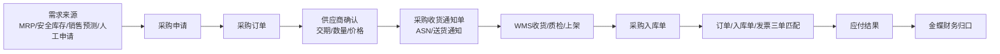
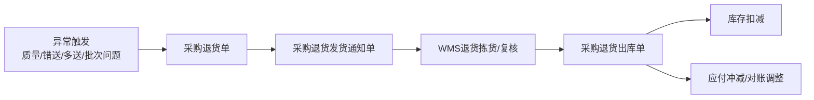
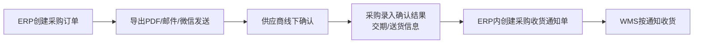
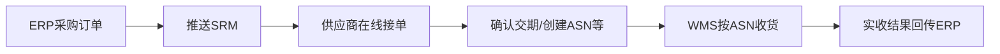
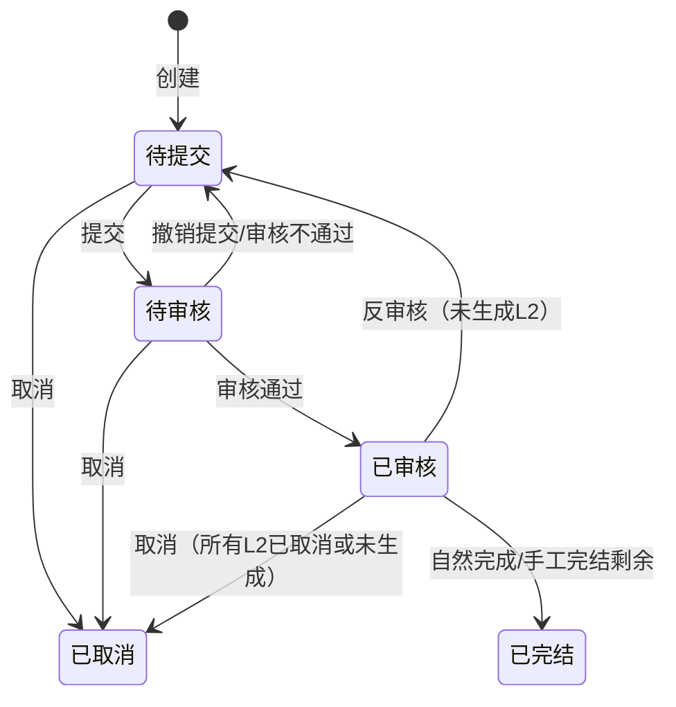
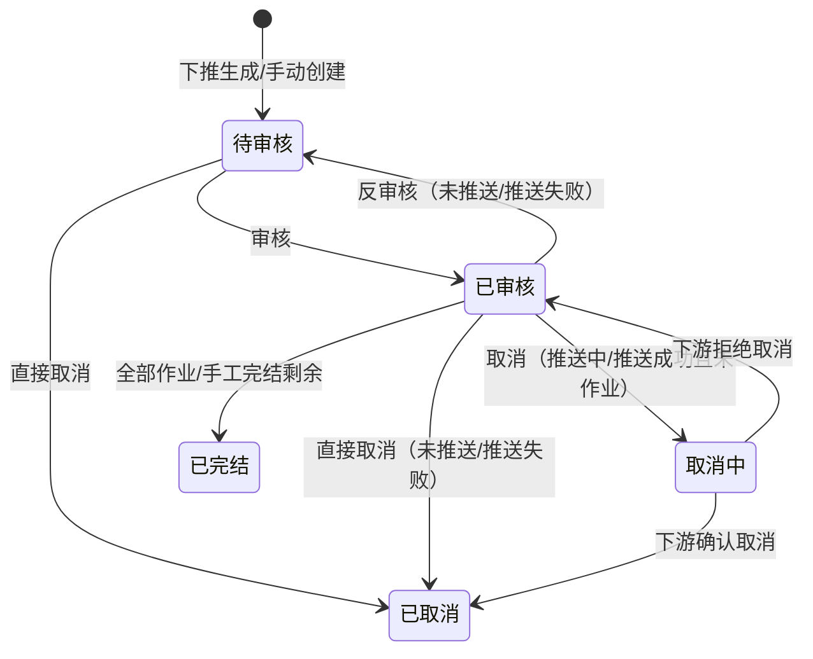
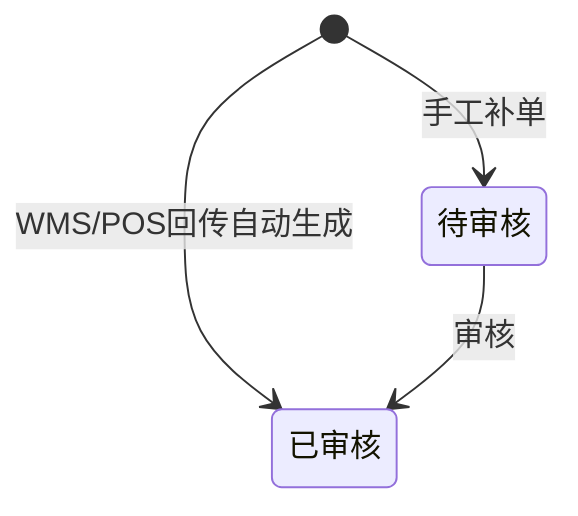
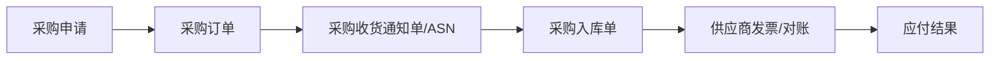
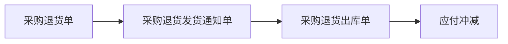

# ERP项目第3讲：采购链路与三层单据设计


| 项目   | 内容                                                        |
| ---- | --------------------------------------------------------- |
| 面向人群 | 已完成ERP第1讲、第2讲，并理解ERP主数据基础口径的学员                            |
| 学习时长 | 90分钟                                                      |
| 难度等级 | ⭐⭐⭐                                                       |
| 前置课程 | [ERP项目第2讲：ERP主数据体系架构与功能设计](./ERP项目第2讲-ERP主数据体系架构与功能设计.md) |


## 1. 课程背景

第2讲我们讲了ERP主数据。主数据解决的是一个基础问题：采购、销售、库存、财务和下游系统到底用哪一套商品、供应商、客户、仓库和组织口径。

从这一讲开始，我们正式进入ERP V1的后台主链路设计。第一条主链路，就是采购。

为什么先讲采购？

因为采购是ERP里最早把主数据真正用起来的业务模块：


| 主数据   | 在采购链路里怎么被使用            |
| ----- | ---------------------- |
| 商品/物料 | 采购订单要明确买什么、规格是什么、单位是什么 |
| 供应商   | 采购订单要明确向谁买、账期是什么、是否能接单 |
| 仓库    | 到货后要明确入哪个仓、由哪个WMS仓库执行  |
| 组织    | 要明确采购归属、成本归属、审批归属什么组织  |
| 财务口径  | 后续对账、发票、应付和金蝶凭证都要引用    |


但这一讲不能只讲「采购订单怎么填」。

在进销存阶段，采购通常可以简单理解为：

```text
采购订单 → 采购入库单
```

到了强盛科技阶段4，采购已经变成一条跨系统链路：

```text
需求来源 → 采购申请（可选） → 采购订单 → 供应商确认 → 采购收货通知单/ASN → WMS收货入库 → 对账/发票 → 应付与金蝶
```

而且采购不只有正向流程，还有逆向流程：

```text
采购退货单 → 采购退货发货通知单 → 采购退货出库单 → 应付冲减/对账调整
```

所以这一讲重点讲一个概念：**采购单据分层**。在主流、偏复杂的 ERP 里，通常会把采购（及同类出入库业务）拆成 **三层单据体系**（业务意图 → 仓库/门店执行通知 → 实收实发结果），本讲后面的状态与联动都按这套三层单据体系来讲。

考虑到课程的时间有限，大家初次接触这个概念，理解起来也会有一定的难度，所以本课不把采购模块讲成完整 SRM/WMS/财务实施课。课堂里只抓住三件事：

1. 采购正向链路怎么从采购订单走到入库和应付；
2. 采购退货链路怎么从退货申请走到出库和应付冲减；
3. 单据状态、数量回写和异常处理怎么避免混在一起。

采购管理不是「采购订单 + 入库单」这么简单，而是一套围绕采购订单逐步展开的单据体系。它要同时回答：

1. 企业计划向供应商买什么？
2. 供应商这次准备送什么？
3. 仓库最终实际收了什么？
4. 如果货有问题，怎么退？
5. 财务最后按什么口径确认应付？

这一讲我们就从这个角度，把ERP里的采购订单体系拆清楚。

## 2. 学习目标

- 能说清ERP采购管理和进销存采购管理的区别
- 能理解采购单据分层：两层结构和三层结构分别适合什么场景
- 能画出采购正向三层单据链路：采购订单 → 采购收货通知单/ASN → 采购入库单
- 能画出采购退货的基础逆向链路：采购退货单 → 采购退货出库单；并知道复杂场景可加退货发货通知单
- 能说清没有SRM和有SRM时，企业与供应商协同方式有什么不同
- 能区分采购申请、采购订单、采购收货通知单、采购入库单、采购退货单、采购退货发货通知单、采购退货出库单的职责
- 能画出 L1/L2/L3 三层单据的核心状态流转，并说明取消、完结、结果单分别用在哪一层
- 能说明单据头状态和单据行状态的关系，尤其是一张采购订单不同 SKU 行可以分别下推通知单
- 能说明部分到货、到货与ASN不一致、超量到货、质量异常、采购退货、采购订单变更等关键异常怎么处理
- 能说清三单匹配的基础含义，以及ERP为什么不能只在采购订单确认时直接生成最终应付

**本讲交付物**：采购正向单据关系图 + 采购退货逆向单据关系图 + L1/L2/L3 状态流转图 + 采购订单行状态与数量字段变化表

## 3. 课程内容

### 3.1 ERP采购管理和进销存采购有什么不同

进销存项目里，我们也讲过采购入库。那一讲重点解决的是：

- 买什么
- 向谁买
- 到货后怎么入库
- 退货怎么出库
- 库存和基础应付怎么变化

这些内容当然重要，但到了ERP阶段，采购模块的复杂度会明显上升。原因不是采购这个词变高级了，而是业务背景变了。

强盛科技阶段4已经不是小团队靠经验采购，也不是单纯从市场拿货再卖货。它进入了供应链深耕期：

- SKU从铺货转向精品策略
- 供应商超过200家
- 参股/深度绑定3家核心工厂
- 供应链中心有采购、计划、仓储、品质等角色
- IT部开始自研ERP、WMS、SRM
- 金蝶从供应链业务主系统退回财务底座

这时候，采购链路要解决的问题已经不只是「货怎么进来」，而是：


| 维度    | 进销存采购更关注       | ERP采购更关注                            |
| ----- | -------------- | ----------------------------------- |
| 需求来源  | 人工判断补货、销售反馈    | MRP（物料需求计划）、安全库存、销售预测、人工申请等多种方式驱动   |
| 采购对象  | 多数是成品采购        | 原料、包材、半成品、成品、委外加工都可能涉及              |
| 供应商协同 | 电话、微信、线下确认     | ERP/SRM接单、交期确认、ASN（预发货通知单）、标签/箱码    |
| 仓库执行  | 入库单确认收货数量后库存增加 | WMS真实收货、质检、上架后回传ERP                 |
| 单据分层  | 常见两层：订单→入库     | 更常见三层：订单→收货通知→入库                    |
| 财务口径  | 基础应付查询         | 采购订单、入库结果（入库单）、发票三单匹配，再推送给金蝶/SAP等系统 |
| 追溯颗粒度 | 能查到采购和入库       | 要能追溯供应商、批次、箱码、入库、退货、应付              |


所以这一讲不是重复进销存采购，而是要把ERP采购里的单据分层、系统边界和协同逻辑讲清楚。在主流的ERP中，这种单据分层，不同层级的单据各司其职的设计，是非常常见的，也是供应链产品经理需要掌握的关键技能。

### 3.2 强盛科技阶段4采购场景发生了什么变化

阶段4有几个很关键的变化。

#### 3.2.1 采购不再只是买成品

阶段3的时候，采购更多是围绕成品和常规3C周边补货。到了阶段4，强盛科技开始做精品SKU和深度供应链。开始涉及更多的原料、包材、半成品、成品、委外加工等采购场景：

- 有些商品涉及BOM
- 有些供应商是成品代工厂
- 有些供应商提供原料、包材、结构件
- 有些采购与新品计划、渠道备货、工厂产能有关

也就是说，采购订单背后可能不只是「买1000个成品」，还可能是：

- 为某个成品采购配件
- 为某个BOM准备物料
- 为亚马逊备货做提前采购
- 为国内电商大促准备成品库存
- 为核心工厂安排供货节奏

本讲不会把 BOM/MRP 讲成制造 ERP 课，但要让大家知道：**ERP采购的需求来源，比进销存采购复杂得多。**

#### 3.2.2 供应商协同不再只靠人盯

阶段3很多协同靠微信、电话、Excel：

- 采购问供应商什么时候发货
- 供应商口头说这周五到
- 仓库不知道具体哪天来货
- 到货后现场才发现数量不对、型号不对、包装不对

阶段4引入SRM之后，供应商协同要逐步线上化：

- 供应商在线确认采购订单
- 供应商在线反馈交期
- 供应商创建采购收货通知单/ASN（Advanced Shipping Notice 预发货通知单）
- 供应商需要提前按要求打印商品的标签、箱码等
- 仓库需要ASN来提前准备收货，准备人力、物力、空间，支持供应商送货前预约等
- ERP沉淀订单、到货、入库和对账结果

这就是为什么采购链路需要多一层「采购收货通知单」。它不是为了多一张表，而是为了把供应商准备送货这件事提前结构化。

#### 3.2.3 仓库执行交给WMS，ERP不再自己“点入库”

在阶段4里，自研WMS开始接管仓内执行。ERP不应该直接假设「供应商说送了多少，仓库就一定收了多少」。真实世界里经常会出现：

- 供应商通知送1000个，实际只到960个
- 外箱标签和系统不一致
- 实物规格不一致
- 部分破损
- 需要质检后才能正式入库
- 送错批次或送错仓

所以ERP采购订单表达计划，采购收货通知单表达供应商准备送货，采购入库单表达WMS确认后的真实结果。这三者不能混在一起，各有各的职责。

#### 3.2.4 财务要的不只是“采购了多少钱”

到了拟上市和业财一体阶段，财务会关心：

- 采购订单中的采购价格、金额是多少
- 实际入库的商品数量、金额是多少
- 供应商发票金额是多少，税额是多少
- 退货是否冲减应付，冲减了多少
- 差异是否有审批和原因说明
- 单据能不能从ERP追溯到金蝶凭证，凭证号是多少

所以采购模块不只是业务模块，也会影响财务协同。作为供应链产品经理，我们不能只考虑实物流和信息流，一定是还需要加上考虑资金流，也就是兼顾财务的需求。

### 3.3 采购订单体系先看全貌

ERP采购订单体系，大体上可以拆分成2条链路，一条是正向业务，一条是逆向业务。然后课程在讲解的过程中会更倾向于多讲正向业务，同时又考虑到ERP和SRM的协同相关的内容也比较重要，所以我们大致拆成3条线来讲：

1. 正向采购链路
2. 逆向采购退货链路
3. 供应商协同链路

#### 3.3.1 正向采购链路




这条链路里，最核心的是3张业务单据：


| 单据          | 回答的问题                          |
| ----------- | ------------------------------ |
| 采购订单        | 企业计划向供应商买什么、买多少、什么价格、什么时候要     |
| 采购收货通知单/ASN | 供应商这一次准备送什么、送多少、什么时候到、箱码/标签是什么 |
| 采购入库单       | 仓库最终实际收了什么、合格多少、不合格多少、入到哪里     |


**采购收货通知单是供应商送货前或送货时提交的ASN/送货通知。** 它的核心价值，是让仓库在货到之前就知道这次会来什么货，而不是等货车到了再临场处理。

#### 3.3.2 逆向采购退货链路

采购不是只有正向到货。只要有采购正向业务，就一定会有逆向退货的业务：

- 到货后发现质量不合格
- 入库后抽检发现问题
- 供应商送错型号
- 多送了不需要的货
- 后续使用时发现批次问题
- 财务对账时发现应付需要冲减

完整的采购退货链路可以这样理解：




这条链路里的3张单据分别是：


| 单据        | 回答的问题                          |
| --------- | ------------------------------ |
| 采购退货单     | 为什么退、退给谁、退什么、责任怎么归属            |
| 采购退货发货通知单 | 这一次准备退哪些货、什么时候退、通知哪个供应商、仓库怎么准备 |
| 采购退货出库单   | WMS最终实际退了什么、出库多少、库存和应付怎么调整     |


很多小系统会把采购退货做得很简单：

```text
采购退货单 → 采购退货出库单
```

这在简单场景里没问题。

但如果企业已经有SRM、WMS、箱码、批次、供应商预约退货、财务冲减，就更适合做三层结构：

```text
采购退货单 → 采购退货发货通知单 → 采购退货出库单
```

#### 3.3.3 供应商协同链路

采购订单体系，还有一个比较经典和关键的场景，那就是我们的ERP是否要和SRM系统进行协同？还是基于ERP自己内部自闭环？不让供应商参与系统层面的协同交互？

如果没有SRM，供应商不直接进系统，采购协同只能靠线下完成：




如果有SRM，供应商可以进入协同链路：




SRM不是简单地多一个供应商登录页面。它真正改变的是：供应商从线下沟通对象，变成采购单据链路里的在线协同参与方。本节课只讲 ERP 采购主链路，SRM 先讲到协同边界，不展开供应商门户的完整功能。

### 3.4 正向单据分层：两层单据与三层单据

在讲解正向采购链路之前，我们先来简单回顾一下采购单据分层的概念：两层与三层的区别和用途、**多张业务单据之间的实体关系（例如 1:N、1:1）**，以及**自上而下逐步生成/下推**单据时产品侧要守住的口径。

#### 3.4.1 两层单据结构

两层结构最常见：

```text
采购订单 → 采购入库单
```

它的逻辑是：

- 采购订单：计划买什么
- 采购入库单：实际入了什么

这种结构适合比较简单的场景：

- 供应商少
- 到货批次少
- 不需要预约送货
- 不需要供应商在线协同
- 仓库收货相对简单
- 没有复杂箱码、标签、批次要求

比如一个小公司采购办公用品，采购订单下给供应商，货到了仓库直接收货入库，两层结构就够用。

#### 3.4.2 三层单据结构

三层结构是：

```text
采购订单 → 采购收货通知单（ASN/送货通知）→ 采购入库单
```

它把「供应商准备送货」这件事单独抽出来。


| 层级  | 单据          | 核心含义                    |
| --- | ----------- | ----------------------- |
| 第一层 | 采购订单        | 企业计划采购什么，是合同和计划口径       |
| 第二层 | 采购收货通知单/ASN | 供应商本次准备送什么，是到货预告和收货准备口径 |
| 第三层 | 采购入库单       | 仓库实际收了什么，是库存和应付口径       |


为什么要多这一层？

因为采购订单和实际到货之间，通常不是一一对应。一张采购订单可能会：

- 分多次送货
- 每次送货数量不同
- 有不同箱码和批次
- 有不同预计到货时间
- 有部分货先到，部分货后到
- 有些送货需要预约仓库月台
- 有些货需要先质检再入库

如果没有采购收货通知单，系统只能在采购订单和采购入库单之间硬连。这样会导致：

- 仓库不知道今天会来哪些货
- 供应商送货没有结构化记录
- 到货差异不好判断
- WMS收货缺少预期数据
- 后续追溯不知道这次送货对应哪次供应商通知

所以强盛科技阶段4更适合三层结构。

#### 3.4.3 单据实体关系与自上而下生成

分层结构一旦落地成系统，就不只是「画三张纸」，而是要在数据模型里把**主从关系**和**生成顺序**说清楚。采购正向链路上，最常见的实体关系可以概括如下。


| 关系              | 典型基数         | 含义（采购正向）                                                                                  |
| --------------- | ------------ | ----------------------------------------------------------------------------------------- |
| 采购订单 → 采购收货通知单  | **1:N**      | 一张订单可以分多次送货；每次送货（或每次供应商/物流侧确认的到货批次）对应一张或多张通知单。行级往往是「订单行拆成多行通知」，数量在通知单上逐次扣减订单的「可通知/可收货」数量。 |
| 采购收货通知单 → 采购入库单 | **多数场景 1:1** | 一张通知单对应仓库/WMS的一次收货作业闭环：有预期、有实绩，一张入库单（或一张与WMS回传一一对应的收货结果单）最利于对账与追溯。                        |
| 采购订单 → 采购入库单    | **间接 1:N**   | 通过多张通知单叠加，订单最终会对应多张入库单；两层结构时则是订单直接 1:N 到入库单。                                              |


基数上的例外（面试和方案评审里常被问到）：

- **通知单 → 入库单不是严格的数学 1:1**：例如一次收货拆成「合格入库 + 不合格待处理」两张结果单、跨仓拆分、或事后补录/冲销再重做时，会出现 1:N；少数企业会把多次到货合并过账，也会出现 N:1。产品讨论时建议说**「默认按 1:1 设计，在规格里写清允许拆分的条件」**，避免实施时各说各话。
- **两层结构**下没有通知单这一层，关系退化为「采购订单 → 采购入库单」的 **1:N**，差异追溯只能压在订单行与入库行上，对仓库与协同不友好。

**自上而下生成（下推）**是主流做法：业务含义是「上层单据先锁定意图与数量口径，下层单据在上游状态允许时生成，并继承关联键」。

```text
采购订单（已审核/允许收货）
    → 下推或协同生成 → 采购收货通知单（按本次到货维度）
        → WMS按通知执行 → 采购入库单（实收结果；可由WMS回传驱动ERP生成）
```

要点：

- **顺序**：一般是 PO → ASN → GRN 逐级出现；不会「先有入库单再补订单」作为正常流程（补单、追溯录入属于例外流程，要单独建模权限与审计）。
- **数量联动**：不要只写一个“订单状态”。建议至少拆出 `采购数量`、`已通知数量`、`累计入库数量`、`未入库数量`、`可通知数量`。这样才能区分“供应商已经通知要送”和“仓库已经实际收货”，避免把通知数和入库数混在一起。
- **关联键设计**：入库单头建议同时保留 `采购订单ID` 与 `采购收货通知单ID`（见下一小节字段表）。这样报表既能按合同/订单看执行率，也能按「第几次送货」看差异。

两层结构里对应的是「订单直接下推入库单」或仓库手工选订单行生成入库单，少了「到货预告」这一刀，但**自上而下**仍然是：先意图、后结果。

#### 3.4.4 三层结构先看职责，不急着堆字段

这一小节先只看每张单的设计重点。具体字段放到 3.8，等状态流转讲清楚之后再补。


| 单据      | 先抓住什么      | 设计重点               |
| ------- | ---------- | ------------------ |
| 采购订单    | 企业打算买什么    | 管计划、价格、合同、审批和供应商承诺 |
| 采购收货通知单 | 供应商本次准备送什么 | 管到货预告、仓库准备和供应商协同   |
| 采购入库单   | 仓库实际收了什么   | 管实收结果、库存增加和应付依据    |


注意：采购入库单不能只关联采购订单，最好也能关联采购收货通知单。

这样才能追溯：

```text
采购订单计划1000个
供应商第一次ASN通知送600个
WMS实际收货590个
其中合格580个，不合格10个
```

这比只看「订单1000个、入库580个」清楚得多。

### 3.5 逆向单据分层：采购退货怎么讲到够用

采购退货不要一上来就讲成复杂逆向体系。90 分钟基础版先让学员掌握一个判断：**退货单不是出库结果，真正影响库存的是退货出库单。**

基础结构是：

```text
采购退货单 → 采购退货出库单
```

复杂结构是：

```text
采购退货单 → 采购退货发货通知单 → 采购退货出库单
```


| 单据        | 基础课要讲清什么                   | 什么时候需要加深                  |
| --------- | -------------------------- | ------------------------- |
| 采购退货单     | 为什么退、退给谁、退什么、计划退多少、责任归属是什么 | 退货审批、换货、扣款、供应商责任判定复杂时     |
| 采购退货发货通知单 | 本次准备退哪些货、什么时候退、仓库怎么准备      | 有 WMS、批次/箱码、供应商预约接货、多次退货时 |
| 采购退货出库单   | 仓库实际退了什么，库存和应付冲减按它落账       | 需要和 WMS、财务、供应商对账强关联时      |


所以课堂里可以这样讲：

- 小系统：退货单直接下推退货出库单。
- 有 WMS/SRM 的系统：中间增加退货发货通知单，用来承接仓库执行和供应商协同。
- 无论哪种结构，**采购退货单不等于库存已经减少**，只有退货出库单审核或 WMS 回传后，库存和应付冲减才有依据。

### 3.6 无SRM和有SRM：采购协同链路有什么不同

采购订单体系还要回答一个问题：供应商是否参与系统协同？


| 模式    | 谁确认订单/交期         | 谁创建 ASN                | 优点                  | 风险                   |
| ----- | ---------------- | ---------------------- | ------------------- | -------------------- |
| 无 SRM | 供应商线下确认，采购录入 ERP | 采购代供应商创建               | 上线快，不要求供应商配合系统      | 留痕弱，交期变化靠人盯，标签/箱码难前置 |
| 有 SRM | 供应商在线确认          | 供应商在 SRM 创建，回传 ERP/WMS | 协同留痕好，仓库可提前按 ASN 收货 | 建设成本高，需要供应商配合        |


基础版只要求学员记住一句话：**SRM 不是替代 ERP，而是把供应商确认、交期反馈、ASN、标签/箱码这些协同动作从线下搬到线上。**

强盛科技阶段4已经有 200+ 供应商、核心工厂、WMS 和 SRM 建设诉求，所以适合按三层单据和 SRM 协同方向设计。但不是所有公司一上来都要做 SRM，很多企业会先用 ERP + 线下协同跑起来，再逐步把重点供应商接进 SRM。

### 3.7 先把单据和状态流转搞清楚

这一节先不急着列字段。做 ERP 单据设计时，顺序应该是：

```text
先确定有多少张单据 → 再确定每张单据属于哪一层 → 再确定每层状态怎么流转 → 最后再补字段
```

如果先堆字段，容易把“审批状态、执行状态、库存结果、财务结果”混到同一个字段里，后面做异常流程时一定会乱。

#### 3.7.1 本讲涉及几张单据

采购主链路里，本讲重点看 6 张核心单据；采购申请是可选前置单据，不放进三层主状态机里深讲。


| 层级        | 单据          | 解决什么问题                  | 本讲重点         |
| --------- | ----------- | ----------------------- | ------------ |
| 可选前置      | 采购申请        | 内部为什么要采购                | 知道它可选，不深讲状态机 |
| L1 业务订单层  | 采购订单        | 企业正式向供应商买什么             | 重点讲          |
| L2 通知/执行层 | 采购收货通知单/ASN | 供应商本次准备送什么，仓库准备收什么      | 重点讲          |
| L3 结果层    | 采购入库单       | 仓库实际收了什么，库存和应付依据是什么     | 重点讲          |
| L1 业务订单层  | 采购退货单       | 为什么退，计划退什么              | 重点讲          |
| L2 通知/执行层 | 采购退货发货通知单   | 本次准备退哪些货，仓库准备怎么退        | 复杂场景讲        |
| L3 结果层    | 采购退货出库单     | 仓库实际退了什么，库存扣减和应付冲减依据是什么 | 重点讲          |


可以先让学员记住一张总表：


| 层级  | 管什么  | 正向采购        | 采购退货      | 库存是否变化 |
| --- | ---- | ----------- | --------- | ------ |
| L1  | 业务意图 | 采购订单        | 采购退货单     | 不变化    |
| L2  | 执行通知 | 采购收货通知单/ASN | 采购退货发货通知单 | 不变化    |
| L3  | 执行结果 | 采购入库单       | 采购退货出库单   | 变化     |


#### 3.7.2 L1：采购订单、采购退货单的状态流转

L1 管的是业务意图和审批生命周期。采购订单和采购退货单可以共用一套基础状态。


| 状态字段 | 状态值       | 说明                         |
| ---- | --------- | -------------------------- |
| 单据状态 | 待提交       | 草稿状态，可编辑                   |
| 单据状态 | 待审核       | 已提交，等待审核；可撤销提交回到待提交        |
| 单据状态 | 已审核       | 审核通过，可生成 L2                |
| 单据状态 | 已取消       | 单据终止，终态                    |
| 单据状态 | 已完结       | 不再继续执行，可能是自然完成，也可能是剩余量手工完结 |
| 完结方式 | 自然完成/手工完结 | 区分“全部执行完”和“剩余不做了”          |





操作矩阵抓这几条就够：


| 当前状态 | 可做什么                | 前置条件                          | 结果                    |
| ---- | ------------------- | ----------------------------- | --------------------- |
| 待提交  | 编辑、提交、取消            | 必填字段校验通过才能提交                  | 待审核或已取消               |
| 待审核  | 撤销提交、审核通过、取消        | -                             | 待提交、已审核或已取消           |
| 已审核  | 生成 L2、反审核、手工完结剩余、取消 | 反审核要求未生成 L2；取消要求所有 L2 已取消或未生成 | 状态保持已审核、退回待提交、已完结或已取消 |
| 已取消  | 无                   | 终态                            | 不可继续操作                |


这里有两个关键点：

- L1 不需要“取消中”。如果存在未取消的 L2，L1 的取消按钮应该禁用，提示先取消下游通知单。
- 采购退货单是出库类业务，审核后可能触发库存预占或冻结；采购订单是入库类业务，通常不预占库存。

**L1 还必须看单据行状态。** 因为一张采购订单通常有多行 SKU，不同行可以分别生成下游通知单。


| 行级字段/状态     | 说明              |
| ----------- | --------------- |
| 采购数量/计划数量   | 这一行原计划采购或退货多少   |
| 已通知数量       | 已经生成 L2 通知单的数量  |
| 累计入库/累计出库数量 | 已经由 L3 结果单回写的数量 |
| 未入库/未出库数量   | 还没有形成结果的数量      |
| 可通知数量       | 还能继续生成 L2 的数量   |
| 行状态         | 进行中 / 已完结       |
| 完结方式        | 自然完成 / 手工完结     |


行状态的判断比头状态更细：


| 场景                | 行状态怎么理解       |
| ----------------- | ------------- |
| SKU A 已全部通知并全部入库  | SKU A 行可以自然完结 |
| SKU B 只通知了一部分     | SKU B 行仍是进行中  |
| SKU C 入了一部分，剩余不再要 | SKU C 行手工完结   |


单据头状态由行状态汇总：只要还有任意一行未完结，头就不能自然完结；所有行都自然完成或手工完结后，单据头才进入已完结。

#### 3.7.3 L2：采购收货通知单、采购退货发货通知单的状态流转

L2 管的是执行通知。它比 L1 多了两个状态维度：是否推送下游、下游是否已经作业。


| 状态字段   | 状态值                    | 说明                             |
| ------ | ---------------------- | ------------------------------ |
| 单据状态   | 待审核                    | 下推生成或手工创建后的初始状态                |
| 单据状态   | 已审核                    | 审核后可推送 WMS/POS                 |
| 单据状态   | 取消中                    | 已推送下游后发起取消，等待下游确认              |
| 单据状态   | 已取消                    | 取消成功，终态                        |
| 单据状态   | 已完结                    | 本次通知不再继续执行，可能是全部作业，也可能是剩余量手工完结 |
| 推送下游状态 | 未推送、推送中、推送成功、推送失败、无需推送 | 表示是否已经给 WMS/POS                |
| 作业状态   | 未作业、部分作业、全部作业          | 表示 WMS/POS 是否已经回传执行结果          |
| 完结方式   | 自然完成/手工完结              | 区分全部作业完成和剩余不再执行                |





L2 的取消不是只看单据状态，还要看推送和作业：


| 单据状态 | 推送下游     | 作业状态      | 能不能取消              |
| ---- | -------- | --------- | ------------------ |
| 待审核  | -        | -         | 可以直接取消             |
| 已审核  | 未推送/推送失败 | 未作业       | 可以直接取消             |
| 已审核  | 推送中/推送成功 | 未作业       | 进入取消中，等 WMS/POS 确认 |
| 已审核  | 任意       | 部分作业/全部作业 | 不能取消，只能完结剩余        |


作业状态在业务页面上可以换成更容易理解的名称：


| 通知单       | 底层作业状态        | 业务展示          |
| --------- | ------------- | ------------- |
| 采购收货通知单   | 未作业、部分作业、全部作业 | 未收货、部分收货、全部收货 |
| 采购退货发货通知单 | 未作业、部分作业、全部作业 | 未发货、部分发货、全部发货 |


**L2 也要看单据行状态。** 通知单通常是整单推送到 WMS/POS，但 WMS/POS 回传结果时，差异往往发生在行级。


| 行级字段/状态 | 说明                  |
| ------- | ------------------- |
| 通知数量    | 本次通知这个 SKU 要收/要发多少  |
| 实际作业数量  | WMS/POS 实际收货或实际发货数量 |
| 差异数量    | 通知数量 - 实际作业数量       |
| 行作业状态   | 未作业 / 部分作业 / 全部作业   |
| 行状态     | 进行中 / 已完结           |
| 完结方式    | 自然完成 / 手工完结         |


例如一张 ASN 整单推送给 WMS，里面有 3 个 SKU：


| SKU   | 通知数量 | WMS实收 | 行作业状态 | 行状态 |
| ----- | ---- | ----- | ----- | --- |
| SKU A | 100  | 100   | 全部作业  | 已完结 |
| SKU B | 50   | 30    | 部分作业  | 进行中 |
| SKU C | 20   | 0     | 未作业   | 进行中 |


这时通知单头可以显示“部分收货”，但真正判断后续还能不能继续处理，要看每一行。只有所有行都全部作业或手工完结，L2 头才进入已完结。

#### 3.7.4 L3：采购入库单、采购退货出库单的状态流转

L3 管的是执行结果。采购入库单和采购退货出库单一旦审核，就会影响库存和后续财务口径，所以不能像 L1/L2 一样随便取消。

结果单的状态不要设计得太复杂。对学员来说，L3 只需要先理解两个主状态：


| 状态字段   | 状态值               | 说明                   |
| ------ | ----------------- | -------------------- |
| 单据状态   | 待审核               | 少量手工补单场景             |
| 单据状态   | 已审核               | WMS/POS 回传生成时通常直接已审核 |
| 推送金蝶状态 | 未推送、推送中、推送成功、推送失败 | 表示财务归口系统是否接收         |





L3 的操作规则：


| 当前状态 | 可做什么 | 结果               |
| ---- | ---- | ---------------- |
| 待审核  | 审核   | 已审核，触发库存变化       |
| 已审核  | 重推金蝶 | 单据状态不变，只更新推送金蝶状态 |


#### 3.7.5 取消、完结怎么选


| 动作     | 适用层级  | 什么时候用                 | 对库存/财务的影响           |
| ------ | ----- | --------------------- | ------------------- |
| 取消     | L1/L2 | 还没有形成执行结果             | 释放预占或回补可通知量，不形成财务凭证 |
| 已完结    | L1/L2 | 全部执行完成，或已经执行一部分但剩余不做了 | 保留已发生结果，不再继续执行      |
| 一句话判断： |       |                       |                     |


- 没有 L3 结果：优先取消。
- 已有 L3 结果，但剩余不做：已完结，完结方式=手工完结。

#### 3.7.6 三层单据怎么互相回写


| 事件      | 回写目标 | 回写内容              |
| ------- | ---- | ----------------- |
| L2 创建成功 | L1 行 | 已通知数量 +N，可通知数量 -N |
| L2 取消成功 | L1 行 | 已通知数量 -N，可通知数量 +N |
| L3 审核过账 | L2 行 | 实际作业数量更新，行作业状态变化  |
| L3 审核过账 | L1 行 | 累计入库/累计出库数量更新     |


头状态不要直接手工维护，优先由行状态汇总：


| 汇总对象     | 汇总规则                |
| -------- | ------------------- |
| L1 头已完结  | 所有 L1 行均已完结         |
| L2 头全部作业 | 所有 L2 行均全部作业或手工完结   |
| L2 头部分作业 | 至少一行有实际作业，但不是所有行都完结 |
| L2 头未作业  | 所有 L2 行实际作业数量都为 0   |


#### 3.7.7 状态流转案例：采购订单到入库


| 节点       | 采购订单 L1   | 收货通知单 L2 | 入库单 L3 | 行级数量变化             |
| -------- | --------- | -------- | ------ | ------------------ |
| 创建 PO    | 待提交       | -        | -      | PO行：采购数量1000       |
| 提交 PO    | 待审核       | -        | -      | 不影响库存              |
| 审核 PO    | 已审核       | -        | -      | PO行：可通知1000        |
| 生成 ASN-1 | 已审核       | 待审核/已审核  | -      | PO行：已通知600，可通知400  |
| WMS 实收   | 已审核       | 全部收货，已完结 | 已审核    | PO行：累计入库600        |
| 生成 ASN-2 | 已审核       | 待审核/已审核  | -      | PO行：已通知1000，可通知0   |
| WMS 再实收  | 已完结（自然完成） | 全部收货，已完结 | 已审核    | PO行：累计入库1000，行自然完结 |


注意：不要为了部分到货新增一个“部分到货”主状态。部分到货应该用已通知、累计入库、未入库表达；全部完成或剩余不做时，再进入已完结。

#### 3.7.8 状态流转案例：采购退货到出库


| 节点        | 采购退货单 L1 | 退货发货通知单 L2 | 退货出库单 L3 | 数量变化               |
| --------- | -------- | ---------- | -------- | ------------------ |
| 创建退货单     | 待提交      | -          | -        | 计划退200             |
| 审核退货单     | 已审核      | -          | -        | 可通知200，可按规则预占/冻结库存 |
| 生成退货通知    | 已审核      | 待审核/已审核    | -        | 已通知120，可通知80       |
| WMS 实发    | 已审核      | 部分/全部发货    | 已审核      | 累计出库120            |
| 继续退货或完结剩余 | 已审核/已完结  | 继续生成通知或完结  | -        | 剩余80继续执行或手工完结      |


### 3.8 状态清楚后，再放字段

状态流转清楚之后，再补字段。字段不是越多越好，先围绕“状态能不能跑通、数量能不能回写、上下游能不能追溯”来选。

#### 3.8.1 采购申请（可选前置）


| 字段         | 说明                 |
| ---------- | ------------------ |
| 申请单号       | 系统生成               |
| 需求来源       | MRP、安全库存、渠道备货、人工申请 |
| 申请组织/申请人   | 谁发起需求              |
| 商品/物料、申请数量 | 需要采购什么、多少          |
| 期望到货日期     | 什么时候需要             |
| 用途说明       | 备货、补货、新品、项目等       |
| 审批状态       | 可用简单审批流，不纳入三层主状态机  |


#### 3.8.2 采购订单（L1）


| 字段           | 说明                            |
| ------------ | ----------------------------- |
| 采购订单号        | 系统生成                          |
| 供应商、采购组织、采购员 | 从主数据和组织体系引用                   |
| 商品/物料明细      | SKU/物料、规格、采购单位、单位换算、数量        |
| 价格与税         | 采购单价、税率、价税合计、价格来源             |
| 交期与收货        | 期望到货日期、收货仓库                   |
| 来源单据         | 采购申请、MRP建议、手工创建               |
| 状态字段         | 单据状态、完结方式                     |
| 行级数量字段       | 采购数量、已通知数量、累计入库数量、未入库数量、可通知数量 |
| 行级状态字段       | 行状态、完结方式                      |
| 变更字段         | 变更版本、变更原因、是否重新审批、是否重新通知供应商    |


#### 3.8.3 采购收货通知单/ASN（L2）


| 字段         | 说明                    |
| ---------- | --------------------- |
| 通知单号       | 系统生成                  |
| 关联采购订单     | 必填，用于回写 L1            |
| 供应商、送货仓库   | 从采购订单带出或按本次送货维护       |
| 本次通知数量     | 供应商本次准备送多少            |
| 预计到货时间     | 仓库排班、预约、收货准备使用        |
| 箱码/标签、物流信息 | 供 WMS 收货扫码和追溯         |
| 状态字段       | 单据状态、推送下游状态、作业状态、完结方式 |
| 行级状态字段     | 行作业状态、行状态、差异数量        |


#### 3.8.4 采购入库单（L3）


| 字段                | 说明                |
| ----------------- | ----------------- |
| 入库单号              | 系统生成              |
| 关联采购订单、关联收货通知单    | 用于订单维度和到货批次维度追溯   |
| 实收数量、合格数量、不合格数量   | 以 WMS/仓库实收为准      |
| 入库仓库、批次/生产日期、上架结果 | 影响库存和追溯           |
| 状态字段              | 单据状态、推送金蝶状态       |
| 财务字段              | 是否形成预计应付、是否进入三单匹配 |


#### 3.8.5 采购退货单（L1）


| 字段             | 说明                              |
| -------------- | ------------------------------- |
| 退货单号           | 系统生成                            |
| 关联采购订单/采购入库单   | 已入库退货时建议关联入库单                   |
| 供应商、退货商品、退货数量  | 退给谁、退什么、计划退多少                   |
| 退货原因、责任归属、处理方式 | 质量问题、错送、多送、换货、扣款等               |
| 状态字段           | 单据状态、完结方式                       |
| 行级数量字段         | 计划退货数量、已通知数量、累计出库数量、未出库数量、可通知数量 |
| 行级状态字段         | 行状态、完结方式                        |


#### 3.8.6 采购退货发货通知单（L2）


| 字段          | 说明                    |
| ----------- | --------------------- |
| 退货通知单号      | 系统生成                  |
| 关联采购退货单     | 必填，用于回写 L1            |
| 本次通知退货数量    | 本次准备退多少               |
| 预计出库时间、出库仓库 | 仓库准备拣货和发货             |
| 批次/箱码、物流信息  | 指定实际退货批次和物流           |
| 状态字段        | 单据状态、推送下游状态、作业状态、完结方式 |
| 行级状态字段      | 行作业状态、行状态、差异数量        |


#### 3.8.7 采购退货出库单（L3）


| 字段                | 说明            |
| ----------------- | ------------- |
| 退货出库单号            | 系统生成          |
| 关联采购退货单、关联退货发货通知单 | 用于退货计划和执行批次追溯 |
| 实际出库数量、出库仓库、批次/箱码 | 以 WMS 实发为准    |
| 状态字段              | 单据状态、推送金蝶状态   |
| 应付冲减标记            | 是否进入应付冲减或对账调整 |


### 3.9 关键异常流程

采购链路真正考验产品设计的地方，不是正常流程，而是异常。

这一讲重点讲7类异常。

#### 3.9.1 部分到货

部分到货是最常见的异常，也是必须支持的正常支流程。

处理原则：

- 采购订单保留采购数量
- 每次供应商发货后，按实际发货的数量来生成对应采购收货通知单
- 采购订单记录累计已收数量
- 剩余未收数量继续等待后续到货
- 全部到货后：订单行可以自然完成；如果剩余数量不再执行，则进入 **已完结**，完结方式记录为“自然完成”或“手工完结”

按本讲采用的三层体系口径：**不要把「部分到货」写进 L1 的主状态枚举**；部分到货是「数量与 L2 作业状态」现象，L1 用累计入库、未入库、可通知、是否手工完结剩余来管。

不要为了部分到货去拆采购订单。采购订单代表合同和计划，入库单代表每次实际到货。

#### 3.9.2 到货与ASN不一致

供应商通知送600个，实际到了590个，这很常见。

系统要区分：


| 情况   | 处理方式                 |
| ---- | -------------------- |
| 少送   | 按实收数量入库，差异回写采购订单和ASN |
| 多送   | 超出部分拒收，或由采购确认是否接收    |
| 错送   | 仓库拒收或转异常待处理          |
| 规格不符 | 记录异常，必要时触发采购/质检确认    |


这里最重要的是：**库存只能按实收结果更新，不能按ASN通知数量更新。**

#### 3.9.3 超量到货

超量到货有两种处理方式：


| 处理方式   | 适用场景                |
| ------ | ------------------- |
| 直接拒收   | 订单数量严格控制，不允许超收      |
| 采购确认接收 | 业务允许多收，但需要采购确认并补充审批 |


如果允许接收超量，系统要考虑：

- 是否更新采购订单数量
- 是否生成超量接收记录
- 是否影响应付
- 是否需要审批
- 是否影响供应商绩效

#### 3.9.4 质量异常

质量异常可以发生在收货、质检、上架前后。

基础处理方式可以分为：


| 处理方式 | 说明                 |
| ---- | ------------------ |
| 拒收   | 不入库，直接退回供应商        |
| 部分接收 | 合格部分入库，不合格部分待处理或退货 |
| 让步接收 | 业务确认可以接收，但要记录原因    |
| 采购退货 | 已入库后发现问题，走退货链路     |


本讲不展开完整质检模块，但要讲清最小闭环：

```text
到货暂收 → 质检 → 合格入库 / 不合格待处理 / 拒收 / 入库后采购退货
```

也就是说，不合格品不要直接混进可售库存。它至少要落到“不合格待处理、待退货、拒收”这类库存状态或异常记录里，后续再由采购、质检、仓库、财务一起决定处理方式。

#### 3.9.5 采购退货

采购退货分两种：


| 类型    | 说明                  |
| ----- | ------------------- |
| 入库前拒收 | 货到仓库时发现问题，不形成正式入库   |
| 入库后退货 | 已经入库，后续发现问题，需要退给供应商 |


入库前拒收可以在收货/质检环节处理。

入库后退货必须走退货单据链：

```text
采购退货单 → 采购退货发货通知单 → 采购退货出库单
```

因为它会影响库存扣减和应付冲减。

#### 3.9.6 采购订单变更

采购订单审核后，经常还会发生变更：


| 变更类型  | 产品设计要点                              |
| ----- | ----------------------------------- |
| 数量变更  | 已通知、已入库部分不能随意覆盖；未执行部分可以申请变更         |
| 价格变更  | 影响应付、对账和发票匹配，通常需要审批，一般供应商确认之后也不允许更改 |
| 交期变更  | 影响计划、库存预警和供应商履约记录                   |
| 收货仓变更 | 如果已推送 WMS/供应商，需要同步撤回或重新推送           |


所以采购订单变更不要直接改原字段。基础做法是：记录变更前后值、变更原因、发起人、审批结果、是否重新通知供应商。

#### 3.9.7 供应商延期

供应商延期会影响采购、计划、销售和库存。

系统至少要支持：

- 交期字段
- 预计到货日期
- 超期预警
- 供应商反馈新交期
- 采购催办记录
- **交期变更只改日期类字段与预警，不必改 L1 单据状态**（L1 仍为已审核；协同在 SRM/线下完成）

如果有SRM，供应商可以在线反馈延期原因和新交期；如果没有SRM，就由采购手工维护。

### 3.10 三单匹配与应付确认

采购最终一定会走到财务。但 90 分钟基础课不展开完整财务模块，只讲供应链 PM 必须知道的应付边界：ERP不能在采购订单审核通过时就直接确认应付。

原因很简单：采购订单只是计划，货还没到。

更合理的做法是基于三单匹配。

#### 3.10.1 三单是哪三单

采购三单一般指：


| 单据         | 作用               |
| ---------- | ---------------- |
| 采购订单       | 企业计划买什么、价格和数量是多少 |
| 采购入库单/收货结果 | 仓库实际收了什么         |
| 供应商发票      | 供应商最终开票金额是多少     |


也可以理解为：

```text
订单口径 → 收货口径 → 发票口径
```

三者要能对得上，才能稳定确认应付。付款本身通常还会进入财务付款流程，本讲只讲到“应付依据怎么形成”。

#### 3.10.2 为什么不能只看采购订单

如果只看采购订单，会出问题。

比如采购订单采购1000个，每个10元，总金额10000元。

但实际可能是：


| 情况         | 结果            |
| ---------- | ------------- |
| 只到货900个    | 应付不能按1000个确认  |
| 其中20个不合格   | 合格入库和不合格处理要拆开 |
| 供应商开票金额不一致 | 需要差异核查        |
| 后续退货100个   | 应付要冲减         |


所以应付确认不能只依赖采购订单。

#### 3.10.3 强盛科技建议采用的口径

本课程建议采用这个口径：

1. 采购订单审核通过后，不直接生成最终应付。
2. 采购入库单确认后，形成预计应付或待对账金额。
3. 供应商对账时，按采购订单、入库结果、退货结果确认本期应付范围。
4. 供应商发票到达后，做采购订单、入库单、发票三单匹配。
5. 如果发生采购退货，根据采购退货出库结果冲减应付。
6. 匹配完成后，将应记账结果推送给金蝶。

可以把它理解成四层：


| 层次   | 含义                   | 本课掌握到什么程度              |
| ---- | -------------------- | ---------------------- |
| 预计应付 | 入库后，系统先知道大概应该付多少钱    | 知道它来自入库结果，不来自采购订单审核    |
| 采购对账 | 采购、供应商、财务确认本期入库和退货范围 | 知道退货、差异、扣款会影响对账        |
| 发票匹配 | 发票金额、税额与订单/入库结果核对    | 知道三单匹配是为了防止多付、错付       |
| 应付入账 | 匹配后的结果进入金蝶/财务系统      | 知道 ERP 推送的是业务确认后的应记账结果 |


这样设计的好处是：

- 库存和应付有真实入库依据
- 采购退货可以冲减应付
- 财务能追溯订单、入库、发票、退货
- 更符合阶段4业财一体和审计要求

### 3.11 本讲小结：采购订单体系到底在设计什么

这一讲内容比较多，但核心可以收成一句话：

**ERP采购管理不是设计一张采购订单，而是设计一套围绕采购订单展开的正向、逆向、协同、库存和应付链路。**

它至少包含6件事：


| 要设计什么 | 具体内容                                  |
| ----- | ------------------------------------- |
| 正向链路  | 采购订单、采购收货通知单、采购入库单                    |
| 逆向链路  | 采购退货单、采购退货发货通知单、采购退货出库单               |
| 协同方式  | 无SRM线下协同，有SRM在线协同                     |
| 执行边界  | ERP管业务口径，SRM管供应商协同，WMS管实物执行，金蝶管财务归口   |
| 状态与联动 | L1/L2/L3 的状态边界、取消/手工完结剩余、下推与回写（见 3.8） |
| 财务口径  | 三单匹配、应付确认、采购退货冲减                      |


如果这一讲学明白，后面学库存管理、财务协同、多系统集成时，就会顺很多。

因为采购是第一条真正把主数据、供应商、仓库、库存、财务全部串起来的后台主链路。

## 4. 实操任务 & 交付物

### 4.1 任务说明

本讲的实操任务围绕「采购订单体系」展开，不要求一次性写完整采购PRD。重点是先画清楚单据关系和 L1/L2/L3 状态流转，再补数量字段和关键异常。

#### 必做任务

- **任务1**：画一张「采购正向单据关系图」，覆盖采购申请、采购订单、采购收货通知单/ASN、采购入库单、对账/发票、应付。
- **任务2**：画一张「采购退货逆向单据关系图」，覆盖采购退货单、采购退货发货通知单、采购退货出库单、应付冲减。
- **任务3**：画出 L1/L2/L3 三张状态流转图：L1 覆盖待提交、待审核、已审核、已取消、已完结；L2 覆盖待审核、已审核、取消中、已取消、已完结；L3 只覆盖待审核、已审核。
- **任务4**：设计一张「采购订单行状态与数量字段变化表」，覆盖 SKU、采购数量、已通知、累计入库、未入库、可通知、行状态、完结方式。

#### 任务模板

采购正向单据关系图可以按这个结构画：




采购退货逆向单据关系图可以按这个结构画：




L1/L2/L3 状态流转图建议直接参考 3.7.2、3.7.3、3.7.4 的三张 Mermaid 图。

采购订单行状态与数量字段变化表建议按这个结构填写：


| 节点      | SKU | 采购数量 | 已通知 | 累计入库 | 未入库 | 可通知 | 行状态 | 完结方式 |
| ------- | --- | ---- | --- | ---- | --- | --- | --- | ---- |
| 审完PO    |     |      |     |      |     |     |     |      |
| 第一次ASN后 |     |      |     |      |     |     |     |      |
| 第一次入库后  |     |      |     |      |     |     |     |      |
| 第二次ASN后 |     |      |     |      |     |     |     |      |
| 第二次入库后  |     |      |     |      |     |     |     |      |


#### 选做任务

- 设计一个「采购退货」处理流程，说明退货单、退货出库单的关键字段；如果企业有 WMS/SRM，再补退货发货通知单。

### 4.2 产出标准


| 产出物             | 合格标准                                     |
| --------------- | ---------------------------------------- |
| 采购正向单据关系图       | 至少覆盖采购申请、采购订单、采购收货通知单、采购入库单、发票/对账、应付     |
| 采购退货逆向单据关系图     | 至少覆盖采购退货单、采购退货发货通知单、采购退货出库单、应付冲减         |
| 无SRM/有SRM协同对比图  | 能说明供应商确认、ASN创建、WMS收货、标签/箱码由谁处理           |
| L1/L2/L3 状态流转图  | 能分别说清业务意图层、通知执行层、结果层有哪些头状态和行状态，以及取消、完结边界 |
| 采购订单行状态与数量字段变化表 | 能按 SKU 区分采购数量、已通知、累计入库、未入库、可通知、行状态、完结方式  |
| 到货与ASN不一致处理说明   | 能说明少送、多送、错送怎么处理，并解释为什么库存只认 L3 实收数量       |


## 5. 自检清单

学完这一讲，重点检查自己能不能说清下面几件事：

- 我能说清ERP采购和进销存采购的区别吗？
- 我能说清两层单据和三层单据分别适合什么场景吗？
- 我能说清采购订单、采购收货通知单、采购入库单分别解决什么问题吗？
- 我能说清采购退货单、采购退货发货通知单、采购退货出库单分别解决什么问题吗？
- 我能说清没有SRM和有SRM时，采购协同链路有什么不同吗？
- 我能画出采购从需求到入库、对账、应付的完整链路吗？
- 我能说清ERP、SRM、WMS、金蝶在采购链路里的边界吗？
- 我能画出 L1、L2、L3 三层单据的头状态流转图，并说明哪些状态需要看行级汇总吗？
- 我能用一张表说明采购订单不同行 SKU 的行状态和数量字段怎么变化吗？
- 我能解释部分到货、到货与ASN不一致、超量到货、质量异常、采购退货、采购订单变更怎么处理吗？
- 我能说清三单匹配为什么重要，以及预计应付、采购对账、发票匹配、应付入账之间的基础关系吗？

## 6. 补充知识

### 6.1 面试考点

- 采购链路上 L1/L2/L3 各是什么？为什么不能把单据状态、执行状态和库存结果混成一个状态？
- L2 在什么条件下可以直接取消，什么条件下需要下游确认，什么条件下只能完结剩余？
- ERP采购模块和进销存采购模块有什么区别？（从需求来源、单据分层、SRM/WMS协同、三单匹配回答）
- 采购订单、采购收货通知单、采购入库单分别是什么？为什么不能混成一张单？
- 什么场景适合两层单据，什么场景适合三层单据？
- 没有SRM时，企业怎么和供应商协同？有SRM后，单据链路怎么变化？
- 采购退货单、采购退货发货通知单、采购退货出库单分别解决什么问题？
- 到货数量和ASN通知数量不一致时，系统应该按哪个数量更新库存？
- 三单匹配是哪三单？为什么采购订单不能直接确认最终应付？

### 6.2 推荐资料

- 金蝶云·星空——重点看采购订单、收料通知、采购入库、应付管理相关功能
- SRM系统资料——重点看供应商接单、ASN、送货预约、标签/箱码
- WMS系统资料——重点看采购收货、质检、上架，怎么回传结果到ERP

> **下一讲预告**：第4讲进入库存管理模块。采购入库和采购退货出库之后，ERP要如何管理可售、锁定、在途、待检、退货、FBA备货等逻辑库存口径？下一讲会从库存状态、逻辑仓、库存流水和WMS回传结果开始拆解。

