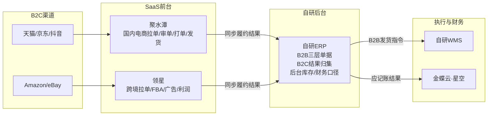
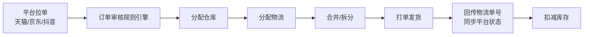
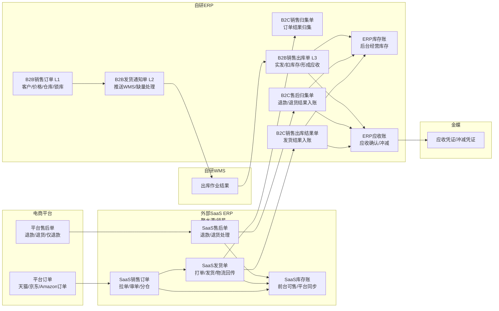
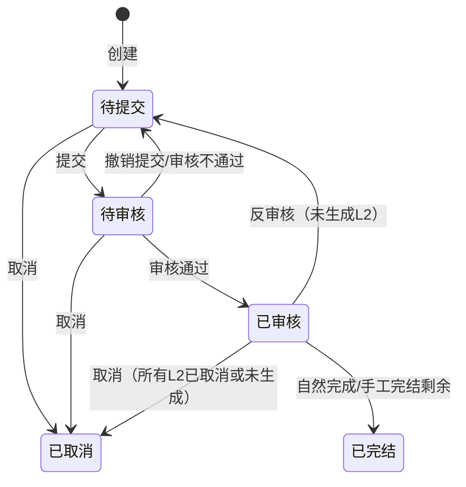
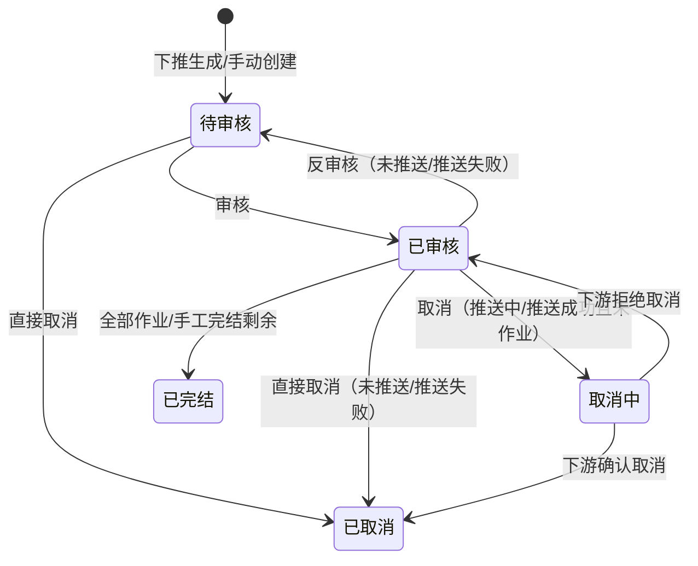
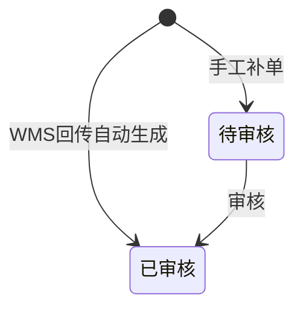
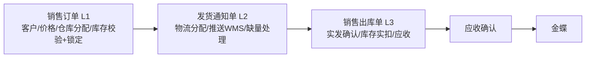
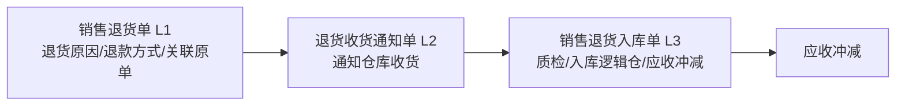

# CC-ERP项目第5讲：多渠道销售与履约模块产品设计

| 项目 | 内容 |
| --- | --- |
| 面向人群 | 已完成ERP第1-4讲，理解主数据、采购三层单据、实体仓+逻辑仓仓库模型的大家 |
| 学习时长 | 90分钟 |
| 难度等级 | ⭐⭐⭐ |
| 前置课程 | ERP项目第4讲：从一个仓库到多逻辑仓库存模型 |

## 1. 课程背景

简单回顾一下我们的ERP项目课程，第2讲建了主数据，第3讲讲了采购三层单据，第4讲建了实体仓+逻辑仓的仓库模型（先把"货放在哪、归谁管"讲清楚，而库存的多维表达留到第6讲）。

现在我们进入到了第5讲，要讲的是：**货怎么卖出去、怎么履约、怎么形成应收**。

不同的公司会对ERP有不同的定义，不同的ERP也会对"销售模块"有不同的定义。大家可能都在聊"销售管理"或者"订单管理"，但是它们在不同系统里长得完全不一样。你去看领星和聚水潭，它们的销售模块核心是平台拉单、审单、打单发货。你去看金蝶，它的销售模块核心是批发订单/B2B订单、销售出库单、应收、凭证。它们都叫"销售模块"，但解决的问题完全不同。

所以在进入单据设计之前，这一讲先做一件事：**分清楚两套世界**。

- **电商B2C**：高并发小单，领星/聚水潭处理完整的审单→分仓→打单→发货链路，自研ERP不需要重做一遍
- **批发/B2B销售**：低频大单，自研ERP原生处理销售订单→发货通知→出库→应收的完整三层单据链路

这节课，我们的重点是后者——**强盛科技自研ERP的B2B销售三层单据怎么设计**。B2C部分只需了解SaaS ERP的处理链路全貌，目的是知道边界在哪、哪些能力不要重做。

> 如果大家只做过或者了解过电商B2C的ERP项目，这节课能帮你补上批发/B2B销售的产品设计视角。如果大家只做过或者了解过B2B的ERP项目，这节课也能帮你理解电商SaaS的订单处理逻辑。

## 2. 学习目标

- 能说清电商B2C SaaS ERP和B2B自研ERP在销售模块上的核心差异（含订单来源）
- 能说清不同渠道订单（B2B/B2C）分别以什么形态进入自研ERP
- 能画出销售正向三层单据链路：销售订单L1 → 发货通知单L2 → 销售出库单L3
- 能说清三层单据之间的实体关系（1:N / 1:1）和自上而下生成的顺序
- 能说清为什么仓库分配必须在L1完成，以及库存校验/锁定/释放的时机
- 能画出L1/L2/L3三层单据的核心状态流转
- 能用一张推演表说清一个销售订单从审核到分批出库的全过程
- 能说清批发/B2B销售退货和电商B2C售后在"钱"和"货"上为什么不同步
- 能说清销售出库→应收→金蝶的业财协同关系

## 3. 课程内容

### 3.1 两种世界，两种销售模块

同一个强盛科技，B2C和B2B的销售处理走的是两套完全不同的系统。大家必须先把这个认知建起来，否则后面讲三层单据时会一直想"为什么B2C不这样做"。

| | B2C 电商 | B2B 批发 |
|---|---|---|
| **订单来源** | 电商平台 API 拉单（天猫/京东/抖音/Amazon/eBay） | 线下/非电商平台（电话、邮件、客户拜访），由销售在 ERP 人工录入，或 Excel 批量导入 |
| **谁处理** | 领星/聚水潭（SaaS ERP） | 自研ERP |
| **订单特点** | 高并发、小单、平台驱动 | 低频、大单、客户关系驱动 |
| **核心单据链** | 平台拉单→审单→分仓→打单→发货 | 销售订单L1→发货通知单L2→销售出库单L3 |
| **仓库何时确定** | 审单时按规则自动匹配 | L1创建/审核时确定 |
| **库存何时锁定** | SaaS内部锁定 | L1审核时预占（特殊场景创建时即占） |
| **ERP角色** | 接收履约结果，在后台形成库存和财务口径 | 原生主控，完整履约链路 |

如果把两套世界硬塞进同一套销售模型，问题会很快暴露：

| 混用方式 | 会出什么问题 | 正确拆法 |
|---|---|---|
| B2C平台订单也走自研ERP完整三层 | 高并发小单会把人工审单、物流分配、发货通知流程压垮；平台规则变化也会不断反向改造自研ERP | SaaS主控拉单、审单、打单和发货，自研ERP接收履约结果 |
| B2B大客户订单也交给SaaS处理 | 客户信用、账期、合同价、分批发货、应收对账支撑不足 | 自研ERP主控销售订单、发货通知、销售出库和应收 |
| B2C售后和B2B退货共用一个"已退货"状态 | 已退款、已退货、已入库混在一起，库存和应收都对不清 | 拆开平台售后状态、实物退货状态、财务冲减状态 |

强盛科技阶段4的真实系统分工：



高并发小单交给 SaaS ERP（领星、聚水潭等），低频大单和内部配货交给自研 ERP。

**边界结论：SaaS 已有的能力不要重做。** 平台 API 拉单、面单打印、物流渠道对接、平台售后状态同步、审核规则引擎——这些都是 SaaS 的核心壁垒，维护成本极高。自研 ERP 要做的是接住 SaaS 的履约结果：SaaS 完成发货后，把平台订单、发货结果、退款/退货结果同步到自研 ERP，在后台统一形成销售出库、库存和应收口径，用于对账和推送金蝶。

> 学习提示：本节重点是建立 B2B vs B2C 两套世界的认知框架。后续 §3.2 会展开 B2C SaaS 的链路细节，§3.3 开始进入本讲核心：B2B 三层单据。

### 3.2 电商B2C：SaaS ERP的销售单据流（参考阅读）

这一节是"看懂别人的设计"，目标读者是只做过其中一边的同学。已理解 B2C SaaS 链路全貌的可直接跳到 §3.3。

> 边界提醒：本节只看 SaaS 订单链路的全貌。SaaS 内部的 SKU 映射机制、审单规则引擎里的库存判断、扣减时机、和自研 ERP 三层库存模型的衔接，会在**第6讲**「电商ERP订单履约与三层库存模型」做详细拆解。本讲不要陷进 SaaS 的内部细节。

#### 3.2.1 聚水潭（国内电商）的一条典型订单链路



| 节点 | 做什么 | 典型规则 |
|---|---|---|
| **订单审核规则引擎** | 自动过滤异常订单，释放审单人力 | 地址校验、库存校验、赠品规则、拆合单规则、黑名单拦截 |
| **分配仓库** | 确定从哪个仓发货 | 按店铺绑定的默认仓、按收货地址就近仓、按 SKU 在各仓的库存可用量 |
| **分配物流** | 匹配快递/物流渠道 | 按目的地、时效要求、成本、快递覆盖范围 |
| **合并/拆分** | 优化履约效率 | 同一收货地址多笔订单合并发货；一单多 SKU 分仓拆分 |
| **打单发货** | 生成面单、推送 WMS 或仓库 | 电子面单、拣货单、发货复核 |
| **回传平台** | 同步物流单号和发货状态 | 平台要求在指定时间内回传，超时可能罚款 |

> 审核规则引擎是电商 ERP 的灵魂。一个好的规则引擎能让 95% 的订单自动审核通过，只留下 5% 的异常需要人工处理。

#### 3.2.2 领星（跨境电商）的关键差异

| 差异点 | 国内电商（聚水潭） | 跨境电商（领星） |
|---|---|---|
| **仓库形态** | 国内仓为主 | FBA仓、海外仓、国内直发仓多种形态 |
| **库存维度** | 实体仓+渠道库存 | 国内仓+海外仓+渠道库存+特殊平台库存 |
| **头程物流** | 不涉及 | FBA头程（国内→FBA仓）是独立业务链路 |
| **订单路由** | 按仓库和物流匹配 | 还要判断FBA履约、海外仓履约，还是国内直发履约 |
| **售后处理** | 退货退款、换货 | 跨境退货成本高，可能有部分是直接退款不退货 |

#### 3.2.3 B2C结果归集模型 vs B2B过程主控模型

> 学习提示：本节先看 Mermaid 图和同步方向表，抓住"谁主控、谁接结果"；后面的防循环同步说明用于理解接口设计时为什么不能做简单双向同步。

这里要特别强调：B2C订单进入自研 ERP 后，不建议重走 B2B 的 L1 → L2 → L3 三层单据。

原因很简单：聚水潭/领星已经完成了平台拉单、审单、分仓、打单、发货。自研 ERP 如果再生成完整的销售订单、发货通知单、销售出库单，就会变成"形式上有流程，实际上不主控"的假三层。

所以第5讲这里要建立一个关键判断：

> **B2B 是过程主控模型，B2C 是结果归集模型。两者最终都进入自研 ERP 的库存账、应收账和金蝶口径，但不是用同一套单据流程进入。**



这张图要看懂两层关系：

1. **单据关系**：B2B 销售由自研 ERP 完整主控，走销售订单 L1 → 发货通知单 L2 → 销售出库单 L3；B2C 销售由外部 SaaS ERP 主控，自研 ERP 只接收订单、发货、售后结果，生成 B2C 销售归集单、B2C 销售出库结果单、B2C 售后归集单。
2. **库存关系**：SaaS ERP 有自己的库存账，用来支撑前台 B2C 审单、分仓、平台库存同步；自研 ERP 也有自己的库存账，用来支撑后台经营库存、B2B 销售、采购、调拨、财务和金蝶对接。两套库存账分别维护，但要通过库存事件同步和定期对账保持一致。

两套库存账之间不是简单的"双向库存同步"，而是**按主控边界同步库存事件**。

| 库存变化来源 | 主控系统 | 同步方向 | 对方怎么处理 |
|---|---|---|---|
| 采购入库 | 自研ERP | 自研ERP → SaaS ERP | SaaS更新可售/仓库库存 |
| B2B销售出库 | 自研ERP | 自研ERP → SaaS ERP | SaaS减少可售库存，防止B2C继续卖 |
| 内部调拨/门店配货 | 自研ERP | 视是否影响B2C可售池 | 只同步影响B2C可售池的变化 |
| 库存调整/盘点 | 自研ERP或WMS归口后入ERP | 自研ERP → SaaS ERP | SaaS按调整结果更新 |
| B2C销售发货 | SaaS ERP | SaaS ERP → 自研ERP | 自研ERP生成B2C销售出库结果单，扣ERP库存 |
| B2C退货入库 | SaaS ERP/WMS | SaaS ERP → 自研ERP | 自研ERP生成B2C退货入库结果单，增加ERP库存 |
| B2C仅退款 | SaaS ERP/平台 | SaaS ERP → 自研ERP | 自研ERP冲减应收，不动库存 |
| B2C取消未发货 | SaaS ERP | SaaS ERP → 自研ERP | 如果ERP未入账，不动库存；必要时只更新归集状态 |

这里最容易踩的坑，是把库存同步理解成"两边库存数字互相覆盖"。

不推荐：

```text
SaaS告诉自研ERP：当前库存=980
自研ERP直接把库存改成980
```

也不推荐：

```text
自研ERP采购入库 +100 → 推给SaaS
SaaS库存 +100 → 又回传ERP库存 +100

SaaS发货 -10 → 回传ERP扣 -10
ERP库存减少 -10 → 又同步给SaaS扣 -10
```

推荐的设计原则是：

> 谁主控业务过程，谁产生库存变动事件；对方只消费结果，不再把消费后的库存变化反向当成新事件同步回来。

所以，自研 ERP 主控的采购入库、B2B 出库、调拨、盘点调整，会生成 `ERP_TO_SAAS` 库存同步事件，更新 SaaS 侧可售库存。SaaS ERP 主控的 B2C 发货、退货入库、仅退款，会生成 `SAAS_TO_ERP` 履约/售后结果事件，驱动自研 ERP 生成 B2C 销售出库结果单、B2C 退货入库结果单或应收冲减记录。

一句话收束：

> B2C 不是没有销售单据，而是销售过程不由自研 ERP 主控；B2C 不是不影响自研 ERP 库存，而是通过外部 SaaS 的履约/售后结果入账影响 ERP 库存。第5讲只需要讲清这个"过程主控 vs 结果归集"的边界，具体接口字段、幂等、重试、对账放到第9讲展开。

### 3.3 B2B销售正向三层单据（★本讲核心）

先看一个极简推演，建立三层协作的直觉（完整版含差异处理见 §3.3.6）：

| # | 节点 | L1 销售订单 | L2 发货通知 | L3 出库单 | 锁定数量 | 实物库存 |
|---|---|---|---|---|---|---|
| ① | 审核订单（100个） | 已审核 | — | — | +100 | 不变 |
| ② | 一次发货（100个） | 已审核 | 已完结 | 已审核 | 0（转实扣） | -100 |
| ③ | 全部完成 | 已完结 | — | — | 0 | — |

三层各司其职：**L1 管承诺（锁库存）、L2 管执行指令（推WMS）、L3 管真实结果（实扣库存+应收）。**

#### 3.3.1 先看全貌：六张单据一张表

和第3讲采购三层对称，销售模块涉及 6 张核心单据：

| 层级 | 管什么 | 正向单据 | 逆向单据 | 采购对应 | 库存动作 | 销售独有职责 |
|---|---|---|---|---|---|---|
| L1 业务意图 | 卖给谁/退什么 | 销售订单 | 销售退货单 | 采购订单/采购退货单 | 正向锁定/逆向不动 | 客户信用、价格等级、**仓库分配、库存校验+锁定** |
| L2 执行通知 | 本次发/收什么 | 发货通知单 | 退货收货通知单 | 收货通知单/退货发货通知 | 不动 | **物流分配、缺量发货、分批发货** |
| L3 执行结果 | 实际发/收了多少 | 销售出库单 | 销售退货入库单 | 采购入库单/退货出库单 | **正向实扣/逆向实增** | 实发数量、物流单号回写、质检入仓 |

#### 3.3.2 三层单据实体关系与自上而下生成

分层结构落地到系统，不只是"画三张单据"，还要在数据模型里把**主从关系**和**生成顺序**说清楚：

| 关系 | 典型基数 | 含义（销售正向） |
|---|---|---|
| 销售订单 → 发货通知单 | **1:N** | 一张订单可以分多次发货；每次发货对应一张通知单。行级是"订单行拆成多行通知"，数量在通知单上逐次扣减订单的"可通知数量" |
| 发货通知单 → 销售出库单 | **多数场景 1:1** | 一张通知单对应仓库/WMS的一次发货作业闭环：有指令、有实绩，一张出库单（与WMS回传一一对应）最利于对账与追溯 |
| 销售订单 → 销售出库单 | **间接 1:N** | 通过多张通知单叠加，订单最终会对应多张出库单 |

基数上的例外（产品评审里常被问到）：

- **通知单 → 出库单不是严格的数学 1:1**：例如一次发货拆成"A单 + B单"两张结果单、或事后补录冲销时会出现 1:N；少数企业把多次发货合并过账会出现 N:1
- 产品讨论时建议说 **"默认按 1:1 设计"**，有特殊情况可拓展支持 1:N

**自上而下生成（下推）** 是主流做法：上层单据先锁定意图与数量口径，下层单据在上游状态允许时生成，并继承关联键。

```text
销售订单（已审核 + 已预占库存）
    → 下推生成 → 发货通知单（按本次发货维度，分配物流）
        → 推送 WMS 执行 → 销售出库单（WMS 回传驱动生成，记实发结果）
```

要点：

- **顺序**：正常流程是 SO（销售订单） → DN（销售发货通知单） → GI（销售出库单）逐级出现。"先有出库单再补订单"属于例外流程（补单/追溯录入），要单独建模权限与审计
- **关联键设计**：出库单头同时保留 `销售订单ID` 与 `发货通知单ID`。报表既能按订单看履约率，也能按"第几次发货"看差异

> 数量字段（`销售数量`、`已通知数量`、`累计出库数量`、`可通知数量`）的具体联动方式见 §3.3.6 推演表和 §3.3.8 回写规则。

#### 3.3.3 L1：销售订单——仓库分配、库存校验与锁定/释放

**核心职责**：卖给谁、卖什么、什么价格、从哪个仓出、锁多少库存。

销售订单必须回答的5个问题：

```
① 客户是谁？（客户主数据、信用额度、价格等级、账期）
② 卖什么？（SKU、数量、单价、税率）
③ 从哪个仓出？（仓库分配——必须在L1完成）
④ 库存够不够？（库存校验+预占——锁定具体实体仓+逻辑仓的库存）
⑤ 什么时候要？（期望发货日期）
```

**仓库为什么必须在L1确定**

这是一个硬依赖，不能放到L2：

> 库存预占不是"总库存减100"，而是"某个实体仓+某个逻辑仓的库存减100"。如果不知道从哪个仓出，就不知道锁哪一份库存。所以在本讲的 B2B 单据流程里，仓库分配必须发生在 L1，审核通过时就锁定对应仓库的库存。

也有一些系统会把最开始的销售订单当成"原始订单"，类似平台拉下来的订单，订单创建时还没有指定履约仓。这种情况下，锁库存动作会后移到分仓之后的下一层。本讲讨论的是强盛科技自研 ERP 的 B2B 链路：销售创建订单时已经明确履约仓库，所以在 L1 锁库。

**库存校验：分时机做不同强度的校验**

L1的库存校验不是一次完成的，而是在不同时机做不同强度的校验：

| 时机 | 校验强度 | 校验对象 | 失败处理 |
|---|---|---|---|
| 创建时（保存草稿） | 粗校验 | 仓库总量是否够 | 提示警告，允许保存 |
| 提交审核时 | 中校验 | 指定实体仓+逻辑仓的库存是否够 | 阻断提交，要求修改仓库或数量 |
| 审核通过时 | 严格校验+预占 | 指定仓库的库存能否成功预占 | 预占失败→审核不通过，提示缺量 |
| L2推送WMS时 | WMS侧再校验 | 实物库位是否真的够拣（破损/丢失/批次） | 部分可拣→部分发货；全部缺货→回挂L1 |

> 重点：**ERP账面预占成功 ≠ WMS真的能拣到货**。ERP管账面承诺，WMS管实物执行，两层校验各有边界。

**库存锁定的产品实现**

L1审核成功 = 销售订单"锁定"了一定数量的库存。

核心原则：**锁定不影响实物库存数字，但占用了对应仓库的可承诺额度**。

| 字段（销售L1视角） | 说明 |
|---|---|
| 实物库存 | 仓库真实在架数量，**预占不变** |
| 锁定数量 | 被销售订单预占但还没实扣的数量，**预占时 +N，实扣或释放时 -N** |
| 可用数量 | 实物库存 - 锁定数量 - 其他占用（冻结） |

> 这只列出了销售L1需要感知的库存动作。库存维度的完整多维表达（可用/锁定/在途/预留等）由**第6讲三层库存模型**展开。

**库存预占的时机**

| 场景 | 预占时机 | 说明 |
|---|---|---|
| 常规B2B订单 | L1审核通过时预占 | 流程最稳，审核前库存可能被其他订单抢走 |
| 大客户急单/秒杀 | L1创建即预占 | 先占坑再走审批，防止审批期间库存被占 |
| B2C归集（SaaS同步） | 不会在自研ERP预占 | SaaS侧已完成履约，自研ERP接收结果，在后台账形成销售出库和应收口径 |

**销售订单的状态流转**



| 当前状态 | 可做什么 | 前置条件 | 状态变化 |
|---|---|---|---|
| 待提交 | 编辑、提交、取消 | 必填字段校验通过才能提交 | 待审核或已取消 |
| 待审核 | 撤销提交、审核通过、取消 | — | 待提交、已审核或已取消 |
| 已审核 | 生成L2、反审核、手工完结剩余、取消 | 反审核要求未生成L2；取消要求所有L2已取消或未生成 | 状态保持、退回待提交、已完结或已取消 |
| 已取消 | 无 | 终态 | 不可继续操作 |

> 审核通过时自动执行库存预占。预占失败（指定实体仓+逻辑仓库存不足）时，审核不通过并提示缺量，不静默跳过。

**销售订单的行级状态**

一张销售订单通常有多行SKU，不同行可以分别生成下游通知单：

| 行级字段 | 说明 |
|---|---|
| 销售数量 | 这一行原计划销售多少 |
| 已通知数量 | 已经生成L2发货通知单的数量 |
| 累计出库数量 | 已经由L3出库单回写的实际发货数量 |
| 未出库数量 | 还没有形成出库结果的数量 |
| 可通知数量 | 还能继续生成L2的数量 |
| 行状态 | 进行中 / 已完结 |
| 完结方式 | 自然完成 / 手工完结 |

行状态判断：

| 场景 | 行状态 |
|---|---|
| SKU A 已全部通知并全部出库 | 自然完结 |
| SKU B 只通知了一部分 | 进行中 |
| SKU C 出了一部分，剩余不再要 | 手工完结 |

单据头状态由行状态汇总：所有行都完结后，单据头才进入已完结。

> 退货侧的行级模型与此对称：把"销售数量"换为"计划退货数量"、"出库"换为"入库"即可，不再单独列。

**B2C归集结果进入ERP后的承接**

B2C订单从SaaS同步到ERP后，ERP侧可以生成"归集型销售单/销售出库记录"承接结果。它和B2B销售订单最大的区别是：不在自研ERP里重新审单、分仓、锁库，只记录SaaS已经完成的履约结果。

B2C归集不是只同步一个订单号，而是至少覆盖三类结果：

| 同步对象 | 典型来源 | ERP侧承接 | 用途 |
|---|---|---|---|
| 平台订单结果 | 聚水潭/领星订单 | B2C销售归集单 | 记录平台、店铺、买家、SKU、成交金额 |
| 发货履约结果 | SaaS发货单/WMS结果 | B2C销售出库结果单 | 形成后台库存扣减和销售出库口径 |
| 售后退款结果 | 平台售后单/SaaS售后单 | B2C售后/退款归集单 | 处理退款、退货、仅退款、应收冲减 |

如果一定要和三层单据做类比，可以这样理解：B2C销售归集单只是"结果型L1"，不负责审批和锁库；B2C销售出库结果单更接近 L3；中间没有 ERP 主控的 L2 发货通知，因为发货通知已经由 SaaS/WMS 链路完成。

| 字段 | B2B销售订单 | B2C归集结果 |
|---|---|---|
| 客户 | 经销商/大客户（客户主数据） | 平台买家（记录平台+店铺，不逐个建客户档案） |
| 价格 | 客户价格等级/合同价 | 平台成交价 |
| 信用控制 | 需要校验 | 不需要（已在平台付款） |
| 仓库 | ERP规则分配 | SaaS侧已确定，同步时带过来 |
| 来源单据 | 无或报价单 | 聚水潭/领星订单号+平台订单号 |

#### 3.3.4 L2：发货通知单——物流分配与缺量发货

**核心职责**：选哪个物流、推送WMS拣货、缺量怎么处理。

和采购收货通知单（ASN）的对称关系：

| 维度 | 采购L2（收货通知单/ASN） | 销售L2（发货通知单） |
|---|---|---|
| 谁创建 | 供应商（有SRM）或采购代建 | ERP自动生成或人工创建 |
| 通知谁 | 通知仓库准备收货 | 通知仓库准备发货 |
| 关键分配 | 不涉及 | **分配物流渠道** |
| 核心异常 | 送错、少送、多送 | **缺量发货、物流不可用** |

> L2不再决定从哪个仓出——仓库在L1已确定。L2把已确定仓库的订单转成仓库可执行的发货指令。

**物流分配**

| 分配维度 | 规则示例 |
|---|---|
| 收货地址 | 按省/市/区匹配可配送的物流渠道 |
| 时效要求 | 普通快递 vs 加急 vs 冷链 |
| 成本 | 优先匹配签约物流，降低运费 |
| 货物属性 | 带电/液体/大件影响可选物流 |
| 客户指定 | 部分B2B客户指定物流 |

**缺量发货处理**

缺量发货是销售链路里最常见也最容易出错的地方。处理方案要区分三种情况：

| 缺量情况 | 处理方式 | 对L1的影响 |
|---|---|---|
| **全部可发** | 生成发货通知单，推送WMS拣货 | 无影响 |
| **部分可发**（锁100，可拣80） | 生成部分发货通知（80个），推送WMS | 剩余20保留在L1可通知数量，后续补货后可继续发；也可手工完结 |
| **全部缺货**（锁定的库存在WMS侧不可用） | 不生成发货通知，订单挂起 | L1仍为已审核，标记缺货待处理，触发盘亏/补货流程 |

> 重点：缺量发货不能只靠"看总库存"。L1已经预占了特定实体仓+逻辑仓的库存，但WMS实物执行时仍可能出现差异（破损、丢失、批次不对）。所以L2的缺量判断是基于WMS侧实际可拣数量，不是ERP账面数量。

**发货通知单的状态流转**



L2比L1多了两个状态维度：

| 额外状态字段 | 状态值 | 说明 |
|---|---|---|
| 推送WMS状态 | 未推送、推送中、推送成功、推送失败 | 是否已通知WMS拣货 |
| 作业状态 | 未作业、部分作业、全部作业 | WMS是否已回传拣货/发货进度 |

**取消规则**（和采购L2逻辑一致）：

| 单据状态 | 推送WMS | 作业状态 | 能否取消 |
|---|---|---|---|
| 待审核 | — | — | 可以直接取消 |
| 已审核 | 未推送/推送失败 | 未作业 | 可以直接取消 |
| 已审核 | 推送中/推送成功 | 未作业 | 进入取消中，等WMS确认 |
| 已审核 | 任意 | 部分作业/全部作业 | 不能取消，只能完结剩余 |

**L2行级状态**（字段结构和L1对称，差异在下表）：

| 行级字段 | 说明 |
|---|---|
| 通知数量 | 本次通知这个SKU要发多少 |
| 实际发货数量 | WMS回传的实际发货数量 |
| 差异数量 | 通知数量 - 实际发货数量 |
| 行作业状态 | 未作业 / 部分作业 / 全部作业 |
| 行状态 | 进行中 / 已完结 |

例如一张发货通知包含3个SKU：

| SKU | 通知数量 | WMS实发 | 行作业状态 | 行状态 |
|---|---|---|---|---|
| SKU A | 100 | 100 | 全部作业 | 已完结 |
| SKU B | 50 | 30 | 部分作业 | 进行中 |
| SKU C | 20 | 0 | 未作业 | 进行中 |

#### 3.3.5 L3：销售出库单——实发确认与财务依据

**核心职责**：按WMS实发结果确认、库存实扣、形成应收依据。

| 维度 | 采购L3（采购入库单） | 销售L3（销售出库单） |
|---|---|---|
| 数据来源 | WMS收货回传 | WMS发货回传 |
| 库存影响 | 入库增加库存 | 出库减少库存 |
| 财务影响 | 形成应付依据 | **形成应收依据** |
| 关键差异 | 数量可能分合格/不合格 | 实发数量≠通知数量时按实发为准 |

**状态流转**



L3是结果单，状态很简单。WMS回传生成时通常直接已审核，只有手工补单场景才走待审核。

| 当前状态 | 可做什么 | 状态变化 |
|---|---|---|
| 待审核 | 审核 | 已审核，触发库存实扣+应收确认 |
| 已审核 | 重推金蝶 | 单据状态不变，只更新推送金蝶状态 |

**L3审核后的连锁动作**：

```text
销售出库单审核
  → 库存实扣（指定实体仓+逻辑仓的库存减少；L1的锁定同步转为实扣）
  → 回写L2行（实际发货数量、行作业状态）
  → 回写L1行（累计出库数量）
  → 形成应收依据（按客户+金额+账期）
  → 待推送金蝶
```

> 库存只在L3审核时才真正减少。L1的预占不减少库存，L2的生成通知也不减少。这和采购链路对称：采购入库单审核才增加库存，采购订单和ASN都不增加。

#### 3.3.6 状态流转推演：从销售订单到分批出库

把上面的内容串起来，下面用一个具体案例把三层走一遍。

**场景**：客户A 下单 SKU-X 共 100 个，从深圳总仓 + 批发/B2B销售可售仓出货，分两次发货。中间还会遇到一次 WMS 实发小于通知的差异。

| # | 节点 | L1 销售订单 | L2 发货通知 | L3 出库单 | 锁定数量 | 实物库存 | L1行级数量 |
|---|---|---|---|---|---|---|---|
| ① | 创建SO（100） | 待提交 | — | — | 0 | 不变 | 销售100, 可通知0（未审核） |
| ② | 提交SO | 待审核 | — | — | 0 | — | — |
| ③ | 审核SO | 已审核 | — | — | **+100**（深圳总仓+批发可售仓） | 不变 | 已通知0, 累计出库0, 可通知100 |
| ④ | 生成 DN-1（60个） | 已审核 | 待审核 | — | 不变 | 不变 | 已通知60, 累计出库0, 可通知40 |
| ⑤ | 审核 DN-1 + 推送WMS | 已审核 | 已审核（推送成功） | — | 不变 | 不变 | — |
| ⑥ | WMS 实发55（差5个破损） | 已审核 | 已完结（全部作业，实发55） | 已审核 | **-55（转实扣）**，剩余45 | **-55** | 已通知60, 累计出库55 |
| ⑦ | 差异处理：差额5回退L1 | 已审核 | 已完结 | 已审核 | **-5（释放）**，剩余40 | **不变** | 已通知55, 可通知45 |
| ⑧ | 生成 DN-2（45个） | 已审核 | 待审核 | — | 不变 | 不变 | 已通知100, 可通知0 |
| ⑨ | 审核 DN-2 + 推送WMS | 已审核 | 已审核 | — | 不变 | 不变 | — |
| ⑩ | WMS 实发45 | **已完结（自然完成）** | 已完结 | 已审核 | **-45（转实扣）**，无剩余 | **-45** | 已通知100, 累计出库100 |

关键观察：

- **预占只在 L1 审核时发生一次**（步骤③）；之后 L2 创建/审核都不再动库存
- **实扣只在 L3 审核时发生**（⑥、⑩）；每次 WMS 回传都触发
- **锁定≠实物减少**：步骤⑥ 锁定 -55 同时实物 -55（转化），步骤⑦ 锁定 -5 但实物不变（释放回可用池）
- **差异回退**：⑥步 WMS 实发不足，差额 5 个回退到 L1 的"已通知数量"（⑦），再次生成新的 L2 补发
- **行级字段联动**：
  - `销售数量` 全程不变（除非订单变更）
  - `已通知数量` 在 L2 创建时 +N、L2 取消或差异回退时 -N
  - `累计出库数量` 在 L3 审核时 +N
  - `可通知数量 = 销售数量 - 已通知数量`

> 这张表的本质：销售订单是一个**库存承诺**，三层单据是这个承诺被逐步执行的过程。L1 管承诺总量+锁定，L2 管单次执行指令，L3 管真实执行结果+实扣。

#### 3.3.7 取消、完结怎么选

L1/L2 都同时有"取消"和"已完结"两个出口状态。两者不是同义词，必须区分清楚：

| 动作 | 适用层级 | 什么时候用 | 对库存/财务的影响 |
|---|---|---|---|
| 取消 | L1 / L2 | 还没有形成执行结果 | **释放锁定**（L1 取消）或**回补可通知数量**（L2 取消），不形成财务凭证 |
| 已完结 | L1 / L2 | 全部执行完成（自然完成）或已执行一部分但剩余不再做（手工完结） | 保留已发生结果，不再继续执行 |

怎么选？按这个逻辑走：

```
有没有 L3 结果？
  ├── 没有 → 用「取消」
  └── 有
      ├── 剩余部分不做了 → 用「已完结」，完结方式 = 手工完结
      └── 全部已 L3 落账 → 用「已完结」，完结方式 = 自然完成
```

销售特有的库存边界（完整释放规则见 §3.3.3 和 §3.3.8 回写表，这里只列销售特有的判断）：

- **L1 整单取消** → 释放全部锁定库存
- **L1 反审核**（前提未生成 L2）→ 释放全部锁定库存
- **L1 手工完结剩余** → 释放未发部分的锁定库存
- **L2 取消** → 不释放库存（库存仍锁在 L1 上，等 L1 决定如何处理）
- **B2C 仅退款不退货** → 走 L1 直接已完结（完结方式=仅退款无实物），跳过 L2/L3

#### 3.3.8 三层单据怎么互相回写

三层单据不是孤立的，每一层动作都会回写上下游字段。规则汇总：

| 事件 | 回写目标 | 回写内容 |
|---|---|---|
| L2 创建成功 | L1 行 | 已通知数量 +N，可通知数量 -N |
| L2 取消成功 | L1 行 | 已通知数量 -N，可通知数量 +N |
| L3 审核（实发回传） | L2 行 | 实际发货数量更新，行作业状态变化 |
| L3 审核（实发回传） | L1 行 | 累计出库数量 +N |
| L3 审核（实发<通知，差额回退） | L1 行 | 已通知数量 -差额，可通知数量 +差额 |
| L3 审核 | 库存 | 锁定数量 -N（转为实扣）、实物库存 -N |
| L1 整单取消 | 库存 | 锁定数量 -全部（释放全部预占） |
| L1 反审核（未生成 L2） | 库存 | 锁定数量 -全部（释放全部预占） |
| L1 手工完结剩余 | 库存 | 锁定数量 -未发部分（释放未发对应的预占） |

头状态优先由行状态汇总，不要直接手工维护：

| 汇总对象 | 汇总规则 |
|---|---|
| L1 头已完结 | 所有 L1 行均已完结 |
| L2 头全部作业 | 所有 L2 行均全部作业或手工完结 |
| L2 头部分作业 | 至少一行有实际作业，但不是所有行都完结 |
| L2 头未作业 | 所有 L2 行实际作业数量都为 0 |

### 3.4 正向履约高频异常

按单据层归类。大家不需要记住每一条，但要理解"每层可能出什么问题、产品怎么兜住"。

| 层级 | 异常场景 | 典型情况 | 处理方案 |
|---|---|---|---|
| L1 | **库存预占失败** | 审核时目标实体仓+逻辑仓库存不足 | 提示缺量数量和建议换仓，不静默跳过 |
| L1 | **信用超额** | 客户已用额度+本次金额 > 信用额度 | 阻断提交，提示超额，走特批流程 |
| L1 | **SaaS同步订单重复** | 聚水潭对同一笔平台订单同步两次 | 按来源单号做幂等校验，重复的拒绝生成 |
| L1 | **已审核订单要改仓库/数量** | 客户临时要求换仓或减少数量 | 未生成L2：反审核→修改→重新审核。已生成L2：先取消L2→再反审核L1 |
| L2 | **缺量发货** | L1锁了库存，但WMS实际可拣数量更少 | 部分可发先生成通知推送WMS，剩余保留L1可通知，后续补货后继续发 |
| L2 | **物流不可用** | 分配的物流渠道停运、超出配送范围 | 阻断推送WMS，人工重新分配物流 |
| L2 | **地址校验失败** | 收货地址不完整、电话格式错误 | 阻断推送，标记地址异常，人工修正 |
| L2 | **推送WMS失败** | 网络超时、WMS系统故障 | 推送状态标记失败，支持重试，连续失败后告警 |
| L3 | **WMS实发≠通知** | 通知100，实发95 | 按实发数量出库，差异回写L2和L1。剩余5保留在L1可通知或手工完结 |
| L3 | **WMS回传超时** | 发货通知已推，WMS长时间不回传 | 设置超时预警（如24小时），主动查询WMS状态，不无限等待 |
| L3 | **出库后物流丢件** | 货已出库已扣库存，物流途中丢失 | ERP层面库存已扣不回退，走物流索赔/补发流程。补发走新的销售订单 |

### 3.5 销售退货逆向链路

有正向必有逆向。销售退货不是"把库存加回来"这么简单——要判断货是否退回、是否可售、进哪个逻辑仓、财务是否冲减应收。

#### 3.5.1 三层退货链路全貌

```text
销售退货单 L1 → 退货收货通知单 L2 → 销售退货入库单 L3
```

和正向三层对称：

| 层级 | 采购逆向 | 销售逆向 |
|---|---|---|
| L1 | 采购退货单（退给供应商） | 销售退货单（客户退回来） |
| L2 | 采购退货发货通知单（通知仓库准备退货出库） | 退货收货通知单（通知仓库准备收退货） |
| L3 | 采购退货出库单（实退扣库存扣应付） | 销售退货入库单（实收恢复库存冲应收） |

注意方向差异：采购退货是**出库**（货离开企业），销售退货是**入库**（货回到企业）。

#### 3.5.2 退货三层实体关系与自上而下生成

和正向三层一样，退货链路也要把**主从关系**和**生成顺序**说清楚。

| 关系 | 典型基数 | 含义（销售退货） |
|---|---|---|
| 销售退货单 → 退货收货通知单 | **1:N** | 一张退货单可能分多批退回；每批形成一张通知单（B2B 大客户/工程类退货常见多批退回） |
| 退货收货通知单 → 销售退货入库单 | **多数场景 1:1** | 一张通知单对应仓库的一次收货闭环：有预期、有实绩 |
| 销售退货单 → 销售退货入库单 | **间接 1:N** | 通过多张通知单叠加，退货单最终对应多张入库单 |

退货特有的两种特殊关系：

- **B2C 仅退款不退货**：L1 存在但 **L2/L3 都不生成**（没有实物回流），应收直接冲减，L1 进入"已完结，完结方式=仅退款无实物"
- **质检拆单**：一张退货通知到货后，质检发现合格 80 个 + 残品 20 个 → 拆成两张入库单（合格的入可售仓 + 残品的入残品仓） → 此时 **L2:L3 = 1:N**

**自上而下生成（下推）**：

```text
销售退货单（已审核，关联原销售出库单）
    → 下推生成 → 退货收货通知单（指定退货仓、记录退货物流）
        → WMS 收货 + 质检 → 销售退货入库单（按质检结果决定入库逻辑仓）
```

要点：

- **三联关联键**：退货入库单头同时保留 `销售退货单ID`、`退货收货通知单ID`、**`原销售出库单ID`**（用于应收冲减追溯）
- **数量字段联动**：销售退货单行至少维护 `计划退货数量`、`已通知数量`、`累计入库数量`、`未入库数量`、`可通知数量`
- **顺序**：正常流程是 SR → RN → RI；如果是仅退款无实物，L1 直接走应收冲减结果，不下推 L2/L3

#### 3.5.3 L1：销售退货单

**核心职责**：谁退的、退什么、退多少、退货原因、退款方式、关联原销售出库单。

| 维度 | 内容 |
|---|---|
| 关键字段 | 退货单号、客户、原销售出库单号、退货SKU+数量、退货原因、退款方式（退货退款/仅退款/换货）、应退金额 |
| 关联原单 | 优先关联原销售出库单，用于追溯原出库数量和金额。找不到原单时允许手动创建，标记"未关联原单" |
| 库存动作 | **L1 审核不动库存**（货还没回来）；只有 L3 实收才入库 |

**状态机**：和销售正向 L1 完全一致，唯一差异是**审核不预占库存**（货是要回来的，不是要发出的）。状态图不重新画，参见 §3.3.3。

这一节先抓住三个差异点：

- 退货 L1 审核不动库存；
- 仅退款无实物可以直接完结；
- 生成 L2 后，反审核/取消要受下游通知和收货状态约束。

**行级状态**：字段结构和正向 L1 对称，把"销售数量"换为"计划退货数量"、"出库"换为"入库"。完结方式多一个"仅退款无实物"，不再单独展开。

#### 3.5.4 L2：退货收货通知单

**核心职责**：通知仓库准备收退货、指定退货仓、推送 WMS 准备收货。

| 维度 | 内容 |
|---|---|
| 关键字段 | 通知单号、关联退货单号、退货仓、预计到货时间、退货物流单号、客户退货描述 |
| 与正向 L2 的差异 | 不做物流分配（退货物流由客户/平台决定），但要**指定退货仓**（不同退货仓可能对应不同质检流程） |

**状态机**：和销售正向 L2 完全一致——状态流转、取消规则（推送中需等 WMS 确认、已作业不能取消）均相同。差异仅在于作业状态在退货场景下的业务含义为"收货状态"（未收货/部分收货/全部收货），而非"发货状态"。状态图不重新画，参见 §3.3.4。

这一节重点掌握两件事：**推送 WMS 后取消要等下游确认**，以及**已收货后不能取消，只能完结剩余**。L2 行级字段先不展开，只记住三项：通知数量、实收数量、差异数量。

#### 3.5.5 L3：销售退货入库单

**核心职责**：仓库实际收货确认、质检判定、决定进哪个逻辑仓、回写 L1/L2、冲减应收。

| 维度 | 内容 |
|---|---|
| 关键字段 | 入库单号、关联退货单+退货通知单+原销售出库单、实收数量、质检结果、入库逻辑仓、是否可售 |
| 数据来源 | WMS 收货+质检结果回传 |
| 库存影响 | **入库增加库存**（按质检结果进不同逻辑仓） |
| 财务影响 | **冲减应收**（按原销售出库单关联的金额+实退数量） |

**状态流转**：和正向 L3 一致，WMS 回传生成时通常直接已审核，只有手工补单场景才走待审核。这里不展开状态图，重点放在 L3 审核后同时触发"库存增加+应收冲减"。

**L3 审核后的连锁动作**：

```text
销售退货入库单审核
  → 库存增加（按质检结果进对应逻辑仓——可售仓 / 待检仓 / 残品仓 / 残品待处理仓）
  → 回写 L2 行（实收数量、行作业状态）
  → 回写 L1 行（累计入库数量）
  → 冲减应收（按原销售出库单+应退金额）
  → 待推送金蝶
```

> 这是销售退货链路真正"动库存"和"动应收"的时刻。L1 审核不动，L2 收货通知也不动；只有 **L3 审核才把库存加回来、把应收冲减下去**。和正向链路一致：结果层才动账。

**L3 的关键判断——进哪个逻辑仓**

这个判断直接衔接第4讲的实体仓+逻辑仓模型：

| 质检结果 | 是否跳过质检 | 入库逻辑仓 | 是否可售 | 说明 |
|---|---|---|---|---|
| 合格可售 | 否（需质检） | 退货待检仓→合格后转入正常可售仓 | 质检后是 | 先入待检，确认无误再转可售 |
| 原包装完好 | 是（跳过质检） | 直接入原销售仓对应的逻辑仓 | 是 | 外包装无损、未拆封，快速上架 |
| 轻微瑕疵 | 否（需质检） | 残品待处理仓 | 否 | 可折价销售或内部处理 |
| 严重损坏 | 否（需质检） | 残品仓或报废 | 否 | 不入正常库存 |

> 退货不是简单加回库存。质检不合格→进残品仓，不影响正常品仓的库存。但应收仍然冲减（货退了钱要退），这是库存维度和财务维度不同步的典型案例。

#### 3.5.6 状态流转推演：从销售退货单到分批收货

和正向链路对应，下面用一个具体案例把退货三层走一遍。

**场景**：客户 A 退货 100 个 SKU-X，分两批寄回。第一批 60 个里有 5 个质检不合格进残品仓，第二批 40 个全部合格。

| # | 节点 | L1 销售退货单 | L2 退货收货通知 | L3 退货入库单 | 库存动作 | L1 行级数量 |
|---|---|---|---|---|---|---|
| ① | 创建 SR（100） | 待提交 | — | — | 不动（货还没回来） | 计划退100 |
| ② | 审核 SR | 已审核 | — | — | **不动**（L1 审核不增库存） | 已通知0, 累计入库0, 可通知100 |
| ③ | 生成 RN-1（60） | 已审核 | 待审核 | — | 不动 | 已通知60, 可通知40 |
| ④ | 审核 RN-1 + 推送 WMS | 已审核 | 已审核（推送成功） | — | 不动 | — |
| ⑤ | WMS 实收60（55合格+5残品） | 已审核 | 已完结 | 已审核（**拆成2张**：55入可售仓、5入残品仓） | **可售仓 +55**、**残品仓 +5** | 累计入库60 |
| ⑥ | 生成 RN-2（40） | 已审核 | 待审核 | — | 不动 | 已通知100, 可通知0 |
| ⑦ | 审核 RN-2 + 推送 WMS | 已审核 | 已审核 | — | 不动 | — |
| ⑧ | WMS 实收40（全部合格） | **已完结（自然完成）** | 已完结 | 已审核 | **可售仓 +40** | 累计入库100 |

财务侧同步：每次 L3 审核都触发应收冲减（按实退数量×单价），推送金蝶。

关键观察：

- **L1 审核不动库存**：和正向"L1 审核要锁定库存"完全对称——一个增不动、一个减不动，**只有 L3 才真正动库存**
- **质检拆单**：步骤⑤ 一张通知单 RN-1 因质检结果差异，拆成两张 L3 入库单（合格部分入可售仓、残品部分入残品仓）——这是退货特有的 **L2:L3 = 1:N** 场景
- **应收冲减节奏**：每次 L3 审核都冲减一次，不等所有货收齐；和正向出库每次 L3 审核都形成应收一致

行级字段联动（和正向对称）：

- `计划退货数量` 全程不变（除非退货变更）
- `已通知数量` 在 L2 创建时 +N、L2 取消时 -N
- `累计入库数量` 在 L3 审核时 +N
- `可通知数量 = 计划退货数量 - 已通知数量`

> 这张表的本质：销售退货单是一个**退款承诺**，三层单据是这个承诺被逐步执行的过程。L1 管退多少、退给谁；L2 管这次收哪些；L3 管真实收了什么 + 质检 + 入哪个仓 + 冲减应收。

#### 3.5.7 退货高频异常

> 学习提示：优先掌握前三类，最后一类作为补充提醒。其他退货异常可以在作业评审或后续接口课中继续展开。

| 层级 | 异常场景 | 处理方案 |
|---|---|---|
| L1 | **找不到原销售出库单** | 允许手动创建退货单，标记"未关联原单"，后续对账需人工确认 |
| L3 | **实收≠预期**（客户说退2个，仓库收到1个） | 按实收数量入库，差异标记为"买家少退"，不自动补发 |
| L3 | **质检不合格**（破损/拆封） | 不入正常品仓，入残品待处理仓。应收仍冲减 |
| — | **仅退款不退货** | 平台已退款但无实物回流。**不生成 L2 和 L3**，L1 直接进入已完结（完结方式=仅退款无实物）。应收仍冲减，但库存不增加 |

### 3.6 业财收口与本讲边界

**ERP → 金蝶**：正向出库→形成应收→推送金蝶；逆向入库→冲减应收→推送金蝶。ERP 只推送应记账结果，金蝶做总账和凭证。与采购链路对称（采购入库→应付），差异在于销售侧没有"三单匹配"——出库即确认应收，不等客户发票。

**本讲不展开，交给后续课的内容：**

| 话题 | 后续 |
|---|---|
| B2C SaaS 订单履约内部细节（SKU 映射、审单规则、扣减时机） | **第6讲** |
| B2C结果归集模型的接口字段、幂等、重试、对账 | **第9讲** |
| 库存多维表达（可用/锁定/在途/预留），与第4讲实体仓+逻辑仓模型的衔接 | **第6讲** |
| 多渠道库存分配、锁定释放、防超卖、跨渠道重分配 | **第7讲** |
| 门店配货/配销（直营/加盟差异、内部结算） | **第8讲** |
| L2推送WMS、L3/应收结果推送金蝶的接口设计、异常重试、对账闭环 | **第9讲** |

学完第5讲要能说清这张衔接表——哪些是第5讲讲透的（B2B三层单据 + 退货逆向链路 + B2C/B2B边界划分），哪些交给后续课。

### 3.7 本讲小结：销售模块到底在设计什么

1. **电商B2C走SaaS ERP的单据流，自研ERP不要重做**——拉单、审单、打单、面单，交给聚水潭/领星，ERP接收履约结果，在后台形成统一的库存、应收和财务口径。
2. **批发/B2B销售走自研ERP的三层单据流**——销售订单L1管客户+价格+仓库分配+库存校验和锁定，发货通知单L2管物流+缺量+推送WMS，销售出库单L3管实发+库存实扣+应收。三层各司其职，和采购三层对称。
3. **三层单据是一个库存承诺被逐步执行的过程**——L1预占、L2通知、L3实扣，每一步都要回写上游的数量字段。库存的多维表达留给第6讲。
4. **退货不是简单加库存，异常不能只靠理想流程**——质检决定进哪个逻辑仓，仅退款不退货不走实物入库，每层都有各自的异常边界。
5. **B2B退货和B2C售后不能混成一回事**——B2B是ERP原生主控完整三层链路；B2C是SaaS主控+ERP接结果，钱和货是两条独立的回流。
6. **本讲的边界要收住**——B2C订单履约细节、多渠道库存分配、门店配销结算、WMS接口对账，这些不属于第5讲，分别会在第6/7/8/9讲展开。

## 4. 实操任务 & 交付物

### 4.1 必做任务（3项）

**任务1**：画一张「销售正向三层单据关系图」，覆盖 B2B 销售订单L1→发货通知单L2→销售出库单L3→应收→金蝶，标注每层核心职责和关键动作。

模板：



**任务2**：设计一张「销售订单状态流转推演表」，覆盖一个B2B订单从创建→审核→分批发货→差异处理（WMS实发≠通知）→自然完结的全过程，库存动作和行级数量正确联动。参考 §3.3.6 的完整版（10步），表格结构如下：

| # | 节点 | L1 销售订单 | L2 发货通知 | L3 出库单 | 锁定数量 | 实物库存 | L1行级数量 |
|---|---|---|---|---|---|---|---|
| ① | 创建SO（200） | 待提交 | — | — | 0 | 不变 | 销售200 |
| ② | 审核SO | 已审核 | — | — | +200 | 不变 | 已通知0, 累计出库0, 可通知200 |
| ③ | ... | ... | ... | ... | ... | ... | ... |

> 必须包含至少一个「WMS实发 < 通知 → 差额回退」的步骤，否则只覆盖了理想流程。

**任务3**：画一张「B2B退货 vs B2C售后差异图」，标注两种链路的主控系统、关键节点、钱货同步性，能区分仅退款和退货退款两种场景下的 ERP 承接形态。

模板：



### 4.2 选做任务（3项）

- 设计一张「电商B2C SaaS vs B2B自研ERP销售链路对比表」，从订单来源、审核方式、仓库分配、库存锁定、单据结构、退货处理 6 个维度对比。
- 画一张「销售三层单据实体关系图」，标注 SO→DN 的 1:N、DN→GI 的 1:1，以及哪些字段做关联键。
- 用一段话写下你认为第5-9讲之间的核心衔接逻辑（不许翻看 §3.6）。

### 4.3 产出标准

| 产出物 | 合格标准 |
|---|---|
| 销售正向三层单据关系图 | 覆盖L1/L2/L3，标注每层核心职责和关键动作，标注与金蝶的关系 |
| 销售订单状态流转推演表 | 至少覆盖审核→分批发货→差异回退→自然完结的全过程，锁定数量和实物库存分开表述 |
| B2B退货 vs B2C售后差异图 | 标注主控系统、原单关联、钱货同步性，能区分仅退款和退货退款 |
| B2C SaaS vs B2B对比表（选做） | 6个维度覆盖完整，有自己的判断 |
| 三层单据实体关系图（选做） | 标注 1:N / 1:1 基数，标注关联键字段 |
| 衔接逻辑描述（选做） | 能说清每讲的边界，至少识别出 3 处需要后续讲展开的点 |

## 5. 自检清单

学完这一讲，重点检查自己能不能说清下面几件事：

**基础理解**

- 我能用一张表说清电商B2C SaaS ERP和B2B自研ERP在销售模块上的核心差异（含订单来源）吗？
- 我能画出聚水潭B2C订单从拉单到发货的完整链路吗？
- 我能说清为什么仓库分配必须在L1完成、不能放到L2吗？
- 我能画出销售正向三层单据（L1/L2/L3）的完整链路，并说清它们的实体关系（1:N / 1:1）吗？
- 我能说清L1库存校验的4个时机（创建/提交/审核/推送WMS）分别校验什么、强度如何吗？
- 我能说清L1审核时库存锁定的产品实现（锁定数量字段、可承诺数量），以及和第4讲实体仓+逻辑仓模型的关系吗？
- 我能列出库存释放的几种时机（整单取消/反审核/手工完结/L3实扣/L2取消）吗？
- 我能说清L2缺量发货的三类情况（全部可发/部分可发/全部缺货）分别怎么处理吗？
- 我能说清L3审核后触发哪些连锁动作（库存实扣、回写L1/L2、应收确认）吗？
- 我能用一张推演表说清一个销售订单从审核到分批出库的全过程吗？
- 我能画出销售退货三层单据链路吗？
- 我能区分B2B退货和B2C售后在主控系统、原单关联、钱货同步上的差异吗？
- 我能说清第5讲的边界——哪些内容会在第6/7/8/9讲展开吗？

**应用判断**

- 客户说"马上要发200个，库存不够就换仓"——你能说清这个变更应该在L1还是L2处理，以及前置条件是什么吗？
- 运营反馈"聚水潭已发货物，ERP出库记录找不到"——你能判断问题可能出在哪个环节吗？
- 销售订单审核成功但L2推WMS发现实物不够——这种情况库存的锁定要不要释放？怎么处理？
- 退货仓收到客户退货，发现只有1件而不是客户说的2件——你能说清入库、库存和应收怎么处理吗？
- 客户退货质检发现破损，不能当新品卖——你能说清这批货入哪个逻辑仓，应收是否冲减吗？
- 平台告诉ERP"这单仅退款，不要求退货"——你能说清ERP应该如何处理库存和应收吗？

## 6. 补充知识

### 6.1 面试考点

| 面试问题 | 回答方向 |
|---|---|
| ERP销售和进销存销售的区别是什么？ | 从多渠道归集、订单来源差异、仓库分配、库存校验/锁定、三层单据、业财协同回答 |
| 为什么销售订单也要三层单据？ | 对仗采购三层讲：订单管意图，通知管执行，出库管结果。每一层各司其职，不能合并 |
| 销售订单和发货通知单是什么关系？ | 1:N。一张订单可以分多次发货；每次发货生成一张通知单，扣减订单的可通知数量 |
| 仓库分配为什么放在销售订单而不是发货通知单？ | 库存预占必须知道哪个实体仓+逻辑仓。没有仓库就不知道锁哪份库存 |
| 销售L1的库存校验有几个时机？分别校验什么？ | 创建/提交/审核/推送WMS四个时机。前三个在ERP侧逐层加强；最后一个在WMS侧校验实物 |
| 销售订单审核后，库存"锁定"在产品上是怎么实现的？ | 独立维护"锁定数量"字段，不影响实物库存数字，但占用可承诺额度 |
| 什么时候释放锁定的库存？ | L1取消/反审核/手工完结剩余时释放；L3实扣时是"转化"不是"释放"；L2取消时锁定保留在L1 |
| 电商B2C有领星/聚水潭了，为什么还要自研ERP管销售？ | SaaS管前台执行，自研ERP管后台口径归集：统一库存、统一应收、统一推金蝶 |
| 为什么库存预占和库存实扣要分开两个时机？ | 预占是承诺，实扣是执行结果。中间可能缺量、取消、换仓 |
| 退货为什么不是直接加回库存？ | 要经过质检判断进正常品仓还是残品仓；仅退款不退货甚至不产生入库 |
| B2B退货和B2C售后有什么本质区别？ | 主控系统不同（ERP原生 vs SaaS主控）、钱和货同步性不同、应收冲减口径不同 |
| 仅退款不退货时ERP怎么记账？ | 应收按平台冲减结果冲减，不生成退货入库单，库存不变化 |
| 销售出库和金蝶应收是什么关系？ | 出库即确认应收，推送应记账结果给金蝶。ERP不替代金蝶做总账 |

### 6.2 常见坑与误区（正文未覆盖的补充）

以下三条是正文设计细节中没有明确展开、但在实际落地时容易踩到的坑。第一次学习时先理解判断逻辑，不要求逐条背诵。

| 坑 | 为什么是坑 | 正确做法 |
|---|---|---|
| 把"已退款""已退货""已售后"混成一个状态 | B2C场景下钱和货不一定同步，混成一个状态后无法判断库存和应收的真实进度 | 拆开：平台售后状态、实物退货状态、财务退款状态，三个独立维度 |
| 把第6/7/8/9讲的内容塞进第5讲 | 大家第一遍学就一锅粥，分不清哪些是销售模块本身、哪些是库存调度/门店结算/接口对接 | 第5讲只讲多渠道销售边界+B2B三层+退货逆向；其他归后续讲 |
| 预占和实扣用了同一个库存字段 | 预占了但还没实扣，系统显示库存已减少，实际货还在仓库 | 拆开预占和实扣两个时机和字段（库存的多维口径详见第6讲三层库存模型） |

### 6.3 推荐资料

| 资料 | 重点看什么 |
|---|---|
| 聚水潭帮助文档/产品体验 | 订单审核规则引擎的配置项、仓库分配规则、物流匹配规则 |
| 领星ERP帮助文档 | 跨境订单的FBA/海外仓/国内直发三种履约路径的差异 |
| 金蝶云·星空销售模块 | 销售订单→销售出库→应收→凭证的完整链路，看"业财一体"怎么实现 |
| 万里牛ERP（免费注册） | 国内电商+线下门店一体化场景下的销售订单处理，看B2B和B2C怎么在一个系统里共存 |

> **下一讲预告**：第6讲进入「电商ERP订单履约与三层库存模型」——第5讲讲了B2C订单由聚水潭/领星主控、自研ERP接结果，但SaaS内部到底怎么处理订单？SKU映射、审单规则里的库存判断、扣减时机长什么样？三层库存模型（实物层/调度层/销售层）和第4讲的实体仓+逻辑仓模型怎么衔接？第6讲会把这些都拆清楚，为第7讲的全渠道库存分配调度打好认知地基。
