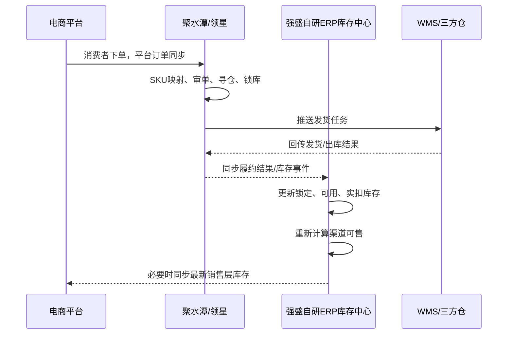
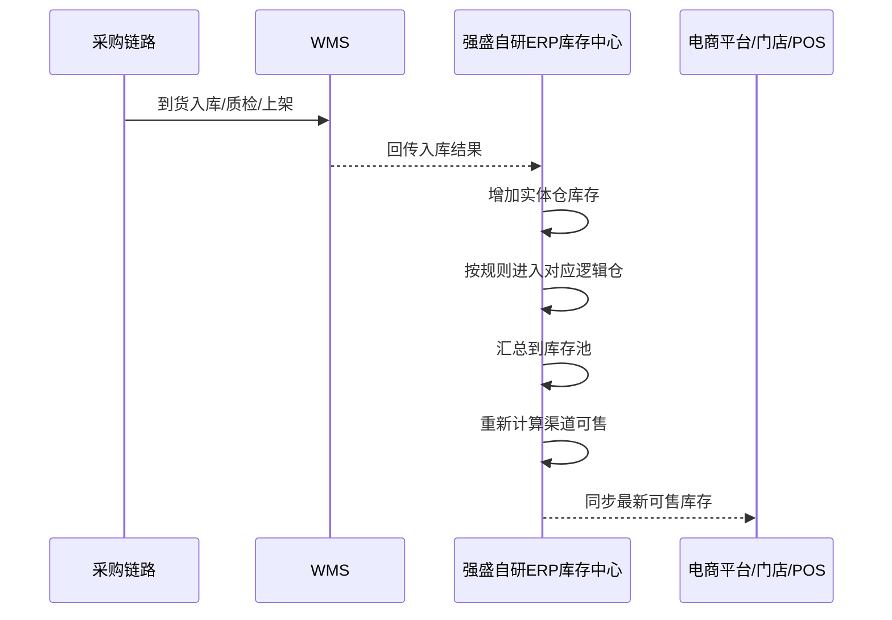

# 课程7：ERP的三层库存体系与库存同步方案拆解

| 项目 | 内容 |
| --- | --- |
| 面向人群 | 已完成ERP第1-6讲，理解主数据、逻辑仓、销售履约、B2C订单处理的学员 |
| 学习时长 | 正文完整阅读约120分钟；课堂讲授可压缩到90-100分钟 |
| 难度等级 | ⭐⭐⭐⭐ |
| 前置课程 | 第4讲：从一个仓库到多逻辑仓库存模型；第5讲：多渠道销售与履约模块产品设计；第6讲：电商ERP的订单模块产品设计 |
| 本讲定位 | 借鉴电商SaaS ERP成熟玩法，反推强盛科技阶段5自研ERP库存中心如何升级 |


## 1. 课程背景：本讲到底在讲什么
### 1.1 本讲边界：参考SaaS ERP，落点是强盛科技自研ERP
第5讲和第6讲里，我们已经看过电商SaaS ERP如何处理平台订单、审单、寻仓、锁库和发货。短期内，这些高频履约能力仍然可以由聚水潭、领星、万里牛这类成熟系统承担。

但到了阶段5，强盛科技的问题不再只是“把天猫订单发出去”，而是要把天猫、京东、抖音、Amazon、B2B批发、线下门店放到同一个库存调度视角里管理。

所以，本讲不是照着聚水潭做一个电商ERP，而是借助成熟SaaS ERP的库存同步玩法，反推强盛科技自研ERP V2要如何升级为全渠道库存中枢。

| 问题 | 本讲口径 |
| --- | --- |
| 我们是在讲第三方电商SaaS ERP吗？ | 是，但它们是参考样本，不是最终系统边界 |
| 我们是在讲强盛科技自研ERP吗？ | 是，最终落点是强盛科技阶段5自研ERP V2的库存中心 |
| 强盛科技要不要一上来重做聚水潭/领星？ | 不一上来全重做，先借鉴成熟产品的库存同步玩法 |
| 本讲重点是什么？ | 三层库存、库存池、渠道分配、库存同步 |
| 本讲不重点讲什么？ | 平台拉单、打单、面单、售后、接口鉴权、幂等重试、系统集成细节 |


可以把本讲理解成一条演进线：

```latex
过去：SaaS ERP主控电商履约，自研ERP接结果
现在：自研ERP开始升级库存中心能力
未来：自研ERP成为全渠道库存调度层
```

### 1.2 强盛科技为什么现在才需要三层库存
在阶段3，强盛科技采用金蝶云·星空 + 店小秘 + 旺店通的组合。金蝶管后台主账和采购库存，店小秘、旺店通分别管跨境和国内电商前台履约。这个阶段的核心问题是系统分治，库存靠同步维持。

在阶段4，强盛科技开始自研ERP V1，接管主数据、采购、批发销售、逻辑仓、内部结算等后台主链条。B2C履约仍然由成熟SaaS ERP主控，自研ERP主要接结果。

到了阶段5，强盛科技进入新零售和IPO冲刺阶段。此时库存问题变成了全渠道问题：

+ 天猫、京东、抖音、Amazon、B2B批发、线下门店都在销售同一批商品；
+ 国内仓、海外仓、FBA、门店仓、在途库存都会影响可售判断；
+ 聚水潭、领星、POS、WMS、自研ERP都可能看到不同的库存数字；
+ 供应链团队希望统一分配库存，运营团队希望平台库存及时同步，仓库团队希望实物库存不要被系统误占。

| 阶段 | 库存管理形态 | 主要问题 |
| --- | --- | --- |
| 阶段3 | 金蝶 + 店小秘/旺店通 | 后台库存和前台库存分治，靠同步维持 |
| 阶段4 | 自研ERP V1 + SaaS ERP继续主控B2C履约 | ERP接管后台主链条，但全渠道库存调度能力不足 |
| 阶段5 | 自研ERP V2升级为全渠道库存中枢 | 要做全渠道库存调度、渠道分配、库存同步 |


### 1.3 本讲和第4/5/6讲的关系
| 前置课程 | 已经讲过 | 本讲继续解决 |
| --- | --- | --- |
| 第4讲 | 实体仓、逻辑仓、在途仓、库存口径 | 逻辑仓如何汇总成库存池 |
| 第5讲 | B2B销售预占、实扣、释放；B2C结果归集 | 多渠道下锁定和释放怎么影响可售 |
| 第6讲 | B2C订单、SKU映射、审单、寻仓、锁库 | 订单履约如何反向驱动库存同步 |


第4讲主要解决“库存怎么表达”。  
第5讲主要解决“订单怎么消耗库存”。  
第6讲主要解决“电商订单为什么牵出库存判断”。  

本讲往前走一步：库存中心要把实物库存、逻辑仓、库存池、渠道分配、平台同步串起来。


## 2. 学习目标

- 能说清三层库存（实物层/调度层/销售层）分别对应哪些系统、哪些角色、哪些库存粒度
- 能解释"中央库存"不是独立系统，而是ERP/OMS内的库存中心模块
- 能推演单仓/多仓/多逻辑仓场景下，库存如何按比例分配给多个电商渠道
- 能说清独占库存和共享库存的区别，并推演售出/入库后的重算逻辑
- 能拆解一条库存同步规则的四要素：基础信息/库存来源/计算公式/生效商品
- 能说清强盛科技阶段5自研ERP V2在库存中心需要做哪些升级
- 能描述平台销售和采购入库事件，如何经由库存中心影响库存池和渠道可售

**学习交付物：** 三层库存关系图 + 逻辑仓→库存池→渠道分配表 + 独占/共享推演表 + 天猫库存同步规则设计稿

## 3. 三层库存体系：定义与误区

### 3.1 三层基本定义
三层库存体系最早起源于电商多店铺库存同步的需求——同一个商家在天猫、京东、拼多多等多平台卖货，需要解决"同一批货在各平台各卖多少、怎么同步"的问题。后来新零售O2O场景把这个模型从纯电商扩展到了线下门店+线上全渠道。

三层库存体系不是某一个系统里的三张表，而是一个业务概念——把涉及库存管理的场景做了抽象归纳，分成三个层级。

**实物层库存：** 指的是存放在仓库或者门店中的库存，一般用WMS或者POS可以查询到具体的实物库存数量。在WMS和POS中，实物库存的颗粒度有多种，例如SKU库存、SKU-批次库存、SKU-库位库存（仅WMS有）等。

**调度层库存：** 由于库存存放在多个仓库、门店中，同时又因为有多销售渠道需要发货，所以需要有一个调度层的库存，来记录相关的原始库存和调度后的库存，便于集中管理。调度层的库存往往是在ERP或者OMS中进行管理，对应的库存管理颗粒度一般是"SKU库存"，可能会通过逻辑仓来划分，也可能会通过"库存类型"来划分，例如正品库存、不良品库存、在途库存、冻结库存等。

**销售层库存：** 销售层库存是指销售平台/系统中的库存，只有在平台上的商品详情页的库存大于0时，用户才能下单，否则提示商品缺货。销售层的库存是由对应的销售平台的运营后台（商家工作台）进行管理，在发布商品上架时进行设置。

| 库存层级 | 对应的管理系统 | 库存粒度 | 库存用途划分 |
| --- | --- | --- | --- |
| 实物层 | WMS、POS | SKU库存，SKU-批次库存，SKU-库位库存 | 可用库存、锁定库存、分配库存，在途库存 |
| 调度层 | ERP、OMS | SKU库存（正品库存、次品库存、在途库存） | 可用库存，锁定库存，占用库存，预留库存，在途库存 |
| 销售层 | 商家工作台 | SKU库存 | 总库存，可销售库存，预扣库存 |


<!-- 这是一张图片，ocr 内容为： -->


<!-- 这是一张图片，ocr 内容为： -->


在强盛科技中，我们需要知道3层库存体系变成了这样：

| 层级 | 对应系统 | 强盛科技例子 |
| --- | --- | --- |
| 实物层 | WMS、POS、FBA、三方仓 | 东莞仓库存、门店库存、FBA库存 |
| 调度层 | 自研ERP V2 库存中心 | 电商履约池、门店备货池、FBA备货池 |
| 销售层 | 天猫/京东/抖音/Amazon/小程序 | 天猫商品页显示可售120件 |


三层之间的数据流动关系：

<!-- 这是一个文本绘图，源码为：flowchart TD
    subgraph 实物层["实物层（WMS/POS）"]
        WMS["仓库实物库存<br/>SKU/批次/库位"]
        POS["门店实物库存<br/>SKU"]
    end

    subgraph 调度层["调度层（ERP/OMS）"]
        INV["库存中心<br/>账面库存 → 逻辑仓 → 库存池 → 渠道分配"]
        RULE["调度规则<br/>分配比例/独占共享/同步公式"]
    end

    subgraph 销售层["销售层（平台商家后台）"]
        TM["天猫可售库存"]
        JD["京东可售库存"]
        DY["抖音可售库存"]
        XHS["小红书可售库存"]
    end

    WMS -->|"入库/出库结果回传"| INV
    POS -->|"销售/收货结果回传"| INV
    INV -->|"库存同步（覆盖/增量）"| TM
    INV -->|"库存同步（覆盖/增量）"| JD
    INV -->|"库存同步（覆盖/增量）"| DY
    INV -->|"库存同步（覆盖/增量）"| XHS
    RULE --> INV -->


### 3.2 关于“中央库存”或“三层库存”的一些疑问解答
三层库存有几个容易混淆的概念，这里集中解答。

1. 中央库存系统，是什么系统？是单独存在的一个管理后台吗？

:::danger
有人会把三层库存体系中的中间层称之为“中央库存”，然后对应的功能模块就称之为“中央库存系统”，于是很多初学者就会觉得“中央库存系统”应该是一个独立存在的系统，类似于进销存，WMS，ERP一样有一个后台管理界面，然后需要注册登录等。

但是实际上，“中央库存系统”更准确的定义应该是“库存中心”或者“库存管理”模块，它往往存在于OMS或者ERP中的一个库存模块中，而有一些文章称之为“系统”，其实是更偏向于微服务架构中的“库存服务”，即把库存相关的处理都放在这里。

<!-- 这是一张图片，ocr 内容为： -->


<!-- 这是一张图片，ocr 内容为： -->


:::

2. 实物层、调度层、销售层库存，是不是都放在一个系统或者模块中查询？

:::danger
很多人听到了“三层库存体系”，就会觉得好像要把库存分成三层，然后在一个系统中汇总所有的内容。

**但是实际上并不是，“三层库存体系”是分开在不同的系统，由不同的人员来管理的。**

实物层库存，指的是放在仓库或者门店中的库存，那么管理人员自然是仓库管理员或者门店店长，对应的系统是WMS或POS。

销售层库存，指的是销售平台（例如说淘宝的某个店铺）中的库存，对应的库存管理人员应该是电商运营，对应的系统则是销售平台提供的商家工作台/管理后台，例如说淘宝和天猫对应的商家工作台就是“[千牛](https://qn.taobao.com/?spm=a21dvs.24047116.0.0.52d2645e92sX96)”，小红书的商家工作台就是“[千帆](https://ark.xiaohongshu.com/)”。

调度层库存，指的对实物库存（多仓、多店）的“数据化/账面化”的管理，同时将管理后的相关结果同步更新到销售层面。主要是起到连接实物库存和销售库存的桥梁作用，中间会涉及到一些库存的抽取、汇总、分配、调度等。

<font style="color:#585A5A;">“数据化/账面化”管理的意思是指：在我们使用OMS/ERP的时候，当发现仓库库存不足了，我们就会发起采购业务，当门店的库存不足了，我们就会发起配货到店业务，对这些业务单据的管理，也间接地完成了对实物库存的“数据化/账面化”的管理。</font>

:::

3. 进销存或者海外仓OMS等系统是不是也需要引入“三层库存体系”？

:::danger
经过上面的学习，我们已经知道了三层库存，其实核心点应该是中间的“调度层”，而“调度层”的核心应该是连接实物库存和销售库存，并在这中间通过一些策略、规则来实现库存的抽取、汇总、分配、调度等。

如果狭隘地理解，可以认为只要相关的系统中涉及到“实物库存-销售库存”的库存调度业务，都可以称这一部分为“调度库存”。

进销存系统，往往对接的仓库不多，销售渠道也很少对接外部的电商平台等，所以可以理解为没有“调度库存”；

海外仓OMS，一般是只用来做海外仓WMS的客户端，虽然可能会对接一些外部的销售渠道（跨境电商平台），但是往往只是用来拉取订单，不太涉及到库存的调度，所以也可以理解为没有“调度库存”；

一般包含三层库存体系的系统类型：电商ERP（如聚水潭、万里牛）、新零售ERP（如百胜E3、商派OMS）、自研全渠道中台等。强盛科技阶段5自研ERP V2的库存中心，目标正是承担这一层角色，接管多仓、多渠道的库存调度与同步。

:::

### 3.3 实物层库存
实物层库存就是WMS和POS中记录的库存。对强盛科技而言，实物层包含：东莞/广州自建仓（WMS管理）、线下门店（POS管理）、FBA仓（Amazon端管理）、三方仓（三方WMS或接口回传）。后续我们会深入展开WMS相关的库存讲解。这里我先用一张简单的图给大家看一下WMS的库存大概长什么样子，其实跟进销存的是类似的。


### 3.4 销售层库存
销售层库存是指销售平台（以淘宝、小红书为例）中的库存，这里可以参考“千牛”和“千帆”系统的后台页面，让大家看看库存是怎么展示的。

<!-- 这是一张图片，ocr 内容为： -->


<!-- 这是一张图片，ocr 内容为：巧用商品工具之商品限购 小红书千帆 数据 学习中心 返回首页 买手合作 专业号 客服 乘风推广 凶千帆APP 消息 常用 管理 X 编辑库存 商机中心社区用广种草热度风向标 商品管理 订单管理 商品搬家各平台一键销伤至小红书 在售中的商品如果编辑过程中有买家下单,修改时将在实际库存基础上做增减. 经营 商机中心 搜索运营 维他命的知识花园"电子专栏 商品ID:67154D4A38D470000118CE69 中 内容 笔记中心 笔记管理 操作的满意度如何? 改后可售库存 可售库存 规格状态 规格信息 操作 发布笔记 店播中心 直插中控台 直摇计划 默认规格 直播场次 售卖中 请输入库存变更值 清空库存 减 1000 绝对值 规格ID:67154D4A3BD47000118CE6A 打个分吧 条形码:XHS-379W2YGP19MO 日商品 发布商品 商品管理 评价管理 商品诊断 取消 确定 0/1000 图片空间 仓储库存 帮助 商品工具 @发送 "维他命的知识花园"电子专栏 调研 当订单 已发布: 商品ID:67154D4A38D47000118CE69 已发布:( (发布相似品 ￥ 249.00 1000 订单管理 历史累计:0 发货管理 发布新笔记 商品货号:ZSHYZL 渠道信息同步 @预览 电子面单 打单发货 物流异常 发街异常 跨境供应链:海外仓OTWB项目实战 编辑下架删除 已发布:2尚 更多 订单工具 商品ID:6715489AB2C30C0001540E38 ￥108.00 @发布相似品 已发布: 99999 发布新笔记 商品货号:DZZL 历史累计:0 设置讲解笔记 渠道信息同步 固售后 @预览 快递拦截 告后工作台 20条/页 运费宝 小额打款 页 跳至 -->


<!-- 这是一张图片，ocr 内容为：库存变更记录仅保留近6个月变史记录:最多音询1000条,最多导出1000条 小红书千帆 乘风推广 买手合作 独案功能,课程,规则 返回首页 数据 商品名称:维他命的知识花园"电子专栏 渠道库存管理 活动库存管理 普通库存管理 仓库 库存回补设置 常用 规格名称:维他命的知识花园"电子专栏 规格ID:67154D4A380470000118CE6A 商品管理 订中管理 库存类型:普通库存 商品类目 商品名称 请输入商品名称/关连词 经营 导出变更记录 仓库默认仓 查询 商品类型全部 仓库信息 搜索属堂 编码/D  请进入条形商品以货号两家编号查询,多个蜂码中间用 1.1分附 中内容 变更后可信库存 变更仓库 变更数量 明细 变更类型 变更时间 发有暗记 店接中心 默认仓 2025-04-13 21:23:48 -11111 商家调整库存 88888 声择中拉台 仓库ID:CPARTNER 直接汤次 批量调整库存 批量酒空库存 日商品 默认仓 99999 69099 商家调整库存 2025-04-13 21:22:38 商品管理 规格信息 商品信息 仓库ID:CPARTNER 沪价管理 尚品诊所 仓健库存 图片空间 维也命的知识花 维他命的知识花园电子专栏 商工具 默认仓 尚品ID:6715404 -100 900 2025-04-13 21:22:22 商家调整库存 仓库ID:CPARTNER 卤订单 发质管理 订单管理 跨境长应铠:海外仓OTWD项1容战,电了专兴 电子雨中 打单发货 电子专栏 默认仓 开品(D:67F5489 规格证:675489AB2630E0001540639 初始化库存 1000 +1000 2025-04-09 00:22:34 物流开带 仓库ID:CPARTNER 订单1兵 乐画 园售后 20条/页Y 共2条,1页 20条/页 共4条.1页 共道烂做 售后T作台 运费主 小团打破 消防吉权量 任务单 投诉红粉 吕店铺 店动服务分 -->


电商销售平台中的库存，会随着消费者购买下单逐步扣减消耗掉。如果要增加可售库存，可以在商家工作台中进行手动修改，也可以使用接口API的方式直接从电商ERP中同步相关的可售库存数据过去，这里的可售库存，其实就是在“调度层”计算、处理好后的数据，这个场景也称之为：**库存同步，即从OMS/ERP中同步可销售的库存给电商平台。**

:::info
同步的方式有几种：

1. 直接用OMS/ERP计算好的库存，覆盖销售平台当前的库存，也就是全量更新（修改）；
2. 用OMS/ERP计算好的库存，去增加或者减少销售平台当前的库存，也就是增量更新（修改）；

:::

### 3.5 调度层库存
调度层库存存在于ERP/OMS中，是三层中最复杂的一层。库存的增加和减少，由业务单据驱动，主要包括以下几类：

<!-- 这是一张图片，ocr 内容为：减少库存 来源 库存管理 去向 增加库存 供应商 消费者 库存查询 销售出库 采购入库 调拨入库 调拨出库 库存流水 其他仓库/门店 其他仓库/门店 供应商 采购退货 销售退货 消费者 库存 盘亏出库 盘盈入库 系统调整 系统调整 加工(原料)出库 库存同步 原仓库 加工(成品)入库 原仓库 库龄报表 其他出库 其他入库 其他 其他 库存预警 期初导入 其他仓库/门店 -->

1. 调度层的库存与实物层库存怎么联动？

:::info
OMS/ERP会下推单据给WMS，当WMS完成了单据的作业之后会增加或者扣减库存，同时也会回传结果给OMS/ERP，然后OMS/ERP也会增加或扣减库存，两者都通过有关联的单据实现库存的同时增加和减少。

在调度层中，OMS/ERP会使用逻辑仓的概念，将实体仓的库存划分为若干个部分，但是理论上逻辑仓累加的总库存数量是要等于实体仓中的总库存数量。

<!-- 这是一张图片，ocr 内容为：ERP/OMS 东莞仓库 SKU_A 60个 SKU_A 100个 SKU_B80个 SKU_B10个 货主:苹果公司 逻辑仓:电商东莞1仓 SKU_A 40个 SKU_B70个 逻辑仓:线下东莞1仓 -->


:::

2. OMS/ERP中的库存查询和展示

:::info
在OMS/ERP中，可以查询实体仓的库存，数据来源于WMS的接口，或者是ERP/OMS自己记录的。ERP/OMS的采购订单推送到WMS，当WMS完成了入库之后，ERP/OMS生成采购入库单，同时增加对应实体仓的库存。ERP/OMS的销售订单推送到WMS，当WMS完成了出库之后，ERP/OMS生成销售出库单，同时扣减对应实体仓的库存

<!-- 这是一张图片，ocr 内容为：实体仓库存查询 产品名称 可用库存 锁定库存 实体仓库 在途库存 实际库存 SKU 维他柠檬茶 0 东莞仓 100 95 5 A0001 广州仓 维他柠檬茶 0 0 50 50 A0001 维他充电宝 O 东莞仓 20 20 A0002 100 -->


在OMS/ERP中，也可以查询逻辑仓中的商品库存，数据一般是来源于ERP/OMS自己记录的，而且逻辑仓的库存一般都是会有一些加工的，取决于逻辑仓是怎么定义的。

<!-- 这是一张图片，ocr 内容为：逻辑仓库存查询 产品名称 逻辑仓库 实际库存 在途库存 可用库存 锁定库存 SKU 东莞电商仓 60 0 0 60 维他柠檬茶 A0001 5 东莞门店备货仓 0 35 40 维他柠檬茶 0 0 50 广州电商仓 50 A0001 维他充电宝 0 东莞电商仓 A0002 20 100 20 -->


可以按“正常品”，“不良品”来划分逻辑仓，例如：正常品仓和不良品仓。

可以按“销售渠道”来划分逻辑仓，例如：电商仓和门店备货仓。

可以按“业务部门”，例如：销售1仓，销售2仓，销售3仓。

……

:::

3. 逻辑仓虽好用，但是在实际使用的时候可能还要再对逻辑仓进行聚合、汇总处理（调度库存/库存池）

:::info
例如说在全国范围内，实体仓有N个，则逻辑仓可能会N*M个。虽然有这么多的逻辑仓，但是对应的销售渠道其实只有几个，例如说：

+ 电商渠道
+ 线下门店渠道
+ 分销代理渠道

我们希望全国的这些实体仓的库存都能用到到各个销售渠道中，但是可使用的数量和使用的要求等都不一样。所以我们需要对这些库存进行聚合、分配、调度，常见的就是汇总成“库存池”。

当然，这一步也是可以省略的，尤其是如果全国的仓库不多，然后业务形态也比较单一的公司，没必要做这么多的聚合、分配工作。

<!-- 这是一张图片，ocr 内容为：东莞电商逻辑仓 汇总 广州电商逻辑仓 电商履约库存池 惠州电商逻辑仓 东莞线下批发逻辑仓 汇总 门店备货库存池 广州线下批发逻辑仓 上海综合逻辑仓 分销库存池 按比例分配 按比例分配 按比例分配 -->


<!-- 这是一张图片，ocr 内容为：SHOPE/商派 YHG 调度库存 系统首页 基础中心 货品条码: 请选择所属品牌 货品: 请输入货品条码 所属品牌: 配置中心 重置 请输入货品编码或名称 搜索 日商品中心 请输入调度编码或名称 调度: 创建时间: 请选择所属品类 所属品类: 开始时间 结束时间 展开乡 四库存中心 出入库管理 货品类型 序号 包装单位 调度编码 调度名称 货品编码 物料规格 货品名称 实体仓库存 PG 光度:150 普通 D001 苹果 逻辑仓库存 页 共1条 前往 10条/页 渠道库存 调度库存 调度库存 效期批次管理 调度配额单 调度扣减单 策略中心 调度锁库单 客户中心 调度库存变动流水 接口中心 调度占用变动流水 曰订单中心 调度锁定变动流水 营销中心 -->


:::

4. 对调度库存进行精细化的分配，最后就可以得出要给各个渠道/平台同步的库存数量

:::info
渠道库存，即分配到每个渠道可用的库存，这部分的库存会通过“库存同步”的方式，把对应的库存同步到销售平台中。

<font style="color:rgb(26, 28, 30);">假设我们有一个SKU：A001（维他柠檬茶），背后有多个实体仓和逻辑仓，最后逻辑仓汇总成了“库存池”之后，如下所示。</font>

<!-- 这是一张图片，ocr 内容为：实体仓库存查询 产品名称 在途库存 实际库存 实体仓库 锁定库存 可用库存 SKU 维他柠檬茶 东莞仓 O 10 110 120 A0001 维他柠檬茶 广州仓 0 O A0001 30 30 逻辑仓库存查询 逻辑仓库 锁定库存 在途库存 产品名称 可用库存 实际库存 SKU 东莞电商仓 0 70 70 0 维他柠檬茶 A0001 东莞门店备货仓 0 50 10 40 维他柠檬茶 0 广州电商仓 0 30 30 A0001 库存池库存查询 产品名称 库存池 可分配库存 SKU 100 电商履约库存池 维他柠檬茶 A0001 (70+30) 门店备货库存池 维他柠檬茶 40 A0001 -->


在“电商履约库存池”中，有100个可用于分配的库存。而在“门店备货库存池”中，有40个可用于分配的库存。

此时，需要对这些库存池中的库存进行分配，分配到具体的店铺和销售渠道中。

**电商履约库存池：**

+ 拼多多旗舰店，独占2成库存，100*20%=20
+ 京东旗舰店，和淘宝旗舰店共享剩余的8成库存，而且比例是60%。100*80%*60%=48
+ 淘宝旗舰店，和京东旗舰店共享剩余的8成库存，而且比例是40%。100*80%*40%=32

**门店备货库存池：**

+ 华南区门店，独占7成库存，40*70%=28
+ 华北区门店，独占剩余3成库存，40*30%=12

两个库存池之间**完全隔离**：电商履约池卖出库存，不会影响门店备货池；反之亦然。

| 场景步骤 | 华南区门店库存 | 华北区门店库存 | 备注 |
| :--- | :--- | :--- | :--- |
| 初始 | 28 | 12 | 门店备货池40件，华南独占70%，华北独占30% |
| 华南区门店销售8件 | 20 | 12 | 独占库存直接扣减，华北区不受影响，也不触发重算 |
| 门店收货（调拨入库）20件 | 40 | 12 | 门店备货池+20，华南区重算（40+12=52总池？❌）— 注意：此处是独占而非共享，20件全归华南，40-8+20=52；若下次有新调拨，按原比例重算 |

> ⚠️ 注意和电商共享库存的区别：门店两个区是**各自独占**，谁销售谁的库存减少，不会触发相互重算（不像京东和淘宝共享池那样）。

<!-- 这是一张图片，ocr 内容为：渠道库存查询 渠道类型 产品名称 所用库存池 渠道名称 库存比例 可用库存 渠道总库存 占用库存 SKU 20 线上 独占库存(2成)-100% 拼多多旗舰店 电商履约库存池 维他柠檬茶 20 0 A0001 (100*0.2*100%) 48 共享库存(8成)-60% 线上 维他柠檬茶 京东旗舰店 电商履约库存池 48 0 A0001 (100*0.8*50%) 32 淘宝旗舰店 线上 共享库存(8成)-40% 维他柠檬茶 0 电商履约库存池 32 A0001 (110*0.8*50%) 28 独占库存(7成)-100% 线下 华南区门店 维他柠檬茶 门店备货库存池 A0001 0 28 (40*0.7100%) 12 线下 维他柠檬茶 独占库存(3成)-100% 华北区门店 0 门店备货库存池 12 A0001 (400.3*100%) -->


:::

5. 实体仓入库了或者是渠道库存销售了之后，会怎么影响独占和分配的库存呢？

:::info
很多人初次接触“独占”和“共享”的时候容易在这个地方想不清楚，所以我单独抽出这部分来和大家分享一下，怎么更好地理解这一块的逻辑。

独占库存的特性：将库存池的库存按比例单独分配给某个店铺。如果实物库存增加了，那么独占库存也会随之增加；**如果销售了这部分的库存，则独占库存也会随之减少**。一般不会出现实物库存突然减少的情况，除非是仓库发起的盘亏、其他出库等，此时也要随之减少。

共享库存的特性：将库存池的库存按比例抽出来用于共享，而且共享的店铺之间还有一层比例。如果实物库存增加了，那么共享库存也会随之增加；**如果销售了这部分的库存，则共享库存也会随之减少，同时各个店铺之间还需要按减少的库存再重新计算并分配一次库存**。一般不会出现实物库存突然减少的情况，除非是仓库发起的盘亏、其他出库等，此时也要随之减少。

**用“电商履约库存池”来**举个栗子：

+ 拼多多旗舰店，独占2成库存，100*20%=20
+ 京东旗舰店，和淘宝旗舰店共享剩余的8成库存，而且比例是60%。100*80%*60%=48
+ 淘宝旗舰店，和京东旗舰店共享剩余的8成库存，而且比例是40%。100*80%*40%=32

当拼多多旗舰店销售掉了4个库存之后，那么拼多多旗舰店的可销售库存会变成**20-4=16**个。

但是如果京东旗舰店销售掉了4个库存之后，那么看起来是48-4=44个，好像京东旗舰店还可以再销售44个。但是因为京东和淘宝的共享库存，所以无论是京东销售还是淘宝销售，本质上都是把共享池的库存减少了。

当共享池的库存销售掉了4个之后，共享池还剩余80-4=76个。然后系统再触发重新共享库存的重新分配计算：

+ 京东旗舰店，和淘宝旗舰店共享剩余的8成库存，而且比例是60%。**76*60%≈46**
+ 淘宝旗舰店，和京东旗舰店共享剩余的8成库存，而且比例是40%。**76*40%≈30**

**<font style="color:#601BDE;">---分隔线---</font>**

如果此时，当实物仓（东莞仓）又采购了100个商品进来之后，东莞仓的实物库存需要+100，所以对应的电商履约库存池也会+100。

此时还是用“电商履约库存池”来举个栗子：

+ 拼多多旗舰店，独占2成库存，16+100*20%=36，其中16是之前剩余的。
+ 京东旗舰店，和淘宝旗舰店共享剩余的8成库存，而且比例是60%。46+100*80%*60%=94，其中46是之前剩余的
+ 淘宝旗舰店，和京东旗舰店共享剩余的8成库存，而且比例是40%。30+100*80%*40%=62，其中30是之前剩余的

:::


#### 调度层总结：引入逻辑仓 vs 不引入逻辑仓

当业务规模扩大到多仓、多渠道、多用途时，调度层会有两种设计思路：**引入逻辑仓**，或者**直接在实体仓上挂分配规则**。两种方案的核心差异是"库存抽象的粒度"。

**方案一：引入逻辑仓（适合精细化管理）**


<!-- 这是一张图片，ocr 内容为：逻辑仓层 销售渠道层 业务调度层 实体仓库层 电商平台/门店 OMS/ERP OMS/ERP WMS 汇总库存池 按比例分配 逻辑仓定义 东莞1仓正常仓 天猫 东莞仓 东莞2仓-退货仓 电商履约库存池 京东 独占/共享 仓间调拨 淘宝 仓间调拨 广州1仓-门店专用仓 华南区门店 广州2仓-电商专用仓 广州仓 门店备货库存池 独占/共享 华北区门店 广州3仓分销专用仓 华中区门店 仓间调拨 一级分销商 分销库存池 惠州仓 惠州1仓备货仓 独占/共享 二级分销商 深圳门店1 深圳门店1仓-门店仓 -->


**方案二：不引入逻辑仓（适合早中期，规则简单）**

<!-- 这是一张图片，ocr 内容为：销售渠道层 实体仓库层 业务调度层 电商平台/门店 OMS/ERP WMS 按比例分配 定义分配规则 天猫 分配规则 东莞仓 京东 独占/共享 淘宝 仓间调拨 仓间调拨 华南区门店 广州仓 华北区门店 分配规则 独占/共享 华中区门店 仓间调拨 一级分销商 惠州仓 分配规则 独占/共享 二级分销商 独占/共享 深圳门店1 分配规则 -->


| 对比维度 | 引入逻辑仓 | 不引入逻辑仓 |
| :--- | :--- | :--- |
| **库存颗粒度** | 实体仓下细分逻辑仓（如电商仓/退货仓/批发仓） | 直接以实体仓为库存基本单位 |
| **调度灵活性** | 高：不同逻辑仓可走不同分配规则 | 中：只能对整仓设定规则 |
| **系统复杂度** | 高：逻辑仓数量可达几十～几百个，维护成本高 | 低：规则配置在实体仓层面 |
| **适用场景** | 多渠道/多用途场景，需要精细隔离（如电商仓和退货仓不能混用） | 仓库用途单一，或刚起步阶段 |
| **强盛科技现状** | Phase4自研ERP V1起引入逻辑仓；Phase5 ERP V2深度依赖逻辑仓做全渠道调度 | Phase1-2（Excel/管家婆阶段）的早期形态 |

> **强盛科技落点：** 东莞主仓下有"电商正品仓""退货待检仓""B2B批发仓"三个逻辑仓，广州辅仓下有"电商正品仓""门店备货仓"，FBA仓独立管理。这就是"引入逻辑仓"的典型结构——**实体仓管实物位置，逻辑仓管业务用途，库存池管渠道分配**，三层各司其职。


#### 补充说明：账面库存与调度层库存的关系
:::info
前面我们引入了“账面库存”的概念，现在我们来解答一下它和“调度层库存”的关系。

当ERP/OMS账面库存有100，而且我们也只有一个销售渠道的时候，理论上我们可销售的库存也是100，所以我们可以将这个100库存全部用于这个渠道的销售占用、扣减等。

当我们对接了越来越多的电商平台，电商店铺之后，我们会发现这100个库存是需要进行分配的，要有一定的调度规则，分配规则，这样我们才知道每个平台、店铺可以销售多少。

所以，账面库存是调度层库存运算的基础，数据提供的来源。调度层库存是一个更宏大的概念，它不仅仅包含了账面库存的数量，还包含了背后的调度规则，以及使用调度规则计算后的可销售库存的数量。

<font style="color:#8A8F8D;">ERP/OMS总可用库存：100</font>

<font style="color:#8A8F8D;">店铺1：可销售库存 40</font>

<font style="color:#8A8F8D;">店铺2：可销售库存 50</font>

<font style="color:#8A8F8D;">预留的库存：10</font>

上面提到的100，40，50，10都可以称之为“账面库存”，表达的是系统记录了的一堆字符数据。我们用一个更准确、更宏观的概念对其总结、抽象，我们可以称之为“调度层库存”，或者是“逻辑库存”。

<!-- 这是一张图片，ocr 内容为：SHOPE人商派 1.商派库存中心层级与业务关系 品牌零售数字化服务商 三层架构设计,库存分配更加灵活,库存利用率最大化,从而支撑品牌更多业务场景 公域 私域 销售渠道 平台库存 京东 其他 云店 门店 天猫 安全库存/发布策略 销售域 销售库存 门店 其他 京东 云店 2B 天猫 供货关系/分配策略 调度域 逻辑库存 北京逻辑仓A 上海逻辑仓B 上海逻辑仓A 实体仓域 实体库存 其他 北京仓 上海仓 -->


:::

## 4. 从简单到复杂：调度层场景推演
### 4.1 单仓对多店
最基础的场景：一个实体仓（东莞主仓）同时支撑多个电商渠道发货。以 `QC100 智能保温杯` 为例：

<!-- 这是一张图片，ocr 内容为：天猫店铺 同步60 上海仓库 OMS/ERP 同步40 京东店铺 -->


**业务设定:**

+ **实体仓库:** 只有1个实体仓库，“东莞主仓”。
+ **商品:** SKU `QC100 智能保温杯`，在“东莞主仓”有实物库存 **100** 件。
+ **销售渠道:**
    - 天猫旗舰店
    - 京东POP店

**库存分层与管理思路:**

+ **实物层:** “东莞主仓”的 `QC100 智能保温杯`，实物库存100件。
+ **调度层:**
    - **库存基数（来源）:** 直接引用“东莞主仓”的**实物库存**作为可分配基数 (100件)。
    - **分配规则 (直接基于实物库存总量):**
        * 天猫旗舰店: 分配比例 60%。
        * 京东POP店: 分配比例 40%。
+ **销售层:**
    - 天猫旗舰店可售库存: 100 (实物库存基数) * 60% = 60件。
    - 京东POP店可售库存: 100 (实物库存基数) * 40% = 40件。

**库存分配计算的时机和同步的方式:**

+ **计算的时机**：当OMS/ERP的账面库存发生变化的时候（增加/减少库存），自动触发分配计算。也可以搭配定时任务自动计算，然后再结合手动同步的操作
+ **方式**：采用“**覆盖更新**”的方式，即计算后要同步多少库存就直接用这个数量去更新销售平台的库存

| 场景步骤  | 调度层库存基数 | 天猫可售 | 京东可售 | 备注 |
| :--- | :--- | :--- | :--- | :--- |
| 初始 | 100 | 60 | 40 | 覆盖更新的方式 |
| 天猫售10件 | 90 | 54 | 36 | OMS/ERP接收销售订单，出库完成，可用库存-10，所有渠道按比例重算（90×60%=54，90×40%=36） |
| 京东再售5件 | 85 | 51 | 34 | 同理，基数再-5，按比例重算（85×60%=51，85×40%=34） |
| 新入库50件 | 135 | 81 | 54 | 仓库实物入库，可用库存+50，所有渠道按比例重算（135×60%=81，135×40%=54） |


### 4.2 多仓对多店
进阶场景：东莞主仓 + 广州辅仓两个实体仓，库存汇总后统一分配给多个渠道。仍以 `QC100 智能保温杯` 为例：

<!-- 这是一张图片，ocr 内容为：上海仓库 天猫店铺 同步90 OMS/ERP 京东店铺 同步60 广州仓库 -->


**业务设定:**

+ **实体仓库:**
    - 东莞主仓 (QC100: 100件)
    - 广州辅仓 (QC100: 50件)
+ **商品:** `QC100 智能保温杯`，总实物库存 100 + 50 = **150** 件。
+ **销售渠道:**
    - 天猫旗舰店
    - 京东POP店

**库存分层与管理思路:**

+ **实物层:** 东莞主仓 QC100 100件，广州辅仓 QC100 50件。
+ **调度层:**
    - **库存基数（来源）:** 来源于2个实体仓的汇总库存，所以可分配的基数 (150件)。
    - **分配规则 (基于2个实体仓的汇总库存):**
        * 天猫旗舰店: 分配比例 60%。
        * 京东POP店: 分配比例 40%。
+ **销售层:**
    - 天猫旗舰店可售库存: 150 (实物库存基数) * 60% = 90件。
    - 京东POP店可售库存: 150 (实物库存基数) * 40% = 60件。

**库存分配计算的时机和同步的方式:**

+ **计算的时机**：当OMS/ERP的账面库存发生变化的时候（增加/减少库存），自动触发分配计算。也可以搭配定时任务自动计算，然后再结合手动同步的操作
+ **方式**：采用“**覆盖更新**”的方式，即计算后要同步多少库存就直接用这个数量去更新销售平台的库存

| 场景步骤  | 调度层库存基数 | 天猫可售 | 京东可售 | 备注 |
| :--- | :--- | :--- | :--- | :--- |
| 初始 | 150 | 90 | 60 | 东莞主仓100+广州辅仓50，汇总后按比例分配 |
| 天猫售10件 | 140 | 84 | 56 | 可用库存-10，所有渠道按比例重算（140×60%=84，140×40%=56） |
| 新入库50件（东莞主仓） | 190 | 114 | 76 | 东莞主仓入库50，两仓合计+50，所有渠道重算（190×60%=114，190×40%=76） |

:::info
**注意：多仓场景下的仓库不对称问题**

上面的推演是"理想状态"——两个仓库都参与库存基数汇总。但实际业务中，有些仓库只服务特定渠道（比如广州辅仓专门供门店补货，不参与电商渠道分配），此时只有东莞主仓的库存变化才会影响电商调度层基数。

这也是为什么库存同步规则里需要配置"库存来源"：要精确指定哪些仓库、哪些逻辑仓的库存参与这条规则的可售计算。

:::


:::info
在这种理想环境下，上海仓、广州仓的库存增加，扣减都会导致调度层的库存基数变化，所以整体效果和单个仓库发多个电商平台/店铺是没有区别的。

但是在实际的业务场景中，有一些仓库是不能发所有电商平台/店铺的（用户配送地址问题、库存预留和分配问题），所以会有些时候上海仓、广州仓的库存增加、扣减并不一定会影响调度层的库存基数变化。

<!-- 这是一张图片，ocr 内容为：浮生仓库,宝鸡仓 同步以下仓库库存数量: 请选择影响可售库存的因素: 库存数量 采购在途量 调入在途量 虚拟库存量 同步前端可售数量 100% (同步库存数量比例) 可生产量(此因素计算量非常大,可能造成同步库存不及时) 出库申请单 待发量(已审核的销售单) 订购量(已分配仓库的销售单) 尚未指定仓库的销售单产生的订购量 全部 指定 已付款 付款状态 未付款 启用多仓库存同步方式,系统仓库库存同步到平台指定商家仓 仓库匹配 同步0库存到网店(当数量小于等于 时,同步0库存)*默认不同步0库存,部分平台同步0库存会导致下架查看>> 自动库存同步时,只同步货品标记为 的货品库存到网店 同步库存量含小数点时,去掉小数同时数量增加1 组合装的单品存放在多个仓库,根据多仓库单品总和重新计算组合装同步库存数 -->


:::

### 4.3 多仓多逻辑仓对多店
在一些比较复杂的新零售业务场景中，经常会引入“逻辑仓”这个概念，少则几十个逻辑仓，多则几百上千个逻辑仓。当引入了多个**逻辑仓**的时候，往往会也会引入**库存池**的玩法，以及更复杂的**分配规则**。

<!-- 这是一张图片，ocr 内容为：上海电商正品仓 上海仓库 天猫店铺 同步54 上海电商次品仓 OMS/ERP 京东店铺 同步36 广州电商正品仓 广州仓库 广州电商次品仓 广州线下渠道仓 -->


:::info
“库存池”就是一个组合关系，把多个有共同特性的逻辑仓组合在一起，汇总它们的库存，作为“调度层”库存的库存基数使用。后续分配库存、计算销售库存、同步到电商平台的玩法和前面讲到的也是基本一样，基于内容篇幅的考虑，这部分就不展开来讲了。

:::

<!-- 这是一张图片，ocr 内容为：东莞电商逻辑仓 汇总 电商履约库存池 广州电商逻辑仓 惠州电商逻辑仓 东莞线下批发逻辑仓 汇总 门店备货库存池 广州线下批发逻辑仓 汇总库存池 逻辑仓 逻辑仓组合 -->


如果引入了逻辑仓，那么库存调度的处理链路会如下所示，其中“逻辑仓层”和“业务调度层”其实都是在OMS/ERP中处理。只不过是因为引入了逻辑仓，所以OMS/ERP需要先前置对逻辑仓做汇总，这样才能得到“调度层”所需要的“库存基数”，也就是我们提到的“库存池”。

<!-- 这是一张图片，ocr 内容为：逻辑仓层 销售渠道层 业务调度层 实体仓库层 电商平台/门店 OMS/ERP OMS/ERP WMS 汇总库存池 按比例分配 逻辑仓定义 东莞1仓正常仓 天猫 东莞仓 东莞2仓-退货仓 电商履约库存池 京东 独占/共享 仓间调拨 淘宝 仓间调拨 广州1仓-门店专用仓 华南区门店 广州2仓-电商专用仓 门店备货库存池 广州仓 独占/共享 华北区门店 广州3仓-分销专用仓 华中区门店 仓间调拨 一级分销商 分销库存池 惠州1仓-备货仓 惠州仓 独占/共享 二级分销商 深圳门店1 深圳门店1仓-门店仓 -->


<!-- 这是一张图片，ocr 内容为：仓库1 库存分配 库存汇总 电商平台 可售库存 WMS 官网,小程序 仓库2 全渠道共享库存 汇总库存池 完全汇总 按渠道独占库存 按比例汇总 锁定库存 线下B2B客户 按固定值分配库存 门店1 线下门店 按比例分配库存 POS 门店2 独享库存池 安全库存 完全独享 自营店 加盟店 门店3 比例+指定数量分配 -->


> **强盛科技对应：** 到了阶段5，强盛科技的库存调度形态正是"多仓多逻辑仓"模式。东莞主仓下有"电商正品仓""退货待检仓"等逻辑仓，广州辅仓下有"门店备货仓"，FBA仓独立成一个实物池。自研ERP V2的库存中心负责把这些逻辑仓汇总成"电商履约池""门店备货池"，再按渠道比例分配到天猫/京东/抖音/Amazon各店铺。

## 5. 库存同步产品设计：以聚水潭ERP为例
### 5.1 章节定位
前面讲完调度层库存的基础概念和业务逻辑，接下来要看成熟电商SaaS ERP是怎么把“库存同步”做成产品功能的。

这里以聚水潭为例。强盛科技未来自研ERP不一定照搬聚水潭的页面，但这些产品对象和配置逻辑值得参考：

+ 店铺授权；
+ 平台商品与ERP本地商品配对；
+ 商品开启库存同步；
+ 配置库存同步规则；
+ 手动/自动触发同步；
+ 查看同步结果和日志；
+ 配置禁止同步规则。

<!-- 这是一张图片，ocr 内容为： -->


### 5.2 库存同步产品链路
```latex
渠道/店铺授权
→ 平台商品与ERP SKU配对
→ 开启商品库存同步
→ 配置库存同步规则
→ 手动/自动触发同步
→ 查看同步结果和日志
```

### 5.3 电商平台授权
在聚水潭这类电商ERP里，平台授权是库存同步的前置条件。系统只有拿到店铺授权，才能读取平台商品、推送库存、查看同步结果。

<!-- 这是一张图片，ocr 内容为： -->


<!-- 这是一张图片，ocr 内容为： -->


对强盛科技来说，店铺授权不一定由库存课展开，后续系统集成课会讲接口鉴权、授权、幂等、重试等细节。本讲只需要知道：没有授权，就无法把调度层计算出的可售库存同步到销售层。

### 5.4 ERP商品与平台商品配对
库存同步不是把一个数字随便推给平台。系统必须知道：

+ 平台商品是谁；
+ ERP内部SKU是谁；
+ 两者如何映射；
+ 哪些商品启用了库存同步；
+ 哪些商品禁止同步。

<!-- 这是一张图片，ocr 内容为： -->


<!-- 这是一张图片，ocr 内容为： -->


<!-- 这是一张图片，ocr 内容为： -->


这里和第6讲的SKU映射是同一类问题：平台认识的是平台SKU，ERP库存中心调度的是内部SKU，中间必须有稳定映射。

### 5.5 设置库存同步规则
<!-- 这是一张图片，ocr 内容为： -->


<!-- 这是一张图片，ocr 内容为： -->


聚水潭示例中，库存来源是：

```latex
全部仓库，主仓实际库存 - 订单占有数 - 库存锁定数
```

可销售库存计算公式是：

```latex
库存来源 × 100% - 10
```

这里的 `-10` 可以理解成测试用的指定数量，也可以类比为安全库存或缓冲库存的做法。

抽象成强盛科技自研ERP库存中心的规则配置，可以拆成四类：

| 配置项 | 要解决的问题 | 强盛科技例子 |
| --- | --- | --- |
| 基础信息 | 规则名、优先级、生效时间、适用店铺 | 天猫旗舰店日常同步规则 |
| 库存来源 | 用哪个库存池、哪些仓、哪些逻辑仓 | 电商履约库存池 |
| 计算公式 | 怎么算平台可售 | 可用库存 - 锁定 - 安全库存 |
| 生效商品 | 哪些SKU走这条规则 | 爆款SKU单独规则，普通SKU默认规则 |


### 5.6 验证库存同步：手动同步与自动同步
库存同步不只是配置规则，还要能验证结果。

#### 手动同步
手动同步适合作为异常兜底。比如自动同步没有触发、平台库存异常、活动前需要紧急刷新库存，都可以由有权限的运营或系统人员手动触发。

<!-- 这是一张图片，ocr 内容为： -->


<!-- 这是一张图片，ocr 内容为： -->


<!-- 这是一张图片，ocr 内容为： -->


<!-- 这是一张图片，ocr 内容为： -->


<!-- 这是一张图片，ocr 内容为： -->


<!-- 这是一张图片，ocr 内容为： -->


#### 自动同步
自动同步通常由库存变化触发。比如ERP里发生其他出库，导致可用库存减少，系统自动触发同步，把新的可销售库存推给平台。

<!-- 这是一张图片，ocr 内容为： -->


<!-- 这是一张图片，ocr 内容为： -->


<!-- 这是一张图片，ocr 内容为： -->


系统日志里可以看到同步规则、商品对应关系、库存来源、订单占有数、库存锁定数、指定数量等信息。

```latex
规则[5021-小红书商品的同步规则]，商品对应关系:DZS，【实物仓】，
主仓实际库存[350]：350，订单占有数[0]：350，库存锁定数[0]：350，
增加指定数量：-10，wmsrates：{"-1":100.0}，wms:，[350,0,0,0,0,0,0,0.0000]
```

```latex
规则[5021-小红书商品的同步规则]，商品对应关系:ZSXQ，【实物仓】，
主仓实际库存[250]：250，订单占有数[0]：250，库存锁定数[0]：250，
增加指定数量：-10，wmsrates：{"-1":100.0}，wms:，[250,0,0,0,0,0,0,0.0000]
```

<!-- 这是一张图片，ocr 内容为： -->


<!-- 这是一张图片，ocr 内容为： -->


### 5.7 产品建模总结
ERP库存同步规则配置可以粗略拆成四个部分：

1. 基础信息：规则名称、优先级、生效时间范围、影响店铺、销售渠道；
2. 库存来源：哪些仓库、哪些逻辑仓、哪些库存池参与可售计算；
3. 库存分配规则：拿到库存基数后，采用什么公式、比例、独占、共享方式得到最终可售；
4. 生效商品范围：哪些商品使用这条规则，哪些商品禁止同步。

<!-- 这是一张图片，ocr 内容为：库存同步规则配置 1.规则名称,优先级,生效时间范围 基础信息 2.同步到什么店铺 1.来源实体仓,逻辑仓,库存池等 库存来源 2.库存的类型,可用库存,在途库存等 2. 1.设定库存计算的公式 库存来源*比例+指定数量 库存分配的规则 2.比例可自由填写,指定数量可正可负 1.哪些商品会受到库存同步规则的影响 受影响的商品范围 2.按品牌,标签,分组,SKU编码筛选 -->


除了库存同步规则，还需要禁止同步规则。比如某个商品暂时不能同步到某个店铺，就要加入黑名单，避免系统自动推送错误库存。

<!-- 这是一张图片，ocr 内容为： -->


库存同步听起来像一个“把数字推给平台”的功能，但实操做起来复杂，是因为它涉及多个业务对象：

+ 商品；
+ 店铺；
+ 平台商品；
+ ERP内部SKU；
+ 仓库；
+ 逻辑仓；
+ 库存池；
+ 同步规则；
+ 禁止同步规则；
+ 同步日志。

<!-- 这是一张图片，ocr 内容为： -->


<!-- 这是一张图片，ocr 内容为： -->


产品经理做这类设计时，不能只画一个配置页面。更稳的做法是：

```latex
先整理业务对象
→ 再画对象关系
→ 再用表格推演规则
→ 最后落页面与异常处理
```

## 6. 回到强盛：库存变化链路怎么跑
> 课堂重点：这一节把竞品学习落回强盛系统链路。前面看的是成熟SaaS ERP怎么做，这里要回答强盛科技未来怎么用。
>

### 6.1 同步机制总结
库存同步可以从两个角度拆：

| 维度 | 类型 | 说明 |
| --- | --- | --- |
| 同步方式 | 全量同步 | 用ERP计算结果覆盖平台库存，最常用，简单稳定 |
| 同步方式 | 增量同步 | 只同步变化差值，需要平台接口支持，逻辑更复杂 |
| 同步频率 | 实时 | 库存变化后立即触发，对性能和接口频率要求高 |
| 同步频率 | 定时 | 每N分钟批量同步，实现简单，但有延迟 |
| 同步频率 | 手动 | 异常兜底、紧急修正 |


### 6.2 链路一：平台销售 → 库存扣减
过渡期内，强盛科技仍可能由聚水潭、领星等SaaS ERP承接B2C订单履约。但库存中心要逐步接住库存事件和履约结果。



这条链路里，本讲不展开平台拉单、打单、面单、物流回传。我们只关心库存中心收到事件后，如何影响库存池和平台可售。

### 6.3 链路二：采购入库 → 库存增加
采购入库是库存增加的典型来源。



注意：不是所有入库都会直接增加平台可售。

| 入库结果 | 是否进入可售 | 原因 |
| --- | --- | --- |
| 正常品入电商正品仓 | 是 | 可以进入电商履约池 |
| 退货待检入库 | 暂不进入 | 质检前不能承诺给渠道 |
| 残品入库 | 不进入 | 不参与正常销售 |
| FBA备货入库 | 不进入国内电商池 | 服务跨境备货目的 |


### 6.4 回顾第5讲：库存事件同步，不做双向覆盖
第5讲已经讲过，库存同步不是两边互相覆盖数字，而是：

> 谁主控业务过程，谁产生库存变动事件；对方消费事件结果。
>

本讲只是进一步展开：这些事件进入库存中心以后，如何影响库存池、渠道可售和平台同步。

如果自研ERP和SaaS ERP互相覆盖库存数字，就容易出现循环扣减：

```latex
SaaS发货扣库存
→ 同步给自研ERP扣库存
→ 自研ERP又把扣减后的库存同步回SaaS
→ SaaS误以为又发生一次库存变化
```

所以强盛科技未来要做库存中心，重点不是“谁覆盖谁”，而是要把库存事件、库存来源、调度规则和同步方向设计清楚。

## 7. 本讲小结与边界收束
> 课堂处理：收束，不扩展新知识。
>

### 7.1 本讲核心结论
1. 第4讲的逻辑仓，是库存表达的基础。
2. 本讲的库存池，是全渠道调度的基础。
3. 库存同步，是把ERP调度结果推到销售层的动作。
4. 库存同步不是推一个数字那么简单——库存池隔离、规则配置、同步频率、SKU映射和手动兜底，缺一不可。

### 7.2 本讲和相邻课程边界
| 课程 | 解决什么 | 不在本讲展开 |
| --- | --- | --- |
| 第4讲 | 静态库存模型：实体仓、逻辑仓、在途仓 | 不讲渠道分配和库存同步 |
| 第5讲 | 销售履约与库存事件同步 | 不讲调度层内部规则 |
| 第6讲 | B2C订单处理、审单、寻仓、锁库 | 不讲完整库存同步产品配置 |
| 本讲 | 三层库存、库存池、渠道分配、同步规则 | 不讲平台接口和系统集成细节 |
| 后续门店配货 | 门店配货、门店收货、内部结算 | 不在本讲展开配货单据 |


### 7.3 本讲不覆盖
+ 平台API接入细节；
+ 店铺授权技术流程；
+ 面单、物流、发货回传；
+ 接口鉴权、幂等、重试、补偿；
+ WMS库内作业；
+ 门店配货单据和结算。

## 8. 实操任务 & 交付物
### 任务1：画出强盛科技三层库存关系图
要求画出：

+ 实物层：WMS、POS、FBA、三方仓；
+ 调度层：强盛自研ERP V2库存中心；
+ 销售层：天猫、京东、抖音、Amazon、门店、B2B；
+ 标注库存如何从实物层进入调度层，再同步到销售层。

### 任务2：设计逻辑仓 → 库存池 → 渠道分配表
给定SKU `QC100 智能保温杯`，至少设计：

+ 电商履约池；
+ 门店备货池；
+ FBA备货池；
+ 不可售池。

要求说明哪些逻辑仓进入哪个库存池，哪些库存不进入可售池。

### 任务3：推演独占/共享/混合分配下的库存变化
给定：

```latex
电商履约池 = 100
拼多多独占20%
京东和淘宝共享80%
京东占共享池60%
淘宝占共享池40%
```

分别推演：

1. 拼多多售出4件；
2. 京东售出4件；
3. 新入库100件。

### 任务4：设计一条天猫库存同步规则
要求包含：

| 配置项 | 要求 |
| --- | --- |
| 基础信息 | 规则名称、适用店铺、生效时间 |
| 库存来源 | 使用哪个库存池 |
| 计算公式 | 至少包含锁定库存和安全库存 |
| 生效商品 | 指定SKU或商品范围 |
| 异常处理 | 同步失败怎么处理 |


### 任务5：列出5个超卖场景和处理方案
至少覆盖：

+ 同步延迟；
+ 锁库太晚；
+ 库存池配置错误；
+ 商品映射错误；
+ 同步失败未兜底。

## 9. 自检清单
| 自检问题 | 达标标准 |
| --- | --- |
| 我能区分实物层、调度层、销售层吗？ | 能说清对应系统、使用者和库存粒度 |
| 我能解释中央库存为什么不一定是独立系统吗？ | 能落到强盛自研ERP库存中心 |
| 我能解释逻辑仓和库存池的区别吗？ | 能说清表达工具 vs 调度工具 |
| 我能推演独占和共享库存变化吗？ | 能算出京东售出后淘宝为什么也变化 |
| 我能设计一条库存同步规则吗？ | 能包含基础信息、库存来源、计算公式、生效商品 |
| 我能说清库存同步不是双向覆盖吗？ | 能用“业务事件同步”解释 |
| 我能列出超卖的主要根因吗？ | 至少覆盖同步延迟、锁库太晚、映射错误、库存池配置错误 |


## 10. 补充知识
> 正文完整保留，课堂可跳过。学员课后如果想进一步研究库存同步产品，可以从这些资料入手。
>

### 10.1 参考资料链接
| 资料 | 重点看什么 |
| --- | --- |
| [淘宝开放平台文档中心](https://open.taobao.com/docV3.htm?docId=124&docType=1) | 平台库存接口的基本概念 |
| [淘宝开放平台库存API示例](https://open.taobao.com/v2/doc?spm=a219a.15212433.0.0.bac7669axNWZMl#/apiFile?docType=2&docId=21169) | 平台侧库存更新能力 |
| [聚水潭学院-库存同步流程](https://www.erp321.com/app/support/document.html#page=6211) | 成熟SaaS ERP库存同步配置链路 |
| 吉客云网店库存同步触发时机 | 不同库存事件如何触发同步 |
| 万里牛/聚水潭库存同步帮助文档 | 对比不同ERP的库存同步设计差异 |
| 《实战供应链》第7章 | 三层库存和中央库存的进一步理解 |


### 10.2 常见坑
| 坑 | 为什么是坑 |
| --- | --- |
| 把销售层库存当真实库存 | 平台展示库存可能被运营手动改，也可能有同步延迟 |
| 把库存同步理解成互相覆盖 | 容易造成循环扣减和错账 |
| 只看总库存，不看库存池 | 门店备货、FBA备货、B2B预占会被误用 |
| 只讲自动同步，不留手动兜底 | 自动任务失败时无法快速修正 |
| SKU映射没维护好就同步 | 平台库存会同步到错误商品上 |
| 库存规则只按店铺配置 | 爆款、活动商品、FBA商品可能需要特殊规则 |
| 库存池配置后不做数据推演 | 规则看起来合理，实际一卖就出现跨渠道抢货 |

