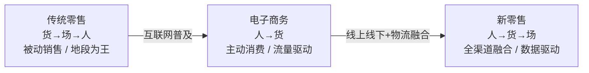
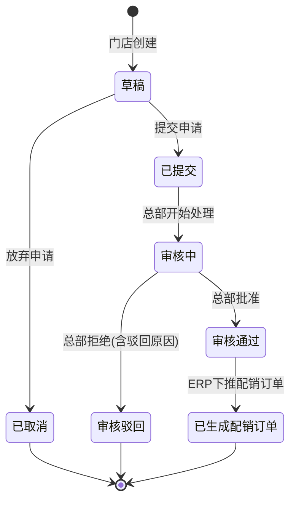
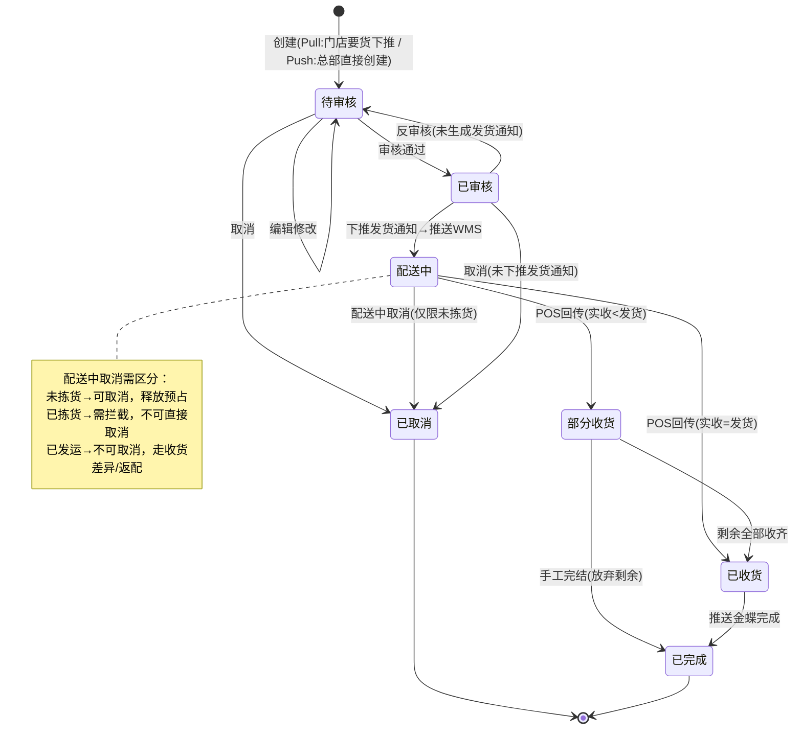
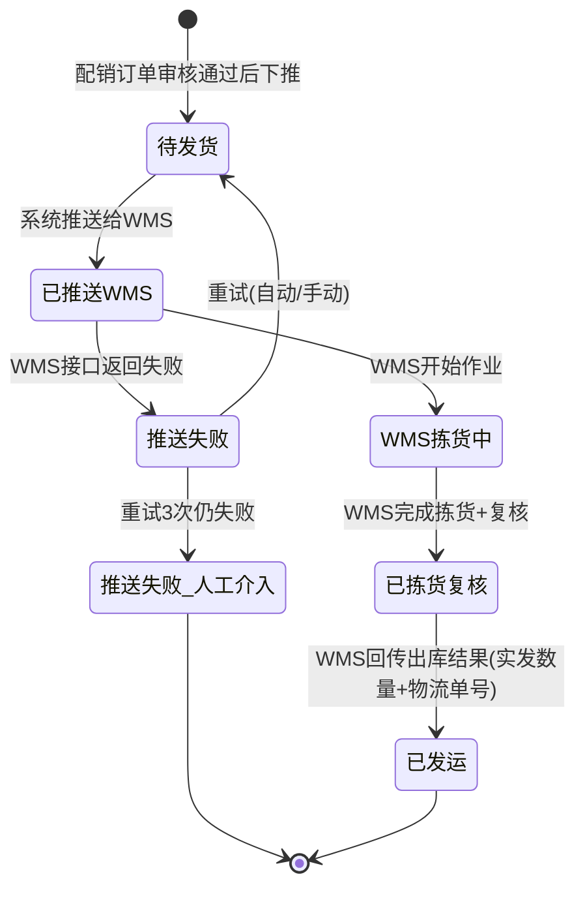
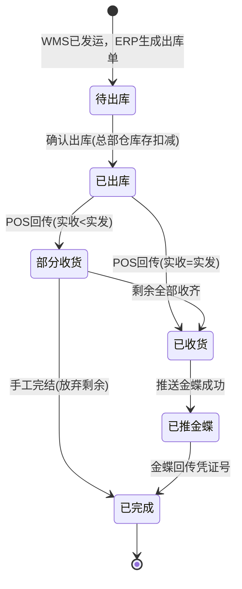
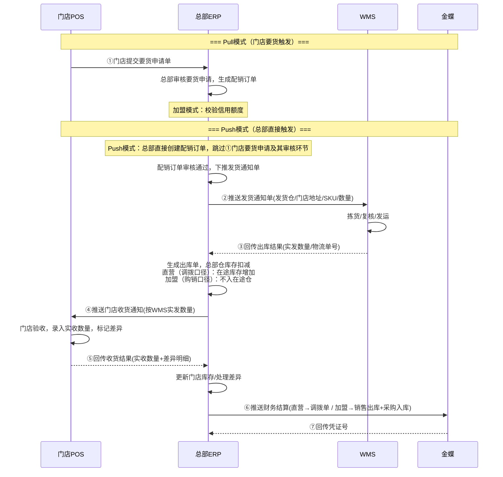

# ERP项目第8讲：总部配货到店流程与ERP单据设计

| 项目 | 内容 |
| --- | --- |
| 面向人群 | 已完成ERP第7讲，理解全渠道库存分配和库存同步的学员 |
| 学习时长 | 90分钟 |
| 难度等级 | ⭐⭐⭐⭐ |
| 前置课程 | [第7讲：全渠道库存分配调度与库存同步方案拆解](./ERP项目第7讲-ERP的三层库存体系与库存同步方案拆解.md) |


## 1. 课程背景

进入阶段5（2023-2026），强盛科技全面铺开新零售布局。截至2026年，公司拥有2家直营旗舰店（深圳万象天地店、上海环球港店）和约30家加盟门店。

直营和加盟并存，是强盛科技ERP配销模块面临的核心复杂度来源：同样是门店，南山万象天地店是直营——总部只是把货调过去，货权没变；罗湖某加盟店——总部是把货卖给它，货权转移了，要结算。

但更麻烦的是：仓库执行层（拣货、打包、发货）完全不关心门店是直营还是加盟。仓库只需要知道"从哪个仓、发什么货、发多少、发到哪"。如果在ERP里为直营和加盟设计两套完全不同的单据流，仓库就得适配两套逻辑，复杂度翻倍。

所以第8讲要解决的核心问题是：

> 总部ERP如何设计一套统一的配货单据体系，让仓库执行层"不感知直营加盟"，同时让财务层"知道该不该结算"？

本讲会包含新零售概念、四种配货方式、关键对象与主线业务的知识体系，并在此基础上深化ERP单据设计逻辑——从门店要货申请到配销订单、从发货通知到出库单、再到门店返配的逆向流程，完整覆盖总部配货到店的"实物流+资金流+单据流"。


## 2. 学习目标

- 能说清新零售"人、货、场"重构的本质，结合强盛科技从B2B→电商→新零售的演进过程来理解
- 能识别新零售供应链中的四个关键对象（供应商、总部仓、门店、消费者）
- 能区分仓配、直送、直通、自采四种配货方式的实物流路径、ERP管控程度和适用场景
- 能说清直营和加盟在结算上的根本差异：直营配货是内部库存转移不产生外部应收，加盟配货是购销行为产生应收应付
- 能画出三种配货模式×两种经营模式共6种组合的单据链路总表
- 能理解配销订单统一设计原则：直营和加盟用同一张单据，通用字段+加盟专属字段的设计模式
- 能画出从要货申请到出库完成的四张核心单据各自的字段、状态机和上下游交互
- 能理解直送模式下的"直送门店单"虚拟串联设计（一单自动下推采购订单+配销订单）
- 能说清ERP↔WMS↔POS↔金蝶的七个交互节点及兜底方案，含pull和push两种触发模式
- 能以门店少收为重点场景，设计直营和加盟的不同差异处理规则
- 能说清门店返配给总部的完整流程和直营/加盟返配结算差异

**学习交付物：** 配销订单正向单据链路图 + 配销订单状态流转图 + 直营/加盟财务结算对比表 + ERP↔WMS↔POS↔金蝶交互流程图 + 门店收货异常处理表 + 返配单据链路图

> **课堂讲授取舍建议（90分钟）**
>
> 本讲覆盖了新零售概念、四种配货方式、六种业务组合、四张核心单据、交互闭环、收货异常和返配——全部展开90分钟讲不完。实际讲课按以下节奏分配：
>
> | 时间段 | 讲什么 | 怎么讲 |
> | --- | --- | --- |
> | 0-5min | 课程背景+核心问题 | 用课程背景中"直营和加盟并存、仓库不感知门店类型"的核心问题直接切入，**不展开新零售概念** |
> | 5-15min | 3.2.2 配货业务引入 + 3.3 四种配货方式 | 重点讲仓配（主线），直送和直通用两张图快速过；3.1和3.2.1作为**课前阅读**，课上不占时间 |
> | 15-35min | 3.4 直营与加盟 ★ 核心 | 重点讲3.4.2"统一配销订单、财务后置"。3.4.1的结算差异用比对表快速过 |
> | 35-60min | 3.6 ERP单据设计 ★ 最重 | 配销订单字段+状态机是课堂重点。要货申请单、发货通知单、出库单各用2-3分钟讲状态机即可 |
> | 60-75min | 3.7 交互闭环 + 3.8 收货异常 | 时序图用pull主线讲，push差异一句话点明。收货异常只讲门店少收一个场景 |
> | 75-90min | 3.9 返配（快速过） | 或作为**课后阅读**交给学员自学。课堂最多用5分钟讲"正向/逆向对比表"收个尾 |
>
> **学员课后必读**：3.1（新零售概念）、3.2.1（四个关键对象）、3.5（六种组合全文）、3.9（返配全文）、6.3（竞品链接和参考PDF）


## 3. 课程内容

### 3.1 认识新零售与强盛科技的门店布局

#### 3.1.1 什么是新零售？

2016年10月，马云在杭州云栖大会上首次提出"新零售"概念，并断言：

> "纯电商时代很快会结束，未来的十年、二十年，没有电子商务这一说，只有新零售这一说，也就是说线上线下和物流必须结合在一起，才能诞生真正的新零售。线下的企业必须走到线上去，线上的企业必须走到线下来，线上线下加上现代物流合在一起，才能真正创造出新的零售来。"

此后，阿里研究院进一步将新零售定义为"以消费者体验为中心的数据驱动的泛零售形态"，其核心是零售三要素 **"人"、"货"、"场"** 的关系重构。

为了更直观地理解这个演进，我们可以看下面的概念演进图：



下面是三种零售形态的定义概述：

- **传统零售（Traditional Retail）**
  - **定义**：在物质短缺和渠道有限的年代，商品（**货**）是稀缺资源，商家将商品陈列在固定的物理场所（**场**），等待消费者（**人**）前来购买。典型关系是"货→场→人"。
  - **特点**：被动式销售，受地理位置和营业时间限制，消费者画像模糊。地段决定客流，商品决定成交。
- **电子商务（E-commerce）**
  - **定义**：互联网打破了物理空间的限制，消费者（**人**）可以随时随地在线上平台浏览和购买商品（**货**）。物流取代了到店自提，典型关系是"人→货"。场从物理门店变成了网页和APP。
  - **特点**：主动式消费，信息撮合交易，SKU近乎无限，但缺乏实体体验，物流体验成为关键竞争要素。
- **新零售（New Retail）**
  - **定义**：以"人"为中心，通过大数据、人工智能等技术，将线上服务、线下体验和现代物流进行深度融合，对商品（**货**）、消费者（**人**）、场景（**场**）等要素进行重构。典型关系是"人→货→场"——消费者需求驱动商品供给和场景构建。
  - **特点**：全渠道融合，数据驱动，场景化体验，消费者高度参与。物流的本质不再是比快，而是消灭库存。

把这个概念落到强盛科技身上，三个阶段恰好对应：

- **传统零售阶段（2012年前）**：创始人阿兰在华强北档口柜台卖手机壳和数据线，靠地段和客流吃饭。顾客来了才成交，走了就断了联系。档口是唯一的"场"，货是华强北通货，人是路过的散客。典型的"货→场→人"。
- **电商阶段（2013-2018，Phase 2-3）**：强盛科技入驻Amazon、天猫、京东。消费者在网上搜索、比价、下单，快递送到家。公司从华强北档口变成了跨境电商玩家。亚马逊US旗舰店、天猫旗舰店成为新的"场"。这是"人→货"模式。
- **新零售阶段（2023-今，阶段5）**：强盛科技在全国开了30+门店（直营+加盟），打通线上线下。顾客可以在深圳万象天地体验无线充QS-WC-001、扫码在官网下单、选择门店自提或快递到家。门店既是销售点，也是体验中心，还是一个微型前置仓。系统记录所有消费数据，分析偏好，精准推荐。这是"人→货→场"模式——消费者在哪，货和场就围绕消费者重新组织。

#### 3.1.2 强盛科技的新零售演进之路

强盛科技从华强北档口到连锁门店的扩张，可以用一张演进图概括：


这张演进路径的背后，是强盛科技ERP系统的持续升级：

| 阶段 | 门店状态 | ERP能力 | 核心矛盾 |
| --- | --- | --- | --- |
| Phase 3（2016-2018） | 无门店 | 金蝶云·星空做后台（采购/库存/B2B/财务总账），店小秘管跨境、旺店通管国内电商 | 多系统数据孤岛，库存同步不稳 |
| Phase 4（2019-2022） | 开始筹备线下 | 自研ERP V1接管后台主链（主数据/BOM/MRP/采购/批发/逻辑库存），领星替店小秘、聚水潭替旺店通 | 自研ERP只管B2B和库存，没有门店配货能力 |
| 阶段5（2023-2026） | 2直营+30加盟 | 自研ERP V2全渠道中枢（订单中心/库存中心/结算中心），新建配销模块+门店主数据+POS | 直营和加盟的结算差异如何在统一单据体系中承载 |

阶段5的ERP V2中，**配销模块**是全新建设的核心模块。在此之前，强盛科技ERP只有采购入库和B2B销售出库，没有"总部→门店"这条链路。门店配货不是B2B销售（客户是代理商，不是自己的门店），也不是内部调拨（加盟店的货权会转移），它是一条独立的业务线，需要一套专属的单据体系。

### 3.2 新零售关键对象与主线业务

#### 3.2.1 四个关键对象

在新零售供应链的业务场景中，有几个比较关键的对象和节点：

1. **供应商**：提供商品的源头。强盛科技约180家活跃供应商，以OEM工厂为主（如鑫泰达供数据线、创合力供充电器、博为供充电宝）
2. **总部（含总部仓）**：供应链的中枢。深圳龙华主仓5,000㎡ + 上海菜鸟云仓 + 亚马逊FBA海外仓（北美/欧洲）
3. **门店**：终端销售节点。2家直营旗舰店 + 约30家加盟门店，每家门店有独立的后仓（约30㎡）
4. **消费者**：最终买单的人，覆盖线下到店、O2O即时零售、B2C电商多个触点

要理解新零售供应链，先从这四个关键对象入手：


随着业务的拓展和丰富，增加了更多的仓库、更多的门店，同时也增加了不同的销售渠道和逆向业务流程：


#### 3.2.2 配货业务引入

零售业务和电商业务有一个很明显的区别：零售一般都有实体门店，而电商则是虚拟的在线店铺。增加了实体门店之后，就多了大量"总部仓库与门店之间"的实物流、信息流、资金流业务场景。

> 1. 零售公司需要在全国开设门店，需要先完成各个门店的经营证件的办理；
> 2. 不同门店所需要的经营证件不一样，其中比较核心关键的是"营业执照"；
> 3. 大多数零售公司会采用"分公司"作为门店的经营主体，来申请"营业执照"；


在新零售业务中，随着零售公司业务的发展，其品牌下的门店会越开越多。这些门店出自同一个品牌，受总部统一管控，商店内外装潢、商品种类以及服务方式也基本相同，称为"连锁店"。

在"有赞"的零售业务中，如果要创建一个门店，必须要先选择经营模式是"直营店"还是"加盟店"。因为这两者在财务结算上有明显差异，所以在定义门店的时候就要先确认好类型，后续的供应链操作都会有所不一样。


强盛科技的门店主数据遵循同样的设计：门店编码、门店名称、经营模式（直营/加盟）、所属区域、收货地址等信息在门店建档时一次性维护好。配货单据创建时，门店类型从主数据自动带出，不可手动修改——因为这个字段直接决定后续财务结算是走调拨还是走购销。

### 3.3 总部配货到门店的四种方式

总部配货给门店，从"实物流"的角度看一般有4种方式：

**1. 仓配（统配）**：用于连锁门店要货时，该配送类型商品在仓库有存储库存，由仓库进行发货配送。适用于长保质期商品，可以大批量采购后在仓库中存储。总部汇总门店的要货需求，生成配货单据并派发给仓库，由仓库进行拣货、打包、发运到门店。

```text
供应商 → 总部仓（存储备货）→ 拣货打包发运 → 门店
```

这是强盛科技的主力配货方式。深圳龙华仓存储QS-CAB-001数据线、QS-PB-001充电宝、QS-CASE-001手机壳等长保标品，门店要货后从龙华仓发货。

**2. 直送**：用于连锁门店要货时，该配送类型商品不适合在仓库有存储（如生鲜商品），而且对应的供应商有配送能力，可以直接送货到门店。总部汇总门店要货需求后发给供应商，由供应商直接送货到各门店。总部仓完全不碰货。

```text
总部汇总门店需求 → 供应商 → 门店（不经过总部仓）
```

> 强盛科技做的是3C数码，几乎不涉及短保生鲜品类，但直送模式在产品设计上仍是一个需要掌握的变体。面试中如果被问到"非标品/短保品怎么配送"，能讲出直送的设计逻辑是加分项。

**3. 直通（越库 Cross-Docking）**：用于连锁门店要货时，该配送类型商品不适合在仓库有存储，但对应的供应商也没有能力直接配送到门店。所以需要先让供应商送货到总部仓库，然后总部仓库进行简单的分拣、分发，再配送到门店。货物在仓库停留时间极短（几小时到一天），快进快出，仓库不将货物做常规入库上架。

```text
供应商 → 总部仓（越库区，不入库上架）→ 分拣分发 → 各门店
```

越库又可细分为两种：一步越库（供应商事先按门店分拣打包好，仓库只做转运）和二步越库（供应商按单品汇总送到，仓库人员按门店分播后再配送）。

**4. 自采**：门店不通过总部配送中心，直接从供货商采购。自采在单店中很常见，甚至是唯一的采购模式。但对于连锁企业来说，自采越多表示标准化程度越低，总部在物流管控中所起的作用就越低。所以要做连锁品牌、大规模标准化扩张，就应该尽可能减少门店自采，增加总部统一配送，以保证货品来源可靠和管理标准化。

> 第1种和第3种的处理方式类似，都要经过仓库，从仓库配货到门店。第2种是供应商直接送货到门店，不经过仓库。第4种在连锁品牌中应尽量减少使用。

四种方式对比总结：

| | 仓配（统配） | 直送 | 直通（越库） | 自采 |
| --- | --- | --- | --- | --- |
| 货物经不经过总部仓 | 经过且存储 | 不经过 | 经过但不存储 | 不经过 |
| 适用品类 | 长保标品 | 短保品，供应商有配送能力 | 短保品，供应商无配送能力 | 本地特色品 |
| ERP管控程度 | 全程管控 | 管结算不管物流 | 全程管控 | 不管控 |
| 总部仓动作 | 收货上架→拣货发货 | 无 | 越库区收货→分拣→发货 | 无 |
| 强盛科技的适用性 | ★ 主力方式 | 不常用但需懂 | 尽量不使用 | 尽量不使用 |
| 本讲深度 | ★ 主线深讲 | ★ 重点讲单据虚拟串联 | 不展开 | 不展开 |

### 3.4 直营与加盟：统一单据流，差异在财务结算

#### 3.4.1 两种经营模式的结算差异

上述四种配货方式是从"实物流"的角度分类，而如果从"资金流"——总部和门店的财务结算角度来划分，又可以分为2类：

**1. 直营门店**：直营门店与总部属于同一经营主体（或同一管理体系），配货本质是**内部库存转移**，不产生总部对门店的外部应收。总部配货给门店时，**没有发生货权转移，货主仍是总部**，只是货物存储的位置从总部仓库转移到了门店仓中。实务中有些企业会按"内部调拨"处理，也有些企业为了统一单据流而使用配销单（只是不填价格、不走外部结算），推金蝶时走调拨单口径。

**2. 加盟门店（购销/经销）**：门店不归属于总部，门店和总部之间采用"**购销模式**"（也称"经销模式"），即总部先销售商品给门店，门店再销售给零售客户。**本案例假设加盟按发货确认货权转移**（即总部出库后货权从总部转移到门店）；如果实际合同中约定门店签收后才转移货权，则加盟也需要门店侧在途或待收口径，不能简单套用"出库即转移"。购销模式下，总部销售价（即门店的采购价）的取值逻辑可以基于总部采购价加价、基于成本价加价、或基于门店零售价倒算。购销模式还可以支持"先货后款"和"先款后货"，不同的模式会影响后续的财务结算和信用管控。

| **总部和门店的业务模式** | **业务说明** | **结算方式** | **总部生成的单据** | **备注** |
| --- | --- | --- | --- | --- |
| 购销/经销 | 门店向总部采购后，商品货权从总部转移给门店 | 配货时发生结算。门店入库后按账期结算，或先款后采 | 配销单 | 总部销售给门店。门店自由经营，独立核算 |
| 代销模式 | 门店向总部要货后，商品货权仍归属总部 | 配货时不发生结算。门店零售后再和总部结算 | 调拨单 | 货物路径：总部→门店→顾客；资金路径：顾客→门店→总部 |


> 对于新零售供应链的产品经理来说，第一步是先搞清楚实际的业务关系，从财务结算的角度出发，理清楚不同主体之间发生的业务是否会触发结算。
>
> 其次要做到**业务实物流和财务信息流解耦划分**。无论配货给加盟店还是直营店，从实物流的角度操作应该一样，所以相关业务单据和流程要尽量统一；针对财务结算的信息，则需要单独拉一条线来考虑结算关系怎么处理。

> 下文为行文简洁，"调拨口径"指直营门店货权不转移的库存流转方式（推金蝶走调拨单），"购销口径"指加盟门店货权转移的库存结算方式（推金蝶走销售出库+采购入库）。两者仅描述配货的财务处理口径，不等同于门店的经营模式定义。

#### 3.4.2 强盛科技的设计选择：统一配销订单

先纠正一个常见误解：很多人以为"直营用调拨单，加盟用销售单"是两套完全不同的单据流。这在产品设计上不是最优解——因为仓库的执行动作（拣货、复核、发货）完全不关心门店是直营还是加盟，仓库只需要知道"从哪个仓、发什么货、发多少、发到哪"。

**强盛科技ERP的设计选择是：不管直营还是加盟，总部→门店统一使用"配销订单"。**

```text
配销订单 → 发货通知单 → WMS出库 → 门店POS收货
```

整条执行链路，直营和加盟完全一样。仓库看到的是同一张发货通知单，门店POS看到的是同一张收货通知。

差异只发生在推送金蝶做财务处理的时候：

| | 直营门店 | 加盟门店 |
| --- | --- | --- |
| **ERP单据** | 配销订单 | 配销订单 |
| **物流执行** | 总部仓发货 → 门店收货 | 总部仓发货 → 门店收货 |
| **货权变化** | 不转移，货主仍是总部 | 本案例假设出库即转移；若合同约定签收后转移，则门店侧需在途口径 |
| **推送金蝶** | 按**调拨单**处理 | 总部按**销售出库单**，门店按**采购入库单** |
| **是否产生应收** | 否（内部库存转移） | 是，总部应收=配销金额，门店应付=配销金额 |
| **门店零售后** | 门店零售额归总部，总部和门店按内部核算规则处理 | 门店零售额归门店自己，总部赚的是配销差价 |

### 3.5 三种配货模式 × 两种经营模式 = 六种业务组合

门店的经营模式有两种（直营/加盟），可以理解为"资金流"的运作方式不一样。总部配货给门店的3种方式（仓配/直送/直通），可以理解为"实物流"的运作方式不一样。两者叠加，形成6种细分的业务流程。

> 本节内容与3.6节单据设计保持一致的命名和单据链路表述。六种组合的起点可能是门店要货申请（pull），也可能是总部直接配货（push），不同起点的单据流转路径在3.6节中统一展开。

#### 3.5.1 仓配模式 + 购销/内部调拨

总部通过仓库配货给门店，总部和门店的经营关系可能是加盟购销或直营内部调拨。ERP中要做的业务单据不同，业务人员填写的字段也不一样。

**仓配+购销模式**：总部是销售给门店，ERP生成"配销订单"（门店类型=加盟，含价格字段，加盟专属字段启用）。配销订单中指定发货仓库、收货门店、商品、数量、价格。总部仓拣货发货后，门店POS生成采购入库单，表明这批商品是门店向总部采购的。

**仓配+内部调拨（直营）模式**：总部只将货物从仓库转移到门店，货权还在总部，没有发生结算。ERP生成"配销订单"（门店类型=直营，无价格字段，加盟专属字段置灰）。门店POS生成调拨入库单。推金蝶时走调拨单，不产生应收。


#### 3.5.2 直送模式 + 购销/内部调拨

直送模式下，总部需要先向供应商采购，然后供应商直接送货到门店。看起来好像总部只需要下一个采购订单、把收货地址改成门店即可，但实际上这个过程包含了总部向门店配货的行为，对应的单据还是需要生成，哪怕是一个虚拟单据，否则会影响财务结算。

核心设计是一张特殊的单据：**直送门店单**。这张单自动下推两条线：

```text
                       ┌→ 采购订单（供应商→虚拟仓）
直送门店单 ──┤          收货地址=门店地址
                       │          供应商按采购订单送货到门店，但财务入库到直送虚拟仓
                       │
                       └→ 配销订单（总部→门店）
                                  纯账务，不经过仓库
                                  发货仓=虚拟仓（直送-不经过实体仓）
                                       │
                                       └→ 推送金蝶
                                          加盟→总部销售出库+门店采购入库
                                          直营→总部调拨单
```


- 购销模式：生成总部销售给门店的配销订单，发货仓设为虚拟仓。门店生成采购入库单。配销单价需从定价规则自动获取。
- 内部调拨（直营）模式：生成总部调拨给门店的调拨单，调出仓库也设为虚拟仓。门店生成调拨入库单。

**产品设计要点**：直送模式下的配销订单，发货仓设为虚拟仓——不对应任何真实仓库，只是为了让单据结构保持一致。采购订单入库到直送虚拟仓（可用库存增加），配销/调拨订单从直送虚拟仓出库（可用库存扣减），使得虚拟仓库存动态平衡守恒。系统需针对虚拟仓排除“实物库存大于0”的硬性校验。

> 这就是课程31里讲的"虚拟单据"和"虚拟仓"设计模式。总部没碰货，但ERP里要有单据来承载业务关系；仓库不存在，但要用虚拟仓来保持单据字段的完整性。

#### 3.5.3 直通模式 + 购销/内部调拨

直通模式重点考验仓库的越库作业能力。单据结构和仓配完全相同（采购订单 + 配销订单），唯一差异是推送WMS时单据上多了"**越库**"标识。

WMS收到越库标识后：收货时不放上架库位，放越库区临时货位；发货时从越库区拣货，不走常规拣货路径。ERP不感知WMS内部的作业差异。


> "直送模式"和"直通模式"这两个名词很相像，但意思不一样。直送是供应商直接送到门店；直通是供应商送到总部仓越库区后再分拨到门店（也称"越库配送"）。

#### 3.5.4 实物流×资金流二维叠加总表

| | 仓配（统配） | 直送 | 直通（越库） |
| --- | --- | --- | --- |
| **直营** | 要货申请→配销订单(直营,无价格)→发货通知→WMS出库→POS收货→金蝶(调拨) | 直送门店单→供应商送达→门店POS收货确认→ERP→金蝶(调拨)，无WMS环节 | 采购订单(越库)+配销订单(越库,直营)→WMS越库→POS收货→金蝶(调拨) |
| **加盟（购销）** | 要货申请→配销订单(加盟,含价格)→发货通知→WMS出库→POS收货→金蝶(销售出库+采购入库) | 直送门店单→供应商送达→门店POS收货确认→ERP→金蝶(销售出库+采购入库)，无WMS环节 | 采购订单(越库)+配销订单(越库,加盟,含价格)→WMS越库→POS收货→金蝶(销售出库+采购入库) |

零售公司总部配货给门店有不同的配货方式，对应的"实物流"节点并不一样。同时门店的不同类型导致总部和门店的经营关系也有好几种，对应的"资金流"处理逻辑也不太一样。两者相结合之后，要求产品经理既要关注"实物流"，也要关注"资金流"，才能设计出贴合实际业务的产品方案。

### 3.6 ERP单据设计：从门店要货到配销完成

总部配货到门店在ERP中通过四张核心单据串联：

```text
门店要货申请单 → 配销订单 → 配销发货通知单 → 配销出库单
```

#### 3.6.1 门店要货申请单

门店要货申请单是配货链路的起点（pull模式）。门店根据自身销售和库存情况，在POS后台提交要货申请，总部审核后下推生成配销订单。

> **配货需求的另一类驱动方式——总部主动配货（push）**：总部根据各门店的销量、库存周转、活动计划，主动分配货量，ERP根据配货规则自动生成配销订单，跳过要货申请环节。两种方式可并存：日常补货用pull（门店最清楚缺什么），新品上市或大促铺货用push（总部统一规划）。

**核心字段：**

| 字段 | 类型 | 说明 | 约束 |
| --- | --- | --- | --- |
| 申请单号 | 字符串 | POS自动生成，唯一标识 | 不可重复 |
| 申请门店 | 枚举 | 哪个门店发起要货 | 从POS登录门店自动带出，不可修改 |
| 商品SKU | 引用 | 要什么货 | 必须在商品主数据中存在 |
| 申请数量 | 数值 | 要多少 | >0 |
| 期望到货日期 | 日期 | 希望什么时候到 | 不可早于申请日期 |
| 要货原因 | 枚举 | 日常补货/活动备货/新品要货/紧急补货 | 用于总部审核时判断优先级 |
| 当前门店库存 | 数值 | 申请时该SKU在门店的即时库存 | 系统自动带入，供审核参考 |
| 建议配货量 | 数值 | 系统根据规则自动计算（可选） | 基于安全库存/销量预测/周转天数，本讲不展开算法 |

**状态流转：**



**与配销订单的关系：**

- Pull模式下，一张或多张门店要货申请单（同一发货仓）→ 汇总生成一张配销订单（N:1），或一张申请单→一张配销订单（1:1）
- 通过来源单号字段追溯，配销订单可以反向查到是哪几张要货申请触发的
- Push模式下，配销订单由总部直接创建，不关联要货申请单

举例：南山店申请QS-CAB-001×30、福田店申请QS-CAB-001×50、罗湖店申请QS-CAB-001×20，三家都从深圳龙华仓发货。总部审核通过后，可以合并生成一张配销订单（深圳龙华仓→三家门店），或拆成三张配销订单（取决于仓库是否支持合并拣货）。

#### 3.6.2 配销订单

配销订单是本讲核心单据，承载总部对门店的配货决策。直营和加盟共用同一张单据，通过"门店类型"字段驱动差异化的字段展示和财务处理分支。

**通用字段**（直营+加盟都需要）：

| 字段 | 类型 | 说明 | 约束 | 不填的后果 |
| --- | --- | --- | --- | --- |
| 配销订单号 | 字符串 | ERP自动生成，唯一标识 | 不可重复 | 单据无法创建 |
| 单据日期 | 日期 | 配货计划日期 | 不可晚于期望到货日期 | — |
| 发货仓 | 枚举 | 从哪个实体仓发货 | 必须是有可用库存的实体仓 | — |
| 收货门店 | 枚举 | 配送到哪个门店 | 门店必须在门店主数据中已建档 | — |
| 门店类型 | 枚举 | 直营/加盟，从门店主数据自动带出 | **不可手动修改** | 财务分支无法判断，推金蝶报错 |
| 商品SKU | 引用 | 配什么货 | 必须在商品主数据中存在 | — |
| 配货数量 | 数值 | 每个SKU配多少个 | >0，≤发货仓可用库存 | 超量配货导致出库时库存不足 |
| 期望到货日期 | 日期 | 门店期望什么时候收到 | ≥单据日期 | — |
| 来源类型 | 枚举 | 门店要货/总部配货/活动铺货 | — | 追溯链断裂，无法溯源 |
| 来源单号 | 字符串 | 关联的门店要货申请单号或配货计划编号 | 来源类型≠总部配货时必填 | 追溯链断裂 |

**加盟专属字段**（仅门店类型=加盟时启用，直营模式下置灰或隐藏）：

| 字段 | 类型 | 说明 | 约束 | 不填的后果 |
| --- | --- | --- | --- | --- |
| 配销单价 | 数值 | 总部卖给门店的价格（≠零售价） | >0，≤零售价 | 价税合计无法计算，无法推送金蝶 |
| 税率 | 枚举 | 增值税率 | 默认13% | 价税合计偏差，财务凭证错误 |
| 价税合计 | 数值 | 配销总金额 = Σ(数量×单价)×(1+税率) | 系统自动计算，可手动微调尾差 | — |
| 账期 | 枚举 | 门店付款的信用账期 | 月结30天/月结60天/现结 | 应收款到期日无法计算 |
| 信用额度 | 数值 | 门店当前可用信用额度 | 超额度时阻断提交，提示走特批 | 赊销风险失控 |
| 结算方式 | 枚举 | 先货后款/先款后货 | 先款后货时发货前需校验收款 | 发货时不知道是否该校验已收款 |

**配销单价怎么定？** 这是加盟模式下的核心业务问题。常见取值逻辑：

| 定价方式 | 说明 | 适用场景 |
| --- | --- | --- |
| 按总部采购价加价 | 配销价 = 总部采购价 × (1+加价率) | 总部赚取固定比例的供应链服务费 |
| 按成本价加价 | 配销价 = 移动平均成本 × (1+加价率) | 考虑库存持有成本，价格更贴近实际 |
| 按门店零售价倒扣 | 配销价 = 门店零售价 × (1-倒扣率) | 加盟商以零售折扣价进货，总部让利 |

> 配销单价的取值逻辑需要在ERP中配置为规则，而不是让操作人员每次手动填。配销订单创建时自动匹配定价规则取值。

**状态流转：**



每个状态节点的触发条件和连锁动作：

| 状态 | 可做什么 | 触发条件 | 连锁动作 |
| --- | --- | --- | --- |
| **待审核** | 编辑、提交、取消 | Pull:门店要货审核通过后下推 / Push:总部配货计划生成 | — |
| **已审核** | 下推发货通知、反审核 | 总部运营审核通过 | **加盟模式：校验信用额度**（超额阻断或走特批）；**直营模式：直接通过** |
| **配送中** | 跟踪WMS作业、推送POS收货通知 | 发货通知单已推送WMS成功 | 总部仓库存**预占**（锁定库存增加），**尚未进入在途**——在途库存增加发生在WMS回传出库、ERP确认出库之后 |
| **部分收货** | 继续等剩余收货、手工完结 | POS回传（实收数量 < 发货数量） | 已收部分入门店仓，未收部分挂起差异，生成收货差异记录 |
| **已收货** | 手工完结 | POS回传（实收数量 = 发货数量） | 触发推送金蝶（直营→调拨单；加盟→总部销售出库+门店采购入库），在途库存清零 |
| **已完成** | 终态，不可操作 | 金蝶推送成功，凭证号回传 | 总部和门店库存数据定格 |
| **已取消** | 终态，不可操作 | 待审核态直接取消；已审核未下推发货通知→取消；配送中→区分：未拣货可取消释放预占，已拣货需WMS拦截，已发运不可取消（走收货差异/返配） | 释放预占库存 |

> 第5讲B2B销售订单的状态流转和这里很像——都是"审核→下推→执行→回传→完成"。但配销订单多了"部分收货"状态（B2B销售通常是一次性收货），且推金蝶的分支更复杂（要判断门店类型决定走调拨还是销售出库）。

#### 3.6.3 配销发货通知单

发货通知单是ERP推给WMS的执行指令。关键设计原则：**WMS不感知直营加盟**，所以发货通知单上不含价格和门店类型字段，WMS只管执行。

**核心字段：**

| 字段 | 类型 | 说明 |
| --- | --- | --- |
| 发货通知单号 | 字符串 | 系统自动生成，唯一标识 |
| 来源配销订单号 | 字符串 | 关联上游配销订单 |
| 发货仓 | 枚举 | 从配销订单带入 |
| 收货门店 | 枚举 | 从配销订单带入 |
| 收货地址 | 字符串 | 从门店主数据带入（详细收货地址/联系人/电话） |
| 商品SKU | 引用 | 从配销订单带入 |
| 发货数量 | 数值 | 从配销订单带入（可部分发货时允许小于配货数量） |
| 物流方式 | 枚举 | 快递/物流/自送 |
| 备注 | 字符串 | 特殊要求标记，如"越库"标识 |

**不含的字段**：价格、税率、门店类型——WMS不关心这些，只执行拣货、复核、发货。

**状态流转：**



**与WMS的交互逻辑：**

- 推送时机：配销订单状态变为"已审核"后，操作人员点击"下推发货"
- 推送内容：发货通知单全部字段 + 收货地址详情
- 推送失败处理：自动重试3次（间隔30秒）→ 仍失败则进入失败队列 → 系统告警 → 人工介入
- WMS回传节点（对应3.7节交互闭环的节点③）：WMS完成拣货复核发运后，回传实发数量和物流单号

**关于库存预占**：推WMS后，总部仓库存进入预占状态（锁定库存增加），不直接扣减——因为WMS还没作业，实物还在仓里。等到WMS回传出库结果后，才真正扣减总部仓库存（见3.6.4）。

#### 3.6.4 配销出库单

WMS完成发运后回传出库结果（实发数量+物流单号），ERP自动生成配销出库单，标志着实物流的关键节点——货已从总部仓发出。

**核心字段：**

| 字段 | 类型 | 说明 |
| --- | --- | --- |
| 出库单号 | 字符串 | 系统自动生成，唯一标识 |
| 来源发货通知单号 | 字符串 | 关联上游发货通知单 |
| 来源配销订单号 | 字符串 | 间接关联配销订单，用于追溯 |
| 发货仓 | 枚举 | 从发货通知单带入 |
| 收货门店 | 枚举 | 从发货通知单带入 |
| 商品SKU | 引用 | 从发货通知单带入 |
| 应发数量 | 数值 | 发货通知单的发货数量 |
| 实发数量 | 数值 | WMS回传的实际发货数量 |
| 物流单号 | 字符串 | WMS回传的快递/物流单号 |
| 出库日期 | 日期 | WMS实际发运日期 |

**状态流转：**



**出库确认后触发的连锁动作：**

1. **总部仓库存变化**：
   - 直营（调拨口径）：总部仓即时库存减少，锁定库存释放，**在途库存增加**（货权仍在总部，货在路上）
   - 加盟（购销）：总部仓即时库存减少，锁定库存释放，**不入在途仓**（货权已转移给门店）

2. **推送门店POS收货通知**：ERP→POS推送，按WMS实发数量通知门店准备收货

3. **加盟模式专属**：扣减门店信用额度（实发数量 × 配销单价 × (1+税率)）

4. **触发金蝶推送**：门店确认收货后触发，根据门店类型走分支：
   - 直营 → 推送调拨单（无应收应付）
   - 加盟 → 推送总部销售出库单（总部应收）+ 门店采购入库单（门店应付）

**购销口径 vs 调拨口径的库存差异：**

| | 直营（调拨口径） | 加盟（购销口径） |
| --- | --- | --- |
| 货权 | 仍在总部 | 已转移给门店 |
| 出库后总部库存 | 即时库存减少，在途库存增加 | 即时库存减少，不入在途仓 |
| 门店收货后 | 在途库存清零，门店库存增加 | 门店库存增加（总部侧无变化） |
| 逻辑仓建议 | 在途库存放入"配货到店在途逻辑仓" | 不做在途管控，直接记门店在途 |

> **为什么购销模式在本案例中不做在途管控？** 本案例假设加盟按发货确认货权转移——从总部角度看，出库后这批货已经"卖掉"了，总部不再对其负有库存管理责任。如果在总部侧仍记在途库存，会导致库存口径混乱（账面显示还有库存，实际货已不是你的）。门店侧的收货和库存管理由门店POS自行负责。**注意：这取决于合同约定的货权转移时点。如果合同约定门店签收后才转移货权，则加盟也需要门店侧在途或待收口径，不能简单套用"出库即转移"。**

### 3.7 ERP↔WMS↔POS↔金蝶交互闭环

前面讲了单据流。这一节把四个系统的交互串起来，同时展示pull（门店要货触发）和push（总部直接配货触发）两种模式的交互差异。



**七个交互节点的数据内容和失败后果：**

| 节点 | 方向 | 推送内容 | 如果失败 | 兜底方案 |
| --- | --- | --- | --- | --- |
| ①提交要货申请 | POS→ERP | 门店/商品/数量/期望到货日期/要货原因 | POS提示提交失败，门店可重新提交 | 重试+离线暂存。仅Pull模式有此节点 |
| ②推WMS | ERP→WMS | 发货通知单号/发货仓/收货门店地址/SKU/数量 | WMS没收到，仓库不作业。配销订单停留在"已审核"状态 | 推送失败自动重试3次（间隔30秒）→ 进入失败队列 → 系统告警 → 人工介入重推 |
| ③回传出库 | WMS→ERP | 发货通知单号/实发数量/物流单号 | ERP不知道发了没有、发了多少。总部库存未扣、门店不知道货在路上 | 超时预警：24小时未回传 → 主动调用WMS查询接口获取状态 |
| ④推POS | ERP→POS | 配销订单号/来源WMS实发数量/物流单号 | POS不知道有货要来。货到了门店但系统里没有待收记录 | 重试（3次）→ 失败后标记异常，门店也可在POS端主动查询"待我收货"列表 |
| ⑤回传收货 | POS→ERP | 配销订单号/实收数量/差异明细（少/多/破损/错货） | 直营：库存卡在在途状态；加盟：卡在门店待收/结算待确认。均无法触发金蝶推送 | 超时预警（发货后N天未收货）→ 主动调用POS接口查询 → 人工联系门店确认 |
| ⑥推金蝶 | ERP→金蝶 | 调拨单（直营）or 销售出库+采购入库（加盟）/价税金额 | 金蝶没入账。业务已完成但财务凭证缺失 | 重试→失败队列→第9讲对账机制兜底（月末批量核对未推送单据） |
| ⑦回传凭证号 | 金蝶→ERP | 金蝶生成的凭证号 | ERP不知道金蝶是否入账成功，配销订单无法进入"已完成"终态 | 超时查询金蝶凭证接口 → 匹配单据号确认入账状态 |

**在途库存的时间窗口**：从③WMS回传出库到⑤POS回传收货之间，这批货在ERP里处于"在途"状态（仅直营/调拨口径，加盟购销口径不入总部在途仓而是门店待收）。第4讲的在途逻辑仓就是为这个时间窗口设计的——库存不凭空消失（总部仓扣了），也不提前进入门店可用库存（门店未确认收货）。如果超过预设阈值（如3天），触发超时预警。

### 3.8 门店收货异常处理

门店收货不是"发了100就收到100"。在实际连锁零售作业中，收货差异有一套成熟的处理框架。

#### 3.8.1 收货差异处理的通用原则

无论直营还是加盟，收货环节有三条铁律是行业通用的：

| 原则 | 说明 | 系统侧落地 |
| --- | --- | --- |
| **当场确认** | 整件数、贵重商品必须与物流司机当面清点，发现差异当场在签收单上标注实收数量，不可虚签 | POS收货页面支持签"异常签收"（区别于正常签收），外包装破损/封条损坏/件数不符时强制走异常签收 |
| **时效要求** | 散货差异、内件破损等事后发现的，需在收货后24小时内反馈登记，超时不予受理（除非能提供完整收货监控视频） | 系统在收货完成后启动24h倒计时，超时锁定差异提报入口 |
| **监控留证** | 收货全程在监控下拆箱清点，差异反馈必须提供从到货拆箱到上架的不间断视频作为凭证 | POS收货页面支持上传监控截图/视频片段，作为差异单附件 |

#### 3.8.2 重点场景：门店少收

> 发货通知单100个，门店实收95个。少了5个。

少收是配货业务中最高频的差异。行业做法区分**当场发现**和**事后发现**两套路径：

**当场发现（与物流司机当面清点时）**：

门店在签收单上签"实收95，少5"，POS端签**异常签收**，录入实收数量95。系统自动生成一张**配货差异单**，记录：发货通知单号、应发100、实收95、差异-5、差异类型=少收。

总部ERP收到差异单后，仓储核实（调取发货监控+出库复核记录）。确认是仓库少发→生成补发任务，差异原因记"仓库短拣"；确认是运输丢失→对物流商按合同索赔，差异原因记"运输丢件"。

**事后发现（物流已离店，拆箱上架时发现）**：

门店在24h内通过POS提交差异反馈，附收货监控截图。总部审核通过后同样生成配货差异单。

**直营和加盟在差异处理上的不同**：

| | 直营 | 加盟 |
| --- | --- | --- |
| **库存处理** | 按实收95入库，差异5系统自动生成**差异回调单**，总部仓库存-5，门店库存不作调整（已按95入） | 按实收95入库，差异5生成差异回调单关联原配销订单 |
| **结算处理** | 不涉及外部结算。差异回调单推金蝶时走内部盘点损溢科目 | 差异5对应的配销金额从本次结算中扣减。ERP自动重算应收：原应收 = 100×单价×税率，实收应收 = 95×单价×税率 |
| **补货处理** | 总部确认后决定是否补发，补发走新配销订单（直营，无价格） | 加盟方可要求补发。若补发，生成新配销订单；若不补发，差异金额从应付中抵减，月结对账时体现 |

**产品设计要点**：差异单（配货差异单/差异回调单）是独立单据，不直接修改原配销订单和出库单——这是业内有赞、星锐等系统的通用做法。原单据保持"发货100"的历史记录不变，差异单单独记录"-5"的调整，审计时可追溯完整链路。系统根据门店类型自动判断差异单的结算影响：直营生成内部盘点差异单（仅影响库存，不推金蝶），加盟生成结算差异记录（影响应收应付，推金蝶时一并报送）。

#### 3.8.3 其余场景速查

| 异常场景 | 当场处理 | 系统动作 | 加盟结算影响 |
| --- | --- | --- | --- |
| **多收**（实收>通知） | 异常签收，多余商品暂存，24h内反馈总部 | 系统生成**差异补调单**，总部审核后门店库存按实收增加。多余商品退回或协商补录采购 | 不按多收量结算，仍按原配销订单数量结算 |
| **破损**（外包装破损+内部商品损坏） | 异常签收，拍照留证，拒收破损部分，实收完好部分 | 生成配货差异单（差异类型=破损）。完好部分入正常品仓，破损部分入残品仓或物流带回 | 按实收完好量结算。破损损失由合同约定方承担 |
| **错货**（收到错误SKU） | 异常签收，整批暂存，拒收或做退货处理 | 生成配货差异单（差异类型=错货）。错发商品做退货单退回总部，正确商品重新走配货 | 当次结算不计入错发商品，正确商品补发后按补发量结算 |
| **超时未收**（发货后N天无收货确认） | — | 系统超时预警触发：主动查询WMS物流状态+向门店POS推送催收通知。确认物流丢件→启动索赔 | 结算节点推迟至收货确认后。加盟方可据此延迟付款 |

> 差异处理的审批权限通常按金额分级：单品200元以内店长审批，1000元以上需总部运营总监签批。ERP在生成差异单时可内置审批流，根据差异金额自动路由到对应审批人。


### 3.9 门店返配给总部

配货的正向流程结束之后，还有一条重要的逆向链路：门店把货物返回总部。在连锁零售里这个场景叫**返配**，它不是顾客退货（售后），也不是采购退货（退给供应商），而是门店把不适合继续在店里销售的商品统一返回总部重新分配或处置。

#### 3.9.1 返配的业务场景

最常见的触发场景：

- 门店商品积压，销路不好，退回总部重新分配给销售更好的门店
- 商品下架或活动结束，剩余库存统一回流总部走后续处置（退回供应商/打折清仓/内部消耗）
- 季节性商品换季，非当季货物从所有门店统一退回
- 门店闭店或改址，存货全部返配回总部

#### 3.9.2 返配的两种模式

和正向配货一样，返配也需要区分直营和加盟——因为结算逻辑不同。

**直营店返配**：货权本就在总部，返配只是实物流反向。ERP走返配申请单→门店返配出库单→总部返配入库单。推金蝶走"反向调拨单"（与正向调拨方向相反），不产生应收应付。

**加盟店返配**：货权在门店，返配在财务上**作为销售退回（红字冲销）**处理，以满足IPO财务合规要求，避免虚增总部采购额和加盟店销售额。单据链路同上，但返配入库单上需含退货单价（基于原配销单价）、价税合计。推金蝶：总部生成**红字销售出库单**，冲减加盟方的应收账款（或贷记往来账户）。

#### 3.9.3 返配的单据设计要点

返配的核心单据链路：

```text
返配申请单（门店POS发起）→ 总部审核 → 门店返配出库单 → 总部返配入库单
```

**返配申请单核心字段：**

| 字段 | 说明 |
| --- | --- |
| 申请单号 | 系统自动生成 |
| 申请门店 | 从POS登录门店自动带入 |
| 商品SKU | 要返配什么 |
| 返配数量 | 要返多少，≤门店当前可用库存 |
| 返配原因 | 积压退货/活动结束/换季/闭店/其他 |
| 当前门店库存 | 系统自动带入，供总部审核参考 |

**返配出库单**：门店侧出库，关联已审核的返配申请单。确认出库后，门店即时库存减少。状态：待出库 → 已出库。

**返配入库单**：总部侧收货，关联门店返配出库单。确认收货后，总部即时库存增加。状态：待收货 → 已收货 → 已完成。收货差异参考正向配货的少收/破损处理口径。

#### 3.9.4 正向配货与逆向返配对比

| 维度 | 正向配货 | 逆向返配 |
| --- | --- | --- |
| 发起方 | 门店要货申请 / 总部配货 | 门店返配申请 |
| 审核方 | 总部 | 总部 |
| 货物流向 | 总部仓 → 门店 | 门店 → 总部仓 |
| 核心单据 | 要货申请→配销订单→发货通知→出库单 | 返配申请→返配出库单→返配入库单 |
| 直营：推金蝶 | 调拨单（总仓→门店） | 反向调拨单（门店→总仓） |
| 加盟：推金蝶 | 总部销售出库+门店采购入库（总部应收） | 总部红字销售出库单（冲减总部应收/退款） |
| 加盟：结算方向 | 加盟店欠总部钱 | 总部扣减应收或退款给加盟店 |

> **一句话记忆**：返配就是配货的逆向——实体店退给总部重新分配。直营本质是双向调拨，加盟本质是反向购销。

### 3.10 本讲小结

本讲用一张统一的配销订单串联了"总部→WMS→门店→POS→金蝶"的完整链路。四件事要记住：

1. **新零售的本质是"人、货、场"重构。** 强盛科技从华强北档口到30+连锁门店的演进，正是从"货→场→人"到"人→货→场"的转型。理解这个背景才能理解ERP为什么需要配销模块。

2. **四种配货方式，仓配是主线，直送和直通是变体。** 产品经理先做仓配，再做变体——直送多"直送门店单"虚拟串联，直通多"越库"标识。ERP单据结构基于仓配扩展。

3. **直营和加盟统一用配销订单，财务分支后置。** 仓库执行层不感知直营加盟。ERP在推送金蝶时根据门店类型决定走调拨（直营）还是销售出库+采购入库（加盟）。这是"实物流和资金流解耦"的标准落地方式。

4. **四张核心单据+返配闭环。** 正向：要货申请→配销订单→发货通知→出库单，每张单有自己的状态机和交互边界。逆向：返配申请→返配出库→返配入库。购销口径和代销口径的在途管控与返配结算逻辑有本质不同。


## 4. 实操任务 & 交付物

### 4.1 任务说明

#### 任务1：仓配模式下直营/加盟两条单据链路图

画出仓配模式下，从门店要货申请到金蝶结算的完整单据链路（pull模式为主线，标注push模式的差异）。要求标注四个系统（ERP/WMS/POS/金蝶）的七个交互节点，并标注直营和加盟在推送金蝶时的分叉点。

#### 任务2：配销订单字段表 + 状态流转图

设计配销订单的完整字段表，区分"通用字段"（≥10个）和"加盟专属字段"（≥5个），每个字段标注类型、约束、不填写的后果。画出配销订单的状态流转图（Mermaid stateDiagram）。

#### 任务3：实物流×资金流二维叠加总表

用一张表列出仓配、直送、直通三种配货方式 × 直营、加盟两种经营模式共6种组合的完整单据链路。每种组合标注：单据链路（含pull起点）、是否经过WMS、推送金蝶的类型。

#### 任务4：门店收货异常处理表 + 返配单据链路图

列出至少3个门店收货异常场景（含少收），每个场景标注系统记录方式、直营方案、加盟方案、对结算的影响。另画一条门店返配给总部的完整单据链路图。

### 4.2 产出标准

| 交付物 | 合格标准 |
| --- | --- |
| 单据链路图 | 覆盖ERP→WMS→POS→ERP→金蝶七个交互节点，直营和加盟两条分叉路径清晰，差异点标注正确，标注pull/push差异 |
| 配销订单字段表+状态图 | 通用字段≥10个，加盟专属字段≥5个，每个字段有类型+约束+后果；状态流转图覆盖所有状态和转换条件 |
| 二维叠加总表 | 6种组合完整，每种标注完整单据链路、WMS参与情况、金蝶推送类型 |
| 异常处理表+返配链路图 | ≥3个异常场景，每个有系统记录方式+直营方案+加盟方案+结算影响；返配链路图覆盖返配申请→出库→入库完整流程 |


## 5. 自检清单

- 我能用强盛科技的发展阶段讲清楚"为什么要做新零售"吗？
- 我能说清新零售"人、货、场"重构的本质，以及三种零售形态的定义吗？
- 我能识别新零售供应链中的四个关键对象（供应商、总部仓、门店、消费者）吗？
- 我能说出门店配货需求的两种驱动方式（pull vs push），以及各自如何触发ERP配销订单吗？
- 我能区分仓配、直送、直通、自采四种配货方式的实物流路径和ERP单据差异吗？
- 我能解释为什么直营和加盟应该用同一张配销订单，而不是两套不同的单据吗？
- 我能说清配销订单上哪些字段是通用的、哪些是加盟专属的，以及加盟专属字段在直营模式下怎么处理吗？
- 我能画出配销订单的完整状态流转图吗？
- 我能画出要货申请单、发货通知单、出库单各自的状态流转图吗？
- 直营和加盟在推送金蝶时的差异是什么——哪个产生应收、哪个不产生？
- 直送模式下，"总部不碰货但ERP还是要管结算"怎么实现？直送门店单下推了哪两条线？
- 虚拟仓在直送模式中起什么作用？
- ERP↔WMS↔POS↔金蝶七个交互节点分别推什么？pull和push模式的交互差异在哪？
- 门店少收时，直营和加盟的处理有什么不同？对后续结算有什么影响？
- 购销口径和代销口径在库存管理上有什么区别——为什么购销在本案例中不入在途仓？
- 门店返配给总部的流程是什么？直营和加盟在返配结算上有什么不同？


## 6. 补充知识

### 6.1 面试考点

| 面试问题 | 回答方向 |
| --- | --- |
| 新零售和传统零售、电商的本质区别是什么？ | 2016年马云云栖大会提出；"人、货、场"重构——传统以货为中心、电商以流量为中心、新零售以人为中心，线上线下物流深度融合 |
| 总部配货到门店，直营和加盟在ERP里怎么处理？ | 统一用配销订单，差异只在推送金蝶时。直营按调拨单（不产生应收），加盟按总部销售出库+门店采购入库（产生应收） |
| 为什么不用两套不同的单据？ | 仓库执行层不感知直营加盟；统一单据流降低系统复杂度；实物流和资金流解耦 |
| 直送模式下总部不碰货，ERP怎么管？ | 直送门店单：一单自动下推采购订单（供应商→门店）+ 配销订单（总部→门店，虚拟仓），供应商按采购订单送货，ERP按配销订单结算 |
| 门店收货差异怎么处理？ | 少收按实收挂起，直营内部核销、加盟从应付扣减；多收暂存核实；破损入残品；错货退回。差异处理规则因门店类型而异 |
| 配销订单和B2B销售订单有什么异同？ | 结构相似（都有客户/价格/信用/账期），但配销订单的客户固定为门店，多了收货通知和POS交互，价格取值逻辑不同（可按采购价加价/成本价加价/零售价倒扣） |
| 虚拟仓是什么？为什么要用？ | 不对应真实仓库，只为保持单据字段结构完整。直送模式下总部不碰货，但配销订单需要填发货仓——用虚拟仓填充 |
| 购销模式和代销口径在库存管理上有什么不同？ | 购销口径货权转移，出库后不入在途仓；代销口径货权仍在总部，出库后在途库存持续记录直到门店收货确认 |
| 门店返配给总部的流程是什么？结算怎么处理？ | 返配申请→返配出库→返配入库。直营：反向调拨无结算；加盟：门店销售给总部，总部应付退款 |
| 仓配、直送、直通三种方式分别在什么场景下使用？ | 仓配：长保标品，库存前置；直送：短保品+供应商有配送能力，总部不碰货；直通：短保品+供应商无配送能力，仓内越库快进快出 |

### 6.2 常见坑与误区

| 坑 | 为什么是坑 | 正确做法 |
| --- | --- | --- |
| 直营和加盟设计两套完全不同的单据流 | WMS和POS需要适配两套逻辑，复杂度翻倍，维护成本高 | 统一配销订单，门店类型字段驱动财务分支 |
| 忘了WMS到POS之间的"在途"状态 | 货已出仓但门店未收，这段时间库存不归属任何可用节点 | 直营（代销口径）利用第4讲的在途逻辑仓承接中间态，超时预警；加盟（购销口径）本案例假设出库即转移，不做总部在途 |
| 直送模式只在采购单上改收货地址 | 财务不知道总部和门店之间发生了配货，加盟结算缺单据依据 | 用直送门店单串联采购和配货两条线 |
| 收货差异不做超时预警 | 货发了3天门店还没确认，可能是物流丢件 | 设置超时阈值，主动查询WMS和POS状态 |
| 加盟专属字段在直营模式下也强制填写 | 直营不需要价格和信用额度，强制填写增加无效操作 | 门店类型驱动字段显示/隐藏，直营模式下加盟专属字段置灰 |
| 购销模式一律不做在途管控 | 货权转移时点取决于合同约定。一律跳过在途仓可能漏掉"签收后转移"的场景 | 确认合同约定的货权转移时点：出库即转移→不入在途仓；签收后转移→门店侧需在途/待收口径 |
| 返配当成顾客退货处理 | 返配是门店退给总部，和终端消费者退货是两回事，单据和结算逻辑都不同 | 独立设计返配单据链路，和售后退货模块区分 |
| 返配忽略了加盟结算 | 加盟店把货退回总部不仅是实物流，还涉及资金流——总部要把钱退给门店 | 加盟返配入库单需含返配单价，推金蝶生成采购入库（总部应付） |

### 6.3 推荐资料

| 资料 | 重点看什么 |
| --- | --- |
| 有赞零售帮助文档 | 门店管理、配货流程、直营/加盟的设置差异（统配/直配/自采/越库配置入口） |
| 银响力 | 门店后台管理≈精简进销存的实操体验 |
| 伯俊/百胜新零售方案 | 仓配/直送/直通的完整单据流设计和配销定价逻辑 |
| 旧课件课程31（第十期） | 新零售业务全貌、四种配货方式详解、实物流资金流解耦原则 |
| 进销存项目第5讲（多门店连锁） | 三条主线（配货/返配/调拨）的业务拆解和单据设计风格参考 |

**竞品体验入口：**

如果对新零售的业务感兴趣，可以先从银响力和有赞零售开始研究，做一些竞品调研和分析。

- [银响力官网 | 收银管理系统_连锁门店管理系统](https://yinxl.zhonglunnet.com/)
- [有赞新零售门店管理系统,门店场景解决方案](https://www.youzan.com/intro/landing/lingshou?utm_source=youzan&from_source=google_sem_pp_0143)

如果想要了解更深入、更复杂的新零售连锁解决方案和标杆产品，可以研究伯俊和百胜。

- [百胜软件_全渠道零售解决方案，能落地的数字化转型中台](https://www.baison.com.cn/)
- [伯俊科技官网-提供进销存ERP、门店POS收银系统、分销系统、全渠道一盘货、业务中台等](https://www.burgeon.cn/)

**补充参考资料：**

- [伯俊进销存BOS+云POS.pdf](https://www.yuque.com/attachments/yuque/0/2025/pdf/460219/1752990880051-1f22955a-7eec-4ba1-bc67-746ce4577ff0.pdf)
- [百胜E3+ 零售企业数字化解决方案（全）.pdf](https://www.yuque.com/attachments/yuque/0/2025/pdf/460219/1752990932532-eb382182-45b8-41b6-8aeb-69bf60cbd353.pdf)
- [商派-微服务业务中台OMS解决方案0320（完整版）.pdf](https://www.yuque.com/attachments/yuque/0/2025/pdf/460219/1752991000441-038292a1-5747-4781-8686-0e928f4a5628.pdf)
- [商派零售数字化枢纽（OMS）产品完整方案_7.14_.pdf](https://www.yuque.com/attachments/yuque/0/2025/pdf/460219/1752991067520-854f8d21-8292-49a7-aeab-e9db28994a78.pdf)

**第十期课程31录播视频：**

录制：课程31（直播课）：新零售业务介绍和相关系统拆解说明
日期：2025-07-20 20:23:32
录制文件：[https://meeting.tencent.com/crm/KzV4pWk867](https://meeting.tencent.com/crm/KzV4pWk867)

[此处为语雀卡片，点击链接查看](https://www.yuque.com/jiaowovitamin/tenth/xqgru3gxc35g0g7l#zocAG)
