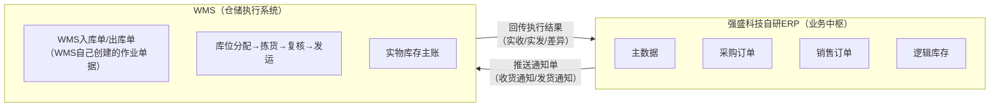
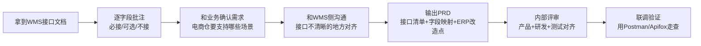
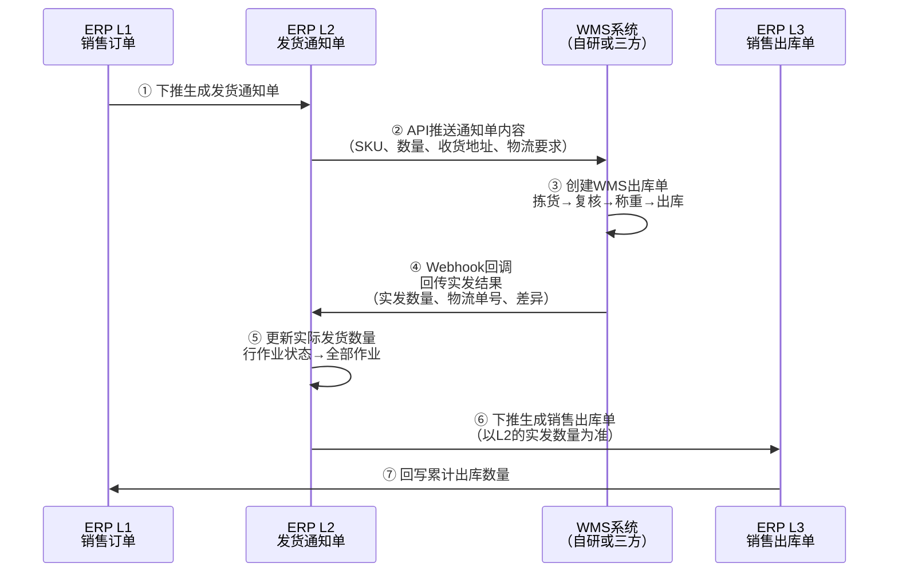
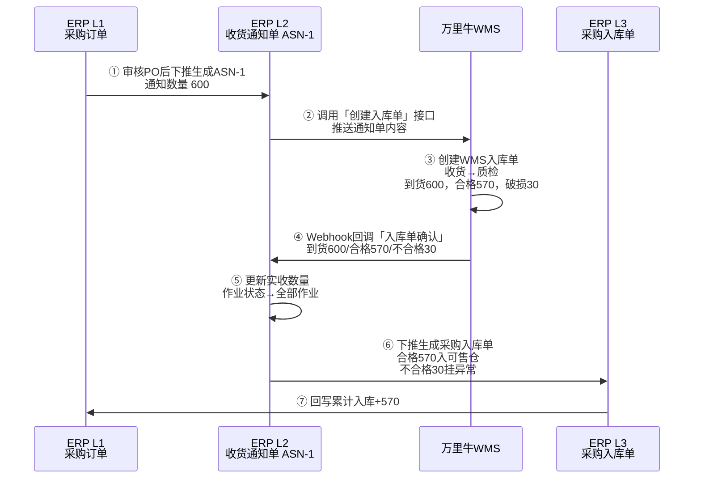

# ERP项目第9讲：ERP与外部WMS的集成对接

| 项目 | 内容 |
| --- | --- |
| 面向人群 | 已完成ERP第1-8讲，理解主数据、采购三层单据、实体仓+逻辑仓模型、B2B销售履约、电商订单处理、全渠道库存分配、门店配货 |
| 学习时长 | 90分钟 |
| 难度等级 | ⭐⭐⭐ |
| 前置课程 | [ERP项目第8讲：门店配货与补货产品设计](./ERP项目第8讲-门店配货与补货产品设计.md) |


## 1. 课程背景

前8讲我们一直在"强盛科技内部"打转——主数据怎么建、采购三层单据怎么流转、实体仓+逻辑仓怎么设计、B2B和B2C销售怎么履约、全渠道库存怎么分配、门店怎么配货。这些能力建好之后，系统要真正跑起来，还差一件事：**和外部系统打通**。

先从根上讲清楚一件事：

> ERP是一套系统，WMS是另外一套系统。两套系统之间要协同，就必须对接——不管这个WMS是自研的还是外采的、是内部的还是三方仓的，本质上都是"ERP把指令推给WMS，WMS执行后把结果回传给ERP"。

在这套课程里，WMS的专题内容在后面才会讲到。但如果你现在只学了ERP，也完全能理解这一讲——因为我们要讲的是**两套系统之间的集成关系**，不展开WMS内部的库位、波次、拣货路径这些执行细节。

所以这一讲，我们从两个视角来拆：

**ERP的视角**：

<font style="background-color:#FAFAFA;"></font>我是ERP，需要把单据指令推送到WMS，让仓库按指令去完成收货、出库等作业，然后接收WMS回传的执行结果。

**WMS的视角**：

我是对外提供服务的仓储系统，需要对外开放OpenAPI，让外部系统（ERP、OMS等）可以通过接口给我下发作业指令。

两个视角加在一起，才构成一套完整的集成认知。


## 2. 学习目标

- 能说清ERP和WMS的本质关系：ERP是业务中枢，WMS是执行系统，两套系统通过接口协同
- 能区分"ERP推送的是通知单，WMS创建的是WMS自己的出入库单"这一关键概念
- 能用一张推演表走完从采购订单→通知单推送→WMS执行→回传→ERP入库的完整链路
- 能说清ERP对接外部WMS的核心接口有哪些、调用方向和数据流向分别是什么
- 能说清ERP侧产品经理在对接项目中的完整工作流：需求调研→接口文档分析→字段映射→PRD输出→联调
- 能说清对接中的关键异常场景（拒单、回调丢失、部分收货）和处理策略
- 能说清一期和二期的接口分期原则
- 能列出ERP侧为对接WMS需要做的主要功能改造
- 能从WMS视角理解对外提供OpenAPI的阶段演进和接口设计思路
- 能解释奇门的本质：一套标准的ERP↔WMS对接协议，解决"一家一议"的问题
- 能在面试中用一张图讲清楚ERP↔WMS的双向数据流

**本讲交付物**：ERP↔WMS接口数据流图 + 对接需求调研表 + 接口模块梳理表 + 端到端推演表


## 3. 课程内容

### 3.1 ERP和WMS的本质关系：两套系统，一条对接链路

#### 3.1.1 先看交互方向

:::info
一般情况下，在仓储履约链路里，WMS承接ERP/OMS下发的执行任务。ERP和WMS的数据流是双向的：ERP下发作业指令，WMS执行后回传实际结果。


:::

放到强盛科技阶段4的系统架构里：

强盛科技自研ERP是业务中枢，管主数据、采购、销售、逻辑库存、内部结算。WMS是仓储执行系统——不管是自研WMS管B2B仓（深圳总仓、东莞仓），还是外部三方WMS管电商仓，ERP和WMS之间的核心模式都是"ERP下发指令→WMS执行→WMS回传结果"。



**一个关键的认知：**

> 不管是自研WMS还是外部三方WMS，ERP和WMS之间的对接链路是一样的。区别只在于：自研WMS走内部系统调用（更快、更可控），外部WMS走API对接（有网络延迟、需要处理认证和异常重试）。但"推送通知单→WMS执行→回传结果"这个核心模式不变。

#### 3.1.2 ERP在什么场景下需要对接WMS？

:::info
ERP对接WMS，本质是ERP要使用WMS所提供的仓储执行能力。

"仓库最基本的功能是储存货物，并对储存的货物实施保管和控制。但随着人们对仓库概念的深入理解，仓库也担负着货物处理、流通加工、物流管理和信息服务等功能。"

当企业需要使用仓库来存储货物并进行保管和控制时，如果企业有自己的ERP系统，就需要用ERP来对接WMS——无论是自己的WMS还是外部三方WMS。

:::

**强盛科技的具体场景：**

在第4讲我们讲了实体仓+逻辑仓的仓库模型。第5讲讲了电商B2C订单的处理链路——高并发小单的履约，需要专业的电商仓能力（拆零拣货、波次作业、多快递渠道、平台时效SLA）。如果企业自己有能支撑这种能力的WMS，那ERP就对接自己的WMS；如果不具备，就对接外部三方仓的WMS。

| 对接对象 | 强盛科技的适用场景 | 对接方式 |
| --- | --- | --- |
| 自研WMS | B2B仓（深圳总仓、东莞仓），批发大单、门店调拨 | 内部系统调用 |
| 外部三方WMS | B2C电商仓，高并发拆零发货、快递面单、平台履约 | API对接 |

外部仓储服务商越多，ERP通常就需要适配越多套WMS接口；规模上来后，才需要考虑用奇门、标准协议或集成中台降低重复对接成本。

#### 3.1.3 一般SaaS的电商ERP会对接多少WMS？

:::info
国内电商SaaS代表：聚水潭，公开帮助文档中可以看到大量仓储、物流和授权仓库相关能力

[https://ww.erp321.com/app/support/document.html#cate=1535](https://ww.erp321.com/app/support/document.html#cate=1535)

跨境电商SaaS代表：店小秘，官网公开资料展示了海外仓、物流和平台生态能力，具体数量以官网最新页面为准

[https://www.dianxiaomi.com/oversea/warehoseIndex.htm?indexType=1](https://www.dianxiaomi.com/oversea/warehoseIndex.htm?indexType=1)

:::

#### 3.1.4 电商SaaS ERP的"授权仓库"机制

:::info
在电商SaaS ERP中，一般都会有一个"授权仓库"模块。ERP已经和很多仓库WMS都完成了技术对接，ERP的用户需要用哪家WMS，就输入对应的授权信息即可。

不同WMS对授权信息的要求不一样，所以要填写的授权字段也会不同。ERP需要写对应的操作手册，让用户知道要填写什么、怎么获取。


:::

> 强盛科技是自研ERP，不像聚水潭那样需要做"授权仓库"模块让几百家WMS可选。但它在仓库主数据（第2讲、第4讲）里同样需要维护三方仓的对接配置——对接哪家WMS、接口地址、AppKey、货主编码、ERP仓库和WMS仓库的映射关系等。

---

### 3.2 ERP视角：对接WMS的完整工作流

:::info
**背景导入：**

强盛科技，之前主要的业务都是通过线下门店和B2B批发实现销售，自研ERP和自研WMS管着B2B仓（深圳总仓、东莞仓）。

最近根据业务规划要大力开拓B2C电商业务（天猫、京东、抖音），B2B仓的作业能力无法满足电商履约要求。所以需要对接专业的三方电商仓——目前已经找好了一家意向仓库，对方用的是**万里牛WMS**，需要对接万里牛WMS的接口。

[https://open.hupun.com/api-doc/wms/open/oms/bill/cancelbill/v2](https://open.hupun.com/api-doc/wms/open/oms/bill/cancelbill/v2)

:::


> **前8讲的哪些设计在本次对接中会被直接用到？**
> 
> - **第2讲 商品主数据**：ERP的SKU要推给WMS，并保存ERP SKU与WMS侧货品标识之间的映射关系。后续推送单据时，根据WMS接口要求传WMS货品ID、WMS货品编码或外部SKU等字段，不能只凭ERP侧SKU编码想当然对接。
> - **第3讲 采购三层单据**：L2通知单（收货通知单）推给WMS后，采购订单行的「已通知数量」要更新。WMS执行完成后回传实收结果给L2通知单，L2更新实收数量后，ERP从L2下推生成L3入库单，触发「累计入库数量」更新和库存增加——这和推自研WMS时的回写逻辑完全一致。
> - **第4讲 仓库模型**：三方仓在ERP里要建为一个「实体仓」，同时配置对应的逻辑仓（如「电商可售仓」）和WMS仓库编码的映射。ERP这边的仓库档案要新增「是否三方仓」「WMS类型」「接口配置」等字段。
> - **第5讲 B2B/B2C销售履约**：B2C订单推给三方WMS发货后，WMS回传的发货结果给L2发货通知单，L2更新实发数据后，ERP从L2下推生成「B2C销售出库结果单」，扣减ERP库存并形成应收口径——和第5讲的结果归集模型对接。
> - **第6讲 电商订单处理**：订单审核规则引擎里的仓库分配，决定了哪些订单走三方仓履约（推外部WMS）、哪些走自研仓履约（推自研WMS）。

#### 3.2.1 调研业务需求，梳理当前诉求

对接WMS之前，先把内部的业务需求搞清楚。强盛科技需要拉通电商运营、仓储物流、采购计划、财务、技术等多个部门。

| **业务部门** | **待确认的问题和事项** | **其他** |
| --- | --- | --- |
| 电商运营部 | 1. 要开展哪些电商业务？<br/>    1. 电商平台：淘宝、京东、拼多多、抖音<br/>    2. 品牌官网/小程序：官网、自营商城<br/>2. 电商销售的品类和线下零售的品类有什么区别？<br/>    1. 电商平台走"少而精""爆品"模式<br/>    2. 线下渠道则是"大而全"模式 | 不同电商平台对履约要求不同，对接WMS时也会有一些需要特殊处理的地方 |
| 仓储物流部 | 1. 电商仓要支持什么业务？不支持哪些业务？<br/>    1. 采购入库、销售出库、调拨入库、调拨出库、采购退货、残次品处理……<br/>2. 电商仓的收发货要求和执行标准是什么？<br/>3. 电商仓的签约合同、费用报价、考核要求等会有什么信息化对接类的需求吗？ | 仓储物流部是面向外部仓库的角色，后续运营中很多需求可能都是他们提出的 |
| 采购和计划部 | 1. 电商仓的库存计划是怎么计算的？<br/>2. 电商仓的货物是调拨入库还是采购入库？<br/>3. 电商仓和B2B仓的采购有什么差异化要求吗？ | 新增了一个仓库，需要从"进销存"多个视角去考虑影响 |
| 财务部 | 1. 电商仓的业务开展和财务计费有什么关系吗？<br/>2. 电商仓的业务单据是否要单独结算、单独标识清楚？ | 电商业务既要考虑仓储履约，也要考虑经营分析 |
| 技术部 | 1. 除了ERP需要和外部WMS对接，还有其他系统、其他功能需要改造吗？<br/>2. 对接方面是否有什么技术难题或者要提前处理的？ | 技术部门要做的不仅是接口对接，还有其他上下游系统的打通 |
| 其他 | 1. 一些其他补充的内容 | 在需求调研过程中发现并记录的其他问题 |


#### 3.2.2 阅读接口文档，提取有效信息

当背景信息和原始需求都搞清楚了，接下来阅读WMS方提供的接口文档，提取关键信息。

1. 获取接口文档的地址或者文件附件
2. 查看对接指引，了解大概的对接流程和步骤，按对方的要求执行
3. 阅读具体的API文档，了解对方提供了哪些接口（API EndPoint），不同接口有什么作用
    1. [https://open.hupun.com/api-doc/wms/open/oms/bill/cancelbill/v2](https://open.hupun.com/api-doc/wms/open/oms/bill/cancelbill/v2)
4. 结合需求调研，加上自己对接口文档的理解，梳理出要对接哪些EndPoint：
    1. 接口认证、授权、鉴权等
    2. 商品同步，即从ERP推送商品资料到WMS中
    3. 入库单创建，即从ERP推送收货通知单/入库通知内容到WMS中
    4. 退货入库单创建，即从ERP推送退货入库单到WMS中
    5. 发货单创建接口，即从ERP推送发货通知单/出库通知内容到WMS中
    6. 单据取消，即从ERP发起单据的取消
    7. 入库单确认接口，WMS入库后更新状态和数据，反向推送给ERP（Webhook回调）
    8. 退货入库单确认接口，WMS退货入库后反向推送给ERP（Webhook回调）
    9. 发货单确认接口，WMS发货出库后反向推送给ERP（Webhook回调）

#### 3.2.3 对接前要搞清楚的关键映射

阅读接口文档时，产品经理要主动梳理ERP和WMS之间的映射关系。这是对接中最容易出问题的地方：

| 映射关系 | ERP侧 | WMS侧 | 对接时可能遇到的问题 |
| --- | --- | --- | --- |
| 仓库映射 | ERP实体仓 + 逻辑仓 | WMS仓库编码 | ERP逻辑仓在WMS侧可能没有对应概念，需要在接口字段里传实体仓+货主来区分 |
| 货主/客户映射 | ERP组织、店铺、业务主体 | WMS货主编码、客户编码 | 三方仓通常按货主管库存和计费，ERP必须明确哪个组织/店铺对应哪个WMS货主 |
| 商品映射 | ERP SKU编码 | WMS货品ID/货品编码/外部SKU | 第2讲讲过主数据分发——ERP的SKU推给WMS后，要保存两边的货品标识映射；后续单据交互按WMS接口要求传参 |
| 单据映射 | ERP通知单号 | WMS入库单/出库单号 | 两边单号不同，ERP要存储WMS返回的单号，用于后续查询和回调匹配 |
| 状态映射 | ERP通知单状态（已推送/部分作业/全部作业） | WMS单据状态（待收货/部分收货/已完成） | 状态不是简单的一比一翻译，部分收货、质检分流等中间状态要提前对清楚 |

#### 3.2.4 对接口文档做详细的批注和分析

WMS方提供的接口文档，可能非常详细，也可能内容简陋、表达不好。产品经理需要逐字段批注——哪些必接、哪些可选、哪些不接——这是对接类需求中花费时间最多的环节。

:::info
对接口文档的批注和分析，取决于产品经理的经验积累和认知水平。懂得越多，很多东西一眼就能看懂，批注的内容就少。

即使懂得比较少也没关系，坦诚地承认，把自己不知道的东西记录下来，再通过会议或者群聊确认相关事项。关键是要提出一个好问题，同时自己提前做好铺垫知识的摄取。

:::

#### 3.2.5 输出接口对接的需求文档

对接外部WMS这类需求，产品经理最终的交付物是一份**接口对接PRD**。它和普通业务需求PRD的重点不同——不画原型页面，而是讲清楚数据流、接口清单、字段映射和异常处理。


[ERP对接万里牛WMS的需求文档（样例）](https://www.yuque.com/jiaowovitamin/tenth/mkmv18wc1vra2oh1)

这份样例PRD覆盖了：需求背景和场景分析、业务流程图、仓库清单、API清单（含分期规划）、每个接口的字段映射表（WMS字段 → ERP是否对接 → ERP传参说明）、ERP侧功能改造点。

**产品经理在这个阶段的典型工作流：**



#### 3.2.6 对接中的关键异常场景

对接类需求最花时间的地方不是正常流程，是异常处理。下面这些异常在实际对接中几乎必遇到，ERP侧产品经理必须在PRD里写清楚处理策略：

| 异常阶段 | 异常场景 | ERP侧怎么感知 | 处理策略 |
| --- | --- | --- | --- |
| 推送时 | WMS接口不可达（网络超时、WMS系统故障） | 接口返回超时或连接拒绝 | 推送状态标记为「推送失败」，支持手动重试或定时重试；连续失败N次后告警 |
| 推送时 | WMS拒单（SKU未维护、仓库不支持该业务类型、收货窗口关闭） | WMS返回明确的错误码和拒单原因 | 推送状态标记为「推送失败」，记录WMS返回的拒单原因；通知单挂起，人工确认后重新推送或取消 |
| 推送时 | 重复推送（ERP超时重试，同一张通知单推了两次） | — | ERP侧用「通知单号」做幂等校验；WMS侧用同样的字段去重，拒绝重复单据 |
| 回调时 | 回调丢失（WMS作业完成但Webhook没发出或ERP没收到） | ERP超过预期时效仍未收到回调 | ERP侧设置超时预警（如24小时），超时后主动调用WMS的「单据查询接口」拉取最新状态，不无限等待回调 |
| 回调时 | 回调重复或乱序（WMS重复推送同一结果，或先后状态顺序异常） | ERP收到相同业务单号、相同回调流水或不符合状态前进规则的数据 | ERP侧按通知单号、WMS单号、回调流水号做幂等；只接受合法的状态前进，不让重复回调反复更新L2和生成L3 |
| 回调时 | 回调数据异常（WMS回传的数量、状态和ERP预期不一致） | 解析回调数据时发现差异 | 记录差异日志，触发人工核查；通过关键校验后，以WMS实收/实发更新L2，再从L2下推生成L3；若SKU、仓库、单据状态等关键字段不一致，应先挂异常，不直接落账 |
| 执行业务 | 部分收货（WMS实收数量 < 通知数量） | WMS回调中实收数量 < 通知数量 | L2按实收数量更新，ERP从L2下推生成L3入库单；差额回写通知单行和采购订单行，后续是否补推新的通知单，要看采购单是否允许继续收货 |
| 执行业务 | 部分发货（WMS实发数量 < 通知数量） | WMS回调中实发数量 < 通知数量 | L2按实发数量更新，ERP从L2下推生成L3出库单；未发部分进入缺货、拆单补发、改仓补发或取消流程，不能简单套用入库的「可通知数量」逻辑 |
| 执行业务 | 质检不合格（收货后发现残品/不合格品） | WMS回调中标注了不合格数量 | 合格部分入可售逻辑仓，不合格部分入残品仓或退货待处理仓；库存按质检结果分开入账 |
| 库存同步 | WMS库存查询结果和ERP账面不一致 | 定时对账或在关键节点主动查询WMS库存 | 记录差异，超过阈值告警；不自动覆盖ERP库存账，人工确认后再做库存调整 |

> **一个设计原则**：ERP不能因为WMS不回调就卡住不动。回调是WMS的主动通知，ERP侧必须同时支持定时主动查询WMS状态，作为回调的兜底机制。两者是互补关系，不是二选一。

#### 3.2.7 分期策略：哪些接口放一期，哪些放二期

对接外部WMS通常不是一个大版本搞定。样例PRD里的做法是拆两期，这个分期逻辑是可迁移的：

**一期的判断标准——让闭环能跑起来：**

| 一期必须覆盖 | 为什么 |
| --- | --- |
| 接口认证/授权/鉴权 | 对接的前提，没有授权什么都推不了 |
| 商品同步 | WMS要知道这批货是什么，不推商品资料，后续入库出库都没法做 |
| 入库单创建 + 入库单确认回调 | 采购入库是库存来源，必须先打通 |
| 出库单创建 + 出库单确认回调 | 销售出库是库存消耗，要先能让电商订单发出去 |
| 入库单/出库单状态查询 | 回调丢失或延迟时，ERP要有主动查询单据状态的兜底能力 |
| 单据取消 | 业务上必然会出现推错、改数、撤回的场景，必须有取消通道 |

**二期补充的内容：**

| 二期再补齐 | 为什么可以缓 |
| --- | --- |
| 退货入库单创建/确认 | 电商退货业务量可能一开始不大，可以先走线下处理再补系统对接 |
| 库存查询 | 一期先保证单据状态可查，库存查询可以等业务稳定后再做主动查询和定期对账 |
| 物流轨迹查询 | 运营可以先在WMS后台查物流，不是阻断性问题 |
| 库存异动通知 | WMS侧主动推送的库存调整事件，属于补充能力 |

> **判断原则**：先覆盖让业务能正常流转的闭环（商品→入库→出库→确认），再补辅助类和优化类接口。如果一期范围太大，研发周期拉长，业务等不了。

#### 3.2.8 ERP侧需要配合的功能改造

对接外部WMS不只是写接口代码。ERP多个模块都需要配合改造：

| 改造点 | 说明 | 涉及模块 |
| --- | --- | --- |
| 仓库档案新增字段 | 新增「是否三方仓」「WMS类型」「接口地址」「AppKey/AppSecret」「货主编码」「WMS仓库编码映射」 | 仓库主数据（第2讲、第4讲） |
| 通知单新增推送状态 | L2通知单新增「推送WMS状态」字段：未推送、推送中、推送成功、推送失败 | 采购模块（第3讲）、销售模块（第5讲） |
| 商品-WMS映射表 | 商品推给WMS后，将WMS侧货品ID、货品编码或外部SKU等标识回存到商品主数据的「WMS商品映射」子表，后续单据交互按WMS接口要求取值 | 商品主数据（第2讲） |
| WMS回调日志 | 新增独立的「接口日志」页面，记录每次推送和回调的请求参数、返回结果、耗时、成功/失败状态 | 系统管理/集成监控 |
| 库存对账入口 | 库存查询页能区分「ERP账面库存」和「WMS实物库存」两个口径，支持按仓库、按SKU对账 | 库存模块（第4讲） |
| 推送重试机制 | 推送失败的WMS通知单支持手动重试，或配置自动重试策略（间隔、次数上限） | 采购模块、销售模块 |
| 仓库分配规则扩展 | 订单审核规则里分配仓库时，能区分「走自研WMS的仓」和「走外部WMS的仓」，触发不同的推送逻辑 | 订单模块（第6讲） |

> 这些改造不是一次性全部做完。一期优先做：仓库档案新增字段、通知单推送状态、商品-WMS映射表、推送重试机制、接口日志/推送记录/回调记录——这些是让对接能跑起来、联调能排障的最小集。库存对账可以在二期补上。

### 3.3 关键概念：ERP推送的是通知单，WMS创建的是自己的单据

这是对接中最容易搞混的概念，单独用一节讲透。

#### 3.3.1 概念讲解

回顾第3讲的三层单据体系：L1是业务意图（采购订单/销售订单），L2是执行通知（收货通知单/发货通知单），L3是执行结果（采购入库单/销售出库单）。

对接WMS时，ERP把**L2通知单**推给WMS——"这批货要收了""这批货要发了"。WMS收到后，**在WMS系统内部创建WMS自己的入库单或出库单**，按WMS自己的作业流程去执行。

**关键的环节在这里：WMS执行完成后，回传给谁？**

不是直接回传给ERP的L3。WMS的回调是回传给**ERP的L2通知单**——"你之前推给我的那批货，实际收了这么多、合格这么多、破损这么多"。L2收到回传后，更新自己的实收/实发数量和作业状态，然后ERP再从L2**下推生成L3结果单**。

用一张时序图看清楚这个交互过程（以销售发货为例）：



**入库方向完全对称**——把"发货通知单"换成"收货通知单"，"销售出库单"换成"采购入库单"，"实发"换成"实收"，逻辑一样：


对应到第3讲的三层单据回写规则（§3.7.6）：

| 事件 | 回写目标 | 回写内容 |
| --- | --- | --- |
| ② L2推送WMS | L1 行 | 已通知数量 +N，可通知数量 -N |
| ④⑤ WMS回传 → L2更新实收/实发 | L2 行 | 实际作业数量更新，行作业状态变化 |
| ⑥ L3审核过账 | L1 行 | 累计入库/累计出库数量更新 |
| ⑥ L3审核过账 | 库存 | 库存增加（入库）或减少（出库） |

一句话收束：

> **WMS回传 → ERP L2 通知单（更新实收/实发数据）→ ERP 从 L2 下推生成 L3 结果单。L3 不是 WMS 直接回调生成的，它是 ERP 内部在 L2 拿到确认数据后自己下推出来的。**

理解了这个概念之后，再看WMS接口文档里的"创建入库单接口""创建出库单接口"，就很清楚了——这些接口的名字是从WMS视角命名的。站在ERP视角，调用"创建入库单接口"就是把ERP的收货通知单内容推过去，让WMS去创建WMS自己的入库单。

#### 3.3.2 端到端案例推演：从采购订单到WMS入库的完整链路

下面用一个具体案例把上面的概念串起来。先看时序图，再看步骤推演表。

场景：

> 强盛科技向供应商采购 1000 个 QC100 充电头，入电商仓（由万里牛 WMS 管理）。供应商分两次送货：第一次按ASN通知送 600 个，WMS 验收后确认合格 570 个、破损 30 个；第二次送 400 个，WMS 全部实收合格。30 个破损品单独进入残品/异常处理，不计入可售库存。

**时序图（第一次送货 600 个）：**



**完整步骤推演表（两次送货全过程）：**

| # | 节点 | ERP L1 采购订单 | ERP L2 收货通知单 | 推WMS | WMS侧 | WMS回传 → L2更新 | L2下推 → ERP L3 入库单 | ERP库存变化 |
| --- | --- | --- | --- | --- | --- | --- | --- | --- |
| ① | 审核采购订单（1000个） | 已审核，采购数量 1000 | — | — | — | — | — | 不变 |
| ② | 供应商ASN通知送600 | — | ASN-1 已审核，通知数量 600 | 调用万里牛「创建入库单」接口，推送通知单内容 | WMS创建WMS入库单（预期收600） | — | — | 不变 |
| ③ | 推送成功 | — | ASN-1 推送状态→推送成功 | — | — | — | — | 不变 |
| ④ | WMS收货完成 | — | — | — | WMS入库单完成，到货600，合格570，不合格30 | Webhook回调 → ASN-1：更新实收数量、合格570/不合格30，作业状态→全部作业 | — | 不变（等L3审核） |
| ⑤ | ERP从ASN-1下推生成L3入库单 | 累计入库+570 | ASN-1 已完结 | — | — | — | L3入库单审核，合格570入电商可售仓；不合格30挂异常/残品处理 | 电商可售仓 +570 |
| ⑥ | 供应商第二次ASN通知送400 | — | ASN-2 已审核，通知数量 400 | 调用万里牛「创建入库单」接口 | WMS创建WMS入库单（预期收400） | — | — | 不变 |
| ⑦ | WMS收货完成 | — | — | — | WMS入库单完成，实收400 | Webhook回调 → ASN-2：更新实收数量400，作业状态→全部作业 | — | 不变 |
| ⑧ | ERP从ASN-2下推生成L3入库单 | 累计可售入库 570+400=970；30个破损单独挂异常处理 | ASN-2 已完结 | — | — | — | L3入库单审核，实收400（全部入电商可售仓） | 电商可售仓 +400（累计+970），残品/异常数量30 |

**从这张表抓六个关键观察：**

1. **L2推送 ≠ 库存变化**：②③步只建立了推送关系，库存完全不动
2. **WMS回传给L2，不是L3**：④步Webhook回调的目标是ASN-1（L2），更新L2的实收数量和作业状态
3. **L3是ERP从L2下推生成的**：⑤步，ERP内部从ASN-1下推生成采购入库单，以L2上已更新的实收数量为准
4. **L3审核 = 库存落账的唯一时刻**：⑤⑧步，只有L3入库单审核，库存才增加。和第3讲的逻辑完全一致
5. **差异不阻塞流程**：④⑤步，30个破损不影响570个合格品正常入库。差异部分单独记录，不卡住正常库存流转
6. **三类单号并行存在**：ERP原始通知单号（L2 ASN/发货通知单）、WMS单号（WMS内部入库单/出库单）、ERP结果单号（L3采购入库单/销售出库单）——各自独立，通过接口请求和回调中的关联字段串联

---

#### 3.3.3 出库方向同样适用

上面的案例讲的是入库方向（采购入库），出库方向（销售发货）的逻辑完全对称，同样遵循"WMS回传→L2→L2下推L3"的链路：

```text
ERP L2 发货通知单
  → 调用WMS「创建出库单」接口
    → WMS创建WMS出库单 → 拣货→复核→称重→出库
      → Webhook回调 → ERP L2 发货通知单（更新实发数量、物流单号）
        → ERP从L2下推生成 L3 销售出库单
          → 库存实扣 + 应收确认
```

唯一的差异是：出库方向 WMS 回调里会多带一个**物流单号**，ERP L2 更新时一并记录，L3 生成后 ERP 再把物流单号回传给电商平台（第6讲讲的"标发"）。但这个差异不影响"通知单→WMS单据→回传L2→L2下推L3"这个核心模型。

### 3.4 WMS视角：如何对外提供OpenAPI（补充）

:::info
**背景导入：**

维他海外仓是一家专注于服务欧美市场、为3C类品牌卖家提供精细化仓储服务的海外仓公司，最近刚好自研上线了自己的WMS系统。

刚好最近接入了一些KA型客户，这些客户希望维他海外仓能提供一套对外的OpenAPI，通过接口从客户的ERP或后台管理系统直接推送商品数据、业务单据到WMS中，而不是每次都登录海外仓OMS手动处理单据。

[https://open.wingsing.com/#/home](https://open.wingsing.com/#/home)

:::

> 强盛科技阶段4的自研WMS是对内系统，不需要对外提供OpenAPI。但如果你是一家WMS公司的产品经理——比如万里牛、旺店通、维他海外仓——你的WMS要接外部ERP，你就要提供接口。这一节站在WMS产品经理的视角来讲。学完之后，你能理解对接的另一端在做什么、考虑什么，这对ERP产品经理同样重要。

#### 3.4.1 调研业务需求，梳理当前诉求

WMS要对外提供接口，必然是希望能做成通用的，这样每个外部客户接入WMS都可以走同一套标准。但通用API不是一蹴而就的，产品经理需要了解当前客户量级、客户诉求、WMS功能发展情况，来制定方案。

| 阶段 | 场景/业务特点 | 接口的解决方案 |
| --- | --- | --- |
| 早期较原始阶段 | 1. WMS的外部客户很少，可能就几个<br/>2. WMS自身功能可能也不完善，能对外提供的接口有限 | 直接用Word文档展示或者Swagger UI，接口的授权和校验等也可以简单处理 |
| 中期探索阶段 | 1. WMS的外部客户开始多了起来，需要频繁解答对接问题<br/>2. WMS自身功能相对完善，可以对外提供更丰富的接口<br/>3. WMS功能更新后，接口内容可能也要调整 | 继续使用Word或Swagger UI，但开始考虑搭建OpenAPI开放平台，支持客户在线查看API文档和接入指南 |
| 后期稳定阶段 | 1. WMS的外部客户非常丰富，对接耗费精力较多<br/>2. WMS功能基本完善，能对外提供的接口很多，需要重点开发、维护 | 持续搭建OpenAPI开放平台，引入应用注册、审核、接口监控等高级功能 |


三张图均来自"<font style="color:rgba(0, 0, 0, 0.9);">新零售SaaS架构：开放平台架构设计</font>"这篇文章

#### 3.4.2 研发和产品各自负责OpenAPI的不同部分

当确定了要对外提供WMS接口文档后，产品经理和研发需要分工协作。研发关注和技术有关的内容（签名算法、请求格式、错误码），产品关注和业务逻辑、应用参数相关的内容（字段含义、必填/可选、枚举值范围）。


#### 3.4.3 产品经理怎么定义对外接口

> 这一节是补充视角，不是强盛科技第9讲的主线。课堂时间不够时，可以只讲“接口模块表”和“常见坑”，把开放平台演进留作课后阅读。

**（1）怎么知道要提供多少个接口？**

:::info
搭建OpenAPI和做业务一样，需要逐步迭代、逐步丰富。产品经理不可能一次性就把所有接口都定义出来。

作为一个"后追型"产品，最快的方式就是对标竞品，看别人是怎么做的、提供了哪些接口，然后借鉴模仿。

:::

| **模块/大类** | **接口/EndPoint** | **用途** | **调用方式** |
| --- | --- | --- | --- |
| 授权/生成签名 | 签名接口 | 接口授权使用，对接必备 | 外部→WMS |
| 基础资料 | 获取仓库信息 | 可以知道WMS有多少个仓库及基础信息 | 外部→WMS |
| | 获取物流渠道 | 可以知道WMS有多少个物流及基础信息 | 外部→WMS |
| 货品 | 创建货品 | 通过接口推送商品资料给WMS | 外部→WMS |
| | 修改货品 | 通过接口修改已经推送的商品资料 | 外部→WMS |
| | 查询货品 | 通过接口查询已经推送到WMS的商品 | 外部→WMS |
| 入库 | 创建入库单 | 通过接口推送入库单给WMS | 外部→WMS |
| | 入库单取消 | 通过接口取消推送过来的入库单 | 外部→WMS |
| | 入库单查询 | 通过接口查询入库单的状态和作业进展 | 外部→WMS |
| | 入库单回传 | 仓库完成收货或上架后，主动通过回调接口推送结果 | <font style="color:#DF2A3F;">WMS→外部</font> |
| 出库 | 创建出库单 | 通过接口推送出库单给WMS | 外部→WMS |
| | 出库单取消 | 通过接口取消推送过来的出库单 | 外部→WMS |
| | 出库单查询 | 通过接口查询出库单的状态和作业进展 | 外部→WMS |
| | 出库单回传 | 仓库完成称重或出库后，主动通过回调接口推送结果 | <font style="color:#DF2A3F;">WMS→外部</font> |
| | 获取运单号 | 通过接口查询出库单的运单号 | 外部→WMS |
| | 轨迹查询 | 通过接口查询出库单的物流轨迹信息 | 外部→WMS |
| 库存 | 库存查询 | 通过接口查询库存数量 | 外部→WMS |
| | 库存流水 | 通过接口查询库存流水 | 外部→WMS |
| | 库存异动通知 | 仓库主动发起的库存调整、盘点、其他出入库等，推送给对接者 | <font style="color:#DF2A3F;">WMS→外部</font> |
| 退货 | 创建退货单 | 通过接口推送客户退货单给WMS | 外部→WMS |
| | 退货单取消 | 通过接口取消推送过来的退货单 | 外部→WMS |
| | 退货单查询 | 通过接口查询退货单的状态和作业进展 | 外部→WMS |
| | 退货单回传 | 仓库完成退货接收或处理后，主动通过回调接口推送结果 | <font style="color:#DF2A3F;">WMS→外部</font> |

> **怎么判断哪些接口优先做？** 以奇门仓储为例，它提供了 63 个接口，但真正和 ERP-WMS 仓储对接强相关的只有约 20 个。筛选标准很简单：问自己"这个接口不接，货物能不能正常收、正常发、正常查库存？"——能，就往后排；不能，就是一期必做。门店类、调拨类、拦截类接口在小众场景才用到，初期直接划 NO。

> **对照理解**：这张表里的"创建入库单""创建出库单"，站在ERP视角就是调用WMS的接口来推送通知单内容。站在WMS视角，是WMS对外提供的接口——外部ERP调用后，WMS内部创建WMS自己的入库单或出库单。同一个接口，两端叫法不同，但本质一样。

**定义接口时，按模块关注的关键字段：**

产品经理在定义每个模块的接口字段时，不能只是照搬竞品——要知道哪些字段对仓库作业有实际影响。以下是从奇门仓储标准协议和多家WMS接口文档中提炼的各模块重点关注字段：

| 模块 | 重点字段 | 为什么要关注 |
| --- | --- | --- |
| 货品 | 一品多码（条码列表）、商品类型（正常品/组合品/赠品/包材）、效期管理（保质期天数、禁收/禁售天数）、批次管理开关、SN唯一码管理开关 | 这些字段直接影响仓库收货时的采集流程和上架策略。如果商品启用了SN管理但接口没传，仓库收货时会不知道该不该扫SN |
| 入库 | 业务类型（采购入库/调拨入库/退货入库/其他入库）、关联ERP单据号、库存类型（`ZP`正品 / `CC`残次 / `JS`机损 / `XS`箱损）、生产日期/失效日期/批次号、SN编码列表 | 库存类型决定了收货后商品进入哪个库存池。这个字段填错（比如残品标成正品），库存就直接错账 |
| 发货/出库 | 业务类型——发货单用 `JYCK`一般交易 / `HHCK`换货 / `BFCK`补发；出库单用 `PTCK`普通 / `DBCK`调拨 / `CGTH`采购退货、物流公司编码、库存类型、指定批次信息、是否完结字段 | 销售型发货单通常一次性出库，非销售型出库单可能需要分批次回传。具体字段名和取值以当前WMS接口文档为准 |
| 库存 | 查询条件（按SKU/按仓库/按库位/按批次）、库存类型过滤（`ZP`/`CC`/`JS`/`XS`/`ZT`在途）、分页参数 | 库存查询接口如果设计不好（不支持按库存类型过滤、不支持分页），ERP侧展示库存时就要自己做大量后处理 |

（2）怎么知道接口中要提供哪些字段？

:::info
很多产品经理因为自己不懂技术，对接口文档有抵触或畏惧情绪。其实把接口文档换成"简配版"的原型或者产品信息结构，你会发现提供接口中的字段和画一个表单提交的原型是一样的事情。

:::


**（3）怎么走查定义好的接口？**

:::info
定义好接口后，让开发发布到测试环境，产品经理用Apifox或Postman等工具模拟请求接口。可以走查字段是否有遗漏、字段约束是否需要调整、接口反馈信息是否需要改进。

:::

**（4）接口怎么内部评审？**

:::info
一般来说，研发自己走查一遍，产品再走查一遍，最后测试再验证一遍，就可以完成评审。

接口文档在后续如果需要改动或优化，需要考虑是否对历史接入的客户有影响。如果有影响，改动之后的接口就要用新的版本号来区分；如果没有影响，那就可以在之前的版本号上迭代。

接口的版本号定义需要研发评估——如果加了某些必填字段或结构发生了变化，导致"历史用户"请求报错，就需要用不同版本号划分。如果没有这种影响，就可以不用新版本号。

:::

**（5）定义对外接口时，产品经理容易踩的坑**

以下是研究奇门仓储标准协议和多家WMS接口文档后提炼的几个注意点：

| 注意点 | 为什么容易踩 | 怎么避免 |
| --- | --- | --- |
| 漏掉"单据取消"接口 | 正向推送接口是主角，取消接口容易被当成次要功能忽略。但实际业务中推错、改数、撤回是高频场景 | 每定义一个"创建"接口，就同步定义对应的"取消"接口。不要等上线后业务反馈"推错了撤不回"才补 |
| 混淆"发货单"和"出库单" | 销售型订单（B2C小单）和非销售型订单（B2B大单/调拨出库）在WMS侧经常走不同的接口，因为两者的作业方式差异很大——B2C要求一次性出库，B2B允许分批发货 | 明确区分两类出库接口的适用场景，在接口文档里写清楚：发货单=销售型、出库单=非销售型，并标注分批回传的规则差异 |
| 正向入库和退货入库用同一个接口 | 正向入库（采购入库）和逆向入库（退货入库）的业务逻辑不同——退货入库涉及质检、退款关联、原单追溯，混用同一个接口会让下游WMS无法区分处理 | 拆成两个独立接口，或者至少用「业务类型」字段区分，确保WMS侧能正确路由到不同的作业流程 |
| 确认接口不支持"多批次回传" | 如果出库确认接口设计成"一次回传全部完结"，后续遇到分批发货的场景就无法支持——仓库第一次发了80个但接口已经把单据关了 | 确认接口预留"是否完结"字段，让WMS可以多次回传，每次标记本次发了多少、是否还有剩余；字段名和取值不要脱离具体WMS文档写死 |
| 接口文档只写正向流程，不写异常码 | 对接方在联调时遇到报错，错误码含义不清，反复沟通拉长周期 | 每个接口都要标注可能的错误码、错误原因和对接方应该怎么处理（重试/修改参数/联系WMS） |

#### 3.4.4 对外发布上线，持续迭代完善

接口定义好、测试验证通过后就可以发布上线，和普通业务需求发布版本一样。接口发布后让外部客户来对接使用，在对接过程中遇到问题及时解决，持续迭代完善。

---

### 3.5 对接知识总结

最后用一张画板收束全讲的核心内容：


**对接中ERP侧和WMS侧的职责分工：**

| 角色 | 系统 | 对接时的核心职责 | 关键交付物 |
| --- | --- | --- | --- |
| ERP产品经理 | 强盛科技自研ERP | 调研电商仓业务需求、阅读WMS接口文档、输出接口对接PRD、跟进联调 | 需求调研表、接口批注、接口对接PRD |
| WMS产品经理 | 外部三方WMS（如万里牛） | 提供OpenAPI文档、定义接口字段和版本号、支持客户接入和答疑 | OpenAPI文档、接入指南、接口版本管理 |
| ERP研发 | 强盛科技自研ERP | 对接WMS API、处理通知单推送和回传解析、处理异常重试和幂等 | 接口代码、异常处理逻辑 |
| WMS研发 | 外部三方WMS | 提供API EndPoint、处理Webhook回调、保证接口稳定性和安全性 | API实现、回调机制、监控告警 |

**五个关键认知：**

1. **ERP是一套系统，WMS是另外一套系统**——不管WMS是自研还是外采，两套系统之间的对接模式是一样的：ERP推送通知单，WMS创建自己的单据去执行，执行完了回传结果
2. **ERP推送的是通知单，WMS创建的是WMS自己的出入库单**——两套独立的数据，通过接口关联，不是同一张单
3. **对接前先搞清楚"我需要WMS提供什么能力"**——不是照着接口文档全部接一遍，而是从业务需求出发筛选
4. **状态映射是坑最多的环节**——ERP的通知单状态和WMS的作业状态不是简单一比一，部分收货、质检分流等中间状态要提前对清楚
5. **接口对接不是一次性项目**——后续业务变化会导致新的对接需求，接口版本也会持续迭代


## 4. 实操任务 & 交付物

### 4.1 任务说明

#### 必做任务

**任务1**：画一张"ERP↔WMS接口数据流图"，覆盖商品同步、入库单推送、出库单推送、回传确认四组核心接口，标注每组的调用方向（ERP→WMS 还是 WMS→ERP）。

**任务2**：选一个你熟悉的WMS（万里牛、旺店通、吉客云等），打开它的OpenAPI文档，列出它提供了哪些模块的接口（货品、入库、出库、库存、退货等），每个模块至少写2个接口。

**任务3**：假设你是强盛科技的ERP产品经理，要对接一个外部三方仓，写一份"接口对接需求调研表"，覆盖需要调研的业务部门、待确认问题、对接范围。

**任务4**：画一张端到端推演表，参考 3.3.2 的格式，场景换为"电商订单推WMS发货的异常演练"——销售订单（300个）→ 发货通知单推送 → WMS先回传200个，剩余100个因缺货只实发95个，覆盖库存锁定→推送→回传→实扣→差异处理的全过程。

#### 选做任务

- 用Postman或Apifox，找一个开放API的WMS（如万里牛），模拟请求一个"商品同步"、"单据状态查询"或"库存查询"接口，记录请求参数和返回结果。
- 解读万里牛WMS接口文档中的"创建入库单"接口，梳理出必填字段和可选字段，并标注如果你是ERP侧产品经理，哪些字段一定要传、哪些可以不传。

### 4.2 产出标准

| 产出物 | 合格标准 |
| --- | --- |
| ERP↔WMS接口数据流图 | 至少覆盖商品同步、入库、出库、回传四组接口，标注调用方向 |
| WMS接口模块梳理 | 至少覆盖5个模块，每个模块至少2个接口 |
| 接口对接需求调研表 | 至少覆盖4个业务部门，每个部门至少有2个关键问题 |


## 5. 自检清单

学完这一讲，重点检查自己能不能说清下面几件事：

- 我能说清ERP和WMS的本质关系吗（两套独立系统，ERP推送通知单，WMS创建自己的单据执行）？
- 我能区分"ERP推送的是通知单，WMS创建的是WMS自己的出入库单"吗？
- 我能用一张推演表走完从采购订单到WMS入库的完整链路吗（含差异处理和库存变化）？
- 我能说清ERP对接WMS的核心接口有哪些、调用方向分别是什么吗？
- 我能说清一个ERP产品经理从拿到WMS接口文档到输出PRD的完整流程吗？
- 我能说清对接前要梳理的四类映射关系吗（仓库映射、商品映射、单据映射、状态映射）？
- 我能说清推送失败、回调丢失、部分收货这三类核心异常的处理策略吗？
- 我能说清一期和二期的接口分期原则吗（哪些必须一期闭环、哪些可以二期补齐）？
- 我能列出ERP侧为对接WMS至少5项功能改造吗？
- 我能说清WMS对外提供接口的三个阶段演进（早期→中期→后期）吗？
- 我能说清奇门是什么、它解决什么问题吗？
- 我能说清接口版本管理的基本原则吗（什么改动需要新版本号）？


## 6. 补充知识

### 6.1 面试考点

| 面试问题 | 回答方向 |
| --- | --- |
| 你们ERP怎么对接WMS？ | 讲需求调研→接口分析→字段映射→PRD输出→联调的完整流程，重点讲"推送的是通知单，WMS自己创建单据" |
| ERP和WMS的集成，核心接口有哪些？ | 商品同步、入库单创建/回传、出库单创建/回传、单据取消、单据状态查询；库存查询/库存异动可作为二期对账能力补充 |
| ERP推送数据和WMS回传结果，数据一致性怎么保证？ | Webhook回调+对账机制，回调失败要有重试和告警 |
| 如果你要设计一套WMS的OpenAPI，你会怎么做？ | 先对标竞品，选核心模块（商品、入库、出库、库存、退货），按业务页面"翻译"接口字段，逐步迭代 |
| 对接项目中，产品经理最大的价值是什么？ | 不是写代码，而是理解业务需求→筛选接口→明确传参规则→梳理异常场景→保证两端理解一致 |

### 6.2 常见坑与误区

| 坑 | 为什么是坑 | 正确做法 |
| --- | --- | --- |
| 以为ERP推给WMS的是ERP自己的入库单/出库单 | 把两套系统的单据混为一谈，联调时发现状态、字段、业务逻辑全对不上 | 理解"ERP推通知单，WMS创建自己的单据"这个基本模型 |
| 以为接口对接就是照着文档全部接一遍 | 接口文档几十上百个接口，全接完周期太长，很多接口根本用不上 | 从业务需求出发筛选一期要对接的接口范围 |
| 对接完一期就认为完事了 | 业务变化、WMS升级、新增仓类型，都会触发新的对接需求 | 把接口对接当作持续迭代过程，预留扩展能力 |
| 只画正向流程，不画异常回路 | 推单失败、回调超时、WMS拒单、缺货——这些异常不闭环，实际运营会频繁卡单 | 每个接口都要考虑失败场景和补偿机制 |
| 忽视接口版本管理 | 接口改了字段结构没通知对方，历史对接方请求全部报错 | 破坏性改动必须用新版本号，提前通知所有对接方 |

### 6.3 推荐资料与参考链接

**有哪些WMS的接口文档可以参考？**

:::info
阿里奇门：[https://open.taobao.com/doc.htm?docId=106850&docType=1](https://open.taobao.com/doc.htm?docId=106850&docType=1)

京东宙斯：[https://jos.jd.com/apilistnewdetail.html?first=457&second=477](https://jos.jd.com/apilistnewdetail.html?first=457&second=477)

旺店通WMS：[https://www.yuque.com/huice-wiki/bhxv6e/rlk3ar](https://www.yuque.com/huice-wiki/bhxv6e/rlk3ar)

万里牛WMS：[https://open.hupun.com/guide/guide-wms](https://open.hupun.com/guide/guide-wms)

以上外部链接仅作阅读入口和接口样例参考，具体字段、枚举、接口路径和授权方式，以各平台当前官方文档与实际联调结果为准。

吉客云WMS：[https://open.jackyun.com/developer/solutionDetail.html?id=1](https://open.jackyun.com/developer/solutionDetail.html?id=1)

4PX WMS：[https://open.4px.com/](https://open.4px.com/)

谷仓WMS：[https://open.goodcang.com/](https://open.goodcang.com/)

Shipout WMS：[https://open.shipout.com/portal/documentation/wmsOmsAPI.html](https://open.shipout.com/portal/documentation/wmsOmsAPI.html)

出口易WMS：[https://openapi.ck1info.com/v1/Help/Api/POST-v1-merchantSkus](https://openapi.ck1info.com/v1/Help/Api/POST-v1-merchantSkus)

:::

**什么是"奇门"，干嘛用的？**

奇门（Qimen）是阿里定义的一套**ERP↔WMS对接标准协议**。它本质上解决了一个"N×N"的问题。

**没有奇门时的对接模式——网状结构：**

每个ERP要逐一对接每个WMS，M个ERP × N个WMS = M×N次对接。每次对接都要重新理解对方的接口规范、数据格式、业务逻辑和异常处理机制。


**接入奇门之后——一对一的对接方式：**

ERP和WMS只需分别与奇门数据总线对接一次，即可完成所有系统的适配。奇门充当了"翻译官"的角色——统一接口协议、标准化数据格式、规范错误处理。


**ERP、奇门、WMS三者的调用关系：**


正向调用：ERP发请求→奇门解析/映射/翻译→转发给WMS→WMS响应→奇门统一返回给ERP。反向调用同理。奇门在中间承接了数据格式转换和协议适配。

对ERP产品经理来说，研究奇门的接口文档的价值在于：它把常见的商品同步、入库单创建/确认、出库单创建/确认、库存查询等接口抽象成一套标准模型。理解了这套标准，再看任何一家WMS的接口文档，你都能快速定位关键接口和关键字段——因为万变不离其宗。但即使走奇门，也仍然要看具体WMS的接入说明、字段约束和业务差异；奇门降低的是对接成本，不是消除对接工作。

:::info
[https://w.erp321.com/app/support/document.html#page=5960](https://w.erp321.com/app/support/document.html#page=5960)

[https://open.taobao.com/doc.htm?docId=106850&docType=1](https://open.taobao.com/doc.htm?docId=106850&docType=1)

:::

> 强盛科技自研ERP目前只对接一家万里牛WMS，暂时不需要走奇门。但如果将来要对接多家三方仓，或者要对接天猫的仓配体系，奇门就是绕不开的知识点。

**API对接相关的知识学习，有什么入门资料？**

:::info
[API接口知识小结 | 专题 | 人人都是产品经理](https://www.woshipm.com/topic/api)

:::

| 资料 | 重点看什么 |
| --- | --- |
| 万里牛WMS OpenAPI文档 | 商品同步、入库单创建、出库单创建、单据取消、回调接口的字段定义和调用方式 |
| 旺店通WMS接口文档 | 对比万里牛，看不同WMS在接口设计上的差异 |
| 聚水潭帮助文档"授权仓库" | 看SaaS ERP怎么设计"多家WMS可选对接"的产品体验 |
| Postman/Apifox | 实际动手模拟接口请求，理解请求参数和返回结果 |


## 课程学习视频

如需要访问腾讯会议在线录制的视频，可以访问此链接。如提示无权限，可以发起权限申请，待审批后即可访问。

:::color5
录制: 番外篇：从两个不同的视角，讲解ERP和WMS的对接

日期: 2024-05-26 20:06:25

录制文件：[https://meeting.tencent.com/crm/23VwZ6jL34](https://meeting.tencent.com/crm/23VwZ6jL34)

:::

[此处为语雀卡片，点击链接查看](https://www.yuque.com/jiaowovitamin/tenth/xt63e03c1w47ngdb#QIT3a)
