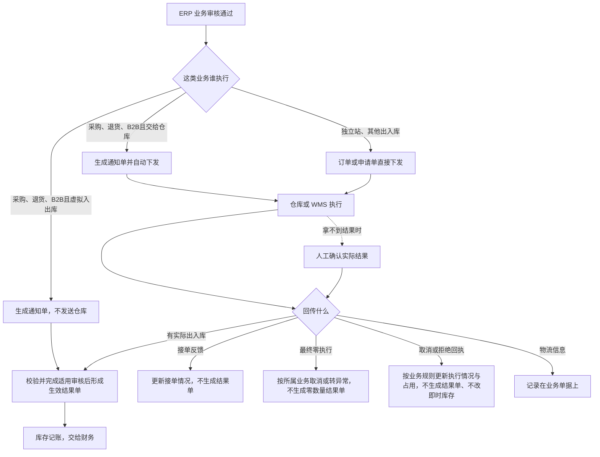

# 集成协作与人工补充

本文说明ERP和外部履约方、仓库、财务系统各做什么，拿不到结果时谁来确认，以及映射和异常记录归谁维护。

> 版本：V0.14｜更新日期：2026-10-15｜状态：业务设计初稿，待决策事项仍有效。

| 版本 | 本次变化 | 状态 |
| --- | --- | --- |
| V0.3 | 区分关闭与仓库取消确认，区分人工确认的执行反馈和实际出入库结果 | 已确认规则的一致性修正 |
| V0.4 | 虚拟入出库不发送仓库，与人工确认拆开 | 已确认规则 |
| V0.5 | 财务ERP失败重推改到系统集成中心；人工确认含采购，但不能无来源建入库单 | 已确认规则 |
| V0.6 | 人工确认入口统一放系统集成中心 | 已确认规则 |
| V0.7 | 集成中心定位表述修正为「不改业务内容」 | 本轮走查收口 |
| V0.8 | 入口调整：映射随基础资料维护；人工确认与订单导入回到对应业务单据页面；推送异常按推送对象分页签 | 已确认规则（2026-09-24） |
| V0.9 | 收口确认：人工确认在单据详情页、原型Mock回传；商品映射独立页面按平台＋店铺；异常记录与处理记录全部保留 | 已确认规则（2026-09-24） |
| V0.10 | 补充「虚拟入出库」与渠道侧说法的术语对照；明确一期不向聚水潭/领星推送采购入库等库存事件 | 已确认规则的一致性修正 |
| V0.11 | 补充电商仓采购链说明（含采退）：经SaaS中转仍属正常采购入库与采退出库执行，不属虚拟入出库任一种；表述改用国内/跨境电商订单口径 | 已确认规则的一致性修正（2026-10-14） |
| V0.12 | 二版补充：聚水潭（国内）、领星（跨境）两套独立接口与映射；出站/入站方向与异常幂等口径对齐（重复回传去重、处理原记录、推送失败不回滚、取消边界） | 已确认规则的一致性修正（2026-10-14） |
| V0.13 | 异常记录关闭口径对齐已定结论：一期不做人工关闭，只按重试成功、原单取消、原记录处理成功自动置为已处理（对齐02/07 INT-FR05；B10①集成走查问题2回填） | 已确认规则的一致性修正（2026-10-15） |
| V0.14 | 人工确认责任岗位收口（用户裁定）：一期不指定岗位，具备功能权限即可操作；留痕记录确认人，可追溯；出错责任按留痕与审计处理；§二、§4.4、§4.6、§5.3、§七同步 | 已确认规则（2026-10-15 用户裁定） |

> 内容依据已确认的需求整理，未确认的事项集中在文末。本文只讲业务分工和责任，接口字段、协议、重试和去重的具体机制留在接口设计里。

输入来源：[系统集成需求分析](../02-需求调研和分析/07-系统集成/系统集成需求分析.md)、[系统集成需求调研](../02-需求调研和分析/07-系统集成/系统集成需求调研.md)。各系统的业务规则见[强盛ERP的定义和上下游链路](../01-全局背景信息/3.强盛ERP的定义和上下游链路.md)和[强盛ERP全局业务规则与约束](../01-全局背景信息/4.强盛ERP全局业务规则与约束.md) §六，业务域各自怎么写结果见采购、销售、库存三篇。

## 一、业务定位与范围

ERP是业务中枢，不是执行方。仓库里的活由仓库或WMS干，电商订单的履约由渠道方干，财务核算由财务ERP干。这一层要回答清楚的是：谁把什么事交给谁、对方实际做完了怎么告诉ERP、拿不到消息时业务还能不能往下走。

| 外部系统 | 一期定位 | 和ERP怎么配合 |
| --- | --- | --- |
| 领星、聚水潭 | 负责国内、跨境电商的运营与履约，电商仓可经它们中转 | 回传国内/跨境电商订单和实际结果；采购及采退的执行指令按映射传递，国内/跨境电商销售只归集结果、不下发发货指令 |
| Shopify | 独立站订单来源 | ERP拉取已付款订单，把发货结果和运单反馈给Shopify；未覆盖的订单可以人工导入 |
| 自营仓作业系统 | 自营仓的实物作业 | ERP直连下发执行指令，接收实际结果、取消回执和库存信息 |
| 第三方WMS／仓库 | 第三方仓的实物作业 | 接收通知或直接推送的订单、申请单，回传实际结果 |
| 财务ERP | 财务核算底座 | 接收七类已审核结果单 |

这一层不重新定义业务规则：单据怎么分层、什么时候预占、结果怎么记账，都以各业务域为准。ERP不下发没有依据的指令，也不因为接口能通就替外部系统决定业务怎么做。

## 二、参与角色

| 角色 | 负责什么 | 在哪些对象上做什么 | 必须交出什么 | 补充说明 |
| --- | --- | --- | --- | --- |
| 各业务域的业务人员 | 产生执行指令、审核结果 | 通知单、订单、申请单、结果单 | 可下发的指令、可生效的结果 | 规则在各域 |
| 渠道履约方 | 完成国内/跨境电商的正向和售后履约 | 渠道侧订单和售后单据 | 原订单、实际结果及来源关联 | 外部执行方 |
| 仓库／WMS | 执行实物作业并回传结果 | 接收指令，回传实际数量、结束、取消和物流结果 | 实际执行结果 | 外部执行方 |
| 集成维护方 | 维护外部映射，查看异常记录 | 映射关系、系统集成中心 | 可用的映射、异常清单 | 由业务人员在基础资料对应档案维护（商品资料、实体仓） |
| 相关人员 | 接口拿不到结果时人工确认实际结果；导入未覆盖的订单 | 结果单、导入的订单 | 确认过的实际结果 | 入口在对应业务单据页面；一期不指定岗位，具备功能权限即可操作（2026-10-15 用户裁定） |
| 技术运维 | 处理推送失败和连接异常 | 推送记录、接口日志 | 修复后的结果 | 与业财异常运维同一套流程 |
| 财务 | 接收财务ERP侧结果并核算 | 财务ERP单据 | 财务处理结果 | 见《结算与业财交接》 |

## 三、业务场景

集成场景分四类：主场景、分支场景、辅助场景、异常场景。本节只列场景和关键分支，过程细节见第四节，异常后果见第七节。

### 3.1 主场景

| 场景 | 发生条件 | 参与方 | 主要步骤和判断点 | 业务结果 | 后续环节 |
| --- | --- | --- | --- | --- | --- |
| 下发执行并接收结果 | 业务审核通过，需要仓库做事 | 业务人员、仓库／WMS | 通知单或订单、申请单自动下发 → 仓库执行 → 回传实际结果 | 结果单生成，库存和财务衔接 | 回到各业务域收尾 |
| 拉取订单并反馈发货结果 | Shopify产生已付款订单 | 系统、独立站业务人员 | 拉取订单 → 人工选仓选物流并审核 → 自动下发 → 把发货结果反馈给Shopify | 订单交付完成 | 财务交接 |
| 分发商品 | 新增商品 | 系统、主数据维护人员 | 商品SKU分发到WMS和财务ERP | 外部系统能识别商品 | 业务建单 |

### 3.2 分支场景

| 场景 | 发生条件 | 参与方 | 主要步骤和判断点 | 业务结果 | 后续环节 |
| --- | --- | --- | --- | --- | --- |
| 人工确认实际结果 | 接口拿不到接单、执行结束或取消结果 | 相关人员 | 在对应业务单据页面按实际发生情况确认结果，仍要过业务校验 | 接单、取消反馈更新执行情况；实际出入库经审核后记账，保留确认记录 | 按确认内容进入后续业务 |
| 人工导入订单 | Shopify某类订单接口没覆盖 | 独立站业务人员 | 在独立站订单页面从Shopify导入ERP，走对应的审核要求 | 订单进入正常流程 | 按独立站流程执行 |
| 维护映射 | 外部商品、仓库或货主需要对应关系 | 业务人员、集成维护方 | 在基础资料对应档案配置映射，不要求建档时就有 | 外部结果能识别到ERP对象 | 结果正常归集 |
| 查看异常 | 推送失败或结果处理失败 | 业务人员、集成维护方 | 在系统集成中心查看异常单据和失败记录 | 知道哪张单卡住了 | 转技术运维或补映射 |

### 3.3 辅助场景

| 场景 | 发生条件 | 参与方 | 主要步骤和判断点 | 业务结果 | 后续环节 |
| --- | --- | --- | --- | --- | --- |
| 商品分发 | 商品建档完成 | 系统 | 分发到WMS和财务ERP；分发失败不阻止内部业务 | 下游能识别商品 | 推单时如失败进入异常 |
| 物流选择下发 | 非自提发货 | 业务人员、仓库 | 把选择的物流服务产品，或“由仓库指定”传给仓库 | 仓库按此安排 | 回传实际物流结果 |
| 库存信息交换 | 仓库主动回传实际变动或库存快照 | 仓库、仓储运营 | 结果按业务域规则记账；快照用于比对 | 账实差异可见 | 人工查明原因 |

### 3.4 异常场景

异常场景按触发条件识别，业务后果、责任方和恢复方式统一在第七节说明，本节不重复。

| 场景 | 触发事件 | 前置 |
| --- | --- | --- |
| 拿不到结果 | 接口没有返回执行结束或取消结果 | 指令已经下发 |
| 映射缺失或匹配失败 | 商品、仓库或货主对不上 | 结果已经回传 |
| 分发失败 | 商品或资料没有成功传到下游 | 下游需要这些数据 |
| 重复回传 | 同一结果多次到达 | 原结果已经处理 |

## 四、核心业务流程

### 4.1 一条执行链：谁交给谁

同一条业务只下发一次、只执行一次。仓库内部怎么分批作业、拆成几个任务，ERP不关心；ERP关心的是这次执行有没有结束、实际做了多少。

### 4.2 各系统的分工边界

- 国内/跨境电商（领星、聚水潭）：接单、发货、售后都由它们完成，ERP接收国内/跨境电商订单和实际结果，不接管抓单和打单，也不重复驱动仓库。聚水潭（国内）、领星（跨境）为两套独立接口与映射，不共用一套「电商ERP」抽象配置。
- 独立站（Shopify）：ERP自己拉单、审核和下发，并把发货结果反馈给Shopify；取消要等仓库回执，不能提前对Shopify认定成功（规则见《销售与履约业务设计》）。
- 仓库：只按收到的指令执行。ERP取消不等于仓库已经取消，仓库的回执才算。
- 财务ERP：只负责财务核算，不做采购、销售的业务入口。

一期与聚水潭、领星的库存相关集成，重点是**销售/退货实际结果归集**、经SaaS中转的**执行指令**（含电商仓采购收货、采退的通知与结果）与**商品SKU分发**：出站是采购收货通知单、采退发货通知单分别映射为渠道侧采购／入库类、出库类执行单据（渠道侧名称待联调核验），入站是入库结果形成采购入库单、出库结果形成销售出库单、退货入库结果形成销退入库单、采退出库结果形成采退出库单；国内/跨境电商的销售由渠道主控，强盛只归集结果、不下发发货指令。**不向**渠道SaaS推送采购入库等库存事件，也不做全量库存双向同步或对渠道可用量的巡检。出站、入站的单据对照以《系统集成需求分析》第五章为准。全局逻辑仓以自研ERP入账为准，见[《强盛ERP的定义和上下游链路》](../01-全局背景信息/3.强盛ERP的定义和上下游链路.md)§一、§四。

#### 4.2.1 术语对照：「虚拟入库／虚拟出库」

口语里「虚拟入库」可能指两套不同的事，集成设计时不要混用：

| 说法 | 指什么 | 会不会驱动物理作业 | 强盛一期 |
| --- | --- | --- | --- |
| ERP通知单上的**虚拟入库／虚拟出库** | 采购收货通知、销退收货通知、销售发货通知、采退发货通知等选择该处理方式：不调用仓库接口，在ERP内按通知数量直接生成并审核对应结果单 | 否 | 有，属ERP内部履约路径 |
| 渠道侧**虚拟入库**（聚水潭/领星等行业用语） | 自研中枢把**已审核的入库类结果**推给电商ERP后，渠道在己方账上纯数据加库存，用于可售计算 | 否 | **不纳入**；不以ERP推采购入库结果给SaaS作为一期范围 |

人工确认不能替代上述任一种「虚拟」路径；也不能用来无来源新建采购入库单（见§4.4）。

电商仓的采购链（含采退）也不属于以上任一种「虚拟入库／虚拟出库」：通知与结果经聚水潭、领星中转（部分仓WMS仅开放经SaaS对接），由SaaS原样转达；仓内实际收货或退货出库、回传实际结果，形成的仍是正常采购入库与采退出库执行。自营仓不经过SaaS，仍由ERP直连作业系统；SaaS只承担通信中转，不构成第二次执行，也不替代ERP记账。

### 4.3 映射怎么准备和维护

商品、仓库、货主这些外部对应关系，在档案建立之后由业务人员在基础资料维护（商品映射在商品资料的独立页面按「平台＋店铺」维护多条外部编码，仓库映射与货主标识随实体仓，2026-09-24确认），不要求建档时就配好。ERP通过商品编码或确认过的映射识别外部结果；识别不了就按异常处理，不把结果随便归到某个商品或仓库上。

商品SKU分发到WMS和财务ERP；领星、聚水潭不全量接收商品资料。分发没成功不阻止ERP内部的业务继续走，但下游推单时会失败，失败会进入异常清单。

### 4.4 拿不到结果怎么办

接口没能返回接单、执行结束或取消结果时，相关人员可以按实际发生的情况人工确认结果，采购收货等已经交给仓库的通知同样适用。入口放在对应业务单据页面，在通知单、申请单详情页提供「人工确认」，原型用Mock模拟回传（2026-09-24确认），不再由系统集成中心统一承接；具体交互随对应模块PRD；岗位与权限已定（2026-10-15 用户裁定）：一期不指定岗位，具备功能权限即可操作。人工确认不等于可以随便填：商品、归属、数量这些仍要过业务校验和适用的审核。确认接单或取消只更新相应执行情况，不生成出入库结果单；确认实际出入库后形成的结果单，审核通过才记库存并进入财务交接。另外，ERP里的“申请取消”也不等于“仓库已经取消”，业务判断不能替代仓库的回执。人工确认只用于已经交给仓库、接口拿不到结果的情形，不能用来替代通知单上事先选择的虚拟入库／虚拟出库，也不能用来无来源新建采购入库单。

### 4.5 异常在哪里看

推送失败和结果处理失败集中展示在系统集成中心：推送异常按推送对象分页签（推送财务ERP、推送外部仓库、推送电商平台、主数据分发、结果处理），能看到原单、推送状态、时间、失败原因和必要的处理记录。推送失败不回滚已经生效的业务和库存；修复后沿用原单据重推，不另建业务。推送财务ERP失败时，在业财结果单据页针对原单重推，仍不能改业务内容；要修业务内容回业务域，要修接口和数据由技术运维处理。

### 4.6 一条完整走查：采购收货结果回到 ERP

| 步骤 | 谁在做 | ERP里看到什么 | 业务结果 |
| --- | --- | --- | --- |
| 1 | 采购审核订单并生成收货通知 | 通知单自动下发 | 仓库收到执行要求 |
| 2 | 仓库实际收货 | 等待回传 | 现场数量已经确定 |
| 3 | 仓库回传实收580件 | 通知单结束，结果单生成并自动审核 | 库存 +580 |
| 4 | 结果单自动推财务ERP | 推送记录 | 财务收到结果 |
| 5 | 分支：接口没回传最终结果 | 通知单还挂在执行中 | 相关人员按实际确认（一期不指定岗位，具备功能权限即可操作；确认仍要过业务校验），结果照常处理 |
| 6 | 分支：回传的商品或仓库对不上 | 结果挂在异常里 | 补齐映射后处理原记录，不重复记账 |

这张表说明两件事：结果以实际发生为准，流程可以人工兜底；但兜底不能绕过校验，也不能重来一次。

## 五、业务对象及关系

### 5.1 对象清单

| 对象 | 业务含义 | 如何识别 | 业务阶段 | 阶段结束时 |
| --- | --- | --- | --- | --- |
| 外部系统 | 领星、聚水潭、Shopify、WMS、财务ERP | 系统名称 | 长期存在 | — |
| 映射关系 | ERP对象和外部标识的对应 | 商品、仓库、货主等对象 + 外部编码 | 建档后维护，可调整 | 外部结果能识别到ERP对象 |
| 执行指令 | 通知单，或直接承担指令的订单、申请单 | 单据编号 | 生成 → 下发 → 执行 → 结束或取消 | 只执行一次，补办另建单据 |
| 回传结果 | 实际数量、执行结束、取消回执、物流信息 | 挂在对应指令上 | 接收 → 校验 → 生效或转异常 | 形成结果单或保留异常 |
| 异常记录 | 推送失败、映射失败、处理失败的记录 | 挂在原单下 | 产生 → 处理 → 关闭（关闭对应处理完成、已处理，保留处理过程；已定：一期不做人工关闭，只按重试成功、原单取消、原记录处理成功自动置为已处理，2026-09-24确认） |
| 商品分发记录 | 商品资料传到下游的结果 | 商品 + 下游系统 | 分发 → 成功或失败 | 失败不影响内部业务，影响下游推单 |

### 5.2 对象关系

| 关系 | 基数与可选性 | 说明 |
| --- | --- | --- |
| 执行指令 → 回传结果 | 1 : 0..1 | 一次执行回一次结果；零收零出按取消处理，不生成结果单 |
| 映射关系 → 回传结果 | 1 : N | 没有映射就识别不了，结果转异常 |
| 结果单 → 异常记录 | 1 : N | 失败和重试各留记录 |
| 国内/跨境电商订单 → 结果单 | 1 : N | 渠道售后的多张单据分别接收 |

追溯路径：从ERP的结果单能查到它来自哪条执行指令、哪个国内/跨境电商订单，以及是哪一次执行或售后；来源订单改了、完结了，也不回改已经生效的结果。

### 5.3 谁对什么负责

| 事项 | 谁负责 |
| --- | --- |
| 执行指令是否该下发 | 业务域 |
| 实际做了什么 | 仓库、渠道履约方 |
| 结果能不能识别和记账 | 业务域 + 映射维护 |
| 接口通不通、失败怎么修 | 技术运维 |
| 异常清单里有什么、处理到哪一步 | 集成维护方 |
| 人工确认的内容是否真实 | 确认人（一期不指定岗位，具备功能权限即可操作），仍要过业务校验 |

回传数量和结果怎么对上：

| 环节 | 数量口径 |
| --- | --- |
| 下发的执行指令 | 计划数量，下多少只能做多少，超量回传直接拒绝 |
| 仓库或渠道回传 | 实际数量；少于指令量的可以按各业务规则处理，零收零出按取消处理 |
| 形成的结果单 | 等于实际数量；零收零出不生成结果单 |
| 交到财务 | 等于结果单的数量，一批一笔 |

## 六、核心业务规则

### 6.1 外部系统执行，ERP 定规则

仓库和渠道方负责实际执行和回传，ERP负责业务规则、库存记账和财务交接。任何一方都不越界：ERP不替仓库决定怎么作业，外部系统也不替ERP决定业务结果怎么记。

### 6.2 拿不到结果时，先等结果，不能默认失败或成功

接口没回消息时，业务状态保持等待，不能默认失败，也不能默认成功。人工确认要基于实际发生的情况，并且保留确认记录。

### 6.3 撤回仓库执行要取得确认，关闭只停止新增安排

已交给仓库的执行要求需要撤回时，先申请取消，取得仓库取消成功的结果后再按所属业务规则处理；仓库拒绝取消的，恢复原来的执行状态继续做。尚未交给仓库或已明确发送失败的，按所属业务的取消条件办理。

采购、采购退货、B2B销售及销售退货的关闭，只停止新增通知，不等待仓库同意，也不撤销已有通知。已有通知继续接收实际结果，执行中的占用不能因关闭提前释放。依据：《采购业务管理需求分析》PUR-FR03、PUR-FR05及《销售与履约需求分析》SAL-FR03、SAL-FR06。

### 6.4 集成中心不改业务内容

系统集成中心是异常和推送结果的查看口，不是改单口。要改业务内容回业务域，要改接口和数据处理找技术运维。

### 6.5 映射后置，但不放任

映射不要求建档时就配好，也不阻止内部业务继续；但没有映射就不能把外部结果记到某个商品或仓库上，只能进异常。映射由业务人员在基础资料对应档案维护（商品映射随商品资料，仓库映射与货主标识随实体仓），责任明确。

### 6.6 演示里的 Mock 不代表接口已验证

需求讨论和原型演示可以用Mock表达流程，但不等于真实接口已经打通。接口覆盖范围、字段和协议要单独核验。

## 七、特殊与异常场景

本节汇总异常的触发条件、业务后果、责任方和恢复方式；完整规则见第四节和第六节，这里不重复展开。表里的“责任方”和“能否恢复”两列就是每个异常的后续环节：能恢复的按恢复方式继续，不能恢复的另办单据。

| 情形 | 触发条件 | 业务后果 | 责任方 | 能否恢复 |
| --- | --- | --- | --- | --- |
| 接口拿不到结果 | 下发后没有回传执行结束或取消结果 | 业务保持等待，可人工确认后继续 | 相关人员（一期不指定岗位，具备功能权限即可操作） | 能：人工确认后按结果处理 |
| 映射缺失或匹配失败 | 商品、仓库、货主对不上 | 结果不生效、不记账、不推财务ERP | 集成维护方、业务人员 | 能：补齐映射后处理原记录 |
| 商品分发失败 | 商品没传到WMS或财务ERP | 内部业务继续，下游推单时失败并进异常 | 集成维护方 | 能：补充分发后继续 |
| 重复回传 | 同一结果多次到达 | 已成功的业务不重复记账，也不再次触发已完成的履约 | 系统；技术运维 | 能：按来源标识去重、处理原记录；识别口径见《系统集成需求分析》INT-FR02，具体字段与部分成功恢复机制待接口设计 |
| 仓库拒绝取消 | 申请取消后仓库不同意 | 恢复原来的执行状态继续执行，需要停止的由人工介入 | 仓库、业务人员 | 能：人工拦截或继续执行 |
| 外部系统完成但ERP记不了账 | 来源成功，本地库存或映射不满足 | 本地不出现负库存，不推财务ERP；核实后继续原记录 | 业务域、集成维护方 | 能：解决差异后继续 |
| 人工确认出错 | 确认的实际结果与真实情况不符 | 结果单更正按单据分层的规则处理，不设常规改单入口 | 确认人（一期不指定岗位，具备功能权限即可操作）、技术运维 | 能：按更正规则处理 |

### 待确认事项

“业务先确认”的解释见《强盛科技一期业务蓝图》§七；下表只列本域还没定的事，已在蓝图 §七确认的结论不再重复。

| 事项 | 需要确认什么 | 来源 | 处理阶段 |
| --- | --- | --- | --- |
| 实际接口覆盖 | 各系统实际支持的单据、字段、协议和成功判定 | [系统集成需求分析](../02-需求调研和分析/07-系统集成/系统集成需求分析.md) §七 | 接口设计与联调前 |
| 人工确认责任 | 谁有权限人工确认实际结果，怎么留痕，出错谁负责 | 系统集成需求分析 §七、[强盛ERP全局业务规则与约束](../01-全局背景信息/4.强盛ERP全局业务规则与约束.md) §五 | 已定（2026-10-15 用户裁定）：一期不指定岗位，具备功能权限即可操作；入口在通知单、申请单详情页（2026-09-24 已定），原型用Mock模拟回传；留痕记录确认人，可追溯；出错责任按留痕与审计处理 |
| 映射维护入口 | 外部映射在哪个页面维护，谁能改 | 系统集成需求分析 §七、[商品与主数据需求分析](../02-需求调研和分析/01-商品与主数据/商品与主数据需求分析.md) MD-FR06 | 已定（2026-09-24）：商品映射在商品资料的独立页面按「平台＋店铺」维护，修改权限按角色；仓库映射与货主标识随实体仓创建、编辑维护；商品侧字段随商品资料PRD下一轮补充 |
| 去重与恢复 | 接口字段与部分成功恢复机制 | 系统集成需求分析 §七、INT-FR02、INT-FR05；销售与履约需求分析 SAL-FR12 | 去重标识已定（来源系统＋来源单号＋执行标识，2026-10-14）；其余留接口设计 |
| 异常页面形态 | 集成中心展示哪些异常、怎么流转 | 系统集成需求分析 §七 | 已定（2026-09-24）：推送异常按推送对象分页签（推送财务ERP、推送外部仓库、推送电商平台、主数据分发、结果处理），只读查看与处理记录；财务ERP重推在业财结果单据 |
| 初始化与切换 | 历史数据迁移、切换期间的双边处理 | 系统集成需求分析 §七 | 实施方案 |

本文可用于按“下发与回传、独立站拉单与反馈、人工确认与导入、映射维护、异常查看”这几条线走查；还没定下来的边界，不等于业务设计已经全部确认。对应的业务验收例子见《系统集成需求分析》INT-AC01～INT-AC07。
