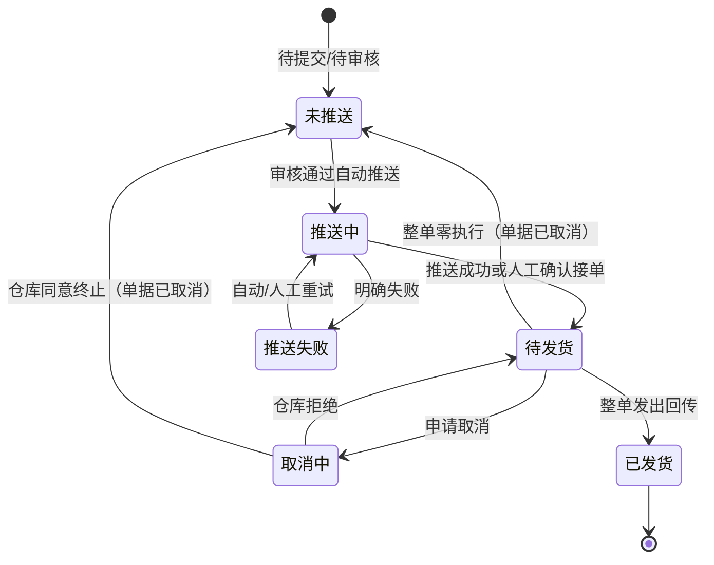

# 独立站订单状态三维（勘误说明）

> **用途**：修正 [《单据与状态流转》§5.1](03-单据与状态流转.md) 原「单一单据状态」口径；以本文为准维护独立站订单状态，直至 §5.1 正文合并修订。
> **确认**：2026-10-15，产品裁定（独立站订单单据状态、仓库执行状态、平台回写状态解耦；推送财务ERP仍在销售出库单）。同日补充：仓库执行状态不含「零执行结束」「不适用」；**整单零执行仅体现为单据已取消**（取消方式=整单零执行取消），仓库执行状态归**未推送**。
> **关联**：[《独立站订单主PRD》](../../20261014-ERP项目第二版迭代/需求文档PRD/3-销售管理/独立站订单/独立站订单主PRD.md) §6、[《独立站订单（详细稿）》](../../20261014-ERP项目第二版迭代/字段清单合集/销售相关/独立站订单/独立站订单（详细稿）.tsv)。

## 1. 三个维度

| 维度 | 字段 | 取值（摘要） | 说明 |
| --- | --- | --- | --- |
| 单据状态 | 单据状态 | 待提交、待审核、已审核、已完结、已取消 | ERP 契约：能否编辑、是否占库、是否终态；**不含**推仓与仓作业 |
| 仓库执行状态 | 仓库执行状态 | 未推送、推送中、推送失败、待发货、取消中、已发货 | 与自营仓作业系统交互；语义对齐通知单推送/执行链；**单据已取消后固定为未推送** |
| 平台回写状态 | 回写状态 | 未回写、已回写、回写失败 | 向 Shopify 回写发货/取消结果；失败不回滚库存与单据 |

**推送财务ERP状态**不在独立站订单上维护；整单发出后由**销售出库单**（及退货链路的销退入库单）承载，规则见 §「推送财务ERP状态独立记录」。

**整单零执行**：仓库回传实发为 0 或人工确认零执行时，单据落**已取消**（取消方式=整单零执行取消），释放占库，不生成出库单；不在仓库执行状态上单独枚举，读单据取消方式与累计实发数量即可。

## 2. 组合示例

| 单据状态 | 仓库执行状态 | 回写状态 | 业务含义 |
| --- | --- | --- | --- |
| 已审核 | 推送中 | 未回写 | 审完占库，系统自动推仓 |
| 已审核 | 推送失败 | 未回写 | 推仓明确失败，可重试/取消审核 |
| 已审核 | 待发货 | 未回写 | 仓已接单，等整单发货回传 |
| 已完结 | 已发货 | 已回写/回写失败 | 履约与出库已认；Shopify 回写可单独失败 |
| 已取消 | 未推送 | 未回写/已回写 | 含取消审核、申请取消、**整单零执行取消**；零执行不单独占仓库枚举 |

原「单一状态」映射：原「已发货」→ 单据**已完结** + 仓库**已发货**；原「推送失败/待发货/取消中」→ 单据多为**已审核** + 对应仓库执行状态。

## 3. 状态—功能矩阵（摘要）

按钮权限 = **单据状态 ∧ 仓库执行状态 ∧ 回写状态（仅重新回写）** 的组合判断；完整矩阵见独立站订单主 PRD §6.4。

- **编辑/提交/删除**：单据=待提交。
- **审核/撤回**：单据=待审核。
- **取消审核**：单据=已审核，仓库∈{未推送、推送中、推送失败}（推送失败须确认仓未接收）。
- **重试推送**：单据=已审核，仓库=推送失败。
- **申请取消**：单据=已审核，仓库=待发货。
- **人工确认·确认接单**：单据=已审核，仓库∈{未推送、推送中、推送失败}。
- **人工确认·执行结束**：单据=已审核，仓库=待发货（整单发出→已完结；整单为 0→已取消，仓库归未推送）。
- **人工确认·取消结果**：单据=已审核，仓库=取消中。
- **复制新单**：单据=已取消。
- **重新回写**：回写状态=回写失败，且单据=已完结或已取消。

## 4. 仓库执行状态流转（独立维护）

单据状态在审核通过时进入**已审核**；整单发出且出库链路完成后进入**已完结**；各类取消（含零执行）进入**已取消**，仓库执行状态同步为**未推送**。
