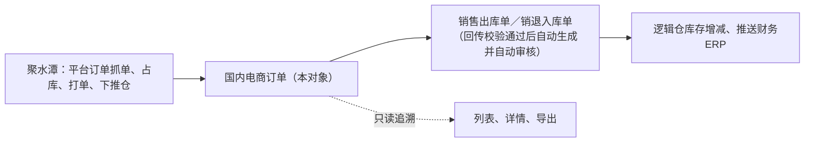
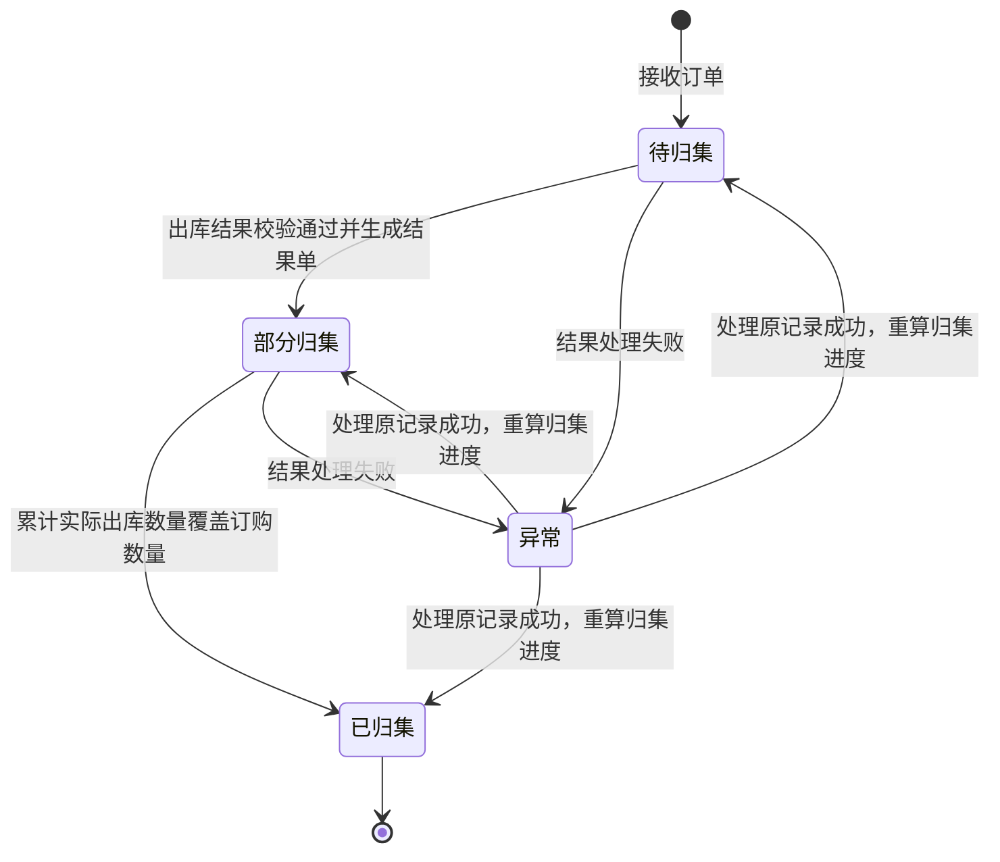

# 国内电商订单主PRD

> 用途：定义国内电商订单在ERP中的接收与编号、来源识别、行与金额快照、履约状态派生、与销售出库单／销退入库单的关联，以及只读边界，作为研发实现和测试验收的依据。
> 定位：应用设计层文档。业务规则以[《销售与履约需求分析》](../../../../../02-需求调研和分析/04-销售与履约/销售与履约需求分析.md)（SAL-FR09、SAL-FR10、SAL-FR11、SAL-FR12）和[《销售与履约业务设计》](../../../../../03-业务分析和设计/02-销售与履约业务设计.md)（§4.6、§5.1～§5.3、§6.5、§七）为准；编号与来源识别以[《6.强盛ERP的编码规则和通用字段规则》](../../../../../01-全局背景信息/6.强盛ERP的编码规则和通用字段规则.md)（§1.2、§1.3）为准；字段与取值以[《国内电商订单（详细稿）》](../../../字段清单合集/销售相关/国内电商订单/国内电商订单（详细稿）.tsv)为准；页面骨架见[《国内电商订单页面骨架》](国内电商订单页面骨架.md)；页面交互以[前端Demo版PRD](前端Demo版PRD/)为准，**须服从本文§6.4状态—功能矩阵**。
> 不写什么：不写聚水潭侧抓单、占库、打单与仓内履约；不写销售出库单／销退入库单的生成、审核、库存记账与推送财务ERP（见销售结果单两篇主PRD，二版重建版）；不写结果处理的匹配、校验、重试与幂等机制（见[《系统集成需求分析》](../../../../../02-需求调研和分析/07-系统集成/系统集成需求分析.md)INT-FR02、INT-FR05）；不写商品外部映射维护（见商品资料）与接口报文、字段映射细节。

| 版本 | 本次变化 | 状态 |
| --- | --- | --- |
| V0.1 | 二版新建对象（B3）：国内电商订单的接收生成、来源识别与去重、行与金额快照、履约状态、结果单关联（分两张）、异常回传记录与只读边界 | 初稿，待评审 |
| V0.2（2026-10-15） | 编码前缀 GNDS 经用户确认固化（Q01 收口为已确认）；编号与来源依据、§2.2 目标句同步；编号格式与示例值不变 | 修订，待评审 |

## 1. 文档信息与阅读边界

| 项目 | 内容 |
| --- | --- |
| 版本 | V0.2（2026-10-15 更新） |
| 日期 | 2026-10-14（初稿）；2026-10-15 更新 |
| 需求类型 | 二版新增对象（B3 订单对象套件；国内电商订单） |
| 读者 | 业务负责人、产品、研发工程师、测试工程师、集成维护方 |
| 文档职责 | 描述本对象的业务目标、边界、功能、状态与异常处理；不重复字段本体、页面结构、系统权限、测试用例和技术实现 |
| 业务依据 | [《销售与履约需求分析》](../../../../../02-需求调研和分析/04-销售与履约/销售与履约需求分析.md) SAL-FR09～SAL-FR12、SAL-AC13、SAL-AC15～SAL-AC21；[《销售与履约业务设计》](../../../../../03-业务分析和设计/02-销售与履约业务设计.md) §3.1、§4.6、§5.1～§5.3、§七 |
| 编号与来源依据 | [《6.强盛ERP的编码规则和通用字段规则》](../../../../../01-全局背景信息/6.强盛ERP的编码规则和通用字段规则.md) §1.2（前缀 GNDS，2026-10-15 用户确认固化）、§1.3（来源系统＋来源单号） |
| 字段依据 | [《国内电商订单（详细稿）》](../../../字段清单合集/销售相关/国内电商订单/国内电商订单（详细稿）.tsv)；字段名称、枚举、必填性与页面展示以TSV为准 |
| 状态依据 | 履约状态由本PRD定义（owner：本PRD）；销售出库单、销退入库单的审核状态与推送财务ERP状态以[《单据与状态流转》](../../../../20260812-ERP项目第一版框架搭建/系统架构和流程/03-单据与状态流转.md)第四节为本PRD之外的owner，本文只引用不重复定义 |
| 页面依据 | [《国内电商订单页面骨架》](国内电商订单页面骨架.md)、[前端Demo版PRD](前端Demo版PRD/)；按钮展示与文案以Demo PRD为准，须服从本文§6.4 |
| 迭代依据 | [《00-二版核心需求与改动任务》](../../../00-二版核心需求与改动任务.md) §2.3、B3；[《01-二版执行计划与Agent分工》](../../../01-二版执行计划与Agent分工.md) 批次1 |

关联资料：[《独立站订单主PRD》](../独立站订单/独立站订单主PRD.md)（并列对象，不合并）、[《销售出库单主PRD》](../销售出库单/销售出库单主PRD.md)（二版重建版，B5）、[《销退入库单主PRD》](../../5-销售退货管理/销退入库单/销退入库单主PRD.md)（二版重建版，B5）、[《系统集成需求分析》](../../../../../02-需求调研和分析/07-系统集成/系统集成需求分析.md) INT-FR02、INT-FR05、[《集成协作与人工补充》](../../../../../03-业务分析和设计/07-集成协作与人工补充.md) §4.5、[《价格管理需求分析》](../../../../../02-需求调研和分析/06-价格管理/价格管理需求分析.md) PRI-FR08、[《4.强盛ERP全局业务规则与约束》](../../../../../01-全局背景信息/4.强盛ERP全局业务规则与约束.md)。

## 2. 需求背景与目标

### 2.1 背景

国内平台店铺（天猫、京东等）的接单、占库、打单、下推仓都由聚水潭完成，仓库实际出库和退货入库的结果也先落在聚水潭。ERP如果只接日汇总销量，就无法说明某一笔平台订单实际出了几件、分几次出、退了几件，也无法把每一张销售出库单、销退入库单与它的来源对应起来。

二版不再用一个统一对象承接平台原始订单，改为按来源分设国内电商订单、跨境电商订单两个对象（《00-二版核心需求与改动任务》§2.3）。国内电商订单承接聚水潭回传的原订单、行与金额快照和履约状态，作为结果单的来源关联与追溯入口；平台单号、渠道单号是该对象上的字段，不再单独设对象。

### 2.2 目标

- 接收聚水潭回传的国内平台订单，在ERP内单独编号（前缀 GNDS，2026-10-15 用户确认固化），保留渠道单号、平台单号、店铺和行与金额快照；
- 按「来源系统＋来源单号」识别同一笔订单，重复回传不重复建单；
- 与销售出库单、销退入库单建立1:N关联，逐笔保留每次实际出库与退货入库结果，不只记汇总销量；
- 用履约状态表达订单的归集进度，并提供异常回传记录的只读查看；
- 订单只作追溯：不提前占库、不触发仓库发货、不下发发货指令、不做库存记账（SAL-FR09；《销售与履约业务设计》§4.6）。

## 3. 单据定位与业务边界

### 3.1 业务作用

| 项目 | 内容 |
| --- | --- |
| 对象层级 | 渠道来源证据与归集对象；不在[《5.强盛ERP的单据分层设计》](../../../../../01-全局背景信息/5.强盛ERP的单据分层设计.md)的业务安排／执行指令／结果单三层中承担执行动作，不生成通知单 |
| 核心职责 | 记录渠道已发生交易的原订单、行与金额快照、履约状态；为销售出库单、销退入库单提供来源关联与追溯入口 |
| 单据来源 | 聚水潭回传，系统自动接收生成；无人工建单、无导入入口 |
| 下游单据 | 销售出库单、销退入库单：由渠道出库／退货入库结果回传、校验通过后自动生成并自动审核（见[《销售出库单主PRD》](../销售出库单/销售出库单主PRD.md)、[《销退入库单主PRD》](../../5-销售退货管理/销退入库单/销退入库单主PRD.md)，均为二版重建版）；结果单侧以「来源国内电商订单」字段关联本订单的ERP单号，本对象只提供来源关联，不参与生成判定 |
| 业务终结 | 只读对象：不提供编辑、取消、关闭、删除；完结结果不跟随来源回改（《销售与履约业务设计》§5.1） |
| 库存影响 | 无。逻辑仓库存只在结果单生效时增减（《00-二版核心需求与改动任务》§四3） |

### 3.2 上下游关系摘要

平台订单在聚水潭侧已经完成履约，ERP收到的是结果证据；订单与结果单之间是一对多的来源关系，ERP不重复驱动仓库，也不向聚水潭下发发货指令。

### 3.3 业务对象关系

| 关系 | 说明 |
| --- | --- |
| 国内电商订单 : 销售出库单 | 1 : N。按来源实际单据逐笔拆分接收，同一订单多次出库保留每条关联（SAL-AC15） |
| 国内电商订单 : 销退入库单 | 1 : N。售后按来源实际单据拆分接收，来源两张就保留两张，不强造同一售后的关联（SAL-AC16） |
| 国内电商订单 : 异常回传记录 | 1 : N。商品或逻辑仓匹配失败、库存不足、重复回传等按结果处理异常记录（SAL-FR12） |
| 国内电商订单 : 客户 | N : 1。取国内渠道对应的通用2C客户，不按消费者逐一建档案（《销售与履约业务设计》§4.7） |

## 4. 核心业务场景

### 4.1 主路径概览

| 步骤 | 参与方 | 动作或单据 | 关键结果 |
| --- | --- | --- | --- |
| 1 | 聚水潭及对应仓库 | 平台订单在渠道侧完成接单、发货、售后 | 渠道侧已发生的订单与实际结果 |
| 2 | 系统 | 接收国内电商订单，按「来源系统＋来源单号」识别并编号 | ERP内生成国内电商订单，保留行与金额快照 |
| 3 | 系统 | 接收销售出库、退货入库结果并校验 | 通过后生成已审核销售出库单／销退入库单并关联本订单；不通过转结果处理异常 |
| 4 | 系统 | 按关联结果单汇总累计实际出库、退货数量 | 刷新订单行的累计数量与履约状态 |
| 5 | 业务人员、数据分析人员 | 在列表、详情查询与追溯 | 只读查看；导出按导出中心 |

### 4.2 场景索引

| 场景ID | 场景 | 类型 | 说明 |
| --- | --- | --- | --- |
| S01 | 订单与首笔出库结果归集 | 主流程 | 接收订单 → 接收出库结果 → 校验通过自动生成已审核销售出库单 → 累计与状态刷新 |
| S02 | 同一平台订单多次出库 | 主流程 | 每次实际出库单独形成结果单并保留关联，不只记汇总销量（SAL-AC15） |
| S03 | 售后拆分两张单 | 支线 | 聚水潭按来源形成两张售后单，ERP也按两张接收，不自行合并、不补造关联（SAL-AC16） |
| S04 | 仅退款 | 支线 | 没有实物流转，不生成供应链单据、不影响库存（SAL-FR09） |
| S05 | 商品或逻辑仓匹配失败、库存不足 | 异常 | 结果单不能生成、不记库存、不推财务ERP；补齐后处理原记录（SAL-AC19、SAL-AC20） |
| S06 | 重复回传或人工重试 | 异常 | 已成功的处理不重复记账、不重复形成财务ERP单据，也不重新触发渠道履约（SAL-AC21） |

## 5. 范围与功能索引

### 5.1 范围

| 类别 | 说明 |
| --- | --- |
| 本期要做 | 接收国内电商订单并单独编号；来源识别与重复回传去重；订单基础信息、行与金额快照、履约状态展示；关联销售出库单／销退入库单查看与跳转；异常回传记录只读查看；导出按导出中心 |
| 本期暂不做 | ERP侧建单、导入、编辑、删除、取消、关闭；订单侧占库、下推仓、发货指令下发；结果处理的重试与修复入口（在系统集成中心与基础资料办理）；商品外部映射维护页面；平台账单、收退款与结算对账；FBA只读报表入口（本对象不涉及） |
| 本对象不负责 | 平台订单抓单、占库、打单与仓内履约（聚水潭）；销售出库单／销退入库单的生成、审核、库存记账与推送财务ERP（结果单与集成规则负责）；财务ERP字段对照（财务联调给出） |

列表筛选、按钮位置与批量栏布局引用Demo PRD及本项目UI规范；本对象不增加业务动作，边界以本节与§7.1为准。

### 5.2 功能与追溯索引

| 功能编号与名称 | 本次内容 | 上游依据 | 规则与状态依据 | Demo PRD | 验收编号 |
| --- | --- | --- | --- | --- | --- |
| F01 国内电商订单列表 | 按单号、渠道单号、平台单号、店铺、平台、履约状态、下单时间、商品编码与平台商品编码查询；只读列表；导出 | SAL-FR09；§2.3 | R01、R03、R04；§6.4 | [列表页](前端Demo版PRD/国内电商订单前端Demo版PRD_列表页.md) | AC01、AC07 |
| F02 订单详情 | 展示订单基础信息、行与金额快照、履约状态；整单只读 | SAL-FR09、SAL-FR10 | R02、R05、R08；§6 | [详情页](前端Demo版PRD/国内电商订单前端Demo版PRD_详情页.md) | AC02、AC03、AC04 |
| F03 关联结果单查看与跳转 | 销售出库单、销退入库单两个胶囊Tab；单号可跳转对应结果单详情 | SAL-FR09、SAL-AC15 | R05、R06；§6.4 | [详情页](前端Demo版PRD/国内电商订单前端Demo版PRD_详情页.md) | AC05 |
| F04 异常回传记录查看 | 只读展示与本订单相关的异常回传记录；不提供重试与修复入口 | SAL-FR12；INT-FR05 | R10；§6.4 | [详情页](前端Demo版PRD/国内电商订单前端Demo版PRD_详情页.md) | AC06 |
| F05 导出 | 按导出中心创建异步任务；范围全部／当前筛选／已勾选；导出列与列表列一致 | 《4.强盛ERP全局业务规则与约束》§五 | R11 | [列表页](前端Demo版PRD/国内电商订单前端Demo版PRD_列表页.md) | AC07 |

## 6. 状态与操作

### 6.1 状态维度

| 维度 | 取值 | 说明 |
| --- | --- | --- |
| 履约状态 | 待归集、部分归集、已归集、异常 | 本对象唯一的状态维度，由关联结果单的系统汇总派生，只读展示 |
| 审核状态、推送财务ERP状态 | 见[《单据与状态流转》](../../../../20260812-ERP项目第一版框架搭建/系统架构和流程/03-单据与状态流转.md)第四节 | 属于销售出库单、销退入库单，不在本对象重复定义，也不在订单上汇总展示 |

订单不参与审核流程：系统接收即生成，没有草稿、待审核与已审核状态；不设关闭、取消状态，履约进度不完结也不影响订单数据的保留。

### 6.2 状态取值说明

| 状态 | 含义 | 是否终态 |
| --- | --- | --- |
| 待归集 | 已接收订单，尚未收到该订单的任何实际结果回传 | 否 |
| 部分归集 | 已收到实际结果并处理，订单行的累计实际出库数量尚未覆盖订购数量 | 否 |
| 已归集 | 订单行的累计实际出库数量已覆盖订购数量；此后仍可能有退货入库结果关联，归集进度不再变化 | 是（归集进度） |
| 异常 | 存在未处理的结果处理异常（商品或逻辑仓匹配失败、库存不足、重复回传等）；异常不改变已归集进度 | 否 |

### 6.3 状态流转图

### 6.4 状态—功能矩阵

> ✅ = 允许；❌ = 不允许；✅（条件）= 允许但须满足前置条件。本对象不提供业务动作，矩阵只说明查看类功能不受履约状态限制。

| 功能编号 / 动作 | 待归集 | 部分归集 | 已归集 | 异常 |
| --- | --- | --- | --- | --- |
| F01 列表查询、F05 导出 | ✅ | ✅ | ✅ | ✅ |
| F02 详情查看 | ✅ | ✅ | ✅ | ✅ |
| F03 关联结果单查看与跳转 | ✅ | ✅ | ✅ | ✅（记录已存在的关联结果单） |
| F04 异常回传记录查看 | ✅（空态） | ✅ | ✅ | ✅ |
| 建单／编辑／删除／导入／取消／关闭 | ❌ | ❌ | ❌ | ❌ |

### 6.5 状态流转表

| 当前状态 | 触发 | 前置条件 | 结果状态 | 二次确认 | 后置影响 | 失败处理 |
| --- | --- | --- | --- | --- | --- | --- |
| 待归集 | 接收出库结果并生成已审核销售出库单 | 商品、逻辑仓、库存校验通过 | 部分归集 | 无 | 结果单关联本订单，行累计实际出库数量增加 | 校验不通过不生成结果单，状态置为异常，进入结果处理 |
| 部分归集 | 累计实际出库数量覆盖订购数量（全部订单行） | 同上 | 已归集 | 无 | 归集进度不再变化；退货入库结果仍可继续关联 | 同上 |
| 异常 | 处理原记录成功 | 阻塞原因已解决（补齐映射、库存差异已核实等） | 按累计进度重算为待归集／部分归集／已归集 | 无 | 不另造业务、不重复履约、不重复记账（SAL-FR12） | 仍未通过则保持异常 |

## 7. 核心业务规则

### 7.1 接收与只读边界

| 规则编号 | 主题 | 规则 | 边界或例外 |
| --- | --- | --- | --- |
| R01 | 接收与生成 | 聚水潭回传国内平台订单时，系统自动接收并在ERP内生成一张国内电商订单；订单没有草稿态，创建生成时分配单号（《6.强盛ERP的编码规则和通用字段规则》§1.1） | 只接收渠道已发生的订单；ERP不拉单、不抓单 |
| R02 | 只读与动作边界 | 不提供新增、导入、编辑、删除、取消、关闭；订单不占库、不下推仓、不生成通知单、不下发发货指令；库存只在结果单生效时增减 | 需要更正渠道数据时，由渠道侧处理后按新回传处理，不在ERP改单（SAL-FR12：完结结果不跟随来源回改） |
| R03 | 来源识别 | 按「来源系统＋来源单号」识别订单：来源系统＝聚水潭，来源单号＝渠道单号；平台单号作为普通外部标识保存 | 来源系统＋来源单号也是结果回传的识别基础（§1.3） |

### 7.2 去重与重复回传

| 规则编号 | 主题 | 规则 | 边界或例外 |
| --- | --- | --- | --- |
| R04 | 重复回传不重复建单 | 同一「来源系统＋来源单号」重复回传订单时，只更新可刷新内容，不重复新建订单；结果回传去重在此基础上加执行标识，区分同一来源单的多次执行 | 去重与幂等口径见INT-FR02；同一订单的多次执行要分别保留（SAL-AC15） |
| R05 | 重复回传不重复记账 | 已成功处理的结果重复回传时，不重复记账、不重复形成财务ERP单据、不再次触发渠道履约 | 由结果单与集成规则执行，本对象不重复处理；已完结结果不覆盖（SAL-AC21） |

### 7.3 归集与状态派生

| 规则编号 | 主题 | 规则 | 边界或例外 |
| --- | --- | --- | --- |
| R06 | 结果单关联 | 销售出库单、销退入库单生成后按订单的ERP单号关联到本订单（分两张，不采用「来源电商订单＋渠道类型」的合并写法）；结果单侧分别为「来源国内电商订单」「来源跨境电商订单」两个互斥字段；同一订单的每次结果都单独保留 | 结果单的生成、审核、库存与财务见[《销售出库单主PRD》](../销售出库单/销售出库单主PRD.md)、[《销退入库单主PRD》](../../5-销售退货管理/销退入库单/销退入库单主PRD.md)（二版重建版，B5） |
| R07 | 累计数量与履约状态 | 订单行展示累计实际出库数量、累计实际退回数量，按已关联结果单汇总；履约状态按§6.2、§6.5派生 | 判定口径（订购数量覆盖、退货是否影响、渠道完结标识是否参与）见§10.2 Q02 |
| R08 | 汇总展示不重算金额 | 行与单头金额沿用渠道来源，ERP不按销售价目表重新取价或重算；累计数量用于追溯，不参与重新定价 | 缺必要金额按异常处理，不自行补价（SAL-FR10、PRI-FR08） |

### 7.4 展示与快照

| 规则编号 | 主题 | 规则 | 边界或例外 |
| --- | --- | --- | --- |
| R09 | 订单行的商品展示 | 平台商品编码原样保留渠道回传值；商品编码、商品名称、基本单位为匹配到的ERP商品资料，按Code-Name规则关联展示，不保存名称快照 | 本对象是只读来源证据，匹配可在异常恢复后补齐；若接口后续提供稳定的商品名称快照，随接口设计再评估 |

### 7.5 异常与只读展示

| 规则编号 | 主题 | 规则 | 边界或例外 |
| --- | --- | --- | --- |
| R10 | 异常回传记录 | 商品或逻辑仓匹配失败、库存不足、重复回传等结果处理异常，按本订单记录只读展示：异常环节、失败时间、失败原因、处理状态、关联结果单；集中查看与处理记录在系统集成中心-推送异常-结果处理页签 | ERP不在此页提供重试、修复或改单入口；匹配失败在基础资料补映射后处理原记录，推送失败不回滚已生效业务（INT-FR02、INT-FR05、SAL-FR12） |
| R11 | 导出 | 导出按导出中心，范围可选全部／当前筛选／已勾选；导出列与列表列一致；空值不写入 `-` | 《4.强盛ERP全局业务规则与约束》§五 |

## 8. 上下游影响与协同

| 关联模块/系统 | 需要配合的变化 | 交接内容与时机 | 验收结果 |
| --- | --- | --- | --- |
| 聚水潭（渠道SaaS） | 回传国内平台订单与各次实际结果 | 订单、出库结果、退货入库结果；接口字段待联调核验 | AC02、AC03、AC05 |
| 销售结果单（销售出库单、销退入库单） | 生成后按订单ERP单号关联本订单；本对象提供追溯入口 | 结果单生效时回写累计数量与履约状态 | AC04、AC05 |
| 库存与仓储 | 结果单生效时增减对应逻辑仓库存；订单不参与 | 只引用，不在本对象记账 | AC08 |
| 系统集成中心 | 结果处理异常集中展示与处理记录 | 异常回传记录的展示口径 | AC06 |
| 商品与主数据 | 商品编码、名称、基本单位、通用2C客户、币别 | 匹配通过后按资料展示 | AC02 |
| 价格管理 | 确认金额沿用渠道来源、不取ERP价目表 | 沿用SAL-FR10、PRI-FR08，不新增取价维度 | AC03 |
| 导出中心 | 提供异步导出任务与下载 | 导出范围全部／当前筛选／已勾选 | AC07 |

## 9. 异常与一致性

### 9.1 并发操作

| 场景 | 业务处理结果 |
| --- | --- |
| 同一订单的出库结果与退货入库结果同时到达 | 分别按各自业务校验处理，各自生成／不生成结果单；累计数量按已成功处理的结果汇总，互不覆盖 |
| 同一来源单的多次执行回传同时到达 | 按执行标识分别处理，不合并、不互相覆盖（SAL-AC15） |

### 9.2 幂等与重复处理

| 操作 | 幂等规则 |
| --- | --- |
| 重复回传订单 | 按「来源系统＋来源单号」识别，不重复建单（R04） |
| 重复回传结果 | 按「来源系统＋来源单号＋执行标识」识别；已成功处理的不重复记账、不重复推财务ERP、不重新触发渠道履约（R05、SAL-AC21） |

### 9.3 与结果单一致性

| 场景 | 处理方式 |
| --- | --- |
| 结果单已完结后来源要求更新 | 原结果与订单关联关系不改，订单不跟随来源回改；后续来源形成新单按其业务含义单独处理（SAL-FR12） |
| 结果单推送财务ERP失败 | 不回滚库存与已生效业务，修复后在系统集成中心沿用原单重推；订单展示不受影响（INT-FR03/INT-FR05） |

## 10. 验收标准与待确认事项

### 10.1 验收标准

| 编号 | 对应功能/规则 | 条件与操作 | 预期结果 |
| --- | --- | --- | --- |
| AC01 | F01/R01、R03 | 聚水潭回传一笔平台订单；再按订单编号、渠道单号、平台单号、店铺、履约状态与商品编码查询 | 列表出现该订单，按来源识别生成ERP单号；各查询条件按AND匹配、状态多选按OR匹配；商品编码命中订单行时返回该订单行所在记录 |
| AC02 | F02/R01、R09 | 打开订单详情 | 展示订单基础信息、行与金额快照；平台商品编码原样保留，商品编码／名称／基本单位按匹配后的ERP资料展示；未匹配的行为 `-` |
| AC03 | F02/R08 | 查看行与单头金额；另测试来源缺少必要金额 | 金额沿用渠道来源的成交优惠后金额与退货金额，不按ERP价目表重算；缺金额按异常处理，不自行补价（SAL-AC17） |
| AC04 | §6/F02 | 订单先收到一笔出库结果，再收到覆盖订购数量的出库结果 | 履约状态由待归集变为部分归集，再变为已归集；行累计实际出库数量同步刷新 |
| AC05 | F03/R06 | 同一订单形成两次实际出库，另有一张退货入库结果 | 销售出库单Tab保留两条关联、销退入库单Tab保留一条；单号可跳转对应结果单详情（SAL-AC15、SAL-AC16） |
| AC06 | F04/R10 | 模拟商品匹配失败与库存不足；再模拟重复回传 | 异常回传记录只读展示异常环节、失败时间、失败原因与处理状态；不提供重试与修复入口；重复回传不产生新的订单或结果关联（SAL-AC19～SAL-AC21） |
| AC07 | F01/R02、R11 | 查看页头与行内；再执行导出 | 无新增、导入、编辑、删除入口，无占库、下推仓、发货指令类动作；导出按导出中心创建异步任务，导出列与列表列一致 |
| AC08 | R02 | 查看订单前后的库存与结果单 | 订单生成与状态变化都不改变逻辑仓库存；库存只在结果单生效时增减（SAL-AC13；《销售与履约业务设计》§4.6） |

### 10.2 待确认事项

| 编号 | 问题 | 影响范围 | 确认人 | 最迟确认阶段或时间 | 状态/结论 |
| --- | --- | --- | --- | --- | --- |
| Q01 | 国内电商订单的编码前缀 GNDS 与编号样例 | 单号生成、页面示例值、导出 | 业务负责人 | — | **已确认**（2026-10-15）：编码前缀 GNDS 固化（用户确认）；编号按《6.强盛ERP的编码规则和通用字段规则》§1.2 生成 |
| Q02 | 履约状态的精确判定口径：订购数量覆盖的判定是否含退货、是否以渠道「订单完结」标识为准 | 列表与详情状态展示、按状态筛选 | 业务负责人、集成维护方 | 接口设计前（SAL-FR12、§七「来源与结果关联」） | 待确认；本文按§6.2口径先行设计，接口核验后同步 |
| Q03 | 平台枚举的完整取值与其他平台的兜底方式 | 平台字段枚举、筛选选项 | 业务负责人 | 联调核验前（SAL-FR11） | 待确认；本文列天猫、京东、淘宝、拼多多、其他 |
| Q04 | 渠道是否提供订单级金额合计、币别与税率明细；只提供行级金额时单头合计的展示口径 | 单头与行金额展示、导出 | 集成维护方 | 接口设计前 | 待确认；本文按「来源单头金额优先、与行合计的差异随接口核验」设计 |
| Q05 | 国内渠道通用2C客户的具体档案与一期启用币别 | 客户、币别字段取值 | 主数据维护方 | 初始化确认时 | 待确认；本文按SAL-FR09的通用2C客户口径引用 |
| Q06 | 异常回传记录的展示列与推送异常页签字段是否完全一致（含执行标识展示） | 详情异常回传记录分区 | 集成维护方 | B2结果处理规则与推送异常修订时 | 待确认；本文按INT-FR02、INT-FR05口径展示 |

## 11. 上线准备

| 阶段 | 准备事项 | 负责方 | 前置依赖 | 完成标准 |
| --- | --- | --- | --- | --- |
| 上线前 | 配置聚水潭接口与映射（商品外部映射按平台＋店铺、仓库映射与货主标识随实体仓） | 集成维护方、主数据维护方 | 商品、实体仓档案就绪 | 回传结果能匹配到ERP商品与逻辑仓 |
| 上线前 | 确认通用2C客户与启用币别 | 主数据维护方 | 客户、辅助资料就绪 | 订单客户、币别字段有可用取值 |
| 上线前 | 明确异常处理责任人与入口 | 集成维护方 | 系统集成中心可用 | 结果处理异常有人跟进，修复后处理原记录 |
