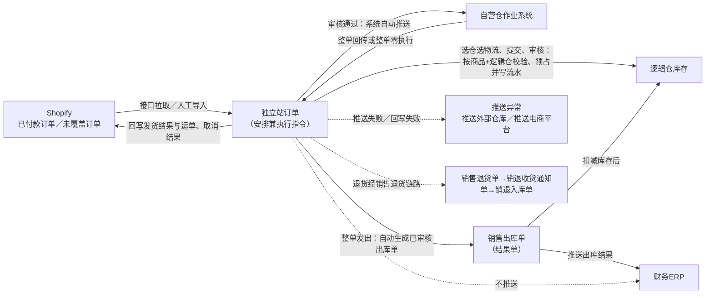
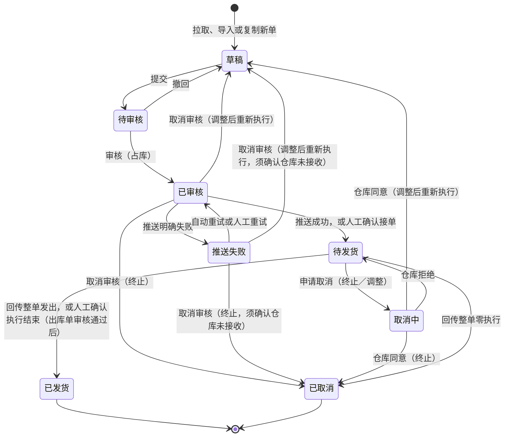

# 独立站订单主PRD

> 用途：定义Shopify独立站订单在ERP中的拉取与人工导入、选仓选物流、审核占库、自动推仓、整单履约与零执行、取消审核与再发复制新单、退货衔接及人工确认（B7边界）等系统行为，作为研发实现和测试验收的依据。
> 定位：应用设计层文档。业务规则以[《销售与履约需求分析》](../../../../../02-需求调研和分析/04-销售与履约/销售与履约需求分析.md) SAL-FR07、SAL-FR08（关联SAL-FR09、SAL-FR12）和[《销售与履约业务设计》](../../../../../03-业务分析和设计/02-销售与履约业务设计.md) §4.5、§6.3为准；状态与操作以[《单据与状态流转》](../../../../20260812-ERP项目第一版框架搭建/系统架构和流程/03-单据与状态流转.md) §5.1为准；字段与取值以[《独立站订单（详细稿）》](../../../字段清单合集/销售相关/独立站订单/独立站订单（详细稿）.tsv)为准；页面骨架见[《独立站订单页面骨架》](独立站订单页面骨架.md)；页面交互以[前端Demo版PRD](前端Demo版PRD/独立站订单前端Demo版PRD_列表页.md)为准，**须服从本文 §6.4 状态—功能矩阵**。
> 不写什么：不重复需求论证；不写销售出库单、销退入库单内部流程（含人工确认形成出库单后的提交审核链，按二版B5重建的销售结果单文档执行）；不写国内/跨境电商订单归集；不写财务ERP接口报文、退款结算和系统权限实现。
> 二版说明：本对象为一版未交付内容，二版新建（任务B3，2026-10-14）。对象名与菜单沿用一版「独立站订单」，与国内/跨境电商订单并列、不合并；编号与B2B销售订单共用前缀XSDD（[《6.强盛ERP的编码规则和通用字段规则》](../../../../../01-全局背景信息/6.强盛ERP的编码规则和通用字段规则.md) §1.3）。

| 版本 | 本次变化 | 状态 |
| --- | --- | --- |
| V0.1 | 初稿：按一版已确认行为建立独立站订单主PRD（拉取/导入、选仓选物流、审核占库、自动推仓、整单零执行与再发、取消审核、退货衔接）；增补人工确认条款（B7边界）与销售出库单/销退入库单、推送异常页签的衔接 | 初稿，待评审 |

## 1. 文档信息与阅读边界

| 项目 | 内容 |
| --- | --- |
| 读者 | 研发工程师、测试工程师、产品复核 |
| 业务依据 | [《销售与履约需求分析》](../../../../../02-需求调研和分析/04-销售与履约/销售与履约需求分析.md) SAL-FR07、SAL-FR08、SAL-AC10～AC12、SAL-AC26～AC28；[《销售与履约业务设计》](../../../../../03-业务分析和设计/02-销售与履约业务设计.md) §4.5、§6.3；[《集成协作与人工补充》](../../../../../03-业务分析和设计/07-集成协作与人工补充.md) §4.4；[《系统集成需求分析》](../../../../../02-需求调研和分析/07-系统集成/系统集成需求分析.md) INT-FR02、INT-FR05、INT-FR06 |
| 字段依据 | [《独立站订单（详细稿）》](../../../字段清单合集/销售相关/独立站订单/独立站订单（详细稿）.tsv)；字段名称、枚举、必填性、页面展示以TSV为准 |
| 状态依据 | [《单据与状态流转》§5.1](../../../../20260812-ERP项目第一版框架搭建/系统架构和流程/03-单据与状态流转.md)（状态owner为外部文档；二版B1四篇按引用处理，不改变独立站订单状态定义） |
| 页面依据 | [《独立站订单页面骨架》](独立站订单页面骨架.md)、[前端Demo版PRD](前端Demo版PRD/独立站订单前端Demo版PRD_列表页.md)（含详情页、弹窗与Mock） |

关联资料：[《价格管理需求分析》](../../../../../02-需求调研和分析/06-价格管理/价格管理需求分析.md) PRI-FR08、[《销售出库单主PRD》（二版B5重建）](../销售出库单/销售出库单主PRD.md)、[《推送异常主PRD》](../../../../20260812-ERP项目第一版框架搭建/需求文档PRD/8-系统集成/推送异常/推送异常主PRD.md) §4.4～§4.5、[《独立站订单（详细稿）》](../../../字段清单合集/销售相关/独立站订单/独立站订单（详细稿）.tsv)。

## 2. 需求背景与目标

### 2.1 背景

Shopify独立站由强盛自己经营，消费者在独立站下单并完成付款后，ERP需要拉取已付款订单、占用库存并推动仓库整单发货，再把发货结果和运单号回写Shopify。独立站与B2B、国内/跨境电商的ERP角色不同：国内/跨境电商的履约在渠道方完成，ERP只归集结果；独立站和B2B由ERP审核占库、安排仓库执行，其中独立站订单本身既是成交约定又是执行指令，不再生成销售发货通知单。

没有统一的独立站订单时，拉单、选仓、占库、仓库执行与回写各环节脱节，消费者取消、仓库发不出、换仓换物流等情形缺少可追溯的处理依据。

### 2.2 目标

- 承接Shopify已付款订单：拉取入ERP、必要时人工导入未覆盖订单，商品、数量、金额与收货信息随单固化，ERP不能改金额；
- 业务人员人工选仓、选物流并提交审核；审核时校验可用库存并占库，审核通过由系统自动推送仓库，不设人工推送；
- 一单一仓、整单履约：整单发出形成销售出库结果，整单零执行时按零出取消并保留占库释放与确认记录；再发从原单复制新单，原单保持已取消；
- 取消审核区分终止与调整后重新执行：未推送直接办理，已推送先取得仓库取消成功；调整重执行保留原执行与回执记录，重审算一次新的仓库执行；
- 发货结果与运单、取消结果回写Shopify；回写失败在推送异常「推送电商平台」页签可查，原单提供重新回写入口；
- 接口拿不到接单、执行结束或取消结果时，支持在详情页人工确认（B7边界），确认仍过业务校验与适用审核并留痕。

## 3. 单据定位与业务边界

### 3.1 业务作用

| 项目 | 内容 |
| --- | --- |
| 单据层级 | 第1层业务安排兼第2层执行指令（依据[《5.强盛ERP的单据分层设计》](../../../../../01-全局背景信息/5.强盛ERP的单据分层设计.md)；独立站一单一仓、整单履约，订单直接承担执行指令，不再生成销售发货通知单） |
| 核心职责 | 记录Shopify已付款订单的消费者收货信息、商品、数量、金额与本次发货安排（仓库、物流），控制审核占库、仓库执行与回写 |
| 单据来源 | 自研接口拉取或人工导入；再发场景从已取消原单复制生成 |
| 下游单据 | 销售出库单（整单回传或人工确认执行结束后形成）；退货走销售退货链路（销售退货单→销退收货通知单→销退入库单） |
| 数量关系 | 一单一仓、整单履约：实际发货数量等于订购数量或整单为0；不支持拆单、分批、缺量 |
| 业务终结 | 已发货、已取消为终态；取消不可撤销；零执行取消后可在原单上复制新单，不复活原单 |

### 3.2 上下游关系摘要

> 完整流程见[《01-系统流程与单据交互》](../../../../20260812-ERP项目第一版框架搭建/系统架构和流程/01-系统流程与单据交互.md)；二版B1增量同步；本文只保留订单侧交接点。

### 3.3 业务对象关系

| 关系 | 说明 |
| --- | --- |
| 独立站订单 : 客户 | N:1；统一使用跨境电商2C通用客户，不按消费者建档案 |
| 独立站订单 : 发货逻辑仓 | N:1；一张订单一个发货仓库，一单一仓 |
| 独立站订单 : 物流服务产品 | N:1；选具体产品或「由仓库指定」 |
| 独立站订单 : 商品明细 | 1:N |
| 独立站订单 : 销售出库单 | 1:0..1；整单发出形成一张，整单零执行不生成 |
| 独立站订单 : 销退入库单 | 经销售退货链路间接关联（溯源退货可选关联本单的出库单），详情页可跳转查看 |
| 独立站订单 : 人工确认记录 | 1:N；按「最近一次」字段展示，逐条保留在操作日志 |
| Shopify来源单号 : 独立站订单 | 1:N；原单变更已审核时新建、零执行取消后复制新单，均可对应同一来源单号的多张ERP单据 |

### 3.4 本单据不负责的事项

- 不直接扣减即时库存；库存变化由已审核销售出库单触发（依据《单据与状态流转》§九）；
- 不执行退款、不处理仅退款；退货走销售退货链路，资金由财务线下处理；
- 不向财务ERP推送本单，只推已审核销售出库单、销退入库单（SAL-FR10）；
- 不承担销售退货单、销退收货通知单、销退入库单内部流程；人工确认形成出库单后的提交、审核、记账、推财务按销售结果单文档执行；
- 不做自动选仓、自动选物流、自动审核的完整自动履约链路（SAL-FR07：后续方向）；
- 不提供虚拟出库处理方式（本期不增加）。

## 4. 核心业务场景

### 4.1 主路径概览

| 步骤 | 参与方 | 动作或单据 | 关键结果 |
| --- | --- | --- | --- |
| 1 | 系统／独立站业务人员 | 自研接口拉取已付款订单；未覆盖订单人工导入 | 生成独立站订单草稿（页面展示「待提交」），金额、商品、地址随来源固化 |
| 2 | 独立站业务人员 | 勾选订单批量选仓选物流，或逐单编辑；提交 | 待审核，具备执行方式 |
| 3 | 独立站业务人员 | 审核 | 按商品＋发货逻辑仓校验并占用库存；审核通过后系统自动推送仓库 |
| 4 | 系统 | 推送成功 | 待发货；推送明确失败转推送失败，自动重试最多3次并可人工重试 |
| 5 | 仓库 | 整单发货或整单零执行，回传结果 | 整单发出：生成已审核销售出库单→已发货→回写Shopify；零执行：按零出取消→已取消 |
| 6 | 系统／业务人员 | 回写Shopify、异常处理 | 回写失败进推送异常「推送电商平台」；零执行取消后复制新单或等消费者取消 |

### 4.2 场景索引

| 场景ID | 场景 | 类型 | 说明 |
| --- | --- | --- | --- |
| S01 | 拉取已付款订单 | 主流程 | 仅已付款进入；金额、商品、数量、地址随来源带出；重复拉取不重复建单（R01～R03） |
| S02 | 人工导入未覆盖订单 | 支线 | 接口未覆盖订单从Shopify导入ERP，校验后生成草稿，仍走提交审核（R05） |
| S03 | 选仓选物流并提交 | 主流程 | 草稿→（批量/单张选仓选物流）→提交→待审核（R08、R10） |
| S04 | 审核占库并自动推送 | 主流程 | 按商品＋逻辑仓校验占库；审核通过自动推送，不需要人工推送（R12、R13） |
| S05 | 库存不足审核失败 | 异常 | 整单审核失败，不占库；补货或换仓后重审（R12） |
| S06 | 整单发货回传 | 主流程 | 整单回传→已审核销售出库单→已发货→回写Shopify（R15） |
| S07 | 换仓换物流（未推送） | 支线 | 取消审核（调整后重新执行）→草稿→修改→重审；原执行记录与回执保留（R19） |
| S08 | 换仓换物流（已推送） | 支线 | 申请取消→取消中→仓库同意→草稿；拒绝→恢复待发货；迟到回传不推进新执行（R19、R20） |
| S09 | 终止订单 | 支线 | 未推送：取消审核（终止）；已推送：申请取消并等仓库同意；均释放占库（R19、R20） |
| S10 | 整单零执行 | 支线 | 回传实发为0→按零出取消订单并释放占库；不生成零数量出库单；保留最终回传与确认记录（R16） |
| S11 | 再发复制新单 | 支线 | 已取消订单复制新单，同一Shopify来源单号、新ERP单号；原单保持已取消（R17） |
| S12 | 消费者取消请求 | 支线 | 未推送自动尝试直接取消；已推送先申请取消，不得提前向Shopify认定成功；拒绝恢复继续（R21） |
| S13 | 来源原单变更 | 支线 | 未审核覆盖商品、数量、地址、金额；已审核未完结新建单并仍挂同一Shopify单号（R04） |
| S14 | 推送失败与重试 | 异常 | 明确失败→推送失败；自动重试最多3次；人工重试；取消须确认仓库未接收（R13、R19） |
| S15 | 人工确认（B7） | 支线 | 接口拿不到接单、执行结束或取消结果时按实际确认；过业务校验与适用审核、留痕（R23） |
| S16 | 退货接入 | 支线 | 退货走销售退货链路；仅退款不增加库存；本单详情可跳转销退入库单（§8） |
| S17 | 回写失败与重新回写 | 异常 | 回写Shopify失败→推送异常「推送电商平台」→本单重新回写（R18） |

## 5. 范围与功能索引

### 5.1 范围

| 类别 | 说明 |
| --- | --- |
| 本期要做 | 拉取已付款订单与来源变更处理；未覆盖订单人工导入；选仓选物流（含批量）与提交、撤回、删除草稿；审核占库与自动推送（Mock/待联调）；推送失败自动重试与人工重试；取消审核（终止／调整重执行）、申请取消与仓库回执；整单零执行、再发复制新单；发货结果回传与回写Shopify、重新回写；人工确认；与销售出库单／销退入库单、推送异常页签衔接 |
| 本期暂不做 | 自动选仓、自动选物流、自动审核的完整自动履约；拆单、分批、缺量发货；ERP执行退款；退货回写等扩展回写内容（接口确认后再加）；无原单结果页面补录；多店铺/多站点识别（随接口设计与商品资料PRD） |
| 本单据不负责 | 退款与资金处理（财务线下）；销售退货单及后续收货、入库流程；库存台账（已审核结果单）；接口报文、字段映射与幂等实现（接口设计）；系统权限矩阵 |

### 5.2 功能与追溯索引

| 功能编号与名称 | 本次内容 | 上游依据 | 规则与状态依据 | Demo PRD | 验收编号 |
| --- | --- | --- | --- | --- | --- |
| F01 列表 | 查询、列展示、状态筛选、批量选仓选物流、行操作入口、导出 | SAL-FR07 | §6.4；R03～R10 | [列表页](前端Demo版PRD/独立站订单前端Demo版PRD_列表页.md) | AC01～AC03、AC09、AC14 |
| F02 拉取入单与来源变更 | 拉取已付款订单；去重；未审核覆盖、已审核新建 | SAL-FR07、SAL-AC27 | R02～R04 | 弹窗 PRD §5（Mock） | AC01、AC09 |
| F03 人工导入 | 接口未覆盖订单从Shopify导入；校验后生成草稿 | INT-FR06 | R05 | 弹窗 PRD §5 | AC10 |
| F04 选仓选物流 | 单张编辑与批量设置发货仓库、物流服务产品 | SAL-FR07 | R08 | 弹窗 PRD §2 | AC02 |
| F05 提交与撤回 | 提交校验；撤回留意见回草稿；删除草稿 | SAL-FR07 | R10、R11、R22 | 弹窗 PRD §2、§3 | AC02、AC15 |
| F06 审核占库 | 按商品＋发货逻辑仓校验、预占并写流水；审核通过自动推送 | SAL-FR07、SAL-AC10 | R12、R13 | 弹窗 PRD §3 | AC03 |
| F07 推送失败与重试 | 明确失败转推送失败；自动重试最多3次；人工重试 | SAL-FR07 | R13 | 弹窗 PRD §3 | AC11 |
| F08 取消审核与申请取消 | 终止／调整重执行；已推送先取得仓库取消成功；释放占库 | SAL-FR08、SAL-AC11 | R19～R21 | 弹窗 PRD §3 | AC04～AC06 |
| F09 详情与追溯 | 分区展示、关联单据（销售出库单／销退入库单）、推送异常衔接、操作日志 | SAL-FR07、SAL-FR08 | §6.4；R18 | [详情页](前端Demo版PRD/独立站订单前端Demo版PRD_详情页.md) | AC16 |
| F10 整单零执行与复制新单 | 零执行按零出取消；已取消复制新单仍挂同一Shopify来源单号 | SAL-FR07、SAL-AC26 | R16、R17 | 弹窗 PRD §3、§5 | AC07、AC08 |
| F11 人工确认（B7） | 确认接单／执行结束／取消结果；过业务校验与适用审核；留痕 | INT-FR06、03/07 §4.4 | R23 | 弹窗 PRD §4 | AC12 |
| F12 回写与重新回写 | 回写发货结果与运单、取消结果；失败进推送异常并重新回写 | SAL-FR07、INT-FR05 | R18 | 弹窗 PRD §5 | AC13 |
| F13 Demo Mock | 仓库回传、回写结果与人工确认以Mock演示，非业务规则 | 演示需要 | — | 弹窗 PRD §5 | AC17 |

## 6. 状态与操作

状态定义owner：[《单据与状态流转》§5.1](../../../../20260812-ERP项目第一版框架搭建/系统架构和流程/03-单据与状态流转.md)。独立站订单为**单一单据状态字段**，串起审核、推送与执行；不设独立的审核状态、业务状态、发货状态。已审核含未推送与推送中；取消、删除不可撤销。

### 6.1 状态维度

| 维度 | 取值 | 说明 |
| --- | --- | --- |
| 单据状态 | 草稿、待审核、已审核、推送失败、待发货、取消中、已发货、已取消 | 控制编辑、提交、审核、推送、取消与人工确认；单一字段 |

「草稿」在页面展示为「待提交」（SAL-FR08）：拉取、人工导入、撤回或取消审核（调整后重新执行）后回到该状态，可编辑仓库、物流并继续提交。计算量（总订购数量、累计实际发货数量、差额数量）不参与流转。

### 6.2 状态取值说明

| 状态 | 含义 | 是否终态 |
| --- | --- | --- |
| 草稿（待提交） | 拉取／导入／撤回／调整重执行后的初始态，尚未提交审核 | 否 |
| 待审核 | 已提交，等待审核 | 否 |
| 已审核 | 审核通过、已占库；含未推送与推送中（系统自动推送，不需要人工推送） | 否 |
| 推送失败 | 推送仓库明确失败，等待自动重试或人工处理 | 否 |
| 待发货 | 仓库已接收执行要求，等待整单发货结果；整单不发时占库继续保留 | 否 |
| 取消中 | 已申请取消，等待仓库回执 | 否 |
| 已发货 | 整单发出并形成出库结果，已回写或待回写Shopify | 是 |
| 已取消 | 整单终止（业务终止或零执行取消），占库已释放 | 是 |

### 6.3 状态流转图

> 依据[《单据与状态流转》§5.1](../../../../20260812-ERP项目第一版框架搭建/系统架构和流程/03-单据与状态流转.md)；二版增补说明：推送失败状态下的取消审核按「未推送成功」处理（须确认仓库未接收），与通知单取消口径一致；人工确认（R23）在接口拿不到结果时按实际确认接单、执行结束或取消结果。

### 6.4 状态—功能矩阵

> ✅ = 允许；❌ = 不允许；✅（条件）= 允许但须满足前置条件。查询与查看各状态均可用，不重复列出。页面按钮须与本表一致，Demo PRD引用本节。

| 动作 | 草稿（待提交） | 待审核 | 已审核 | 推送失败 | 待发货 | 取消中 | 已发货 | 已取消 |
| --- | --- | --- | --- | --- | --- | --- | --- | --- |
| 编辑（选仓选物流，F04） | ✅ | ❌ | ❌ | ❌ | ❌ | ❌ | ❌ | ❌ |
| 批量选仓选物流（F04） | ✅（仅对所选草稿单生效，含非草稿时阻断） | ❌ | ❌ | ❌ | ❌ | ❌ | ❌ | ❌ |
| 提交（F05） | ✅ | ❌ | ❌ | ❌ | ❌ | ❌ | ❌ | ❌ |
| 撤回（F05） | ❌ | ✅ | ❌ | ❌ | ❌ | ❌ | ❌ | ❌ |
| 删除（F05） | ✅ | ❌ | ❌ | ❌ | ❌ | ❌ | ❌ | ❌ |
| 审核（F06） | ❌ | ✅（R12库存校验） | ❌ | ❌ | ❌ | ❌ | ❌ | ❌ |
| 重试推送（F07） | ❌ | ❌ | ❌ | ✅（已自动重试满3次仍失败） | ❌ | ❌ | ❌ | ❌ |
| 取消审核（F08） | ❌ | ❌ | ✅（R19） | ✅（R19，须确认仓库未接收） | ❌ | ❌ | ❌ | ❌ |
| 申请取消（F08） | ❌ | ❌ | ❌ | ❌ | ✅（R20） | ❌ | ❌ | ❌ |
| 人工确认·确认接单（F11） | ❌ | ❌ | ✅（R23） | ❌ | ❌ | ❌ | ❌ | ❌ |
| 人工确认·执行结束（F11） | ❌ | ❌ | ❌ | ❌ | ✅（R23） | ❌ | ❌ | ❌ |
| 人工确认·取消结果（F11） | ❌ | ❌ | ❌ | ❌ | ❌ | ✅（R23） | ❌ | ❌ |
| 复制新单（F10） | ❌ | ❌ | ❌ | ❌ | ❌ | ❌ | ❌ | ✅（R17） |
| 重新回写（F12） | ❌ | ❌ | ❌ | ❌ | ❌ | ❌ | ✅（条件：回写状态=回写失败） | ✅（条件：回写状态=回写失败） |
| 详情/追溯（F09） | ✅ | ✅ | ✅ | ✅ | ✅ | ✅ | ✅ | ✅ |

已发货、已取消：仅查看、追溯与上述条件动作，不显示编辑、提交、审核、取消审核、申请取消。取消中：等待仓库回执，仅可人工确认取消结果。

### 6.5 状态流转表

| 当前状态 | 动作 | 前置条件 | 结果状态 | 二次确认 | 后置影响 | 失败处理 |
| --- | --- | --- | --- | --- | --- | --- |
| 草稿（待提交） | 保存选仓选物流 | 发货仓库、物流服务产品已选 | 草稿（待提交） | 无 | 记录仓库、物流快照与操作日志 | 字段校验失败定位 |
| 草稿（待提交） | 提交 | R10：发货仓库、物流服务产品必填；来源内容完整 | 待审核 | 有 | 可撤回 | 阻断并提示 |
| 草稿（待提交） | 删除 | R22 | 记录移除 | 有 | 记录不可恢复 | 状态不符时隐藏入口 |
| 待审核 | 审核 | 库存充足（R12） | 已审核 | 有 | 按订购数量预占并写「订单预占」流水；记录审核人、审核时间；系统自动推送 | 库存不足阻断，不占库 |
| 待审核 | 撤回 | 必填撤回意见 | 草稿（待提交） | 有 | 保留撤回意见 | — |
| 已审核 | 自动推送 | 审核通过后自动 | 已审核（推送中） | 自动 | 记录推送时间、最近处理时间 | 明确失败转推送失败 |
| 已审核 | 推送成功 | — | 待发货 | 自动 | 记录最近处理时间 | — |
| 已审核 | 取消审核 | R19；未推送成功；确认仓库未接收 | 已取消（终止）或草稿（调整重执行） | 有（必填取消用途、取消原因） | 释放占库并写「订单释放」流水；保留原执行与回执记录 | 状态不符时隐藏入口 |
| 推送失败 | 自动重试/人工重试 | R13：自动重试最多3次；人工重试须已满3次仍失败 | 已审核（推送中） | 无/有 | 记录最近处理时间；成功后转待发货 | 仍失败保持推送失败 |
| 推送失败 | 取消审核 | R19；确认仓库未接收 | 已取消（终止）或草稿（调整重执行） | 有 | 释放占库；释放后不再自动重试 | — |
| 待发货 | 申请取消 | R20；必填取消用途、取消原因 | 取消中 | 有 | 向仓库申请取消；不提前释放占库 | — |
| 取消中 | 仓库同意（回传或人工确认） | 按取消用途 | 已取消（终止）或草稿（调整重执行） | 无 | 释放占库；调整重执行回草稿后重新编辑 | — |
| 取消中 | 仓库拒绝（回传或人工确认） | — | 待发货 | 无 | 恢复原执行状态继续发货 | 确需停止发货由人工线下拦截 |
| 待发货 | 回传整单发出 | 实发等于订购数量；商品、逻辑仓校验通过 | 已发货 | 自动 | 自动生成已审核销售出库单；扣减即时库存与对应预占；回写Shopify发货结果与运单 | 校验失败挂异常，不推进 |
| 待发货 | 人工确认执行结束 | R23；实发等于订购数量或整单为0 | 待发货（待到出库单审核）或已取消（零执行） | 有 | 整单发出生成销售出库单草稿，走提交审核；零执行按零出取消并释放占库 | 非整单数量阻断 |
| 待发货 | 回传整单零执行 | 仓库最终回传实发为0 | 已取消 | 自动 | 按零出取消，释放占库；实发0、差额定购数；不生成零数量出库单 | — |
| 已发货 | 回写Shopify | — | 已发货（回写状态更新） | 自动/人工 | 回写状态、时间、内容；失败可重新回写 | 失败进推送异常「推送电商平台」 |
| 已发货／已取消 | 重新回写 | 回写状态=回写失败 | 状态不变（回写状态更新） | 有 | 更新回写状态、时间、内容；推送异常记录同步 | 仍失败保持回写失败 |
| 已取消 | 复制新单 | R17 | 原单不变；生成新草稿 | 有 | 新单新ERP单号、同Shopify来源单号 | — |

## 7. 核心业务规则

### 7.1 创建与来源规则

| 规则编号 | 主题 | 规则 | 边界或例外 |
| --- | --- | --- | --- |
| R01 | 单号 | 按[《6.强盛ERP的编码规则和通用字段规则》](../../../../../01-全局背景信息/6.强盛ERP的编码规则和通用字段规则.md) §1生成；独立站在ERP内是业务安排兼执行指令，与B2B销售订单共用前缀XSDD | 用户不可编辑、不可修改；拉取、导入或复制新单生成时分配 |
| R02 | 拉单范围 | 自研接口对接Shopify，仅拉取已付款订单；未付款订单不进入ERP | 拉取频率、分页与增量机制随接口设计（待确认） |
| R03 | 来源识别与去重 | 按「来源系统（Shopify）＋Shopify来源单号」识别ERP单据；重复拉取、重复导入不重复建单 | 结果回传去重在此基础上加执行标识（INT-FR02）；同一来源单号可对应多张ERP单据（来源变更新建、复制新单），按状态与生成顺序判定归属 |
| R04 | 来源变更 | 原单改了再拉一次：存在未审核（草稿、待审核）单据时按本次拉取覆盖商品、数量、地址和金额，已选仓库、物流与单据状态不变；不存在未审核单据但存在未完结单据（已审核、推送失败、待发货、取消中）时，新建一张草稿并仍挂同一Shopify来源单号，原单不自动取消；仅有已完结单据（已发货、已取消）时不覆盖、不再建单 | 上游另开新单按新单拉取；覆盖与新建留操作日志；已完结来源是否仍有变更按接口完结标识核验（待确认） |
| R05 | 人工导入 | 接口未覆盖的Shopify订单可人工导入ERP：按Shopify来源单号匹配，校验（商品映射、金额完整、来源单号重复）通过后生成草稿，仍走提交审核（COM-FR02）；任一行校验失败整单不导入 | 入口在本模块列表页；导入覆盖的订单类型、模板字段与校验规则按实际对接范围确定（待确认）；重复导入按R03处理 |
| R06 | 客户与币别 | 客户统一使用跨境电商2C通用客户，不按消费者建档案；币别沿用来源Shopify，不做跨币别换算 | 来源币别未启用时按异常口径处理（待确认） |

### 7.2 单据内容与选仓规则

| 规则编号 | 主题 | 规则 | 边界或例外 |
| --- | --- | --- | --- |
| R07 | 内容来源与不可改 | 商品、订购数量、收货信息、金额（含税单价、税率及价税字段）由来源带出并随单固化，ERP不能改；金额沿用Shopify，不取ERP价目表（PRI-FR08） | 来源变更未审核时按R04覆盖；快照不随主数据实时变化 |
| R08 | 选仓选物流 | 草稿状态下维护发货仓库（逻辑仓）与物流服务产品（或「由仓库指定」）；支持勾选多张草稿单批量设置，批量设置仅含仓库与物流；提交审核前两者必填 | 一单一仓，不支持拆单；已审核后不可改，换仓换物流走R19/R20；禁用档案不可新选 |
| R09 | 履约约定 | 一单一仓、整单履约：不拆单、不分批、不缺量；仓库无法足量发出时整单不发、占库继续保留 | 明确、最终的整单零执行按R16处理；部分数量回传不按缺量处理（阻断并挂异常） |

### 7.3 提交与审核规则

| 规则编号 | 主题 | 规则 | 边界或例外 |
| --- | --- | --- | --- |
| R10 | 提交校验 | 状态为草稿、发货仓库与物流服务产品已选、来源内容完整时可提交；提交后进入待审核 | 提交后不可编辑；可撤回 |
| R11 | 撤回 | 待审核可撤回，撤回意见必填；撤回后回到草稿（待提交） | 撤回意见保留；撤回不等同取消审核 |
| R12 | 审核占库 | 审核时按「商品＋发货逻辑仓」校验可用库存；同商品多行按商品与逻辑仓汇总。任何一项不足时整单审核失败，不占库、不写流水；全部通过后按订购数量预占，并按逻辑仓＋商品写「订单预占」流水。库存不足保留待处理，补货或换仓后重审 | 预占不改变即时库存；审核、预占、流水整单成功或整单不生效；库存公式见库存模块（可用库存＝即时库存−预占−冻结） |
| R13 | 自动推送与重试 | 审核通过后由系统自动推送订单至仓库执行，不需要人工推送；推送明确失败转推送失败并记录推送失败原因；自动重试最多3次，间隔由技术配置（INT-FR05）；仍失败可人工重试推送 | 推送中不重复发送；推送失败不回滚审核与占库；重试成功转待发货；失败记录见推送异常「推送外部仓库」页签 |
| R14 | 金额与价税 | 含税单价、税率随来源带出；不含税单价＝含税单价÷（1＋税率）；行价税合计＝订购数量×含税单价；行金额＝订购数量×不含税单价；行税额＝价税合计−金额，尾差进税额；单头三项汇总明细 | 单价4位、金额和税额2位小数；与来源结算金额的差异按接口设计核对（待确认）；不做零价确认（来源金额直接采用） |

### 7.4 执行与结果规则

| 规则编号 | 主题 | 规则 | 边界或例外 |
| --- | --- | --- | --- |
| R15 | 整单发货回传 | 仓库整单回传发出结果后，商品、逻辑仓与库存校验通过时自动生成**已审核**销售出库单（沿本单、金额沿用），扣减即时库存与对应预占；本单转已发货、累计实际发货数量＝订购数量、差额为0；随后回写Shopify发货结果与运单 | 一单一仓、整单一次；校验失败挂异常、不记账、不推财务，修复后处理原记录（SAL-FR12）；出库单字段与关联见销售出库单文档 |
| R16 | 整单零执行 | 收到仓库明确、最终的整单零执行结果时，按零出取消订单：已取消、释放占库；实际发货数量为0、差额等于订购数量；不生成零数量销售出库单、不推财务ERP；保留最终回传及确认记录；取消方式记「整单零执行取消」 | 原单终止，不能在原单上改仓、改物流后重审；仓库有货后再发按R17，或等消费者取消 |
| R17 | 复制新单 | 已取消订单可复制新单：新单用新的ERP单号（XSDD），仍挂同一个Shopify来源单号；复制商品明细、订购数量、金额快照与收货信息，获取方式记「复制生成」；发货仓库与物流服务产品不带入，需重新选择；原单保持已取消、不复活 | 典型场景：整单零执行取消后仓库有货再发（SAL-FR07）；新单按草稿→选仓选物流→提交→审核→推送完整流程执行 |
| R18 | 回写与重新回写 | 回写内容为发货结果与运单（整单发出后）、取消结果（取消生效后）；回写失败时回写状态置「回写失败」并记录原因，失败记录进推送异常「推送电商平台」页签；详情页提供重新回写入口；自动回写最多3次（INT-FR05），人工重新回写的触发与次数随接口设计（待确认） | 不得提前向Shopify认定取消成功；回写失败不回滚ERP业务与库存；退货回写等扩展内容接口确认后再加 |

### 7.5 取消与删除规则

| 规则编号 | 主题 | 规则 | 边界或例外 |
| --- | --- | --- | --- |
| R19 | 取消审核 | 已审核（未推送成功）或推送失败时可办理取消审核，必须选择取消用途：**终止订单**落为已取消；**调整后重新执行**回到草稿（待提交）继续编辑。两种用途均释放占库并写「订单释放」流水。推送失败或推送结果不明确时办理，须确认仓库尚未接收；已推送成功的须先取得仓库取消成功（走R20） | 原订单不新建；调整重执行重审后算一次新的仓库执行并自动推送；上一次的执行记录、取消用途和回执都保留，迟到的回传只关联上一次执行，不能推进新执行（SAL-FR08） |
| R20 | 申请取消 | 待发货状态可申请取消（用于终止或调整重执行），必填取消用途与取消原因；申请后进入取消中，不提前释放占库；仓库同意按用途落为已取消或草稿，仓库拒绝恢复待发货继续执行 | 已向仓库申请取消须等回传；ERP里的申请不等于仓库已取消 |
| R21 | 消费者取消请求 | 消费者在Shopify提出取消时，ERP自动尝试取消：未推送仓库的可直接取消（视同取消审核-终止）；已推送仓库的先申请取消并等待确认，不能提前向Shopify认定取消成功；仓库拒绝时恢复取消前状态继续发货，确需停止发货由人工线下拦截 | 取消成功后按R18回写取消结果；被拒绝不写取消成功 |
| R22 | 删除 | 仅草稿（待提交）可删除，二次确认；删除后记录移除、不可恢复 | 删除不向Shopify发起任何操作；需终止Shopify侧业务由业务另行处理 |

### 7.6 人工确认规则（B7边界）

| 规则编号 | 主题 | 规则 | 边界或例外 |
| --- | --- | --- | --- |
| R23 | 人工确认 | 已经交给仓库、接口拿不到接单、执行结束或取消结果时，在详情页「人工确认」按实际发生情况确认：①**确认接单**（已审核）：视同仓库已接收，转待发货，不生成结果单；②**执行结束**（待发货）：填写各行实际发货数量与运单号，整单发出时等于订购数量、或整单为0按零执行（R16）；整单发出形成销售出库单草稿（沿来源本单、金额沿用），提交审核通过后记库存并转已发货、进入财务交接；③**取消结果**（取消中）：填写仓库同意或仓库拒绝，按R20落状态。确认仍过业务校验（状态与内容匹配、数量约束、商品与逻辑仓校验）与适用审核；留痕确认人、确认时间、确认内容（逐条在操作日志） | 不得替代虚拟入出库（本对象本期不提供虚拟出库）；不得脱离本单无来源新建销售出库单；接口恢复后按正常回传处理，已确认的记录不重复生成结果单；原型用Mock模拟回传，不代表接口已验证 |

### 7.7 业务生效点

| 业务动作 | 独立站订单影响 | 库存影响 | 业财/外部影响 |
| --- | --- | --- | --- |
| 拉取/导入/复制新单 | 产生草稿（待提交） | 无 | 无 |
| 选仓选物流、提交、撤回 | 状态在草稿与待审核间变化 | 无 | 无 |
| 审核通过 | 状态已审核，系统自动推送 | 预占订购数量并写「订单预占」流水 | 推送仓库 |
| 推送成功/失败 | 转待发货或推送失败 | 无 | 推送异常「推送外部仓库」可查失败 |
| 整单发出回传 | 转已发货，累计实际发货数量回写 | 出库单审核扣减即时库存与对应预占 | 生成已审核销售出库单并推财务ERP；回写Shopify |
| 整单零执行 | 转已取消，取消方式记整单零执行取消 | 释放占库 | 不推财务ERP；回写取消结果 |
| 取消审核/申请取消 | 转已取消或回草稿 | 释放占库 | 申请不等于取消成功；同意后回写取消结果 |
| 人工确认执行结束 | 生成出库单草稿；审核通过后转已发货 | 出库单审核通过后记账 | 审核通过后推财务ERP；出库单人工确认形成 |
| 复制新单 | 生成新草稿，原单不变 | 无 | 无 |

### 7.8 字段校验绑定

完整字段见[《独立站订单（详细稿）》](../../../字段清单合集/销售相关/独立站订单/独立站订单（详细稿）.tsv)。摘要：

| 校验时机 | 要求 |
| --- | --- |
| 保存选仓选物流 | 发货仓库、物流服务产品为选项内有效值；批量设置仅含所选草稿单，含非草稿单阻断 |
| 提交 | 发货仓库、物流服务产品必填；来源内容（Shopify来源单号、商品、订购数量、收货信息）完整 |
| 审核 | R12库存校验；状态为待审核 |
| 人工确认 | 确认类型与当前状态匹配；执行结束数量约束（等于订购数量或整单为0）；运单号必填（整单发出） |

页面控件、错误文案与Mock分支见[弹窗与Mock](前端Demo版PRD/独立站订单前端Demo版PRD_弹窗与Mock.md)。

## 8. 上下游影响与协同

| 关联模块/系统 | 需要配合的变化 | 交接内容与时机 | 验收结果 |
| --- | --- | --- | --- |
| Shopify（自研接口） | 拉取已付款订单与来源变更；回写发货结果与运单、取消结果；未覆盖订单人工导入入口 | 拉单、回写、导入 | 未付款不进入；回写失败进推送异常；接口字段待联调 |
| 自营仓作业系统 | 接收独立站订单推送；回传整单结果或整单零执行 | 审核通过自动推送；回传结果 | 推送明确失败自动重试最多3次；回传校验通过才记账 |
| 销售出库单（二版B5重建） | [《销售出库单主PRD》（二版）](../销售出库单/销售出库单主PRD.md)；整单回传或人工确认执行结束形成出库单；来源关联本单、金额沿用；独立站来源字段维持「来源销售订单」 | 出库单生成与审核回写 | 1:0..1；零执行不生成；出库单来源字段可追溯本单 |
| 销退入库单（二版B5重建） | [《销退入库单主PRD》（二版）](../../5-销售退货管理/销退入库单/销退入库单主PRD.md)；退货走销售退货链路，入链结果可跳转查看 | 退货收货完成 | 仅退款不增加库存；退货详情可跳转本单 |
| 推送异常（系统集成中心） | 「推送外部仓库」页签展示推送本单失败；「推送电商平台」页签展示回写失败，单据编号可点击进入本单详情 | 失败产生即记录 | 本单提供重试推送／重新回写入口；页面只读 |
| 商品资料（外部映射） | 订单行按「平台＋店铺」商品外部映射识别ERP SKU | 拉取/导入时识别 | 映射缺失按异常处理，不把行随意归到某个商品；映射字段随商品资料PRD |
| 逻辑仓库存 | 审核占库、取消/零执行释放、结果单记账 | 审核、取消、出库 | 不允许负库存；流水可按本单追溯 |
| 客户资料 | 提供跨境电商2C通用客户 | 系统赋值 | 不为消费者建档 |
| 财务ERP | 本单不推送；只推已审核销售出库单、销退入库单 | 出库单审核后 | 逐单推送，不按日期汇总 |

## 9. 异常与一致性

### 9.1 并发操作

| 场景 | 业务处理结果 |
| --- | --- |
| 两人同时审核同一待审单 | 只允许一个成功；另一个提示状态已变化 |
| 审核与取消审核并发 | 按先成功者处理；后到操作因状态不符阻断 |
| 两人同时编辑同一草稿的选仓选物流 | 后保存者不得覆盖先保存结果；提示刷新后重试 |
| 取消中与真实结果并发到达 | 到达的实际结果按真实结果处理并结束等待 |

### 9.2 幂等与重复处理

| 操作 | 幂等规则 |
| --- | --- |
| 重复拉取/重复导入 | 按R03识别，不重复建单；未审核覆盖、已审核按R04 |
| 重复回传结果 | 按来源系统＋来源单号＋执行标识去重，不重复记账、不重复触发已完成的履约（INT-FR02） |
| 重复人工确认 | 状态不符时阻断；已生成结果单后再次确认执行结束不重复生成 |
| 重复回写 | 按回写内容去重，不产生重复平台单据；失败重试沿用原记录 |

### 9.3 与下游单据一致性

| 场景 | 处理方式 |
| --- | --- |
| 调整重执行后旧执行迟到回传 | 保留在旧执行下，不推进新执行；不重复占用或消耗新执行预占 |
| 出库单已生成后再次收到整单发出回传 | 不重复生成出库单；按真实数量核对，差异按异常处理 |
| 已取消订单收到发货结果 | 不推进原单；按实际发生情况核实后线下处理，另办单据 |
| 取消审核后旧执行回执保留 | 执行记录、取消用途与回执保留在原单操作日志 |

## 10. 验收标准与待确认事项

### 10.1 验收标准

| 编号 | 对应功能/规则 | 条件与操作 | 预期结果 |
| --- | --- | --- | --- |
| AC01 | F02/R02、R03 | 拉取已付款订单；重复拉取同一订单 | 仅已付款进入；商品、数量、地址、金额随来源带出；重复拉取不重复建单 |
| AC02 | F04/F05/R08、R10 | 批量勾选订单选仓选物流并提交；另测未选仓库或物流提交 | 批量设置仅含草稿单生效；未选仓库或物流时提交阻断；通过后进入待审核 |
| AC03 | F06/R12、R13 | 审核库存不足与库存充足两种情形 | 不足时整单失败、不占库、不写流水；充足时预占订购数量、写「订单预占」流水并自动推送 |
| AC04 | F08/R19 | 已审核且未推送时取消审核（分别选终止、调整重执行） | 终止落已取消并释放占库；调整回草稿可继续编辑，重审后作为新的执行自动推送 |
| AC05 | F08/R20 | 待发货申请取消，仓库同意（终止与调整各一次） | 分别落已取消与草稿；同意前不释放占库；申请不等于取消成功 |
| AC06 | F08/R20 | 待发货申请取消，仓库拒绝；另测旧执行迟到回传 | 拒绝后恢复待发货继续发货；迟到回传留在旧执行，不推进新执行 |
| AC07 | F10/R16 | 仓库回传整单零执行 | 订单已取消并释放占库；实发为0、差额等于订购数量；不生成零数量出库单、不推财务ERP；保留最终回传及确认记录 |
| AC08 | F10/R17 | 零执行取消后仓库有货，从原单复制新单；另测等消费者取消 | 新单新ERP单号、仍挂同一Shopify来源单号、需重新选仓选物流；原单保持已取消；不复活原单 |
| AC09 | F02/R04 | Shopify原单改了再拉；分别测ERP未审核与已审核 | 未审核覆盖商品、数量、地址、金额，仓库物流不变；已审核再建一张新单并仍挂该Shopify单号，原单不自动取消 |
| AC10 | F03/R05 | 导入一张接口未覆盖的Shopify订单；另测重复导入与行校验失败 | 校验通过生成草稿并走提交审核；重复导入按识别规则处理；任一行失败整单不导入 |
| AC11 | F07/R13 | 推送仓库明确失败；自动重试3次后人工重试 | 转推送失败并记录原因；重试成功转待发货；推送中不重复发送 |
| AC12 | F11/R23 | 分别在已审核确认接单、待发货确认执行结束（整单发出、零执行各一次）、取消中确认同意/拒绝 | 接单转待发货；执行结束形成出库单草稿并经提交审核后转已发货，零执行按R16取消；取消结果按R20落状态；确认人、时间、内容留痕 |
| AC13 | F12/R18 | 整单发出后回写Shopify失败；取消生效后回写失败 | 回写状态置回写失败并进推送异常「推送电商平台」；本单可重新回写；不得提前认定取消成功 |
| AC14 | F01 | 列表查询、状态筛选、导出 | 单据状态多选筛选按OR匹配；导出按异步任务 |
| AC15 | F05/R11、R22 | 待审核撤回；草稿删除 | 撤回必填意见并回草稿；草稿删除二次确认，删除后不可恢复 |
| AC16 | F09 | 打开已发货、已取消订单详情；从推送异常「推送电商平台」单据编号打开本单 | 关联单据（销售出库单／销退入库单）可跳转；详情分区与操作日志完整；跳转直达本单详情 |
| AC17 | F13 | Demo 演示仓库回传、回写与人工确认 | Mock 可连续演示主链，标注「演示数据」；不代表接口已验证 |

### 10.2 待确认事项

| 编号 | 问题 | 影响范围 | 确认人 | 最迟确认阶段或时间 | 状态/结论 |
| --- | --- | --- | --- | --- | --- |
| Q01 | Shopify拉取/回写/推送仓库的接口字段、协议、执行标识与重试参数 | 全流程接口实现 | 技术运维＋业务 | 接口设计与联调前 | 待确认（依据02/04 §七、02/07 §七） |
| Q02 | 人工导入覆盖的订单类型、模板字段与校验规则 | F03、列表导入入口 | 业务＋技术运维 | 随实际对接范围核验 | 待确认（INT-FR06：类型按实际对接范围确定） |
| Q03 | 已审核订单来源变更新建单据时，发货仓库与物流是否继承原单 | R04 | 业务 | 接口设计前 | 本期按不继承、重新选择设计，待确认 |
| Q04 | 回写失败重新回写的触发方式与次数（自动重试最多3次已定） | F12 | 技术运维 | 接口设计前 | 待确认（推送异常主PRD Q01） |
| Q05 | 来源币别未启用、价税字段缺失或与来源结算金额不一致时的异常口径 | R06、R14 | 业务＋财务 | 接口设计前 | 待确认（财务对照表由财务联调给出） |
| Q06 | 商品外部映射的平台、站点、店铺识别范围与字段 | 拉取/导入商品识别 | 业务＋技术运维 | 商品资料下一轮修订与接口设计 | 待确认（MD-FR06、INT-FR04） |
| Q07 | 多店铺/多站点支持与进阶自动履约（自动选仓、自动选物流、自动审核） | 后续版本 | 业务 | 后续版本规划 | 本期不做（SAL-FR07） |
| Q08 | 退货回写等扩展回写内容 | F12 | 技术运维 | 接口确认后 | 待确认（推送异常主PRD §4.5） |

## 11. 关联文档与阅读入口

| 关联内容 | 阅读入口 | 本 PRD 与其边界 |
| --- | --- | --- |
| 需求条款 | [《销售与履约需求分析》](../../../../../02-需求调研和分析/04-销售与履约/销售与履约需求分析.md) SAL-FR07、SAL-FR08 | 需求来源；本文落地系统行为 |
| 业务设计 | [《销售与履约业务设计》](../../../../../03-业务分析和设计/02-销售与履约业务设计.md) §4.5、§6.3 | 业务运行规则；本文不重写 |
| 集成与人工确认 | [《集成协作与人工补充》](../../../../../03-业务分析和设计/07-集成协作与人工补充.md) §4.4、[《系统集成需求分析》](../../../../../02-需求调研和分析/07-系统集成/系统集成需求分析.md) INT-FR06 | 人工确认边界；本文R23落地 |
| 状态与操作 | [《单据与状态流转》§5.1](../../../../20260812-ERP项目第一版框架搭建/系统架构和流程/03-单据与状态流转.md) | 状态owner；本文§6.4～§6.5服从之 |
| 字段定义 | [《独立站订单（详细稿）》](../../../字段清单合集/销售相关/独立站订单/独立站订单（详细稿）.tsv) | TSV为字段owner |
| 页面结构 | [《独立站订单页面骨架》](独立站订单页面骨架.md) | 区域与线框走查，非规则权威 |
| 页面交互 | [前端Demo版PRD](前端Demo版PRD/独立站订单前端Demo版PRD_列表页.md) | 控件、文案、Mock；服从§6.4 |
| 销售结果单 | [《销售出库单主PRD》（二版B5重建）](../销售出库单/销售出库单主PRD.md)、[《销退入库单主PRD》（二版B5重建）](../../5-销售退货管理/销退入库单/销退入库单主PRD.md) | 结果单内部流程与人工确认形成后的提交审核链；来源字段命名与B5一致 |
| 推送异常 | [《推送异常主PRD》](../../../../20260812-ERP项目第一版框架搭建/需求文档PRD/8-系统集成/推送异常/推送异常主PRD.md) §4.4～§4.5 | 异常查看与跳转口径 |
| 编码与通用字段 | [《6.强盛ERP的编码规则和通用字段规则》](../../../../../01-全局背景信息/6.强盛ERP的编码规则和通用字段规则.md) | 单号XSDD、Code-Name、金额精度等 |
| 交付登记 | 二版《交付清单》（任务B6） | 本套件为二版新增，登记见B6 |
