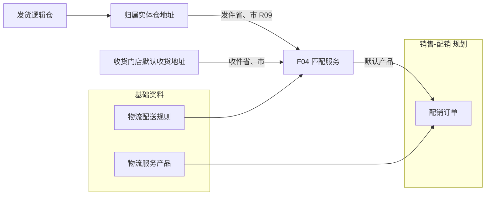

# 配销订单-物流服务产品自动带出衔接说明

> 用途：在**配销订单对象与主 PRD 尚未交付**的前提下，登记其如何消费基础资料「物流配送规则」匹配服务（主PRD F04），避免后续各写一套口径。
> 定位：规划衔接文档，**不是**配销订单正式 PRD；配销立项时本说明并入配销主PRD相应章节，并补充字段清单与页面交互。
> 版本：V0.2｜日期：2026-10-20｜状态：初稿，待评审。

| 版本 | 本次变化 | 状态 |
| --- | --- | --- |
| V0.1 | 二版增量：基于已交付的物流配送规则主PRD F04/R06/R07/R09，约定配销侧触发、入参解析与验收引用 | 初稿，待评审 |
| V0.2 | 用户确认 Q03～Q05、PQ01：同级取最后更新时间；仅国内地址；可选「由仓库指定」；单头已有值后改仓/改门店不重算 | 初稿，待评审 |

## 一、背景与边界

| 项 | 说明 |
| --- | --- |
| 业务场景 | 总部向门店配货（配销订单）需指定承运方式；线路不同默认物流服务产品不同（见课程与[《00-二版核心需求与改动任务》](../../../00-二版核心需求与改动任务.md)§2.6） |
| 已交付能力 | [《物流配送规则主PRD》](../../1-基础资料/物流配送规则/物流配送规则主PRD.md)建档、启停、R05 唯一性、**F04 匹配服务**口径；09 原型导出 `matchLogisticsProductByRoute` 作演示实现 |
| 本期（二版） | **不**交付配销订单菜单、字段清单与状态机；**不**在 09 做配销页 |
| 不在范围 | B2B 销售订单、独立站订单、国内/跨境电商订单接入本匹配；运费、时效、面单 |

## 二、消费关系（对象未建时的约定）

| 步骤 | 系统动作 | 规则依据 |
| --- | --- | --- |
| 1 | 用户在配销订单选择**发货逻辑仓**、**收货门店**（及门店默认收货地址，字段名待配销 TSV 固化） | 配销 PRD 待建 |
| 2 | 系统按 R09 读取逻辑仓归属**实体仓**地址的省、市编码，作为发件侧入参 | [物流配送规则主PRD](../../1-基础资料/物流配送规则/物流配送规则主PRD.md) R09 |
| 3 | 系统读取门店收货地址省、市编码，作为收件侧入参 | 与规则表字典口径一致 |
| 4 | 调用 F04：仅命中**启用**规则，按 R06 优先级取一条，输出**启用**的物流服务产品 | R06、R07 |
| 5 | 仅当单头「物流服务产品」为空时，将 F04 结果写入；用户可改选启用产品，或在 ERP 选择「由仓库指定」（2026-10-20 确认） | 不以规则表维护「由仓库指定」虚拟产品（见主PRD R04） |

## 三、触发时机（配销 PRD 应引用）

| 时机 | 行为 | 备注 |
| --- | --- | --- |
| 新建配销订单，发货逻辑仓与收货门店均已选，且单头「物流服务产品」为空 | 调用 F04，有结果则预填 | 无匹配则留空，不阻断保存（R07） |
| 修改发货逻辑仓或收货门店/收货地址 | **不**因改仓、改门店自动重算物流 | 单头已有取值（含系统预填、用户改选、「由仓库指定」）一律保留（PQ01，2026-10-20 确认） |
| 用户清空「物流服务产品」后再次满足「仓+店已选且字段为空」 | 可再次调用 F04 预填 | 配销 Demo PRD 可约定是否仅在清空当下触发一次 |
| 保存／审核配销订单 | 不强制必须为具体物流服务产品 | 可为「由仓库指定」或留空；下发 WMS 约束在配销 PRD 定义 |

## 四、入参与出参（接口级约定）

与 09 演示函数对齐，正式实现以服务端匹配服务为准：

| 入参 | 来源 | 为空时 |
| --- | --- | --- |
| `senderProvinceCode`、`senderCityCode` | 发货逻辑仓 → 实体仓地址 | 任一侧省缺失：不调用匹配或调用后按 R07 返回空 |
| `receiverProvinceCode`、`receiverCityCode` | 门店默认收货地址 | 同上 |
| 规则集 | 全部启用物流配送规则 | — |
| 产品档案 | 物流服务产品（校验启用） | — |

| 出参 | 说明 |
| --- | --- |
| 命中 | 物流服务产品**业务编码**（或内部 id，配销字段清单与 Code-Name 展示规则一致即可） |
| 未命中 | 空；界面不报错，可提示「未匹配到线路默认物流，请手工选择」（文案待配销 Demo PRD） |

匹配优先级与主PRD R06 一致：双方市均填 > 仅一方填市 > 双方市均空（全省）；同级取**最后更新时间**最新（2026-10-20 确认 Q03）。发件/收件地址非中国大陆省、市字典时不调用 F04（Q04）。

## 五、异常与提示（与主PRD对齐）

| 情况 | 处理 |
| --- | --- |
| 实体仓未维护或地址缺省省、市 | R07：不自动填充；可配销侧轻提示（见主PRD AC06） |
| 命中规则但关联产品已禁用 | 视为无匹配（R07、F04） |
| 门店无默认收货地址或省、市不全 | R07 |
| 规则表无启用记录 | R07 |

## 六、验收引用（配销 PRD 交付时执行）

配销测试用例应**引用**物流配送规则主PRD已有 AC，避免重复定义：

| 引用编号 | 配销侧验证要点 |
| --- | --- |
| AC05 | 给定发货仓对应粤-深圳、收件京-空，预置规则 A（粤深→京空）与 B（粤全省→京空），配销单应带出 A 对应产品 |
| AC06 | 发货逻辑仓无法解析发件省、市时，物流产品留空且可保存 |
| AC04 | 禁用规则后，相同线路新建配销单不再带出该产品 |

配销专属 AC（配销 PRD 编写时落地）：

| 编号 | 条件与操作 | 预期结果 |
| --- | --- | --- |
| PAC01 | 新建配销单，仓+店已选且物流字段为空；存在命中规则 | 自动预填对应物流服务产品 |
| PAC02 | 已预填或用户已选产品/「由仓库指定」后，修改发货逻辑仓 | 物流字段**不变** |
| PAC03 | 单头选择「由仓库指定」 | 保存成功；不因 F04 覆盖该选择 |

## 七、待确认事项

| 编号 | 问题 | 影响 | 状态 |
| --- | --- | --- | --- |
| Q05 | 自动带出后是否允许改为「由仓库指定」 | 配销单头枚举与 WMS 下发 | **已确认（2026-10-20）**：允许，用户在 ERP 单头选择 |
| Q03 | 同级命中用更新时间还是优先级字段 | F04 实现 | **已确认（2026-10-20）**：最后更新时间最新 |
| PQ01 | 改发货仓/门店是否自动覆盖单头物流 | 配销交互 | **已确认（2026-10-20）**：**不覆盖**；ERP 已选即保留 |
| PQ02 | 配销订单物流服务产品字段是否必填 | 保存校验、下发 WMS | 配销 PRD 待建 |

## 八、关联交付物

| 文档 | 关系 |
| --- | --- |
| [《物流配送规则主PRD》](../../1-基础资料/物流配送规则/物流配送规则主PRD.md) | 匹配规则权威 |
| [《物流配送规则交付清单》](../../1-基础资料/物流配送规则/物流配送规则交付清单.md) | 基础资料套件索引 |
| [《实体对象关系（V2）》](../../../系统架构和流程/02-实体对象关系.md) | 对象关系 |
| 配销订单主PRD（未建） | 正式消费方；立项时吸收本章并删除独立衔接说明或改为附录 |
